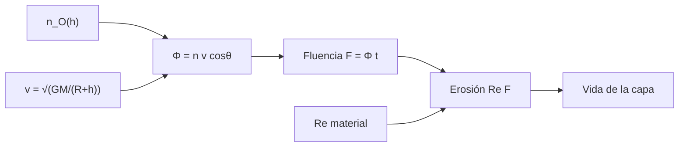

# B85-C13 — Efectos de oxígeno atómico

<!-- nav:top -->
x
<!-- /nav -->

## 1. Ubicación, nivel y alcance

Clase 13 del bloque B85. Nivel N3. En órbita baja la nave avanza contra una atmósfera residual de oxígeno atómico que oxida y erosiona polímeros. Aquí calculas el flujo en la cara de proa, la fluencia anual, el espesor que pierde un polímero con una reactividad dada y cuánto dura una capa protectora. La densidad, la reactividad y los espesores son sintéticos o ilustrativos y no consultados.

## 2. Por qué esta clase existe

Un polímero exterior puede desaparecer en meses en la cara de proa a baja altitud. La decisión central: **¿cuánto espesor pierde una superficie por año según la altitud y la orientación, y qué protección dura la misión?** La decisión central: **¿cuánto espesor pierde una superficie por año según la altitud y la orientación, y qué protección dura la misión?**

## 3. Lo que podrás hacer al terminar

1. Calcular la velocidad orbital y el flujo de proa `Φ = n v`.
2. Calcular la fluencia anual y el espesor erosionado `Re × fluencia`.
3. Estimar cuánto dura un polímero y una capa protectora.
4. Ver el efecto de la altitud y de la incidencia oblicua.
5. Integrar una densidad variable en el ciclo solar y contrastar con la forma cerrada.
6. Separar lo consultado (`g`, `R`) de lo ilustrativo y no consultado (`n_O`, reactividades).

La evidencia es la **ficha de erosión por oxígeno atómico** del ejercicio 12 (sección 20).

## 4. Con qué llegas y cómo comprobarlo

1. ¿Qué es el oxígeno atómico en órbita baja?
2. ¿Qué es la fluencia?
3. ¿Qué es una reactividad de erosión?
4. ¿Cuál es la velocidad orbital circular?
5. ¿Qué es una verificación por segunda vía?

<details>
<summary>Ver respuestas</summary>

1. Oxígeno monoatómico de la atmósfera superior, producido por fotodisociación, muy reactivo. 2. El flujo acumulado en el tiempo, en átomos/m². 3. El volumen de material perdido por átomo incidente, `Re`. 4. `v = √(GM/(R + h))`. 5. Calcular lo mismo con otro método y comparar.
</details>

Con cuatro o cinco aciertos, sigue; si no, repasa los prerrequisitos.

## 5. Un caso de contexto y casos de referencia

A `400 km` con `n_O = 10¹⁵ m⁻³`, la cara de proa recibe `7,67 × 10¹⁸ átomos/(m² s)` y un polímero con `Re = 3 × 10⁻²⁴ cm³/átomo` pierde `726 µm` al año: una película de `25 µm` dura `0,41 meses`. Es el **ejemplo conductor**. Todo es **ilustrativo y no consultado**, salvo `g` y `R`.

## 6. Vocabulario

El **flujo de proa** es `Φ = n v cosθ`. La **fluencia** `F = Φ t`. La **erosión** es `Δe = Re F`. La **reactividad `Re`** se da en cm³/átomo (`1 cm³ = 10⁻⁶ m³`). Una **capa protectora** de óxido tiene una reactividad mucho menor. La **cara de proa** es la que mira en el sentido del movimiento.

## 7. Modelo mental



*Descripción textual:* la densidad y la velocidad dan el flujo de proa; integrado en el tiempo es la fluencia; multiplicada por la reactividad da el espesor perdido y la vida de la capa.

Analogía: un chorro de arena sobre una pared: cuanta más arena y más tiempo, más espesor se pierde, y un recubrimiento duro dura más. Límite: la reactividad real depende de la energía de impacto, la temperatura y de si hay defectos que permiten socavar la capa protectora.

## 8. La explicación, paso a paso

### 8.1 Velocidad y flujo

`GM = g R² = 3,98590 × 10¹⁴ m³/s²` (derivada de `g = 9,820 m/s²` y `R = 6371 km`). La velocidad orbital circular es `v = √(GM/(R + h))`:

| `h` (km) | `v` (m/s) | `n_O` (m⁻³) | `Φ` (m⁻² s⁻¹) | `F` anual (m⁻²) | Polímero (µm/año) |
|---|---|---|---|---|---|
| 300 | 7729,8 | 5,0 × 10¹⁵ | 3,86 × 10¹⁹ | 1,22 × 10²⁷ | 3659,0 |
| 400 | 7672,5 | 1,0 × 10¹⁵ | 7,67 × 10¹⁸ | 2,42 × 10²⁶ | 726,4 |
| 500 | 7616,5 | 2,0 × 10¹⁴ | 1,52 × 10¹⁸ | 4,81 × 10²⁵ | 144,2 |

### 8.2 Vida de un polímero y de una capa

A `400 km`, una película de `25 µm` dura `0,41 meses` en la cara de proa; una capa de óxido de `100 nm` con `Re = 3 × 10⁻²⁸ cm³/átomo` (ilustrativa) dura `16,5 meses`. Con incidencia a `60°` (`cosθ = 0,5`) la pérdida anual baja de `726` a `363 µm`.

### 8.3 Ciclo solar

Con `n(t) = n₀(1 + 0,6 sen(2π t/T))` y `T = 11 años` (sintético), la fluencia en medio ciclo es `1,84036 × 10²⁷ m⁻²` por forma cerrada y `1,84036 × 10²⁷ m⁻²` por trapecios; coinciden y dan `5521 µm` en el polímero.

### 8.4 Qué decide

La altitud pesa más que cualquier otra variable: `400 km` pierde `20 %` de lo que `300 km`. La orientación importa: una cara de popa o lateral recibe mucho menos. Por eso los polímeros expuestos en proa a baja altitud necesitan capa protectora o un material resistente.

## 9. Magnitudes, símbolos y unidades

| Símbolo | Qué es | Unidad | Valor / nota |
|---|---|---|---|
| `n_O` | densidad de O | m⁻³ | 1,0 × 10¹⁵ (400 km, ilustrativa) |
| `v` | velocidad orbital | m/s | 7672,5 |
| `Φ` | flujo de proa | m⁻² s⁻¹ | 7,67 × 10¹⁸ |
| `Re` | reactividad | cm³/átomo | 3 × 10⁻²⁴ (ilustrativa) |
| `F` | fluencia anual | m⁻² | 2,42 × 10²⁶ |
| `Δe` | espesor perdido por año | µm | 726 |

## 10. Convenciones y referencias

`g` y `R` de la ficha de la Tierra. `n_O` por altitud, `Re` de un polímero y de un óxido, espesores y el ciclo solar son ilustrativos y no consultados. Órbita circular, cara de proa normal al movimiento. `1 año = 365,25 d`.

## 11. De dónde sale lo que afirmamos

| ID | Fuente | Localizador | Respalda | Estado |
|---|---|---|---|---|
| S1 | NASA/NSSDC, Earth Fact Sheet — https://nssdc.gsfc.nasa.gov/planetary/factsheet/earthfact.html (consultada 2026-11-10) | ficha completa | `g = 9,820 m/s²` y radio medio `6371 km` para `GM = g R²` | Consultada |
| — | Flujo de proa `n v`, fluencia y erosión `Re F`; cálculo de `v` por gravitación | — | las verifica el laboratorio con una segunda vía | No consultada en una fuente concreta |

Límites: la densidad de oxígeno atómico, las reactividades y los espesores no se consultaron; ninguna cifra describe una misión real; no se consideran protecciones con defectos, erosión por átomos térmicos ni fotodisociación.

## 12. Cómo ver el resultado

| Magnitud | Valor |
|---|---|
| `v` a 400 km | 7672,5 m/s |
| `Φ` | 7,67 × 10¹⁸ m⁻² s⁻¹ |
| pérdida anual (polímero) | 726 µm |
| vida de 25 µm | 0,41 meses |
| trapecios − cerrada | < 1e-8 |

Descripción larga: a 400 km un polímero de 25 µm no sobrevive un mes en la cara de proa con estos datos; una capa protectora lo extiende a más de un año.

## 13. Ejemplo trabajado

**Paso 1 · Velocidad.** `v = √(3,98590 × 10¹⁴/6,7710 × 10⁶) = 7672,5 m/s`.

**Paso 2 · Flujo y fluencia.** `Φ = 10¹⁵ × 7672,5 = 7,67 × 10¹⁸`; `F = Φ × 3,156 × 10⁷ s = 2,42 × 10²⁶ m⁻²`.

**Paso 3 · Erosión.** `Δe = 3 × 10⁻³⁰ m³ × 2,42 × 10²⁶ = 726 µm`.

## 14. Distintas formas de describir el problema

**Por flujo:** `n v`. **Por fluencia:** `Φ t`. **Por espesor:** `Re F`. **Por vida:** `e/(Re Φ)`.

## 15. Práctica guiada

**Ejercicio 1 · con los pasos indicados.** Calcula `v` a `500 km`. *Pasos:* `√(GM/(R + h))`.

<details><summary>Solución comentada</summary>

`7616,5 m/s`.
</details>

**Ejercicio 2 · con una pista.** Predice la fluencia anual a `500 km`. *Pista:* `Φ × 1 año`.

<details><summary>Solución comentada</summary>

`4,81 × 10²⁵ m⁻²`.
</details>

**Ejercicio 3 · casi autónomo.** ¿Por qué la pérdida a `300 km` es cinco veces la de `400 km`? Mira `n_O`.

<details><summary>Solución comentada</summary>

Porque `n_O` es cinco veces mayor (`5 × 10¹⁵` frente a `10¹⁵`); `v` casi no cambia.
</details>

## 16. Práctica autónoma, transferencia e integrador

**Ejercicio 4 · autónomo.** Calcula la vida de `25 µm` con `Re` a la mitad.

<details><summary>Solución comentada</summary>

`0,83 meses`.
</details>

**Ejercicio 5 · autónomo.** Calcula la erosión en `3 años` a `500 km`.

<details><summary>Solución comentada</summary>

`433 µm`.
</details>

**Ejercicio 6 · autónomo.** ¿Qué incidencia reduce la pérdida a un cuarto?

<details><summary>Solución comentada</summary>

`cosθ = 0,25`, es decir `θ ≈ 75,5°`.
</details>

**Ejercicio 7 · autónomo.** Estima la pérdida en medio ciclo solar de `5,5 años` con `n = n₀` constante.

<details><summary>Solución comentada</summary>

`3995 µm` (sin ciclo solar), frente a `5521 µm` con el ciclo sintético.
</details>

**Ejercicio 8 · autónomo.** ¿Cuánto cambia `v` entre `300` y `500 km`?

<details><summary>Solución comentada</summary>

`113,3 m/s`: casi nada.
</details>

**Ejercicio 9 · transferencia.** **Transferencia.** Una película de `50 µm` en proa a `400 km` dura la misión de `3 años`?

<details><summary>Solución comentada</summary>

No: pierde `2179 µm` en 3 años; hace falta protección o reorientar.
</details>

**Ejercicio 10 · transferencia.** **Transferencia.** ¿Por qué un recubrimiento óxido con un defecto puede fallar antes que el cálculo?

<details><summary>Solución comentada</summary>

Los átomos socavan el polímero por el defecto; la reactividad uniforme de la capa no describe ese modo.
</details>

**Ejercicio 11 · transferencia.** **Transferencia.** Un colega presenta `726 µm/año` como la erosión «medida». ¿Qué corriges?

<details><summary>Solución comentada</summary>

Es un cálculo con una densidad y una reactividad ilustrativas no consultadas; no hay medición.
</details>

**Ejercicio 12 · integrador.** **Integrador.** Elabora tu *ficha de erosión por oxígeno atómico*: `v`, `Φ`, fluencia y pérdida por altitud, vida de un polímero y de una capa, integral del ciclo solar y lista de lo consultado, ilustrativo y no consultado.

<details><summary>Solución comentada</summary>

Secciones 8.1–8.4 y la salida del laboratorio.
</details>

## 17. Laboratorio: flujo, fluencia y erosión

El script [oxigeno_atomico.py](oxigeno_atomico.py) calcula `v`, el flujo de proa, la fluencia y la erosión por altitud, la vida de un polímero y de una capa, y la integral de un ciclo solar sintético (**comprueba** trapecios frente a forma cerrada a 1e-8 y `v(400 km)` a 5 m/s de 7668,6).

**Datos:** `g` y `R` consultados; `n_O`, `Re`, espesores y ciclo solar **ilustrativos y no consultados**. **Predice antes de ejecutar:** ¿cuánto dura una película de 25 µm a 400 km en proa? (unos 0,4 meses.) **Ejecución del 2026-11-10 (Python 3.12.9):**

```text
Python 3.12.9 (biblioteca estandar)
GM = g R^2 = 3.98590e+14 m3/s2 (de g = 9.82 m/s2 y R = 6371 km consultados)
Densidad de O por altitud: ILUSTRATIVA y no consultada; reactividades: ILUSTRATIVAS
 h [km]   v [m/s]   n_O [m-3]   flujo [m-2 s-1]  fluencia/anio [m-2]  Kapton/anio [um]
    300    7729.8     5.0e+15         3.865e+19            1.220e+27            3659.0
    400    7672.5     1.0e+15         7.673e+18            2.421e+26             726.4
    500    7616.5     2.0e+14         1.523e+18            4.807e+25             144.2
A 400 km, Kapton de 25 um dura 0.41 meses en cara ram; SiOx de 100 nm dura 16.52 meses (reactividades ILUSTRATIVAS)
Con incidencia a 60 grados (cos = 0.5) la perdida anual en Kapton baja a 363.2 um
Fluencia en medio ciclo solar sintetico: trapecios = 1.84036e+27 ; cerrada = 1.84036e+27 m-2
Perdida en medio ciclo = 5521.1 um ; cociente 400/300 km = 0.199
Pruebas superadas.
```

```bash
python programa/clases/B85/B85-C13-efectos-de-oxigeno-atomico/oxigeno_atomico.py
```

**Límites:** cara de proa normal, reactividad constante y sin defectos; no es un modelo de misión.

## 18. Errores frecuentes y cómo corregirlos

**Aplicar el flujo de proa a todas las caras.** depende de `cosθ` (8.2)

**Confundir cm³ con m³ en `Re`.** `1 cm³ = 10⁻⁶ m³` (sección 6)

**Ignorar el ciclo solar.** `n_O` varía (8.3)

**Presentar la erosión como medición.** se corrige con la sección 10

## 19. Cómo sabrás que vas bien

Tras la sección 8: ¿qué pérdida esperabas a `500 km` y cuál obtuviste? Si dudas, repasa el ejemplo 13. Tras el laboratorio: ¿qué comprueba? (ver la sección 17).

## 20. Qué entregas y cómo se evalúa

El producto es tu **ficha de erosión por oxígeno atómico** (ejercicio 12).

| Criterio | Inicial | En desarrollo | Logrado | Destacado |
|---|---|---|---|---|
| Conceptos | Los confunde | Parciales | Calcula flujo, fluencia y erosión | Explica los límites |
| Cálculo | Sin unidades | Con errores | Tablas completas con unidades | Calcula casos nuevos |
| Numérico | Sin comprobar | Un caso | Contraste con una segunda vía | Interpreta las diferencias |
| Fuentes | Sin fuente | Sin fecha | Fuentes con fecha y estado | Declara lo ilustrativo y lo no consultado |
| Límites | No los nombra | Uno | Tres | Discute qué falta del modelo |

**Condiciones críticas (no se compensan con promedio):** rotular `n_O`, `Re` y espesores como ilustrativos y no consultados; no presentar la erosión como medición; citar solo lo consultado.

## 21. Ética, seguridad y límites

Clase educativa: los modelos son simplificados y sus datos son sintéticos o ilustrativos; ningún resultado describe una nave real, ni sustituye a los estándares de proyecto, a la verificación con datos de misión ni a una revisión disciplinar. Los valores de este texto no son requisitos de ningún proyecto. Accesibilidad: tablas equivalentes a las gráficas, fórmulas en texto, ejercicios sin conexión.

## 22. Para cerrar y seguir

A `400 km` el oxígeno atómico erosiona unos `726 µm` por año de un polímero en proa con estos datos ilustrativos, y una capa de óxido de `100 nm` extiende la vida a más de un año. Queda una pregunta: ¿qué le hace la radiación ultravioleta al color de las superficies?

**Glosario español–inglés.** oxígeno atómico · *atomic oxygen*; fluencia · *fluence*; reactividad de erosión · *erosion yield*; cara de proa · *ram face*; erosión · *erosion*.

**Continuidad.** [B85-C14](../B85-C14-degradacion-ultravioleta/CLASE.md) estudia la degradación ultravioleta.

**Referencias:** ver sección 11.

<!-- nav:bottom -->
x
<!-- /nav -->
