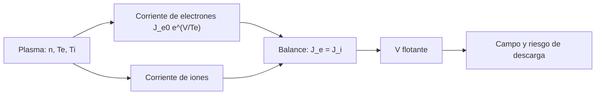

# B85-C15 — Electrificación superficial

<!-- nav:top -->
[🏠 Programa](../../../../README.md) · [📚 Bloque B85](../../../tronco-comun/B85-gestion-termica-y-entorno-espacial.md) · [← Anterior: B85-C14 — Degradación ultravioleta](../B85-C14-degradacion-ultravioleta/CLASE.md) · [Siguiente: B85-C16 — Polvo lunar y contaminación →](../B85-C16-polvo-lunar-y-contaminacion/CLASE.md)
<!-- /nav -->

## 1. Ubicación, nivel y alcance

Clase 15 del bloque B85. Nivel N3. Una superficie en un plasma recoge más electrones que iones, porque los electrones se mueven mucho más rápido, y se carga hasta que las corrientes se igualan. Aquí resuelves ese balance para la órbita baja (potencial de unas décimas de voltio negativo) y para el eclipse geoestacionario (kilovoltios negativos), calculas el tiempo de carga de un dieléctrico y el campo en su espesor. Las condiciones del plasma y el modelo son ilustrativos; solo se consultó la ficha de NASA-HDBK-4002B.

## 2. Por qué esta clase existe

Una carga diferencial de kilovoltios entre superficies puede producir una descarga que daña la electrónica. La decisión central: **¿a qué potencial flota una superficie en un plasma dado y es probable que alcance un umbral de riesgo?** La decisión central: **¿a qué potencial flota una superficie en un plasma dado y es probable que alcance un umbral de riesgo?**

## 3. Lo que podrás hacer al terminar

1. Plantear el balance de corrientes de electrones e iones.
2. Calcular el potencial flotante en LEO con iones de proa y electrones retardados.
3. Resolver el potencial en GEO con Newton y bisección.
4. Estimar la capacidad y el tiempo de carga de un dieléctrico.
5. Calcular el campo eléctrico en un espesor dado.
6. Separar lo consultado (alcance de un manual) de lo ilustrativo (plasma, modelo).

La evidencia es la **ficha de potencial de una superficie** del ejercicio 12 (sección 20).

## 4. Con qué llegas y cómo comprobarlo

1. ¿Qué es la corriente térmica de electrones?
2. ¿Qué es el potencial flotante?
3. ¿Qué es la carga diferencial?
4. ¿Cómo se calcula la capacidad por área de un dieléctrico?
5. ¿Qué es una verificación por segunda vía?

<details>
<summary>Ver respuestas</summary>

1. `J = e n √(kT/(2π m_e))`, en A/m². 2. El potencial al que la corriente neta a una superficie es cero. 3. La diferencia de potencial entre dos superficies de la misma nave. 4. `C = ε₀ ε_r/d`. 5. Calcular lo mismo con otro método y comparar.
</details>

Con cuatro o cinco aciertos, sigue; si no, repasa los prerrequisitos.

## 5. Un caso de contexto y casos de referencia

En LEO (`n = 10¹¹ m⁻³`, `T_e = 0,1 eV`) una superficie flota a `-0,193 V`; en el eclipse geoestacionario (`n = 10⁶ m⁻³`, `T_e = 5 keV`, `T_i = 10 keV`) flota a `-12911 V` y un dieléctrico de `1 mm` tarda unos `205 s` en alcanzarlo. Es el **ejemplo conductor**. Todo es **ilustrativo y no consultado**.

## 6. Vocabulario

El **potencial flotante** `V` anula la corriente neta: `J_e0 e^(V/T_e) = J_i`. En LEO `J_i = e n v_ram`. En GEO los iones atraídos siguen `J_i0(1 − V/T_i)` (modelo de movimiento orbital limitado). La **carga diferencial** entre superficies y la **descarga** son los riesgos. El **tiempo de carga** `t = C |V|/J`.

## 7. Modelo mental



*Descripción textual:* el plasma define las corrientes de electrones e iones; su igualdad da el potencial flotante, del que se deriva el campo y el riesgo de descarga.

Analogía: un recipiente al que entran gotas rápidas (electrones) y lentas (iones): se llena hasta que sobran las lentas. Límite: no se modelan emisión secundaria, fotoemisión ni geometría; la emisión puede cambiar el potencial en miles de voltios.

## 8. La explicación, paso a paso

### 8.1 LEO

`J_i = e n v_ram = 1,229 × 10⁻⁴ A/m²` y `J_e0 = e n √(kT_e/(2π m_e)) = 8,477 × 10⁻⁴ A/m²`. El potencial flotante es `V = T_e ln(J_i/J_e0) = -0,193 V`. Con `T_e = 0,2 eV`, `-0,456 V`; la densidad no lo cambia (`-0,193 V` con `n = 10¹⁰`), porque ambas corrientes escalan con `n`.

### 8.2 GEO en eclipse

`J_e0 = 1,895 × 10⁻⁶ A/m²` y `J_i0 = 6,256 × 10⁻⁸ A/m²`. La ecuación `J_e0 e^(V/T_e) = J_i0(1 − V/T_i)` da `V = -12910,6 V` por bisección y `-12910,6 V` por Newton, con residuo `6,8 × 10⁻²⁰ A/m²`. Con `T_e = 2 keV` y `T_i = 4 keV`, `V = -5164 V`.

### 8.3 Tiempo de carga y campo

Un dieléctrico de `1 mm` (`ε_r = 3,4`) tiene `C = 3,010 × 10⁻⁸ F/m²` y se carga en `t = C|V|/J_e0 = 205 s`. Un potencial de `1 kV` a través de `25 µm` da `4,00 × 10⁷ V/m`.

### 8.4 Qué falta

El modelo no incluye fotoemisión (que en el Sol baja mucho el potencial), emisión secundaria ni geometría; NASA-HDBK-4002B explica cuándo la carga puede ser un problema y las soluciones comunes de diseño, pero aquí solo se consultó su ficha. Un diseño real conecta las superficies a tierra y analiza la carga con herramientas dedicadas.

## 9. Magnitudes, símbolos y unidades

| Símbolo | Qué es | Unidad | Valor / nota |
|---|---|---|---|
| `n` | densidad del plasma | m⁻³ | 10¹¹ (LEO); 10⁶ (GEO) |
| `T_e` | temperatura electrónica | eV | 0,1; 5000 |
| `J_e0` | corriente térmica de electrones | A/m² | 1,90 × 10⁻⁶ (GEO) |
| `V` | potencial flotante | V | -0,193 (LEO); -12911 (GEO) |
| `C` | capacidad por área | F/m² | 3,01 × 10⁻⁸ |
| `E` | campo en 25 µm | V/m | 4,00 × 10⁷ |

## 10. Convenciones y referencias

Constantes `e`, `k_B` exactas del SI; masas de electrón y protón de uso general (no consultadas aquí); plasmas maxwellianos ilustrativos; sin fotoemisión ni emisión secundaria; `v_ram = 7670 m/s`; `ε_r = 3,4` ilustrativo. Potenciales en voltios respecto del plasma.

## 11. De dónde sale lo que afirmamos

| ID | Fuente | Localizador | Respalda | Estado |
|---|---|---|---|---|
| S1 | NASA, NASA-HDBK-4002B «Mitigating In-Space Charging Effects — A Guideline» (ficha del estándar) — https://standards.nasa.gov/standard/nasa/nasa-hdbk-4002 (consultada 2026-11-10) | ficha del estándar | título «Mitigating In-Space Charging Effects — A Guideline», versión B, 07/06/2022; su alcance: cuándo la carga puede ser un problema, sus causas y soluciones comunes de diseño | Consultada |
| — | Corrientes térmicas de un plasma maxwelliano, movimiento orbital limitado y capacidad de un dieléctrico | — | las verifica el laboratorio con una segunda vía | No consultada en una fuente concreta |

Límites: solo se consultó la ficha de NASA-HDBK-4002B (no el documento completo); las condiciones de plasma, las masas, el modelo de corrientes y los umbrales son ilustrativos; no se consultó SPENVIS ni ECSS para la carga.

## 12. Cómo ver el resultado

| Magnitud | Valor |
|---|---|
| `V` LEO | -0,193 V |
| `V` GEO (Newton / bisección) | -12910,6 / -12910,6 V |
| residuo GEO | 6,8 × 10⁻²⁰ A/m² |
| tiempo de carga 1 mm | 205 s |
| campo en 25 µm a 1 kV | 4,00 × 10⁷ V/m |

Descripción larga: en LEO el potencial es de décimas de voltio; en el eclipse geoestacionario, del orden de diez kilovoltios con este plasma ilustrativo.

## 13. Ejemplo trabajado

**Paso 1 · Cociente de corrientes.** `J_i/J_e0 = 1,229 × 10⁻⁴/8,477 × 10⁻⁴ = 0,145`.

**Paso 2 · Potencial.** `V = 0,1 × ln(0,145) = -0,193 V`.

**Paso 3 · Comprobación.** `J_e0 e^(V/T_e) = 1,229 × 10⁻⁴ = J_i`.

## 14. Distintas formas de describir el problema

**Por corrientes:** `J_e = J_i`. **Por potencial:** `V`. **Por capacidad:** `C`, `t`. **Por campo:** `E = V/d`.

## 15. Práctica guiada

**Ejercicio 1 · con los pasos indicados.** Calcula `J_i` con `n = 10¹¹` y `v = 7670 m/s`. *Pasos:* `e n v`.

<details><summary>Solución comentada</summary>

`1,229 × 10⁻⁴ A/m²`.
</details>

**Ejercicio 2 · con una pista.** Predice el signo de `V` en LEO. *Pista:* los electrones son más rápidos.

<details><summary>Solución comentada</summary>

Negativo: recogen más electrones que iones.
</details>

**Ejercicio 3 · casi autónomo.** ¿Por qué la densidad no cambia `V` en LEO? Mira las dos corrientes.

<details><summary>Solución comentada</summary>

Ambas son proporcionales a `n`; el cociente no depende de ella.
</details>

## 16. Práctica autónoma, transferencia e integrador

**Ejercicio 4 · autónomo.** Calcula `V` en LEO con `T_e = 0,3 eV`.

<details><summary>Solución comentada</summary>

`-0,744 V`.
</details>

**Ejercicio 5 · autónomo.** Calcula el tiempo para cargar `C = 3 × 10⁻⁸ F/m²` a `5 kV` con `J = 1,9 × 10⁻⁶ A/m²`.

<details><summary>Solución comentada</summary>

`79 s`.
</details>

**Ejercicio 6 · autónomo.** Calcula `E` para `500 V` en `50 µm`.

<details><summary>Solución comentada</summary>

`1,00 × 10⁷ V/m`.
</details>

**Ejercicio 7 · autónomo.** ¿Qué pasa con `V` en GEO si `T_i` sube de 10 a 20 keV?

<details><summary>Solución comentada</summary>

`V = -12843 V`: cambia poco, domina `T_e`.
</details>

**Ejercicio 8 · autónomo.** Calcula `C` de un dieléctrico de `0,1 mm` con `ε_r = 3,4`.

<details><summary>Solución comentada</summary>

`3,010 × 10⁻⁷ F/m²`.
</details>

**Ejercicio 9 · transferencia.** **Transferencia.** Un panel solar de `1 m²` con `J = 10⁻⁶ A/m²` tarda `5 s` en cargarse. ¿Cuánta carga acumula?

<details><summary>Solución comentada</summary>

`Q = J A t = 5 × 10⁻⁶ C`.
</details>

**Ejercicio 10 · transferencia.** **Transferencia.** Una superficie al Sol en GEO flota a pocos voltios en vez de `−13 kV`. ¿Qué lo explica?

<details><summary>Solución comentada</summary>

La fotoemisión: la superficie pierde electrones con la luz y compensa la corriente de electrones del plasma; el modelo de la clase no la incluye.
</details>

**Ejercicio 11 · transferencia.** **Transferencia.** Un ingeniero afirma que «la nave tiene `−12,9 kV`». ¿Qué corriges?

<details><summary>Solución comentada</summary>

Es un cálculo con un plasma ilustrativo, sin fotoemisión ni emisión secundaria, no una medición.
</details>

**Ejercicio 12 · integrador.** **Integrador.** Elabora tu *ficha de potencial de una superficie*: corrientes, `V` en LEO y GEO con segunda vía, tiempo de carga, campo y lista de lo consultado, ilustrativo y no consultado.

<details><summary>Solución comentada</summary>

Secciones 8.1–8.4 y la salida del laboratorio.
</details>

## 17. Laboratorio: potencial flotante en LEO y GEO

El script [electrificacion.py](electrificacion.py) calcula las corrientes, el potencial flotante por Newton y bisección, el tiempo de carga y el campo en un dieléctrico (**comprueba** Newton frente a bisección a 1e-3 V, balance en LEO y signos).

**Datos:** `e` y `k_B` exactas; plasma, masas, `ε_r` y modelo **ilustrativos y no consultados**; solo la ficha de NASA-HDBK-4002B consultada. **Predice antes de ejecutar:** ¿flota negativa una superficie en LEO? (sí, unas décimas de voltio.) **Ejecución del 2026-11-10 (Python 3.12.9):**

```text
Python 3.12.9 (biblioteca estandar)
Plasma ILUSTRATIVO (no consultado). Modelo: corrientes de electrones maxwellianos retardados y de iones; sin emision secundaria ni fotoemision
LEO (n = 1e11 m-3, Te = 0.1 eV, v_ram = 7670 m/s): J_i = 1.229e-04 A/m2 ; J_e0 = 8.477e-04 A/m2 ; V_flotante = -0.193 V
  Con Te = 0.2 eV: V = -0.456 V ; con n = 1e10 m-3: V = -0.193 V (la densidad no cambia V: ambas corrientes escalan con n)
GEO eclipse (n = 1e6 m-3, Te = 5 keV, Ti = 10 keV): J_e0 = 1.895e-06 A/m2 ; J_i0 = 6.256e-08 A/m2
  V_flotante biseccion = -12910.6 V ; Newton = -12910.6 V ; residuo = -6.79e-20 A/m2
  Con Te = 2 keV, Ti = 4 keV: V = -5164.2 V
Capacidad de un dielectrico de 1 mm (eps_r = 3.4) = 3.010e-08 F/m2 ; tiempo de carga a ese potencial = 205.049 s
Campo de 1 kV a traves de 25 um = 4.00e+07 V/m
Pruebas superadas.
```

```bash
python programa/clases/B85/B85-C15-electrificacion-superficial/electrificacion.py
```

**Límites:** sin fotoemisión ni emisión secundaria; maxwelliano sin geometría; no es un análisis de carga.

## 18. Errores frecuentes y cómo corregirlos

**Esperar un potencial positivo en LEO sin fotoemisión.** los electrones dominan (8.1)

**Olvidar la fotoemisión.** puede cambiar el potencial en miles de voltios (8.4)

**Confundir `T_e` en eV con kelvin.** `T_e` está en eV (sección 10)

**Presentar el potencial como medición.** se corrige con la sección 10

## 19. Cómo sabrás que vas bien

Tras la sección 8: ¿qué signo esperabas en LEO y cuál obtuviste? Si dudas, repasa el ejemplo 13. Tras el laboratorio: ¿qué comprueba? (ver la sección 17).

## 20. Qué entregas y cómo se evalúa

El producto es tu **ficha de potencial de una superficie** (ejercicio 12).

| Criterio | Inicial | En desarrollo | Logrado | Destacado |
|---|---|---|---|---|
| Conceptos | Los confunde | Parciales | Calcula `V` y el tiempo de carga | Explica los límites |
| Cálculo | Sin unidades | Con errores | Tablas completas con unidades | Calcula casos nuevos |
| Numérico | Sin comprobar | Un caso | Contraste con una segunda vía | Interpreta las diferencias |
| Fuentes | Sin fuente | Sin fecha | Fuentes con fecha y estado | Declara lo ilustrativo y lo no consultado |
| Límites | No los nombra | Uno | Tres | Discute qué falta del modelo |

**Condiciones críticas (no se compensan con promedio):** rotular el plasma y el modelo como ilustrativos y no consultados; no presentar el potencial como medición; citar solo lo consultado.

## 21. Ética, seguridad y límites

Clase educativa: los modelos son simplificados y sus datos son sintéticos o ilustrativos; ningún resultado describe una nave real, ni sustituye a los estándares de proyecto, a la verificación con datos de misión ni a una revisión disciplinar. Los valores de este texto no son requisitos de ningún proyecto. Accesibilidad: tablas equivalentes a las gráficas, fórmulas en texto, ejercicios sin conexión.

## 22. Para cerrar y seguir

Un balance de corrientes da `-0,19 V` en LEO y `-12,9 kV` en eclipse geoestacionario con estos plasmas ilustrativos. Queda una pregunta: ¿qué polvo y qué contaminación se acumulan sobre las superficies, empezando por el polvo lunar?

**Glosario español–inglés.** potencial flotante · *floating potential*; carga superficial · *surface charging*; fotoemisión · *photoemission*; dieléctrico · *dielectric*; descarga · *discharge*.

**Continuidad.** [B85-C16](../B85-C16-polvo-lunar-y-contaminacion/CLASE.md) estudia el polvo lunar y la contaminación.

**Referencias:** ver sección 11.

<!-- nav:bottom -->
---

[← Anterior: B85-C14 — Degradación ultravioleta](../B85-C14-degradacion-ultravioleta/CLASE.md) · [📚 Bloque B85](../../../tronco-comun/B85-gestion-termica-y-entorno-espacial.md) · [Siguiente: B85-C16 — Polvo lunar y contaminación →](../B85-C16-polvo-lunar-y-contaminacion/CLASE.md)
<!-- /nav -->
