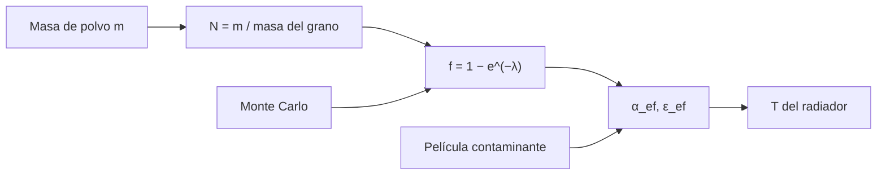

# B85-C16 — Polvo lunar y contaminación

<!-- nav:top -->
[🏠 Programa](../../../../README.md) · [📚 Bloque B85](../../../tronco-comun/B85-gestion-termica-y-entorno-espacial.md) · [← Anterior: B85-C15 — Electrificación superficial](../B85-C15-electrificacion-superficial/CLASE.md) · [Siguiente: B85-C17 — Criogenia de instrumentos →](../B85-C17-criogenia-de-instrumentos/CLASE.md)
<!-- /nav -->

## 1. Ubicación, nivel y alcance

Clase 16 del bloque B85. Nivel N3. El polvo lunar es abrasivo y se adhiere a las superficies; sobre un radiador cubre parte del área y sube su absortividad, y la contaminación molecular añade una película que hace lo mismo. Aquí calculas la cobertura de polvo con un modelo de discos aleatorios contrastado con Monte Carlo, la absortividad efectiva, la temperatura del radiador y el efecto de una película contaminante. Los parámetros son sintéticos.

## 2. Por qué esta clase existe

Un radiador que se ensucia rechaza menos calor y se calienta; en la Luna la limpieza no es sencilla. La decisión central: **¿qué cobertura de polvo o espesor de película hace subir la temperatura de un radiador por encima de su límite?** La decisión central: **¿qué cobertura de polvo o espesor de película hace subir la temperatura de un radiador por encima de su límite?**

## 3. Lo que podrás hacer al terminar

1. Calcular la masa de un grano y la cobertura con un modelo de Boole.
2. Contrastar la cobertura analítica con Monte Carlo.
3. Calcular `α` y `ε` efectivas y la temperatura de un radiador con polvo.
4. Estimar el espesor y el efecto de una película contaminante.
5. Calcular tiempos de acumulación con una tasa ilustrativa.
6. Separar lo consultado (`σ`, `S₀`) de lo ilustrativo y no consultado (polvo, deposición).

La evidencia es la **ficha de contaminación de un radiador** del ejercicio 12 (sección 20).

## 4. Con qué llegas y cómo comprobarlo

1. ¿Qué es un modelo de Boole?
2. ¿Qué es la absortividad efectiva?
3. ¿Qué es el CVCM?
4. ¿Qué es un factor de vista?
5. ¿Qué es una verificación por segunda vía?

<details>
<summary>Ver respuestas</summary>

1. Discos colocados al azar con densidad `λ`; la fracción cubierta es `1 − e^(−λ)`. 2. La media ponderada de `α` por la cobertura. 3. La fracción de masa de un material que se condensa en una superficie fría al desgasificar. 4. La fracción de lo emitido que llega a otra superficie. 5. Calcular lo mismo con otro método y comparar.
</details>

Con cuatro o cinco aciertos, sigue; si no, repasa los prerrequisitos.

## 5. Un caso de contexto y casos de referencia

Un radiador ilustrativo (`α = 0,10`, `ε = 0,85`, `150 W/m²`) está a `322,22 K` limpio y a `342,59 K` con `14 g/m²` de polvo (cobertura `29,5 %`); una película de `0,1 µm` lo lleva a `327,37 K`. Es el **ejemplo conductor**. Todo es **ilustrativo y no consultado**, salvo `σ` y `S₀`.

## 6. Vocabulario

La **cobertura** `f = 1 − e^(−λ)` con `λ = N π d²/4` si `N` es el número de granos por m². La **absortividad efectiva** `α_ef = α_r(1 − f) + α_d f`. La **contaminación molecular** es una película condensada; su espesor sale de `m/ρ`. El **radiador** está a la temperatura que iguala su emisión con la carga más lo absorbido.

## 7. Modelo mental



*Descripción textual:* la masa de polvo da el número de granos y la cobertura; junto con la película contaminante, determina la absortividad efectiva y la temperatura del radiador; Monte Carlo verifica la cobertura.

Analogía: gotas de pintura cayendo al azar sobre una pared: al principio cada una cubre blanco nuevo y luego se solapan. Límite: se supone monocapa sin apilamiento ni adhesión selectiva; el polvo real se apila y cambia de propiedades con el tiempo.

## 8. La explicación, paso a paso

### 8.1 Un grano y la cobertura

Con `d = 20 µm` y `ρ = 3000 kg/m³`, la masa de un grano es `1,257 × 10⁻¹¹ kg`. La cobertura sigue `f = 1 − e^(−λ)`:

| Masa (g/m²) | `f` | `α_ef` | `ε_ef` | `T` (K) |
|---|---|---|---|---|
| 0,0 | 0,0000 | 0,1000 | 0,8500 | 322,22 |
| 0,5 | 0,0124 | 0,1093 | 0,8506 | 323,17 |
| 2,0 | 0,0488 | 0,1366 | 0,8524 | 325,91 |
| 5,0 | 0,1175 | 0,1881 | 0,8559 | 330,87 |
| 14,0 | 0,2953 | 0,3215 | 0,8648 | 342,59 |
| 40,0 | 0,6321 | 0,5741 | 0,8816 | 361,46 |

Cubrir el `30 %` requiere `14,27 g/m²`.

### 8.2 Efecto térmico

Con `14 g/m²` de polvo, `α_ef = 0,321` y la temperatura sube `20,38 K` respecto del radiador limpio (`322,22 K`). Con una tasa ilustrativa de `0,5 g/m²` por día se llega a `14 g/m²` en `28` días.

### 8.3 Contaminación molecular

`2 kg` de material con `CVCM = 0,1 %` liberan `2 g` condensables; con un factor de vista de `0,05` llegan `0,10 g` a `1 m²`: `0,100 µm` de película. Con `Δα = 0,5` por µm (ilustrativo), `α` sube `0,050` y `T = 327,37 K`.

### 8.4 Segunda vía

Monte Carlo con discos de diámetro `1` en un cuadrado periódico de lado `40`, `λ = 0,5`: fracción cubierta `0,4003` frente a `0,3935` analítica (la diferencia es el error estadístico). El modelo supone monocapa; con apilamiento el efecto crece.

## 9. Magnitudes, símbolos y unidades

| Símbolo | Qué es | Unidad | Valor / nota |
|---|---|---|---|
| `d` | diámetro del grano | µm | 20 (ilustrativo) |
| `ρ` | densidad del grano | kg/m³ | 3000 (ilustrativa) |
| `f` | cobertura | — | 0,2953 (14 g/m²) |
| `α_ef` | absortividad efectiva | — | 0,321 |
| `T` | temperatura del radiador | K | 322,22 → 342,59 |
| `e` | espesor de la película | µm | 0,100 |

## 10. Convenciones y referencias

`σ` y `S₀` consultadas. Granos esféricos de `20 µm`, monocapa sin apilar; radiador con `α/ε = 0,10/0,85`, polvo `0,85/0,90`, carga `150 W/m²`, `cosθ = 0,5`, suelo a `380 K` con factor `0,3`, fondo `~0 K`; película con `ρ = 1000 kg/m³` y `Δα = 0,5/µm`. Todo ilustrativo y no consultado.

## 11. De dónde sale lo que afirmamos

| ID | Fuente | Localizador | Respalda | Estado |
|---|---|---|---|---|
| S1 | NIST, CODATA 2022, Stefan–Boltzmann constant — https://physics.nist.gov/cgi-bin/cuu/Value?sigma (consultada 2026-11-10) | valor de `σ` | `σ` del balance | Consultada |
| S2 | NASA/NSSDC, Earth Fact Sheet — https://nssdc.gsfc.nasa.gov/planetary/factsheet/earthfact.html (consultada 2026-11-10) | ficha completa | `S₀ = 1361,0 W/m²` (irradiancia solar a 1 UA) | Consultada |
| — | Modelo de Boole de cobertura, medias ponderadas de `α` y `ε`, y balance de un radiador | — | las verifica el laboratorio con una segunda vía | No consultada en una fuente concreta |

Límites: los parámetros del polvo y de la deposición no se consultaron; no se calculan carga electrostática del polvo ni adhesión; no se conoce una cifra de acumulación lunar con fuente; no se describen datos de misión.

## 12. Cómo ver el resultado

| Magnitud | Valor |
|---|---|
| `f` con 14 g/m² | 0,2953 |
| `T` limpio / sucio | 322,22 / 342,59 K |
| espesor de película | 0,100 µm |
| `T` con película | 327,37 K |
| Monte Carlo / analítica | 0,4003 / 0,3935 |

Descripción larga: una cobertura de un tercio del radiador lo calienta unos 20 K; una película de `0,1 µm` lo calienta unos 5 K.

## 13. Ejemplo trabajado

**Paso 1 · Cobertura.** `f = 1 − e^(−λ) = 0,2953`.

**Paso 2 · Absortividad.** `α_ef = 0,10(1 − f) + 0,85 f = 0,321`.

**Paso 3 · Temperatura.** El balance da `342,59 K`.

## 14. Distintas formas de describir el problema

**Por cobertura:** `f`. **Por propiedades:** `α_ef`, `ε_ef`. **Por temperatura:** `T`. **Por película:** espesor.

## 15. Práctica guiada

**Ejercicio 1 · con los pasos indicados.** Calcula la masa de un grano de `20 µm` y `3000 kg/m³`. *Pasos:* `ρ π d³/6`.

<details><summary>Solución comentada</summary>

`1,257 × 10⁻¹¹ kg`.
</details>

**Ejercicio 2 · con una pista.** Predice `f` con `λ = 0,5`. *Pista:* `1 − e^(−0,5)`.

<details><summary>Solución comentada</summary>

`0,3935`; Monte Carlo `0,4003`.
</details>

**Ejercicio 3 · casi autónomo.** ¿Por qué Monte Carlo no coincide exactamente con la fórmula? Piensa en el tamaño de la muestra.

<details><summary>Solución comentada</summary>

El error estadístico con `40 000` puntos es de décimas de porcentaje; la fórmula es exacta para infinitos discos.
</details>

## 16. Práctica autónoma, transferencia e integrador

**Ejercicio 4 · autónomo.** Calcula `α_ef` con `f = 0,2`.

<details><summary>Solución comentada</summary>

`0,10 × 0,8 + 0,85 × 0,2 = 0,250`.
</details>

**Ejercicio 5 · autónomo.** Calcula `f` para `5 g/m²`.

<details><summary>Solución comentada</summary>

`0,1175`.
</details>

**Ejercicio 6 · autónomo.** ¿Cuántos días con `0,5 g/m²` por día para `5 g/m²`?

<details><summary>Solución comentada</summary>

`10` días.
</details>

**Ejercicio 7 · autónomo.** ¿Qué espesor da `2 kg` de material con `CVCM = 0,05 %` y factor `0,05`?

<details><summary>Solución comentada</summary>

`2 × 0,0005 × 0,05 = 5 × 10⁻⁵ kg` por m²; dividido por `1000 kg/m³` da `5 × 10⁻⁸ m = 0,05 µm`.
</details>

**Ejercicio 8 · autónomo.** Si `Δα = 0,5/µm`, ¿qué espesor eleva `α` en `0,1`?

<details><summary>Solución comentada</summary>

`0,2 µm`.
</details>

**Ejercicio 9 · transferencia.** **Transferencia.** Un radiador lunar cubierto con `14 g/m²` supera su límite de `330 K`. ¿Qué medidas hay?

<details><summary>Solución comentada</summary>

Reducir la deposición (orientación, pantallas), añadir cobertura retráctil o limpiar, o aumentar el área para recuperar el margen.
</details>

**Ejercicio 10 · transferencia.** **Transferencia.** ¿Por qué la película de `0,1 µm` pesa tan poco pero calienta?

<details><summary>Solución comentada</summary>

Porque `α` depende de la superficie óptica, no de la masa: unos pocos nanómetros ya cambian la absorción.
</details>

**Ejercicio 11 · transferencia.** **Transferencia.** Un colega presenta `342,6 K` como «la temperatura medida del radiador lunar». ¿Qué corriges?

<details><summary>Solución comentada</summary>

Es un cálculo con polvo y carga ilustrativos, no una medición.
</details>

**Ejercicio 12 · integrador.** **Integrador.** Elabora tu *ficha de contaminación de un radiador*: cobertura, `α_ef`, `T` con polvo y con película, tiempos de acumulación, contraste con Monte Carlo y lista de lo consultado, ilustrativo y no consultado.

<details><summary>Solución comentada</summary>

Secciones 8.1–8.4 y la salida del laboratorio.
</details>

## 17. Laboratorio: cobertura de polvo y película contaminante

El script [polvo_lunar.py](polvo_lunar.py) calcula la cobertura de polvo, `α_ef`, la temperatura del radiador, el espesor de una película y contrasta la cobertura con Monte Carlo (**comprueba** Monte Carlo frente a analítica a 0,01 y temperatura creciente con el polvo).

**Datos:** `σ` y `S₀` consultadas; polvo, deposición, película y radiador **ilustrativos y no consultados**. **Predice antes de ejecutar:** ¿qué `f` cubre `λ = 0,5`? (0,39.) **Ejecución del 2026-11-10 (Python 3.12.9):**

```text
Python 3.12.9 (biblioteca estandar)
Grano ILUSTRATIVO: d = 20 um, rho = 3000 kg/m3, masa = 1.257e-11 kg ; radiador alfa/eps = 0.1/0.85; polvo 0.85/0.9
Radiador con 150 W/m2 de carga, cos(sol) = 0.5, suelo a 380 K con F = 0.3
  masa [g/m2]  cobertura  alfa_ef   eps_ef    T [K]
          0.0     0.0000   0.1000   0.8500   322.22
          0.5     0.0124   0.1093   0.8506   323.17
          2.0     0.0488   0.1366   0.8524   325.91
          5.0     0.1175   0.1881   0.8559   330.87
         14.0     0.2953   0.3215   0.8648   342.59
         40.0     0.6321   0.5741   0.8816   361.46
Masa para cubrir el 30 % = 14.27 g/m2 ; con 14 g/m2 la temperatura sube 20.38 K
Con un deposito ILUSTRATIVO de 0.5 g/m2/dia, 14 g/m2 se alcanzan en 28 dias
Contaminacion molecular ILUSTRATIVA: 0.10 g condensables llegan al radiador -> espesor 0.100 um ; delta alfa = 0.0500 ; T = 327.37 K
Cobertura para lambda = 0.5: Monte Carlo = 0.4003 ; analitica = 0.3935
Pruebas superadas.
```

```bash
python programa/clases/B85/B85-C16-polvo-lunar-y-contaminacion/polvo_lunar.py
```

**Límites:** monocapa sin apilar, sin adhesión selectiva ni carga electrostática; no es un modelo de superficie lunar.

## 18. Errores frecuentes y cómo corregirlos

**Sumar áreas de granos sin solapes.** los granos se solapan: `1 − e^(−λ)` (8.1)

**Ignorar la película molecular.** también sube `α` (8.3)

**Esperar que el polvo no importe por su masa pequeña.** importa la superficie (8.3)

**Presentar la temperatura como medición.** se corrige con la sección 10

## 19. Cómo sabrás que vas bien

Tras la sección 8: ¿qué `T` esperabas con `14 g/m²` y cuál obtuviste? Si dudas, repasa el ejemplo 13. Tras el laboratorio: ¿qué comprueba? (ver la sección 17).

## 20. Qué entregas y cómo se evalúa

El producto es tu **ficha de contaminación de un radiador** (ejercicio 12).

| Criterio | Inicial | En desarrollo | Logrado | Destacado |
|---|---|---|---|---|
| Conceptos | Los confunde | Parciales | Calcula `f`, `α_ef` y `T` | Explica los límites |
| Cálculo | Sin unidades | Con errores | Tablas completas con unidades | Calcula casos nuevos |
| Numérico | Sin comprobar | Un caso | Contraste con una segunda vía | Interpreta las diferencias |
| Fuentes | Sin fuente | Sin fecha | Fuentes con fecha y estado | Declara lo ilustrativo y lo no consultado |
| Límites | No los nombra | Uno | Tres | Discute qué falta del modelo |

**Condiciones críticas (no se compensan con promedio):** rotular el polvo, la deposición y la película como ilustrativos y no consultados; no presentar la temperatura como medición; citar solo lo consultado.

## 21. Ética, seguridad y límites

Clase educativa: los modelos son simplificados y sus datos son sintéticos o ilustrativos; ningún resultado describe una nave real, ni sustituye a los estándares de proyecto, a la verificación con datos de misión ni a una revisión disciplinar. Los valores de este texto no son requisitos de ningún proyecto. Accesibilidad: tablas equivalentes a las gráficas, fórmulas en texto, ejercicios sin conexión.

## 22. Para cerrar y seguir

Un radiador ilustrativo pasa de `322,22 K` a `342,59 K` con un tercio de su superficie cubierta de polvo y a `327,37 K` con una película de `0,1 µm`. Queda una pregunta: ¿cómo se enfrían instrumentos a temperaturas criogénicas?

**Glosario español–inglés.** polvo lunar · *lunar dust*; cobertura · *coverage*; contaminación molecular · *molecular contamination*; película · *film*; absortividad efectiva · *effective absorptivity*.

**Continuidad.** [B85-C17](../B85-C17-criogenia-de-instrumentos/CLASE.md) estudia la criogenia de instrumentos.

**Referencias:** ver sección 11.

<!-- nav:bottom -->
---

[← Anterior: B85-C15 — Electrificación superficial](../B85-C15-electrificacion-superficial/CLASE.md) · [📚 Bloque B85](../../../tronco-comun/B85-gestion-termica-y-entorno-espacial.md) · [Siguiente: B85-C17 — Criogenia de instrumentos →](../B85-C17-criogenia-de-instrumentos/CLASE.md)
<!-- /nav -->
