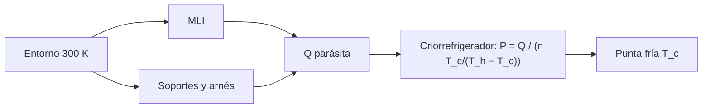

# B85-C17 — Criogenia de instrumentos

<!-- nav:top -->
x
<!-- /nav -->

## 1. Ubicación, nivel y alcance

Clase 17 del bloque B85. Nivel N3. Un instrumento infrarrojo o de detección necesita estar a decenas o cientos de kelvin por debajo del resto de la nave. Aquí sumas las cargas parásitas (radiación a través de una MLI y conducción por soportes), calculas la potencia eléctrica que exige un criorrefrigerador con una fracción de Carnot y el tiempo de enfriamiento con capacidad térmica variable. Todo es sintético; solo se consultó que los criorrefrigeradores llegan a unos 100 K o menos.

## 2. Por qué esta clase existe

Cada vatio parásito a `80 K` cuesta decenas de vatios eléctricos. La decisión central: **¿qué carga parásita llega a la punta fría, cuánta potencia eléctrica cuesta quitarla y cuánto tarda el enfriamiento?** La decisión central: **¿qué carga parásita llega a la punta fría, cuánta potencia eléctrica cuesta quitarla y cuánto tarda el enfriamiento?**

## 3. Lo que podrás hacer al terminar

1. Sumar las cargas parásitas por MLI, soportes y arnés.
2. Calcular la potencia de entrada con una fracción de Carnot.
3. Calcular el tiempo de enfriamiento con `C(T)` variable.
4. Comparar con una superficie desnuda.
5. Verificar el integrador con un caso de capacidad constante.
6. Separar lo consultado (`σ`, rango de los criorrefrigeradores) de lo ilustrativo.

La evidencia es la **ficha de carga térmica criogénica** del ejercicio 12 (sección 20).

## 4. Con qué llegas y cómo comprobarlo

1. ¿Qué es el coeficiente de rendimiento de Carnot?
2. ¿Qué es la conductividad integral?
3. ¿Cómo varía el calor específico a bajas temperaturas?
4. ¿Qué es una MLI?
5. ¿Qué es una verificación por segunda vía?

<details>
<summary>Ver respuestas</summary>

1. `COP = T_c/(T_h − T_c)`, el calor extraído por trabajo entregado en un ciclo ideal. 2. `∫k dT` entre dos temperaturas, que da el flujo por `A/L`. 3. Disminuye con `T` (aquí como `T^1,5`, ilustrativo). 4. Un aislamiento multicapa (clase C06). 5. Calcular lo mismo con otro método y comparar.
</details>

Con cuatro o cinco aciertos, sigue; si no, repasa los prerrequisitos.

## 5. Un caso de contexto y casos de referencia

Un instrumento a `80 K` con una MLI de 20 capas y cuatro soportes recibe `0,588 W` de carga parásita y exige `16,2 W` eléctricos con un criorrefrigerador al `10 %` de Carnot; sin MLI, una superficie desnuda recibiría `183 W`. Es el **ejemplo conductor**. Todo es **ilustrativo**.

## 6. Vocabulario

La **carga parásita** es el calor que llega a la punta fría. La **conductividad integral** `∫k dT` da el flujo por soporte `Q = (A/L)∫k dT`. La **fracción de Carnot** `η` relaciona la potencia real con la ideal: `P = Q/(η COP)`. La **capacidad térmica** `C(T) = m c₀ (T/300)^1,5`.

## 7. Modelo mental



*Descripción textual:* el entorno caliente aporta calor por la MLI y los soportes; la suma es la carga que el criorrefrigerador debe extraer, y su potencia depende de la temperatura de la punta fría.

Analogía: un refrigerador casero, pero cuya puerta tiene fugas: cuanto más frío se quiere, más trabajo cuesta cada vatio que entra. Límite: las propiedades varían con `T` de forma más compleja y la fracción de Carnot real cae con la temperatura.

## 8. La explicación, paso a paso

### 8.1 Cargas

`Q_MLI = A σ(T_h⁴ − T_c⁴)/((N+1)(2/ε − 1))` con `A = 0,5 m²`, `N = 20`, `ε = 0,05`. Los soportes (`4 × 20 mm²`, `5 cm`, `k = 0,1 + 0,0035 T`) conducen `Q = (A/L)·N·[0,1 ΔT + 0,00175(T_h² − T_c²)]`. Con arnés ilustrativo:

| `T_c` (K) | `Q_MLI` (W) | `Q_soportes` (W) | `Q` total (W) | `P` entrada (W) |
|---|---|---|---|---|
| 20 | 0,2804 | 0,2957 | 0,6270 | 87,78 |
| 50 | 0,2802 | 0,2850 | 0,6106 | 30,53 |
| 80 | 0,2790 | 0,2693 | 0,5883 | 16,18 |
| 120 | 0,2732 | 0,2405 | 0,5464 | 8,20 |
| 150 | 0,2629 | 0,2130 | 0,5032 | 5,03 |

### 8.2 Potencia

A `80 K`, `COP = 0,364` y `P = Q/(η COP) = 16,18 W`; un refrigerador ideal pediría `1,618 W`. NASA (SST-SoA) indica que los criorrefrigeradores llegan a unos `100 K` y menos, con puntas frías de `77` a `150 K` en su tabla.

### 8.3 Enfriamiento

Con un enfriador de `5 W` y `C(T)` variable, de `300` a `80 K` tarda `30,8 h`; con `2 W`, `86,0 h`. El integrador RK4 con `C` constante da `88000 s`, igual al analítico `C ΔT/Q = 88000 s`.

### 8.4 Qué decide

Sin MLI el instrumento recibiría `183 W`: el aislamiento es lo que hace viable el enfriamiento. A temperatura más baja, la potencia crece rápido: de `8,2 W` a `120 K` a `88 W` a `20 K` para una carga casi igual.

## 9. Magnitudes, símbolos y unidades

| Símbolo | Qué es | Unidad | Valor / nota |
|---|---|---|---|
| `Q` | carga parásita | W | 0,588 (80 K) |
| `η` | fracción de Carnot | — | 0,10 (ilustrativa) |
| `COP` | Carnot | — | 0,364 |
| `P` | potencia de entrada | W | 16,2 |
| `C` | capacidad térmica | J/K | ~2500 a 80 K |
| `t` | tiempo de enfriamiento (5 W) | h | 30,8 |

## 10. Convenciones y referencias

`σ` consultada. Entorno a `300 K`; MLI de `ε = 0,05`; `k(T) = 0,1 + 0,0035 T`, geometrías, arnés, masa de `5 kg`, `c₀ = 900 J/(kg K)`, `η = 0,10` ilustrativos. Enfriador de potencia constante sin dependencia de `T`.

## 11. De dónde sale lo que afirmamos

| ID | Fuente | Localizador | Respalda | Estado |
|---|---|---|---|---|
| S1 | NIST, CODATA 2022, Stefan–Boltzmann constant — https://physics.nist.gov/cgi-bin/cuu/Value?sigma (consultada 2026-11-10) | valor de `σ` | `σ` de la MLI | Consultada |
| S2 | NASA, State-of-the-Art of Small Spacecraft Technology, capítulo Thermal Control — https://www.nasa.gov/smallsat-institute/sst-soa/thermal-control/ (consultada 2026-11-10) | sección de enfriamiento | criorrefrigeradores a unos 100 K y menos; puntas frías de 77 a 150 K; los TEC se limitan por debajo de unos 130 K | Consultada |
| — | Pantallas de radiación, conductividad integral, ciclo de Carnot y calor específico potencial | — | las verifica el laboratorio con una segunda vía | No consultada en una fuente concreta |

Límites: las propiedades de materiales, la fracción de Carnot y la geometría no se consultaron; no se diseña un criorrefrigerador real ni se modela su capacidad frente a `T`.

## 12. Cómo ver el resultado

| Magnitud | Valor |
|---|---|
| `Q` a 80 K | 0,588 W |
| `P` a 80 K | 16,2 W |
| sin MLI | 183 W |
| enfriamiento 5 W | 30,8 h |
| RK4 − analítico | 0 s |

Descripción larga: la MLI reduce la carga unas 300 veces; a 80 K cada vatio parásito cuesta 27 W eléctricos con esta fracción de Carnot.

## 13. Ejemplo trabajado

**Paso 1 · COP.** `80/(300 − 80) = 0,364`.

**Paso 2 · Carga.** `Q = 0,588 W`.

**Paso 3 · Potencia.** `P = 0,588/(0,10 × 0,364) = 16,2 W`.

## 14. Distintas formas de describir el problema

**Por carga:** `Q_MLI + Q_soportes`. **Por potencia:** `P`. **Por tiempo:** `t_enfriamiento`. **Por temperatura:** tabla `T_c`.

## 15. Práctica guiada

**Ejercicio 1 · con los pasos indicados.** Calcula `COP` a `50 K`. *Pasos:* `T_c/(T_h − T_c)`.

<details><summary>Solución comentada</summary>

`0,200`.
</details>

**Ejercicio 2 · con una pista.** Predice si `P` a `20 K` es mayor que a `80 K` para casi la misma `Q`. *Pista:* `COP` baja.

<details><summary>Solución comentada</summary>

Sí: `87,8` frente a `16,2 W`.
</details>

**Ejercicio 3 · casi autónomo.** ¿Por qué la `Q` total cambia poco entre 20 y 150 K? Mira `T_h⁴`.

<details><summary>Solución comentada</summary>

Dominan los términos con `T_h`; `T_c` resta poco.
</details>

## 16. Práctica autónoma, transferencia e integrador

**Ejercicio 4 · autónomo.** Calcula `P` con `η = 0,2` a `80 K`.

<details><summary>Solución comentada</summary>

`8,09 W`.
</details>

**Ejercicio 5 · autónomo.** Calcula el tiempo de enfriamiento con `C = 3000 J/K` constante y `4 W`.

<details><summary>Solución comentada</summary>

`3000 × 220/4 = 45,8 h`.
</details>

**Ejercicio 6 · autónomo.** Calcula `Q_MLI` a `80 K` con 40 capas.

<details><summary>Solución comentada</summary>

`0,1429 W`.
</details>

**Ejercicio 7 · autónomo.** ¿Qué pasa con `Q_soportes` si se duplica la longitud?

<details><summary>Solución comentada</summary>

Se divide por 2: `0,1346 W`.
</details>

**Ejercicio 8 · autónomo.** Estima `P` anual en `kWh` a `80 K`.

<details><summary>Solución comentada</summary>

`142 kWh`.
</details>

**Ejercicio 9 · transferencia.** **Transferencia.** Un TEC se usa a `100 K`. ¿Qué dice la fuente consultada?

<details><summary>Solución comentada</summary>

Que los TEC se limitan por debajo de unos `130 K` por su baja eficiencia; un criorrefrigerador es la opción.
</details>

**Ejercicio 10 · transferencia.** **Transferencia.** ¿Qué pasa si la MLI se comprime (clase C06)?

<details><summary>Solución comentada</summary>

La carga sube y la potencia con ella en proporción lineal.
</details>

**Ejercicio 11 · transferencia.** **Transferencia.** Un colega presenta `16,2 W` como «la potencia del criorrefrigerador de nuestra misión». ¿Qué corriges?

<details><summary>Solución comentada</summary>

Es un cálculo con una fracción de Carnot y cargas ilustrativas; no es una especificación.
</details>

**Ejercicio 12 · integrador.** **Integrador.** Elabora tu *ficha de carga térmica criogénica*: cargas por `T_c`, `P`, tiempos de enfriamiento y lista de lo consultado e ilustrativo.

<details><summary>Solución comentada</summary>

Secciones 8.1–8.4 y la salida del laboratorio.
</details>

## 17. Laboratorio: cargas parásitas y criorrefrigerador

El script [criogenia.py](criogenia.py) calcula cargas por MLI y soportes, la potencia con fracción de Carnot y el enfriamiento por RK4 (**comprueba** RK4 frente a analítico (≤ 10 s) y monotonía de las cargas y los tiempos).

**Datos:** `σ` consultada; todo lo demás **ilustrativo**. **Predice antes de ejecutar:** ¿cuánto vale `P` a 80 K? (16,2 W.) **Ejecución del 2026-11-10 (Python 3.12.9):**

```text
Python 3.12.9 (biblioteca estandar)
Instrumento ILUSTRATIVO: MLI 20 capas (eps 0.05) sobre 0.5 m2, 4 soportes de 20 mm2 x 5 cm, entorno a 300 K, fraccion de Carnot 0.1
 Tc [K]  Q_MLI [W]  Q_soportes [W]  Q_total [W]  P_entrada [W]
     20     0.2804          0.2957       0.6270          87.78
     50     0.2802          0.2850       0.6106          30.53
     80     0.2790          0.2693       0.5883          16.18
    120     0.2732          0.2405       0.5464           8.20
    150     0.2629          0.2130       0.5032           5.03
A 80 K: carga parasita = 0.5883 W ; potencia de entrada = 16.18 W ; con refrigerador de Carnot ideal = 1.618 W
Superficie desnuda (eps = 0.8) a 80 K: 182.79 W frente a 0.5883 W con MLI y soportes
Enfriamiento 300 K -> 80 K con un enfriador de 5 W: 30.80 h ; con 2 W: 85.97 h
Prueba del integrador (C constante 2000 J/K, 5 W): RK4 = 88000 s ; analitico = 88000 s
Pruebas superadas.
```

```bash
python programa/clases/B85/B85-C17-criogenia-de-instrumentos/criogenia.py
```

**Límites:** `η` constante, enfriador de potencia constante, propiedades simplificadas.

## 18. Errores frecuentes y cómo corregirlos

**Despreciar el arnés y los soportes.** pesan tanto como la MLI (8.1)

**Usar `COP` de temperaturas en °C.** kelvin (sección 10)

**Creer que `P` crece lineal con `1/T_c`.** crece más rápido (8.4)

**Presentar `P` como especificación.** se corrige con la sección 10

## 19. Cómo sabrás que vas bien

Tras la sección 8: ¿qué resultado esperabas (la potencia de entrada a 80 K) y cuál obtuviste? Si dudas, repasa el ejemplo 13. Tras el laboratorio: ¿qué comprueba? (ver la sección 17).

## 20. Qué entregas y cómo se evalúa

El producto es tu **ficha de carga térmica criogénica** (ejercicio 12).

| Criterio | Inicial | En desarrollo | Logrado | Destacado |
|---|---|---|---|---|
| Conceptos | Los confunde | Parciales | Calcula `Q` y `P` | Explica los límites |
| Cálculo | Sin unidades | Con errores | Tablas completas con unidades | Calcula casos nuevos |
| Numérico | Sin comprobar | Un caso | Contraste con una segunda vía | Interpreta las diferencias |
| Fuentes | Sin fuente | Sin fecha | Fuentes con fecha y estado | Declara lo ilustrativo y lo no consultado |
| Límites | No los nombra | Uno | Tres | Discute qué falta del modelo |

**Condiciones críticas (no se compensan con promedio):** rotular los datos ilustrativos o sintéticos como tales; no presentar un resultado modelado como medición; citar solo lo consultado.

## 21. Ética, seguridad y límites

Clase educativa: los modelos son simplificados y sus datos son sintéticos o ilustrativos; ningún resultado describe una nave real, ni sustituye a los estándares de proyecto, a la verificación con datos de misión ni a una revisión disciplinar. Los valores de este texto no son requisitos de ningún proyecto. Accesibilidad: tablas equivalentes a las gráficas, fórmulas en texto, ejercicios sin conexión.

## 22. Para cerrar y seguir

Un instrumento a `80 K` recibe `0,59 W` y exige `16 W` eléctricos; la MLI lo hace viable. Queda una pregunta: ¿cómo se ensambla todo en un modelo de nodos?

**Glosario español–inglés.** criogenia · *cryogenics*; criorrefrigerador · *cryocooler*; carga parásita · *parasitic load*; conductividad integral · *integrated conductivity*; punta fría · *cold tip*.

**Continuidad.** [B85-C18](../B85-C18-modelado-termico-por-nodos/CLASE.md) estudia el modelado térmico por nodos.

**Referencias:** ver sección 11.

<!-- nav:bottom -->
x
<!-- /nav -->
