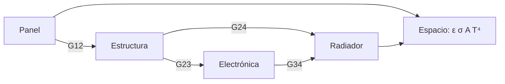

# B85-C18 — Modelado térmico por nodos

<!-- nav:top -->
x
<!-- /nav -->

## 1. Ubicación, nivel y alcance

Clase 18 del bloque B85. Nivel N3. Un modelo térmico por nodos reduce la nave a unos pocos nodos isotermos unidos por conductancias y por radiación al espacio, y resuelve el balance con Newton. Aquí armas una red de cuatro nodos (panel, estructura, electrónica, radiador), la resuelves en régimen estacionario y transitorio, verificas el cierre de energía y un caso de dos nodos con solución analítica. Todo es sintético.

## 2. Por qué esta clase existe

Un modelo por nodos es la herramienta para decidir antes de construir. La decisión central: **¿qué temperatura alcanza cada nodo y qué cambio de diseño (radiador, conductancia, disipación) lo mejora más?** La decisión central: **¿qué temperatura alcanza cada nodo y qué cambio de diseño lo mejora más?**

## 3. Lo que podrás hacer al terminar

1. Plantear el balance de cada nodo con conducción y radiación.
2. Resolver el sistema no lineal con Newton y un jacobiano analítico.
3. Verificar el cierre de energía y un caso analítico de dos nodos.
4. Integrar el transitorio con Euler implícito.
5. Comparar variantes de diseño.
6. Separar lo consultado (`σ`, `S₀`) de lo ilustrativo (todos los nodos).

La evidencia es la **modelo térmico de cuatro nodos** del ejercicio 12 (sección 20).

## 4. Con qué llegas y cómo comprobarlo

1. ¿Qué es un nodo isotermo?
2. ¿Qué es una conductancia?
3. ¿Qué es el método de Newton?
4. ¿Qué es el Euler implícito?
5. ¿Qué es una verificación por segunda vía?

<details>
<summary>Ver respuestas</summary>

1. Un volumen representado por una sola temperatura. 2. `G = kA/L`, en W/K. 3. Un método iterativo que usa la derivada para resolver `f(x) = 0`. 4. Un esquema estable que evalúa la derivada al final del paso. 5. Calcular lo mismo con otro método y comparar.
</details>

Con cuatro o cinco aciertos, sigue; si no, repasa los prerrequisitos.

## 5. Un caso de contexto y casos de referencia

Con un panel que absorbe `204,2 W` y una electrónica de `30 W`, la red de cuatro nodos da panel `289,49 K`, estructura `267,07 K`, electrónica `272,09 K` y radiador `249,61 K`; la potencia radiada iguala a la de entrada (`234,15 W`). Es el **ejemplo conductor**. Todo es **ilustrativo**.

## 6. Vocabulario

El **balance de un nodo** es `Σ G_ij(T_j − T_i) − σ ε_i A_i T_i⁴ + Q_i = 0` (estacionario) o `C_i dT_i/dt = …` (transitorio). El **jacobiano** `∂R/∂T` tiene `−4σεAT³ − ΣG` en la diagonal. **Newton** itera `T ← T − J⁻¹R`. **Euler implícito** resuelve `(C/Δt − J)ΔT = R`.

## 7. Modelo mental



*Descripción textual:* cuatro nodos unidos por conductancias; el panel y el radiador radian al espacio; el Sol calienta el panel y la electrónica disipa potencia.

Analogía: una red de tuberías con depósitos: cada nodo es un depósito, las conductancias son tuberías y el espacio es el desagüe, que vacía más rápido cuanto más alto el nivel. Límite: un nodo oculta gradientes internos y las conductancias de uniones reales son inciertas.

## 8. La explicación, paso a paso

### 8.1 Estacionario

Cuatro iteraciones de Newton dan `panel 289,49 K; estructura 267,07 K; electronica 272,09 K; radiador 249,61 K`, con residuo máximo `5,0 × 10⁻¹³ W`. La potencia radiada `234,1500 W` iguala la de entrada `234,1500 W`: cierre de energía.

### 8.2 Dos nodos analíticos

Un nodo `A` recibe `20 W`, conduce con `4 W/K` a `B` y `B` radia con `εA = 0,3 m²`. Analíticamente `T_B = (Q/(σ ε A))^(1/4)` y `T_A = T_B + Q/G`: `185,1715 K` y `190,1715 K`; el solucionador da lo mismo.

### 8.3 Transitorio

Con Euler implícito (`Δt = 10 s`) desde `250 K` los nodos tienden al estacionario (`289,49, 267,07, 272,09, 249,61 K` a `20 000 s`) y alcanzan el `90 %` del cambio a los `2650 s`.

### 8.4 Variantes

Con `60 W` en la electrónica, `296,99 K`. Con el radiador de área doble, `249,24 K`. Con `G` electrónica–radiador de `4 W/K`, `260,58 K`. Mejorar la conductancia hacia el radiador y su área es lo que más enfría la electrónica.

## 9. Magnitudes, símbolos y unidades

| Símbolo | Qué es | Unidad | Valor / nota |
|---|---|---|---|
| `T_i` | temperaturas de los nodos | K | 289,49; 267,07; 272,09; 249,61 |
| `G_ij` | conductancias | W/K | 2; 1,5; 3; 1 |
| `ε A` | área radiante efectiva | m² | 0,4; 0; 0; 0,34 |
| `C_i` | capacidades | J/K | 400; 1500; 900; 600 |
| `Q_i` | cargas | W | 204,2; 0; 30; 0 |
| residuo | cierre | W | 5,0 × 10⁻¹³ |

## 10. Convenciones y referencias

`σ` y `S₀` consultadas. Sumidero a `0 K` (simplificación), nodos isotermos, conductancias y capacidades constantes, `α = 0,3` en el panel; todo ilustrativo y sintético. Newton con tolerancia `10⁻¹⁰ W`.

## 11. De dónde sale lo que afirmamos

| ID | Fuente | Localizador | Respalda | Estado |
|---|---|---|---|---|
| S1 | NIST, CODATA 2022, Stefan–Boltzmann constant — https://physics.nist.gov/cgi-bin/cuu/Value?sigma (consultada 2026-11-10) | valor de `σ` | `σ` de la radiación | Consultada |
| S2 | NASA/NSSDC, Earth Fact Sheet — https://nssdc.gsfc.nasa.gov/planetary/factsheet/earthfact.html (consultada 2026-11-10) | ficha completa | `S₀ = 1361,0 W/m²` | Consultada |
| — | Método de nodos concentrados, Newton–Raphson y Euler implícito | — | las verifica el laboratorio con una segunda vía | No consultada en una fuente concreta |

Límites: los nodos, las conductancias y las capacidades no se consultaron; el modelo no representa una nave real; el sumidero a `0 K` ignora el entorno planetario.

## 12. Cómo ver el resultado

| Magnitud | Valor |
|---|---|
| `T` electrónica | 272,09 K |
| residuo | 5,0 × 10⁻¹³ W |
| `P` radiada | 234,15 W |
| `t` al 90 % | 2650 s |
| 2 nodos num/ana | 190,1715/190,1715 K |

Descripción larga: el radiador y la conductancia hacia él son los parámetros que más bajan la temperatura de la electrónica.

## 13. Ejemplo trabajado

**Paso 1 · Suposición.** Todos los nodos a `280 K`.

**Paso 2 · Newton.** Se resuelve `J ΔT = −R` cuatro veces.

**Paso 3 · Cierre.** `Σ σεAT⁴ = 234,15 W = Σ Q`.

## 14. Distintas formas de describir el problema

**Por nodos:** ecuaciones de balance. **Por red:** conductancias. **Por solución:** estacionaria y transitoria. **Por variantes:** parámetros.

## 15. Práctica guiada

**Ejercicio 1 · con los pasos indicados.** Escribe el balance del nodo estructura. *Pasos:* suma las conductancias a los otros nodos.

<details><summary>Solución comentada</summary>

`G₁₂(T₁−T₂) + G₂₃(T₃−T₂) + G₂₄(T₄−T₂) = 0` (sin carga ni radiación).
</details>

**Ejercicio 2 · con una pista.** Predice si `T_electrónica` sube o baja con `60 W`. *Pista:* más carga.

<details><summary>Solución comentada</summary>

Sube: `296,99 K`.
</details>

**Ejercicio 3 · casi autónomo.** ¿Por qué el cierre de energía vale 0? Piensa en qué verifica.

<details><summary>Solución comentada</summary>

La conducción interna se cancela y solo queda `Σ Q = Σ radiado`; valida el ensamblado.
</details>

## 16. Práctica autónoma, transferencia e integrador

**Ejercicio 4 · autónomo.** Calcula `T_B` de un nodo con `Q = 20 W` y `εA = 0,3 m²`.

<details><summary>Solución comentada</summary>

`185,17 K`.
</details>

**Ejercicio 5 · autónomo.** Calcula `τ` del nodo electrónica si solo conduce con `1 W/K`.

<details><summary>Solución comentada</summary>

`900 s`.
</details>

**Ejercicio 6 · autónomo.** ¿Qué pasa si `G₂₃` sube de `1,5` a `3 W/K`?

<details><summary>Solución comentada</summary>

La electrónica queda más cerca de la estructura; el gradiente baja.
</details>

**Ejercicio 7 · autónomo.** ¿Qué cambia si el panel tiene `α = 0,6`?

<details><summary>Solución comentada</summary>

Absorbe `408,3 W` y todo se calienta.
</details>

**Ejercicio 8 · autónomo.** Calcula el jacobiano de un nodo que radia: término diagonal.

<details><summary>Solución comentada</summary>

`−4σεA T³ − ΣG`.
</details>

**Ejercicio 9 · transferencia.** **Transferencia.** Un ingeniero duda de que cuatro nodos basten. ¿Qué respondes?

<details><summary>Solución comentada</summary>

Basta para decisiones de concepto; se refina con más nodos donde haya gradientes y se correlaciona con ensayo (clase C27).
</details>

**Ejercicio 10 · transferencia.** **Transferencia.** ¿Por qué conviene un sumidero a `3 K` o a un entorno real en un caso de órbita?

<details><summary>Solución comentada</summary>

El sumidero a `0 K` ignora el infrarrojo y el albedo, que suben el absorbido (clase C01).
</details>

**Ejercicio 11 · transferencia.** **Transferencia.** Un colega presenta `272 K` como «la temperatura de nuestra electrónica». ¿Qué corriges?

<details><summary>Solución comentada</summary>

Es un modelo de cuatro nodos sintético.
</details>

**Ejercicio 12 · integrador.** **Integrador.** Elabora tu *modelo térmico de cuatro nodos*: red, solución estacionaria, cierre de energía, caso de dos nodos, variantes y lista de lo consultado e ilustrativo.

<details><summary>Solución comentada</summary>

Secciones 8.1–8.4 y la salida del laboratorio.
</details>

## 17. Laboratorio: red de cuatro nodos

El script [nodos.py](nodos.py) resuelve la red por Newton, verifica el cierre y el caso de dos nodos, integra el transitorio e identifica variantes (**comprueba** cierre de energía a 1e-8, dos nodos a 1e-6 y transitorio → estacionario a 0,05 K).

**Datos:** `σ` y `S₀` consultadas; nodos y conductancias **ilustrativos**. **Predice antes de ejecutar:** ¿qué nodo queda más frío? (el radiador, unos 250 K.) **Ejecución del 2026-11-10 (Python 3.12.9):**

```text
Python 3.12.9 (biblioteca estandar)
Modelo ILUSTRATIVO de 4 nodos (panel, estructura, electronica, radiador), sumidero a 0 K, panel absorbe 0.3*S0*0.5 m2, electronica disipa 30 W
Estacionario (Newton, 4 iteraciones): panel 289.49 K; estructura 267.07 K; electronica 272.09 K; radiador 249.61 K
Residuo maximo = 4.97e-13 W ; potencia radiada = 234.1500 W ; potencia de entrada = 234.1500 W
Caso de dos nodos (analitico): numerico T_A = 190.1715 K, T_B = 185.1715 K ; analitico T_A = 190.1715 K, T_B = 185.1715 K
Transitorio implicito desde 250 K (paso 10 s, 20000 s): 289.49; 267.07; 272.09; 249.61 K ; 90 % del cambio a los 2650 s
Electronica a 60 W: panel 295.73; estructura 280.39; electronica 296.99; radiador 261.87 K
Radiador de area doble: electronica 249.24 K ; G(electronica-radiador) = 4 W/K: electronica 260.58 K
Pruebas superadas.
```

```bash
python programa/clases/B85/B85-C18-modelado-termico-por-nodos/nodos.py
```

**Límites:** nodos isotermos, sumidero a `0 K`, propiedades constantes.

## 18. Errores frecuentes y cómo corregirlos

**Olvidar la radiación de un nodo.** el nodo no cierra la energía (8.1)

**Usar kelvin y grados Celsius mezclados.** `T⁴` exige kelvin (sección 10)

**Confiar en el cierre sin segunda vía.** se contrasta con el caso analítico (8.2)

**Presentar el modelo como de una nave.** se corrige con la sección 10

## 19. Cómo sabrás que vas bien

Tras la sección 8: ¿qué resultado esperabas (la temperatura de la electrónica) y cuál obtuviste? Si dudas, repasa el ejemplo 13. Tras el laboratorio: ¿qué comprueba? (ver la sección 17).

## 20. Qué entregas y cómo se evalúa

El producto es tu **modelo térmico de cuatro nodos** (ejercicio 12).

| Criterio | Inicial | En desarrollo | Logrado | Destacado |
|---|---|---|---|---|
| Conceptos | Los confunde | Parciales | Plantea y resuelve la red | Explica los límites |
| Cálculo | Sin unidades | Con errores | Tablas completas con unidades | Calcula casos nuevos |
| Numérico | Sin comprobar | Un caso | Contraste con una segunda vía | Interpreta las diferencias |
| Fuentes | Sin fuente | Sin fecha | Fuentes con fecha y estado | Declara lo ilustrativo y lo no consultado |
| Límites | No los nombra | Uno | Tres | Discute qué falta del modelo |

**Condiciones críticas (no se compensan con promedio):** rotular los datos ilustrativos o sintéticos como tales; no presentar un resultado modelado como medición; citar solo lo consultado.

## 21. Ética, seguridad y límites

Clase educativa: los modelos son simplificados y sus datos son sintéticos o ilustrativos; ningún resultado describe una nave real, ni sustituye a los estándares de proyecto, a la verificación con datos de misión ni a una revisión disciplinar. Los valores de este texto no son requisitos de ningún proyecto. Accesibilidad: tablas equivalentes a las gráficas, fórmulas en texto, ejercicios sin conexión.

## 22. Para cerrar y seguir

Una red de cuatro nodos da la electrónica a `272,09 K` y cierra la energía en `5 × 10⁻¹³ W`. Queda una pregunta: ¿cómo se comprueba un modelo así en una cámara de vacío térmico?

**Glosario español–inglés.** modelo por nodos · *lumped-parameter model*; conductancia · *conductance*; jacobiano · *Jacobian*; Euler implícito · *implicit Euler*; cierre de energía · *energy closure*.

**Continuidad.** [B85-C19](../B85-C19-ensayos-de-vacio-termico/CLASE.md) estudia los ensayos de vacío térmico.

**Referencias:** ver sección 11.

<!-- nav:bottom -->
x
<!-- /nav -->
