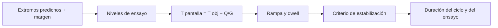

# B85-C19 — Ensayos de vacío térmico

<!-- nav:top -->
x
<!-- /nav -->

## 1. Ubicación, nivel y alcance

Clase 19 del bloque B85. Nivel N3. Un ensayo de vacío térmico lleva el equipo a los extremos de temperatura en una cámara de vacío y exige que se estabilice en cada uno. Aquí planificas un ciclado: niveles con margen sobre lo predicho, temperatura de pantalla necesaria, rampas, tiempos de estabilización y duración total, y los contrastas con la solución analítica. Los valores y criterios son sintéticos; los procedimientos de ensayo (ECSS y otros) no se consultaron.

## 2. Por qué esta clase existe

Un ensayo mal planificado dura el doble o no cubre el caso extremo. La decisión central: **¿qué temperaturas de pantalla, rampas y dwells cubren los extremos predichos con margen y cuánto dura el ensayo?** La decisión central: **¿qué temperaturas de pantalla, rampas y dwells cubren los extremos predichos con margen y cuánto dura el ensayo?**

## 3. Lo que podrás hacer al terminar

1. Fijar los niveles de ensayo como extremos predichos más margen.
2. Calcular la temperatura de pantalla para una temperatura objetivo del equipo.
3. Simular rampas y dwell con criterio de estabilización.
4. Calcular la duración del ciclo y del ensayo.
5. Contrastar el tiempo de estabilización con la fórmula analítica.
6. Separar lo consultado (nada específico) de lo ilustrativo (todo).

La evidencia es la **plan de un ensayo de vacío térmico** del ejercicio 12 (sección 20).

## 4. Con qué llegas y cómo comprobarlo

1. ¿Qué es un dwell?
2. ¿Qué es la constante de tiempo de un equipo?
3. ¿Qué es un criterio de estabilización?
4. ¿Qué es el margen de ensayo?
5. ¿Qué es una verificación por segunda vía?

<details>
<summary>Ver respuestas</summary>

1. El tiempo que se mantiene una condición de ensayo. 2. `τ = C/G` con la pantalla (clase C11). 3. Una condición, por ejemplo `|dT/dt|` bajo un umbral, para dar por alcanzado el equilibrio. 4. La diferencia entre el nivel de ensayo y el extremo predicho. 5. Calcular lo mismo con otro método y comparar.
</details>

Con cuatro o cinco aciertos, sigue; si no, repasa los prerrequisitos.

## 5. Un caso de contexto y casos de referencia

Con extremos predichos sintéticos de `255–320 K` y un margen ilustrativo de `10 K`, los niveles son `245–330 K`; un ciclo completo dura `19,3 h` y cuatro ciclos con la subida inicial, `84 h`. Es el **ejemplo conductor**. Todo es **ilustrativo**.

## 6. Vocabulario

El **nivel de ensayo** es el extremo predicho más el **margen**. La **pantalla** es la pared de la cámara cuya temperatura se controla: `T_pantalla = T_objetivo − Q/G`. La **rampa** es la velocidad de cambio de la pantalla. La **estabilización** se da cuando `|dT/dt|` cae bajo el criterio. Un **ciclo** es un paso al caliente y al frío.

## 7. Modelo mental



*Descripción textual:* los extremos predichos y el margen dan los niveles; de ahí sale la temperatura de la pantalla; rampa y estabilización fijan los tiempos y la duración total.

Analogía: calentar una olla grande antes de hornear: el horno llega pronto a la temperatura pero el interior tarda. Límite: el equipo se trata como un nodo y el control de la cámara es ideal.

## 8. La explicación, paso a paso

### 8.1 Niveles y pantalla

Niveles `245–330 K`. Con `Q = 15 W` y `G = 2 W/K`, la pantalla debe estar a `322,5 K` para el nivel caliente y `237,5 K` para el frío (`T_pantalla = T_obj − Q/G`).

### 8.2 Tiempos

Con rampa de `3 K/min` y criterio `|dT/dt| < 1 K/h`, `τ = 10000 s`:

| Tramo | pantalla en objetivo (h) | equipo estable (h) | `T` final (K) |
|---|---|---|---|
| ambiente -> caliente | 0,16 | 7,25 | 327,22 |
| caliente -> frio | 0,50 | 9,68 | 247,78 |
| frio -> caliente | 0,41 | 9,60 | 327,22 |

La pantalla llega en menos de una hora; el equipo tarda casi diez por su inercia.

### 8.3 Duración

Un ciclo (caliente y frío) dura `19,29 h`; cuatro ciclos con la subida inicial, `84,4 h`. El bombeo a `10⁻³ Pa` (clase C12) toma `0,021 h` en la cámara de esa clase, despreciable frente al ciclado.

### 8.4 Fórmula analítica

Tras alcanzar la pantalla, la diferencia con el equilibrio decae como `δ₀ e^(−t/τ)` y `|dT/dt| = δ/τ`; el tiempo hasta el criterio es `τ ln(δ₀/(τ·criterio))`. Para un escalón de `5 K`, `5878 s` analítico y `5885 s` numérico. Un equipo con mayor inercia alarga el ensayo: dato decisivo para el costo.

## 9. Magnitudes, símbolos y unidades

| Símbolo | Qué es | Unidad | Valor / nota |
|---|---|---|---|
| `C` | capacidad del equipo | J/K | 20 000 |
| `G` | conductancia a la pantalla | W/K | 2,0 |
| rampa | velocidad de la pantalla | K/min | 3,0 |
| margen | margen de ensayo | K | 10 |
| `t_ciclo` | duración de un ciclo | h | 19,29 |
| `t_ensayo` | 4 ciclos | h | 84,4 |

## 10. Convenciones y referencias

Equipo como nodo isotermo con `C = 20 000 J/K`, `G = 2 W/K`, `Q = 15 W`; extremos predichos sintéticos; margen de `10 K`, rampa de `3 K/min` y criterio `1 K/h` ilustrativos y no consultados (no son los de ECSS ni de ningún proyecto). Control ideal de la pantalla.

## 11. De dónde sale lo que afirmamos

| ID | Fuente | Localizador | Respalda | Estado |
|---|---|---|---|---|
| — | Respuesta de un nodo a rampa y escalón, y criterio de estabilización por derivada | — | las verifica el laboratorio con una segunda vía | No consultada en una fuente concreta |

Límites: no se consultó ninguna fuente para esta clase; los niveles, el margen, la rampa y el criterio son ilustrativos; ECSS y estándares de ensayo no se consultaron; no se planifica un ensayo real.

## 12. Cómo ver el resultado

| Magnitud | Valor |
|---|---|
| niveles | 245–330 K |
| pantalla caliente / fría | 322,5 / 237,5 K |
| ciclo | 19,29 h |
| 4 ciclos | 84,4 h |
| estabilización 5 K | 5878 / 5885 s |

Descripción larga: la pantalla llega al objetivo en minutos y el equipo tarda horas: la inercia decide la duración del ensayo.

## 13. Ejemplo trabajado

**Paso 1 · Niveles.** `255 − 10 = 245 K` y `320 + 10 = 330 K`.

**Paso 2 · Pantalla.** `330 − 15/2 = 322,5 K`.

**Paso 3 · Ciclo.** Caliente→frío `9,68 h` y frío→caliente `9,60 h`: `19,29 h`.

## 14. Distintas formas de describir el problema

**Por niveles:** predicho + margen. **Por pantalla:** `T − Q/G`. **Por tiempo:** rampa + estabilización. **Por total:** ciclos × duración.

## 15. Práctica guiada

**Ejercicio 1 · con los pasos indicados.** Calcula `T_pantalla` para `T_obj = 300 K`. *Pasos:* `T − Q/G`.

<details><summary>Solución comentada</summary>

`300 − 7,5 = 292,5 K`.
</details>

**Ejercicio 2 · con una pista.** Predice si un equipo con la mitad de `C` se estabiliza antes. *Pista:* `τ = C/G`.

<details><summary>Solución comentada</summary>

Sí, `τ` baja a `5000 s` y el tiempo se reduce aproximadamente a la mitad.
</details>

**Ejercicio 3 · casi autónomo.** ¿Por qué el equipo termina a `327,2 K` y no a `330 K`? Mira el criterio.

<details><summary>Solución comentada</summary>

Se da por estabilizado cuando `|dT/dt| < 1 K/h`, todavía quedan unos décimos de kelvin.
</details>

## 16. Práctica autónoma, transferencia e integrador

**Ejercicio 4 · autónomo.** Calcula el tiempo de rampa de la pantalla de `293,15` a `322,5 K` a `3 K/min`.

<details><summary>Solución comentada</summary>

`9,8 min`.
</details>

**Ejercicio 5 · autónomo.** Calcula `τ` con `C = 40 000 J/K`.

<details><summary>Solución comentada</summary>

`20 000 s`.
</details>

**Ejercicio 6 · autónomo.** ¿Cuántas horas duran 6 ciclos con la subida inicial?

<details><summary>Solución comentada</summary>

`123,0 h`.
</details>

**Ejercicio 7 · autónomo.** Si el margen sube a `15 K`, ¿cuál es el nivel caliente?

<details><summary>Solución comentada</summary>

`335 K`.
</details>

**Ejercicio 8 · autónomo.** ¿Cuánto cuesta en horas añadir un ciclo?

<details><summary>Solución comentada</summary>

`19,3 h`.
</details>

**Ejercicio 9 · transferencia.** **Transferencia.** Un ensayo se acorta con un criterio de `5 K/h`. ¿Qué riesgo hay?

<details><summary>Solución comentada</summary>

Se da por estabilizado un equipo que aún cambia, y el ensayo no cubre el extremo.
</details>

**Ejercicio 10 · transferencia.** **Transferencia.** ¿Por qué conviene calentar y enfriar con la pantalla más allá del objetivo?

<details><summary>Solución comentada</summary>

Para acelerar: una pantalla más extrema aumenta `δ₀` y reduce el tiempo, con cuidado de no pasar los límites del equipo.
</details>

**Ejercicio 11 · transferencia.** **Transferencia.** Un colega presenta `19,3 h` como «la duración del ensayo de la nave». ¿Qué corriges?

<details><summary>Solución comentada</summary>

Es un cálculo con un nodo sintético; la duración real depende del equipo, la cámara y el procedimiento.
</details>

**Ejercicio 12 · integrador.** **Integrador.** Elabora tu *plan de un ensayo de vacío térmico*: niveles, pantalla, rampas, tiempos, duración y lista de lo consultado e ilustrativo.

<details><summary>Solución comentada</summary>

Secciones 8.1–8.4 y la salida del laboratorio.
</details>

## 17. Laboratorio: plan de un ciclado térmico

El script [ensayo_vtc.py](ensayo_vtc.py) calcula niveles y pantalla, simula las rampas y la estabilización, suma la duración y compara con la fórmula analítica (**comprueba** estabilización analítica frente a numérica (≤ 10 s) y margen total).

**Datos:** todo **ilustrativo y sintético**. **Predice antes de ejecutar:** ¿cuánto dura un ciclo completo? (unas 19 h.) **Ejecución del 2026-11-10 (Python 3.12.9):**

```text
Python 3.12.9 (biblioteca estandar)
Articulo ILUSTRATIVO: C = 20000 J/K, G a la pantalla = 2.0 W/K, disipa 15 W ; tau = 10000 s
Predicho (sintetico) 255-320 K ; margen de ensayo 10 K -> niveles 245-330 K
Pantalla necesaria: caliente 322.5 K ; frio 237.5 K (T_pantalla = T_objetivo - Q/G)
Rampa de la pantalla: 3.0 K/min ; criterio de estabilizacion: |dT/dt| < 1 K/h
  ambiente -> caliente  : pantalla en el objetivo a los 0.16 h ; articulo estable a las 7.25 h ; T = 327.22 K
  caliente -> frio      : pantalla en el objetivo a los 0.50 h ; articulo estable a las 9.68 h ; T = 247.78 K
  frio -> caliente      : pantalla en el objetivo a los 0.41 h ; articulo estable a las 9.60 h ; T = 327.22 K
Ciclo completo (caliente + frio) = 19.29 h ; 4 ciclos con la subida inicial = 84.4 h ; bombeo a 1e-3 Pa (C12) = 0.021 h
Estabilizacion de un escalon de 5 K: analitica = 5878 s ; numerica = 5885 s
Pruebas superadas.
```

```bash
python programa/clases/B85/B85-C19-ensayos-de-vacio-termico/ensayo_vtc.py
```

**Límites:** nodo isotermo, control ideal y sin deriva de la cámara.

## 18. Errores frecuentes y cómo corregirlos

**Fijar la pantalla igual al objetivo.** hay que restar `Q/G` (8.1)

**Estabilizar por tiempo y no por derivada.** el criterio es `|dT/dt|` (8.4)

**Olvidar la inercia.** fija la duración (8.2)

**Presentar el plan como un ensayo real.** se corrige con la sección 10

## 19. Cómo sabrás que vas bien

Tras la sección 8: ¿qué resultado esperabas (la duración de un ciclo) y cuál obtuviste? Si dudas, repasa el ejemplo 13. Tras el laboratorio: ¿qué comprueba? (ver la sección 17).

## 20. Qué entregas y cómo se evalúa

El producto es tu **plan de un ensayo de vacío térmico** (ejercicio 12).

| Criterio | Inicial | En desarrollo | Logrado | Destacado |
|---|---|---|---|---|
| Conceptos | Los confunde | Parciales | Planifica niveles y tiempos | Explica los límites |
| Cálculo | Sin unidades | Con errores | Tablas completas con unidades | Calcula casos nuevos |
| Numérico | Sin comprobar | Un caso | Contraste con una segunda vía | Interpreta las diferencias |
| Fuentes | Sin fuente | Sin fecha | Fuentes con fecha y estado | Declara lo ilustrativo y lo no consultado |
| Límites | No los nombra | Uno | Tres | Discute qué falta del modelo |

**Condiciones críticas (no se compensan con promedio):** rotular los datos ilustrativos o sintéticos como tales; no presentar un resultado modelado como medición; citar solo lo consultado.

## 21. Ética, seguridad y límites

Clase educativa: los modelos son simplificados y sus datos son sintéticos o ilustrativos; ningún resultado describe una nave real, ni sustituye a los estándares de proyecto, a la verificación con datos de misión ni a una revisión disciplinar. Los valores de este texto no son requisitos de ningún proyecto. Accesibilidad: tablas equivalentes a las gráficas, fórmulas en texto, ejercicios sin conexión.

## 22. Para cerrar y seguir

Un ciclado con niveles de `245–330 K` dura `19,3 h` por ciclo con estos datos ilustrativos. Queda una pregunta: ¿cómo se resumen todas las cargas en un presupuesto con margen?

**Glosario español–inglés.** ensayo de vacío térmico · *thermal vacuum test*; pantalla · *shroud*; dwell · *dwell*; criterio de estabilización · *stability criterion*; margen de ensayo · *test margin*.

**Continuidad.** [B85-C20](../B85-C20-presupuesto-termico-de-carga-util/CLASE.md) estudia el presupuesto térmico de la carga útil.

**Referencias:** ver sección 11.

<!-- nav:bottom -->
x
<!-- /nav -->
