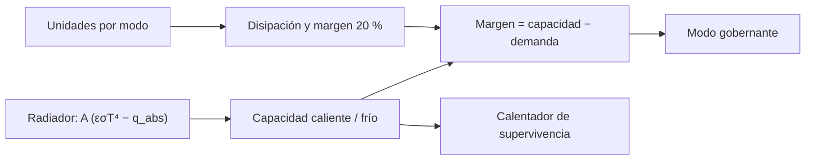

# B85-C20 — Presupuesto térmico de carga útil

<!-- nav:top -->
[🏠 Programa](../../../../README.md) · [📚 Bloque B85](../../../tronco-comun/B85-gestion-termica-y-entorno-espacial.md) · [← Anterior: B85-C19 — Ensayos de vacío térmico](../B85-C19-ensayos-de-vacio-termico/CLASE.md) · [Siguiente: B85-C21 — Efectos de partículas energéticas en electrónica y materiales →](../B85-C21-efectos-de-particulas-energeticas-en-electronica-y-materiales/CLASE.md)
<!-- /nav -->

## 1. Ubicación, nivel y alcance

Clase 20 del bloque B85. Nivel N3. El presupuesto térmico de una carga útil suma lo que disipa cada unidad en cada modo, lo compara con lo que el radiador puede rechazar en el caso caliente y con lo que hay que calentar en el frío, y deja un margen. Aquí armas el presupuesto de una carga sintética de cinco unidades y cuatro modos. Todo es sintético y ninguna política de margen es la de un proyecto.

## 2. Por qué esta clase existe

Un presupuesto sin margen no resiste un cambio de diseño. La decisión central: **¿qué modo gobierna el caso caliente, con cuánto margen cierra y qué calentador pide el frío?** La decisión central: **¿qué modo gobierna el caso caliente, con cuánto margen cierra y qué calentador pide el frío?**

## 3. Lo que podrás hacer al terminar

1. Sumar la disipación por unidad y por modo.
2. Calcular la capacidad del radiador a la temperatura límite.
3. Calcular el margen de potencia y reconocer el modo que gobierna.
4. Calcular el calentador de supervivencia.
5. Dimensionar el área mínima con una segunda vía.
6. Separar lo consultado (`σ`, `S₀`) de lo sintético.

La evidencia es la **presupuesto térmico de una carga útil** del ejercicio 12 (sección 20).

## 4. Con qué llegas y cómo comprobarlo

1. ¿Qué es un modo de operación?
2. ¿Qué es la capacidad de un radiador?
3. ¿Qué es un margen de potencia?
4. ¿Qué es un calentador de supervivencia?
5. ¿Qué es una verificación por segunda vía?

<details>
<summary>Ver respuestas</summary>

1. Un estado de la carga con su propia disipación (supervivencia, espera, nominal, pico). 2. La potencia que rechaza a una temperatura dada (clase C07). 3. La capacidad menos la demanda. 4. El que mantiene la temperatura mínima en no operación (clase C08). 5. Calcular lo mismo con otro método y comparar.
</details>

Con cuatro o cinco aciertos, sigue; si no, repasa los prerrequisitos.

## 5. Un caso de contexto y casos de referencia

Una carga sintética disipa `102 W` en pico (`122,4 W` con `20 %` de margen) frente a una capacidad de radiador de `165,0 W` a `303 K`: margen de `42,6 W` (`25,8 %`). Es el **ejemplo conductor**. Todo es **sintético**.

## 6. Vocabulario

La **disipación del modo** es la suma de las unidades. El **margen de desarrollo** (aquí `20 %`, ilustrativo) cubre la incertidumbre. La **capacidad del radiador** `A(εσT⁴ − q_abs)`. El **margen de potencia** es capacidad menos demanda. El **modo gobernante** es el de menor margen. El **calentador** cubre en el frío lo que el radiador rechaza.

## 7. Modelo mental



*Descripción textual:* la disipación por modo con margen se compara con la capacidad del radiador en el caso caliente; en el frío la capacidad define el calentador; el menor margen indica el modo gobernante.

Analogía: un presupuesto doméstico con ingresos (capacidad de rechazo) y gastos (disipación) por mes (modo), con un colchón. Límite: el presupuesto es un balance estacionario; los transitorios (clase C26) pueden exceder.

## 8. La explicación, paso a paso

### 8.1 Disipación

| Modo | Disipación (W) | Con `20 %` (W) |
|---|---|---|
| supervivencia | 2,0 | 2,4 |
| espera | 13,0 | 15,6 |
| nominal | 71,0 | 85,2 |
| pico | 102,0 | 122,4 |

Suma por unidades y por modos: `188,0 W` por ambos caminos.

### 8.2 Capacidad y margen

Radiador de `0,60 m²`, `ε = 0,85` y `q_abs = 131,19 W/m²` (caso caliente EOL, orden de magnitud de la clase C07): a `303 K`, `165,0 W`.

| Modo | Disipación (W) | Con margen (W) | Margen (W) | % capacidad |
|---|---|---|---|---|
| supervivencia | 2,0 | 2,4 | 162,6 | 98,5 % |
| espera | 13,0 | 15,6 | 149,4 | 90,5 % |
| nominal | 71,0 | 85,2 | 79,8 | 48,4 % |
| pico | 102,0 | 122,4 | 42,6 | 25,8 % |

Gobierna **pico**. En pico con margen el radiador llega a `288,78 K`, `14,22 K` bajo el límite.

### 8.3 Frío

A `253 K` y `5 W/m²` absorbidos, el radiador rechaza `115,5 W`: eso hay que aportar para mantener `253 K`. Con `2 W` de supervivencia, el calentador es `113,5 W` (`141,9 W` con `25 %`). Un radiador descubierto cuesta mucho calentador; en la práctica se usan persianas o aislamiento para reducir esa pérdida.

### 8.4 Área mínima

Con el pico y margen, `A_min = 0,4450 m²` por la fórmula y `0,4450 m²` por bisección, frente a los `0,60 m²` disponibles.

## 9. Magnitudes, símbolos y unidades

| Símbolo | Qué es | Unidad | Valor / nota |
|---|---|---|---|
| `A` | área del radiador | m² | 0,60 |
| `T_max` | límite de operación | K | 303 (ilustrativo) |
| `P_pico` | disipación en pico | W | 102 |
| margen | política de margen | % | 20 (ilustrativa) |
| capacidad | rechazo a 303 K | W | 165,0 |
| calentador | supervivencia | W | 113,5 |

## 10. Convenciones y referencias

`σ` consultada. Disipaciones, modos, límites `253–303 K`, `α_EOL = 0,25`, absorbidos y margen del `20 %` sintéticos o ilustrativos; ninguno es un requisito de proyecto. Presupuesto estacionario.

## 11. De dónde sale lo que afirmamos

| ID | Fuente | Localizador | Respalda | Estado |
|---|---|---|---|---|
| S1 | NIST, CODATA 2022, Stefan–Boltzmann constant — https://physics.nist.gov/cgi-bin/cuu/Value?sigma (consultada 2026-11-10) | valor de `σ` | `σ` de la capacidad | Consultada |
| — | Balance estacionario de un radiador y suma de disipaciones por modo | — | las verifica el laboratorio con una segunda vía | No consultada en una fuente concreta |

Límites: las disipaciones, los límites de temperatura y la política de margen no se consultaron; no es el presupuesto de una carga real; los transitorios no se incluyen; ECSS no se consultó.

## 12. Cómo ver el resultado

| Magnitud | Valor |
|---|---|
| capacidad a 303 K | 165,0 W |
| pico con margen | 122,4 W |
| margen en pico | 42,6 W (25,8 %) |
| calentador | 113,5 W |
| `A_min` (fórmula/bisección) | 0,4450 / 0,4450 m² |

Descripción larga: el modo pico gobierna con un margen del 26 %; el radiador descubierto pide más de cien vatios de calentador en el frío.

## 13. Ejemplo trabajado

**Paso 1 · Pico.** `12 + 24 + 40 + 10 + 16 = 102 W`; con margen `122,4 W`.

**Paso 2 · Capacidad.** `0,6 (0,85 σ 303⁴ − 131,19) = 165,0 W`.

**Paso 3 · Margen.** `165,0 − 122,4 = 42,6 W`.

## 14. Distintas formas de describir el problema

**Por modos:** tabla. **Por capacidad:** `A(εσT⁴ − q_abs)`. **Por margen:** capacidad − demanda. **Por área:** `A_min`.

## 15. Práctica guiada

**Ejercicio 1 · con los pasos indicados.** Suma la disipación del modo nominal. *Pasos:* suma las cinco unidades.

<details><summary>Solución comentada</summary>

`71 W`.
</details>

**Ejercicio 2 · con una pista.** Predice si el pico sin margen deja más o menos margen. *Pista:* `20 %` menos de demanda.

<details><summary>Solución comentada</summary>

Más: `63,0 W`.
</details>

**Ejercicio 3 · casi autónomo.** ¿Por qué las sumas por unidades y por modos coinciden? Piensa en qué comprueba.

<details><summary>Solución comentada</summary>

Es la misma suma ordenada de dos maneras; valida el cálculo, no el presupuesto.
</details>

## 16. Práctica autónoma, transferencia e integrador

**Ejercicio 4 · autónomo.** Calcula la capacidad con `T = 310 K`.

<details><summary>Solución comentada</summary>

`188,4 W`.
</details>

**Ejercicio 5 · autónomo.** ¿Qué área da `A_min` con margen de `30 %`?

<details><summary>Solución comentada</summary>

`0,4821 m²`.
</details>

**Ejercicio 6 · autónomo.** Si `α_EOL` sube a `0,35` y el absorbido a `150 W/m²`, ¿cuál es la capacidad?

<details><summary>Solución comentada</summary>

`153,8 W`.
</details>

**Ejercicio 7 · autónomo.** ¿Qué margen en modo nominal?

<details><summary>Solución comentada</summary>

`79,8 W` (`48,4 %`).
</details>

**Ejercicio 8 · autónomo.** ¿Cuánto calentador hace falta con `ε = 0,85` y radiador de `0,3 m²` a `253 K`?

<details><summary>Solución comentada</summary>

`55,7 W`.
</details>

**Ejercicio 9 · transferencia.** **Transferencia.** Se añade una unidad de `20 W` en pico. ¿Cuál es el nuevo margen?

<details><summary>Solución comentada</summary>

`18,6 W` (`20 × 1,2 = 24 W`).
</details>

**Ejercicio 10 · transferencia.** **Transferencia.** ¿Por qué el calentador es tan grande?

<details><summary>Solución comentada</summary>

El radiador está descubierto y rechaza mucho a `253 K`; hay que reducir su pérdida con persianas o aislamiento en el frío.
</details>

**Ejercicio 11 · transferencia.** **Transferencia.** Un colega presenta `+25,8 %` como «el margen de nuestra carga». ¿Qué corriges?

<details><summary>Solución comentada</summary>

Es un cálculo con disipaciones y límites sintéticos.
</details>

**Ejercicio 12 · integrador.** **Integrador.** Elabora tu *presupuesto térmico de una carga útil*: tabla de modos, capacidad, márgenes, calentador, área mínima y lista de lo consultado, ilustrativo y sintético.

<details><summary>Solución comentada</summary>

Secciones 8.1–8.4 y la salida del laboratorio.
</details>

## 17. Laboratorio: presupuesto de cinco unidades y cuatro modos

El script [presupuesto_termico.py](presupuesto_termico.py) suma las disipaciones, calcula la capacidad del radiador, los márgenes, el calentador y el área mínima (**comprueba** área mínima por fórmula frente a bisección (1e-9), suma por dos caminos y modo gobernante).

**Datos:** `σ` consultada; todo lo demás **sintético e ilustrativo**. **Predice antes de ejecutar:** ¿qué modo gobierna? (pico.) **Ejecución del 2026-11-10 (Python 3.12.9):**

```text
Python 3.12.9 (biblioteca estandar)
Carga ILUSTRATIVA y SINTETICA; radiador 0.6 m2, eps = 0.85; limites 253-303 K ; absorbido caliente 131.19 W/m2, frio 5.0 W/m2 ; margen de disipacion 20 %
modo              detector  procesador      fuente  actuadores  conversion  total [W]  con margen
supervivencia          0.0         0.0         0.0         0.0         2.0        2.0         2.4
espera                 4.0         6.0         0.0         0.0         3.0       13.0        15.6
nominal               12.0        18.0        25.0         6.0        10.0       71.0        85.2
pico                  12.0        24.0        40.0        10.0        16.0      102.0       122.4
Capacidad del radiador a 303 K (caso caliente EOL) = 165.04 W ; a 253 K (frio) = 115.49 W
  supervivencia : margen de potencia = +162.64 W (+98.5 % de la capacidad)
  espera        : margen de potencia = +149.44 W (+90.5 % de la capacidad)
  nominal       : margen de potencia = +79.84 W (+48.4 % de la capacidad)
  pico          : margen de potencia = +42.64 W (+25.8 % de la capacidad)
Modo que gobierna el caso caliente: pico ; T del radiador en pico con margen = 288.78 K (14.22 K bajo el limite)
Calentador de supervivencia = 113.49 W (141.86 W con 25 % de margen)
Area minima del radiador para el pico con margen = 0.4450 m2 (biseccion 0.4450 m2)
Suma de unidades = 188.0 W ; suma de modos = 188.0 W
Pruebas superadas.
```

```bash
python programa/clases/B85/B85-C20-presupuesto-termico-de-carga-util/presupuesto_termico.py
```

**Límites:** presupuesto estacionario, un solo caso caliente y un solo frío.

## 18. Errores frecuentes y cómo corregirlos

**Olvidar el margen de desarrollo.** el margen cubre incertidumbre (8.1)

**Mirar solo el nominal.** gobierna el de menor margen (8.2)

**Ignorar el frío.** el calentador sale del frío (8.3)

**Presentar el margen como de una carga real.** se corrige con la sección 10

## 19. Cómo sabrás que vas bien

Tras la sección 8: ¿qué resultado esperabas (el margen de potencia en modo pico) y cuál obtuviste? Si dudas, repasa el ejemplo 13. Tras el laboratorio: ¿qué comprueba? (ver la sección 17).

## 20. Qué entregas y cómo se evalúa

El producto es tu **presupuesto térmico de una carga útil** (ejercicio 12).

| Criterio | Inicial | En desarrollo | Logrado | Destacado |
|---|---|---|---|---|
| Conceptos | Los confunde | Parciales | Cierra el presupuesto con margen | Explica los límites |
| Cálculo | Sin unidades | Con errores | Tablas completas con unidades | Calcula casos nuevos |
| Numérico | Sin comprobar | Un caso | Contraste con una segunda vía | Interpreta las diferencias |
| Fuentes | Sin fuente | Sin fecha | Fuentes con fecha y estado | Declara lo ilustrativo y lo no consultado |
| Límites | No los nombra | Uno | Tres | Discute qué falta del modelo |

**Condiciones críticas (no se compensan con promedio):** rotular los datos ilustrativos o sintéticos como tales; no presentar un resultado modelado como medición; citar solo lo consultado.

## 21. Ética, seguridad y límites

Clase educativa: los modelos son simplificados y sus datos son sintéticos o ilustrativos; ningún resultado describe una nave real, ni sustituye a los estándares de proyecto, a la verificación con datos de misión ni a una revisión disciplinar. Los valores de este texto no son requisitos de ningún proyecto. Accesibilidad: tablas equivalentes a las gráficas, fórmulas en texto, ejercicios sin conexión.

## 22. Para cerrar y seguir

El presupuesto sintético cierra con `42,6 W` de margen en pico (`26 %`) y pide `113 W` de calentador con el radiador descubierto. Queda una pregunta: ¿qué le hacen a esa carga las partículas energéticas?

**Glosario español–inglés.** presupuesto térmico · *thermal budget*; modo de operación · *operating mode*; margen · *margin*; capacidad del radiador · *radiator capacity*; modo gobernante · *driving mode*.

**Continuidad.** [B85-C21](../B85-C21-efectos-de-particulas-energeticas-en-electronica-y-materiales/CLASE.md) abre la ampliación con los efectos de partículas energéticas.

**Referencias:** ver sección 11.

<!-- nav:bottom -->
---

[← Anterior: B85-C19 — Ensayos de vacío térmico](../B85-C19-ensayos-de-vacio-termico/CLASE.md) · [📚 Bloque B85](../../../tronco-comun/B85-gestion-termica-y-entorno-espacial.md) · [Siguiente: B85-C21 — Efectos de partículas energéticas en electrónica y materiales →](../B85-C21-efectos-de-particulas-energeticas-en-electronica-y-materiales/CLASE.md)
<!-- /nav -->
