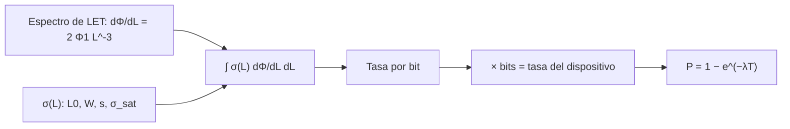

# B85-C21 — Efectos de partículas energéticas en electrónica y materiales

<!-- nav:top -->
[🏠 Programa](../../../../README.md) · [📚 Bloque B85](../../../tronco-comun/B85-gestion-termica-y-entorno-espacial.md) · [← Anterior: B85-C20 — Presupuesto térmico de carga útil](../B85-C20-presupuesto-termico-de-carga-util/CLASE.md) · [Siguiente: B85-C22 — Modelos de exposición a radiación en órbita →](../B85-C22-modelos-de-exposicion-a-radiacion-en-orbita/CLASE.md)
<!-- /nav -->

## 1. Ubicación, nivel y alcance

Clase 21 del bloque B85. Nivel N3. Una partícula pesada que atraviesa un transistor puede cambiar un bit (evento único) sin dañar el componente. Aquí calculas la tasa de eventos únicos como la integral de una sección eficaz de Weibull por un espectro de LET, la contrastas con Monte Carlo y obtienes la probabilidad de al menos un upset en la misión. La sección eficaz, el espectro y el tamaño de la memoria son sintéticos; no se consultó ninguna fuente de datos de radiación.

## 2. Por qué esta clase existe

Un upset en un procesador o en una memoria puede reiniciar un instrumento o corromper un dato. La decisión central: **¿con qué frecuencia ocurre un evento único en un dispositivo dado y cuánto cambia si se elige un componente de mayor umbral de LET?** La decisión central: **¿con qué frecuencia ocurre un evento único en un dispositivo dado y cuánto cambia si se elige un componente de mayor umbral de LET?**

## 3. Lo que podrás hacer al terminar

1. Definir una sección eficaz de Weibull con umbral, ancho y saturación.
2. Integrar la tasa de eventos a partir de un espectro de LET integral.
3. Contrastar la integral con Monte Carlo.
4. Calcular tasas por dispositivo, por día y por año.
5. Calcular la probabilidad de al menos un evento con Poisson.
6. Rotular todo dato como sintético.

La evidencia es la **ficha de tasa de eventos únicos** del ejercicio 12 (sección 20).

## 4. Con qué llegas y cómo comprobarlo

1. ¿Qué es el LET?
2. ¿Qué es una sección eficaz?
3. ¿Qué es un evento único?
4. ¿Qué es la distribución de Poisson?
5. ¿Qué es una verificación por segunda vía?

<details>
<summary>Ver respuestas</summary>

1. La energía que una partícula deposita por unidad de longitud y densidad del material, en MeV cm²/mg. 2. El área efectiva por bit para que ocurra el evento, en cm²/bit. 3. Un efecto causado por una sola partícula, por ejemplo un cambio de bit. 4. La que da la probabilidad de `k` eventos con tasa media constante. 5. Calcular lo mismo con otro método y comparar.
</details>

Con cuatro o cinco aciertos, sigue; si no, repasa los prerrequisitos.

## 5. Un caso de contexto y casos de referencia

Una memoria sintética de `64 Mbit` con `σ_sat = 10⁻⁷ cm²/bit`, `L₀ = 1,5 MeV cm²/mg` y un espectro `Φ(>L) = 10⁻⁶ L⁻² cm⁻² s⁻¹` sufre `2,68` upsets al año (MTBF `136` días) y la probabilidad de al menos uno en un año es `93,2 %`. Es el **ejemplo conductor**. Todo es **sintético**.

## 6. Vocabulario

La **sección eficaz de Weibull** `σ(L) = σ_sat[1 − exp(−((L − L₀)/W)^s)]` para `L > L₀`. El **espectro diferencial** es `dΦ/dL = 2Φ₁L⁻³` si `Φ(>L) = Φ₁L⁻²`. La **tasa por bit** es `∫σ(L) dΦ/dL dL`. Un **upset** es un cambio de estado reversible. La **probabilidad de al menos un evento** en `T` es `1 − e^(−λT)`.

## 7. Modelo mental



*Descripción textual:* la sección eficaz y el espectro de LET se integran en una tasa por bit, que se multiplica por los bits y entra en Poisson para dar la probabilidad en la misión.

Analogía: una lluvia de granizo sobre un tejado con tejas de distintas durezas: solo las piedras grandes rompen las tejas duras. Límite: la sección eficaz real se mide en aceleradores y depende del dispositivo; el espectro real depende de la órbita y de la actividad solar.

## 8. La explicación, paso a paso

### 8.1 Tasa por bit

Con `L₀ = 1,5`, `W = 20`, `s = 1,5` y `σ_sat = 10⁻⁷ cm²/bit`, la integral (Simpson logarítmico entre `L = 1` y `100`) da `1,2663 × 10⁻¹⁵ s⁻¹` por bit; Monte Carlo (400 000 muestras de un Pareto con semilla `20261110`) da `1,2590 × 10⁻¹⁵ s⁻¹`. La cota `σ_sat Φ₁ = 1,0 × 10⁻¹³ s⁻¹` se respeta.

### 8.2 Dispositivo y misión

Con `64 Mbit`: `8,498 × 10⁻⁸ s⁻¹ = 0,0073` por día `= 2,68` por año. La probabilidad de al menos un upset en un año es `93,16 %` y en cinco, `99,9998 %`: ocurrirá, y hay que diseñar para ello.

### 8.3 Elegir un componente

Subir el umbral a `L₀ = 10` reduce la tasa al `16,1 %`; bajar `σ_sat` a la mitad la reduce al `50 %`. La mitigación en diseño combina componentes de umbral alto, códigos de corrección de errores y reinicios por supervisión.

### 8.4 Límites

La sección eficaz de Weibull es una forma convencional; los parámetros reales salen de ensayos. El espectro `L⁻²` es una ilustración; protones de baja energía y reacciones nucleares añaden eventos que esta clase no calcula.

## 9. Magnitudes, símbolos y unidades

| Símbolo | Qué es | Unidad | Valor / nota |
|---|---|---|---|
| `σ_sat` | sección eficaz de saturación | cm²/bit | 10⁻⁷ (sintética) |
| `L₀` | umbral de LET | MeV cm²/mg | 1,5 (sintético) |
| `Φ₁` | flujo con `L > 1` | cm⁻² s⁻¹ | 10⁻⁶ (sintético) |
| `λ` | tasa del dispositivo | 1/año | 2,68 |
| MTBF | tiempo medio entre upsets | días | 136 |
| `P` | probabilidad en 1 año | % | 93,16 |

## 10. Convenciones y referencias

Todo sintético: Weibull (`σ_sat`, `L₀`, `W`, `s`), espectro integral `Φ(>L) = Φ₁ L⁻²` con `L` entre `1` y `100 MeV cm²/mg`, `64 Mbit`. Semilla `20261110`. No se consultó ninguna fuente para esta clase.

## 11. De dónde sale lo que afirmamos

| ID | Fuente | Localizador | Respalda | Estado |
|---|---|---|---|---|
| — | Integral de tasa de eventos únicos con sección eficaz de Weibull y estadística de Poisson | — | las verifica el laboratorio con una segunda vía | No consultada en una fuente concreta |

Límites: no se consultó ninguna fuente para esta clase; los parámetros no corresponden a un dispositivo real ni a una órbita; no se calculan efectos de protones ni dosis total ionizante; SPENVIS y modelos de entorno no se usaron.

## 12. Cómo ver el resultado

| Magnitud | Valor |
|---|---|
| tasa por bit (Simpson / MC) | 1,266 × 10⁻¹⁵ / 1,259 × 10⁻¹⁵ s⁻¹ |
| upsets por año | 2,68 |
| MTBF | 136 días |
| `P` 1 año | 93,2 % |
| umbral `L₀ = 10` | 16,1 % de la tasa |

Descripción larga: con esta sección eficaz y este espectro sintéticos, la memoria sufre unos tres upsets al año; un umbral más alto reduce la tasa a un sexto.

## 13. Ejemplo trabajado

**Paso 1 · Tasa por bit.** `∫σ dΦ/dL dL = 1,266 × 10⁻¹⁵ s⁻¹`.

**Paso 2 · Dispositivo.** `× 6,7 × 10⁷ bits = 8,498 × 10⁻⁸ s⁻¹`.

**Paso 3 · Probabilidad anual.** `1 − e^(−2,68) = 93,2 %`.

## 14. Distintas formas de describir el problema

**Por sección eficaz:** Weibull. **Por espectro:** `Φ(>L)`. **Por tasa:** integral. **Por probabilidad:** Poisson.

## 15. Práctica guiada

**Ejercicio 1 · con los pasos indicados.** Calcula `σ(L = 10)` con `σ_sat = 10⁻⁷`. *Pasos:* `1 − exp(−((10 − 1,5)/20)^1,5)`.

<details><summary>Solución comentada</summary>

`2,420 × 10⁻⁸ cm²/bit`.
</details>

**Ejercicio 2 · con una pista.** Predice si `σ(L = 1)` es nula. *Pista:* `L < L₀`.

<details><summary>Solución comentada</summary>

Sí, es `0`.
</details>

**Ejercicio 3 · casi autónomo.** ¿Por qué la integral y Monte Carlo difieren en décimas de porcentaje? Piensa en las muestras.

<details><summary>Solución comentada</summary>

Monte Carlo tiene error estadístico; la integral Simpson es casi exacta.
</details>

## 16. Práctica autónoma, transferencia e integrador

**Ejercicio 4 · autónomo.** Calcula el flujo con `L > 10`.

<details><summary>Solución comentada</summary>

`Φ₁/100 = 10⁻⁸ cm⁻² s⁻¹`.
</details>

**Ejercicio 5 · autónomo.** Calcula los upsets por año de una memoria de `16 Mbit`.

<details><summary>Solución comentada</summary>

`0,67`.
</details>

**Ejercicio 6 · autónomo.** Calcula la probabilidad de cero upsets en 30 días.

<details><summary>Solución comentada</summary>

`e^(−0,220) = 80,2 %`.
</details>

**Ejercicio 7 · autónomo.** ¿Cuántos días hasta `P = 50 %`?

<details><summary>Solución comentada</summary>

`ln2/0,0073 = 94` días.
</details>

**Ejercicio 8 · autónomo.** ¿Qué pasa con la tasa si `Φ₁` se multiplica por 10?

<details><summary>Solución comentada</summary>

Se multiplica por 10 (la tasa es lineal en el flujo).
</details>

**Ejercicio 9 · transferencia.** **Transferencia.** Un ECC corrige un bit por palabra. ¿Cambia la tasa de upsets?

<details><summary>Solución comentada</summary>

No cambia la tasa de eventos; reduce la tasa de errores visibles porque los corrige.
</details>

**Ejercicio 10 · transferencia.** **Transferencia.** ¿Por qué un procesador de umbral de `L₀ = 40` es mucho más robusto?

<details><summary>Solución comentada</summary>

Porque el espectro cae como `L⁻³` y casi ninguna partícula supera ese LET.
</details>

**Ejercicio 11 · transferencia.** **Transferencia.** Un colega presenta `2,7 upsets/año` como «la tasa medida de nuestra memoria». ¿Qué corriges?

<details><summary>Solución comentada</summary>

Es un cálculo con parámetros sintéticos, no una medición de ensayo ni de vuelo.
</details>

**Ejercicio 12 · integrador.** **Integrador.** Elabora tu *ficha de tasa de eventos únicos*: Weibull, espectro, tasa por bit, por dispositivo, probabilidad, contraste con Monte Carlo y lista de lo sintético.

<details><summary>Solución comentada</summary>

Secciones 8.1–8.4 y la salida del laboratorio.
</details>

## 17. Laboratorio: tasa de eventos únicos

El script [particulas_energeticas.py](particulas_energeticas.py) integra la sección eficaz de Weibull con el espectro, la contrasta con Monte Carlo y calcula las tasas y la probabilidad (**comprueba** Monte Carlo frente a integral a 3 % y la cota `σ_sat Φ₁`).

**Datos:** todo **sintético** (Weibull, espectro, bits, semilla). **Predice antes de ejecutar:** ¿cuántos upsets por año? (unos 2,7.) **Ejecución del 2026-11-10 (Python 3.12.9):**

```text
Python 3.12.9 (biblioteca estandar)
Weibull ILUSTRATIVA: sigma_sat = 1e-07 cm2/bit, L0 = 1.5 MeV cm2/mg, W = 20.0, s = 1.5 ; espectro Phi(>L) = 1e-06 L^-2 cm-2 s-1
Memoria de 67 Mbit
Tasa por bit: Simpson = 1.2663e-15 s-1 ; Monte Carlo (4e5 muestras, semilla 20261110) = 1.2590e-15 s-1 ; cota sigma_sat*Phi1 = 1.0e-13
Por dispositivo: 8.4977e-08 s-1 = 0.0073 por dia = 2.68 por anio ; MTBF = 136.2 dias
Probabilidad de al menos un upset: 1 anio 93.16 % ; 5 anios 99.9998 %
Con umbral L0 = 10 la tasa cae a 16.1 % ; con sigma_sat a la mitad, 50.0 %
Pruebas superadas.
```

```bash
python programa/clases/B85/B85-C21-efectos-de-particulas-energeticas-en-electronica-y-materiales/particulas_energeticas.py
```

**Límites:** forma convencional, espectro simple, sin protones ni reacciones nucleares.

## 18. Errores frecuentes y cómo corregirlos

**Confundir sección eficaz por bit con por dispositivo.** se multiplica por los bits (8.2)

**Esperar tasa cero con un umbral alto.** la tasa baja pero no se anula (8.3)

**Presentar la tasa como medición.** se corrige con la sección 10

**Ignorar la probabilidad acumulada.** la misión dura años (8.2)

## 19. Cómo sabrás que vas bien

Tras la sección 8: ¿qué resultado esperabas (la tasa de upsets por día) y cuál obtuviste? Si dudas, repasa el ejemplo 13. Tras el laboratorio: ¿qué comprueba? (ver la sección 17).

## 20. Qué entregas y cómo se evalúa

El producto es tu **ficha de tasa de eventos únicos** (ejercicio 12).

| Criterio | Inicial | En desarrollo | Logrado | Destacado |
|---|---|---|---|---|
| Conceptos | Los confunde | Parciales | Integra la tasa y calcula `P` | Explica los límites |
| Cálculo | Sin unidades | Con errores | Tablas completas con unidades | Calcula casos nuevos |
| Numérico | Sin comprobar | Un caso | Contraste con una segunda vía | Interpreta las diferencias |
| Fuentes | Sin fuente | Sin fecha | Fuentes con fecha y estado | Declara lo ilustrativo y lo no consultado |
| Límites | No los nombra | Uno | Tres | Discute qué falta del modelo |

**Condiciones críticas (no se compensan con promedio):** rotular los datos ilustrativos o sintéticos como tales; no presentar un resultado modelado como medición; citar solo lo consultado.

## 21. Ética, seguridad y límites

Clase educativa: los modelos son simplificados y sus datos son sintéticos o ilustrativos; ningún resultado describe una nave real, ni sustituye a los estándares de proyecto, a la verificación con datos de misión ni a una revisión disciplinar. Los valores de este texto no son requisitos de ningún proyecto. Accesibilidad: tablas equivalentes a las gráficas, fórmulas en texto, ejercicios sin conexión.

## 22. Para cerrar y seguir

Con parámetros sintéticos, una memoria de 64 Mbit sufre `2,7` upsets al año y un umbral de LET mayor reduce la tasa a `16 %`. Queda una pregunta: ¿cómo se obtiene el flujo de partículas de una órbita?

**Glosario español–inglés.** evento único · *single-event effect*; LET · *linear energy transfer*; sección eficaz · *cross section*; Weibull · *Weibull*; upset · *single-event upset*.

**Continuidad.** [B85-C22](../B85-C22-modelos-de-exposicion-a-radiacion-en-orbita/CLASE.md) estudia los modelos de exposición a radiación en órbita.

**Referencias:** ver sección 11.

<!-- nav:bottom -->
---

[← Anterior: B85-C20 — Presupuesto térmico de carga útil](../B85-C20-presupuesto-termico-de-carga-util/CLASE.md) · [📚 Bloque B85](../../../tronco-comun/B85-gestion-termica-y-entorno-espacial.md) · [Siguiente: B85-C22 — Modelos de exposición a radiación en órbita →](../B85-C22-modelos-de-exposicion-a-radiacion-en-orbita/CLASE.md)
<!-- /nav -->
