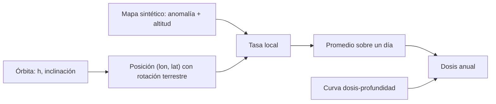

# B85-C22 — Modelos de exposición a radiación en órbita

<!-- nav:top -->
[🏠 Programa](../../../../README.md) · [📚 Bloque B85](../../../tronco-comun/B85-gestion-termica-y-entorno-espacial.md) · [← Anterior: B85-C21 — Efectos de partículas energéticas en electrónica y materiales](../B85-C21-efectos-de-particulas-energeticas-en-electronica-y-materiales/CLASE.md) · [Siguiente: B85-C23 — Dosímetros y monitores de radiación a bordo →](../B85-C23-dosimetros-y-monitores-de-radiacion-a-bordo/CLASE.md)
<!-- /nav -->

## 1. Ubicación, nivel y alcance

Clase 22 del bloque B85. Nivel N3. Los modelos de exposición (AE9/AP9, herramientas como SPENVIS) entregan flujos de partículas atrapadas a lo largo de una órbita. Aquí no los usas: construyes un mapa de flujo sintético con una anomalía del Atlántico Sur y una curva dosis-profundidad, propagas órbitas circulares con rotación terrestre, promedias el flujo y ves cómo cambian la dosis anual con la altitud, la inclinación y el blindaje. Lo que se hace con un modelo real es lo mismo pero con datos reales; aquí todo es sintético.

## 2. Por qué esta clase existe

La dosis anual decide el blindaje y la vida de la electrónica y los materiales. La decisión central: **¿cuánta dosis acumula una órbita al año y cuánto la reduce un milímetro más de blindaje?** La decisión central: **¿cuánta dosis acumula una órbita al año y cuánto la reduce un milímetro más de blindaje?**

## 3. Lo que podrás hacer al terminar

1. Propagar una órbita circular con rotación terrestre y obtener latitud y longitud.
2. Promediar un mapa de tasa de dosis a lo largo de la órbita.
3. Comprobar la convergencia con la resolución y con Monte Carlo.
4. Comparar altitudes, inclinaciones y blindajes.
5. Aplicar una curva dosis-profundidad.
6. Distinguir un mapa sintético de un modelo real (AE9/AP9, SPENVIS).

La evidencia es la **ficha de dosis por órbita (sintética)** del ejercicio 12 (sección 20).

## 4. Con qué llegas y cómo comprobarlo

1. ¿Qué es la anomalía del Atlántico Sur?
2. ¿Qué es una curva dosis-profundidad?
3. ¿Cómo se calcula el periodo de una órbita circular?
4. ¿Qué es el promedio sobre una órbita?
5. ¿Qué es una verificación por segunda vía?

<details>
<summary>Ver respuestas</summary>

1. Una región donde el cinturón interior de protones baja a menor altitud y aumenta el flujo. 2. La dosis en función del espesor de blindaje. 3. `T = 2π √(a³/GM)`. 4. La media temporal de una magnitud a lo largo de la trayectoria. 5. Calcular lo mismo con otro método y comparar.
</details>

Con cuatro o cinco aciertos, sigue; si no, repasa los prerrequisitos.

## 5. Un caso de contexto y casos de referencia

En el mapa sintético, una órbita de `500 km` y `51,6°` acumula `1,18 × 10⁻¹ Gy/año` con `1 mm` de aluminio; la misma órbita a `1200 km` acumula `1,89 × 10⁰ Gy/año`. Es el **ejemplo conductor**. Todo es **sintético**: no es AE9/AP9 ni SPENVIS.

## 6. Vocabulario

El **mapa de flujo** da la tasa de dosis en cada longitud y latitud; aquí es una gaussiana centrada en `(−45°, −25°)` que crece con `exp((h − 500 km)/250 km)`. La **curva dosis-profundidad** `D(x) ∝ (1 + x/x₀)^−p`. El **promedio orbital** integra la tasa a lo largo de un día. La **inclinación** limita la latitud alcanzada. SPENVIS es un sistema de ESA/BIRA-IASB con modelos reales del entorno.

## 7. Modelo mental



*Descripción textual:* la órbita da la posición geográfica en cada instante, el mapa sintético da la tasa local, el promedio sobre un día da la dosis diaria y anual, y la curva dosis-profundidad ajusta el blindaje.

Analogía: caminar por un bosque con zonas de lluvia: la lluvia que recibes depende de cuánto tiempo pasas bajo cada nube. Límite: el mapa sintético no tiene la estructura real de los cinturones (que depende de `L` y `B`, de la actividad solar y de la energía de las partículas).

## 8. La explicación, paso a paso

### 8.1 La órbita

El periodo a `500 km` es `94,47 min` (con `GM = g R²`). La latitud es `asen(sen i sen u)` y la longitud sigue a la rotación de la Tierra (`2π/86 164 s`).

### 8.2 Resultados

| `h` (km) | `i` (°) | Gy/día | Gy/año |
|---|---|---|---|
| 500 | 28,5 | 4,39 × 10⁻⁴ | 1,60 × 10⁻¹ |
| 500 | 51,6 | 3,23 × 10⁻⁴ | 1,18 × 10⁻¹ |
| 500 | 97,4 | 2,28 × 10⁻⁴ | 8,33 × 10⁻² |
| 800 | 51,6 | 1,04 × 10⁻³ | 3,79 × 10⁻¹ |
| 1200 | 51,6 | 5,17 × 10⁻³ | 1,89 × 10⁰ |

La inclinación baja a `97,4°` reduce la dosis porque pasa menos tiempo en la anomalía; subir de `500` a `1200 km` la multiplica casi por `16`.

### 8.3 Blindaje

La curva (relativa a `1 mm`): `0.5 mm`: 1,837, `1.0 mm`: 1,000, `2.0 mm`: 0,465, `5.0 mm`: 0,142. Pasar de `1` a `2 mm` baja la dosis anual de `1,18 × 10⁻¹` a `5,48 × 10⁻² Gy/año`.

### 8.4 Convergencia

A `500 km` y `51,6°`: `10 000` muestras dan `3,2266 × 10⁻⁴ Gy/día`, `40 000` dan `3,2266 × 10⁻⁴` y un muestreo aleatorio con semilla fija, `3,2128 × 10⁻⁴`. Con un modelo real se haría lo mismo con flujos reales; SPENVIS (consultada solo su presentación) cubre cinturones, plasmas, rayos cósmicos y más.

## 9. Magnitudes, símbolos y unidades

| Símbolo | Qué es | Unidad | Valor / nota |
|---|---|---|---|
| `h` | altitud | km | 500–1200 |
| `i` | inclinación | ° | 28,5; 51,6; 97,4 |
| `T` | periodo a 500 km | min | 94,47 |
| `D` | dosis anual (500 km, 51,6°) | Gy/año | 1,18 × 10⁻¹ |
| `x` | blindaje de aluminio | mm | 1; 2 |
| `p` | exponente de profundidad | — | 1,5 (sintético) |

## 10. Convenciones y referencias

`g` y `R` de la ficha de la Tierra para `GM = g R²`. Órbita circular y rotación con el día sideral `86 164,1 s` (aritmética). Mapa, curva dosis-profundidad y todas las constantes sintéticos. Dosis en grays (`1 Gy = 1 J/kg`).

## 11. De dónde sale lo que afirmamos

| ID | Fuente | Localizador | Respalda | Estado |
|---|---|---|---|---|
| S1 | NASA/NSSDC, Earth Fact Sheet — https://nssdc.gsfc.nasa.gov/planetary/factsheet/earthfact.html (consultada 2026-11-10) | ficha completa | `g = 9,820 m/s²` y radio `6371 km` | Consultada |
| S2 | ESA/BIRA-IASB, SPENVIS (página de presentación) — https://www.spenvis.oma.be/ (consultada 2026-11-10) | página de presentación | sistema de ESA con modelos del entorno espacial (cinturones, plasmas, rayos cósmicos, etc.); no se consultaron sus modelos ni resultados | Consultada |
| — | Propagación de una órbita circular y promedio temporal de un mapa | — | las verifica el laboratorio con una segunda vía | No consultada en una fuente concreta |

Límites: no se usó AE9/AP9 ni SPENVIS; el mapa y la curva son sintéticos; los números no describen ninguna órbita real; no se trata la actividad solar ni las partículas solares.

## 12. Cómo ver el resultado

| Magnitud | Valor |
|---|---|
| periodo a 500 km | 94,47 min |
| dosis anual 500 km, 51,6° | 1,18 × 10⁻¹ Gy |
| dosis anual 1200 km | 1,89 × 10⁰ Gy |
| dosis con 2 mm | 5,48 × 10⁻² Gy |
| convergencia fino / grueso | 3,227 × 10⁻⁴ / 3,227 × 10⁻⁴ |

Descripción larga: la dosis crece muy rápido con la altitud y cae con la inclinación y con el blindaje.

## 13. Ejemplo trabajado

**Paso 1 · Periodo.** `T = 2π√(a³/GM) = 94,47 min`.

**Paso 2 · Promedio.** Se evalúa el mapa cada `4,3 s` en un día y se promedia: `3,227 × 10⁻⁴ Gy/día`.

**Paso 3 · Anual.** `× 365,25 = 1,18 × 10⁻¹ Gy/año`.

## 14. Distintas formas de describir el problema

**Por posición:** `(lon, lat)`. **Por mapa:** tasa local. **Por promedio:** dosis diaria. **Por blindaje:** curva.

## 15. Práctica guiada

**Ejercicio 1 · con los pasos indicados.** Calcula el periodo a `800 km`. *Pasos:* `2π√(a³/GM)`.

<details><summary>Solución comentada</summary>

`100,72 min`.
</details>

**Ejercicio 2 · con una pista.** Predice si la dosis a `500 km` e `i = 97,4°` es menor que a `51,6°`. *Pista:* tiempo en la anomalía.

<details><summary>Solución comentada</summary>

Sí: `8,33 × 10⁻²` frente a `1,18 × 10⁻¹ Gy/año`.
</details>

**Ejercicio 3 · casi autónomo.** ¿Por qué los muestreos fino y grueso coinciden a 2 %? Piensa en la suavidad del mapa.

<details><summary>Solución comentada</summary>

El mapa es suave y las 94 min de órbita se muestrean bien con `10⁴` puntos al día.
</details>

## 16. Práctica autónoma, transferencia e integrador

**Ejercicio 4 · autónomo.** Calcula el factor de la curva a `3 mm` relativo a `1 mm`.

<details><summary>Solución comentada</summary>

`((1 + 3/0,5)/(1 + 1/0,5))^(−1,5) = 0,281`.
</details>

**Ejercicio 5 · autónomo.** ¿Qué latitud máxima alcanza `i = 51,6°`?

<details><summary>Solución comentada</summary>

`51,6°`.
</details>

**Ejercicio 6 · autónomo.** ¿Cuántas órbitas completa por día a `500 km`?

<details><summary>Solución comentada</summary>

`15,24`.
</details>

**Ejercicio 7 · autónomo.** ¿Cuánto crece la dosis de `800` a `1200 km` en el modelo?

<details><summary>Solución comentada</summary>

`4,99` veces.
</details>

**Ejercicio 8 · autónomo.** Calcula la dosis de una misión de 5 años a `500 km`, `51,6°`, `1 mm`.

<details><summary>Solución comentada</summary>

`5,89 × 10⁻¹ Gy`.
</details>

**Ejercicio 9 · transferencia.** **Transferencia.** Un limite de `100 Gy` para la electrónica a `1200 km`. ¿Se cumple con `1 mm` en 5 años?

<details><summary>Solución comentada</summary>

`9,45 × 10⁰ Gy`: se cumple con este mapa sintético.
</details>

**Ejercicio 10 · transferencia.** **Transferencia.** ¿Qué falta para usar este cálculo en un proyecto?

<details><summary>Solución comentada</summary>

Un modelo real (AE9/AP9 u otro), la actividad solar, protones solares, la geometría del blindaje y la energía de las partículas.
</details>

**Ejercicio 11 · transferencia.** **Transferencia.** Un colega presenta `0,118 Gy/año` como «la dosis de nuestra órbita». ¿Qué corriges?

<details><summary>Solución comentada</summary>

Es un resultado de un mapa sintético, no de AE9/AP9 ni de una medición.
</details>

**Ejercicio 12 · integrador.** **Integrador.** Elabora tu *ficha de dosis por órbita (sintética)*: tabla por altitud e inclinación, curva dosis-profundidad, convergencia y lista de lo consultado, sintético y no usado.

<details><summary>Solución comentada</summary>

Secciones 8.1–8.4 y la salida del laboratorio.
</details>

## 17. Laboratorio: dosis anual con un mapa sintético

El script [exposicion_orbita.py](exposicion_orbita.py) propaga órbitas circulares con rotación terrestre, promedia un mapa sintético, aplica la curva dosis-profundidad y comprueba la convergencia (**comprueba** fino frente a grueso (2 %), Monte Carlo (5 %) y reducción por blindaje).

**Datos:** `g` y `R` consultados; mapa, curva y órbitas **sintéticos**. **Predice antes de ejecutar:** ¿cuánto crece la dosis de 500 a 1200 km? (unas 16 veces.) **Ejecución del 2026-11-10 (Python 3.12.9):**

```text
Python 3.12.9 (biblioteca estandar)
Mapa de flujo SINTETICO (anomalia gaussiana en lon -45, lat -25; crece con exp(h/250 km)); NO es AE9/AP9 ni SPENVIS
Periodo a 500 km = 94.47 min ; dosis de referencia 5e-03 Gy/dia en el centro, 1 mm Al
 h [km]  inc [deg]  dosis [Gy/dia]  dosis [Gy/anio]
    500       28.5       4.393e-04        1.605e-01
    500       51.6       3.227e-04        1.179e-01
    500       97.4       2.281e-04        8.330e-02
    800       51.6       1.038e-03        3.792e-01
   1200       51.6       5.175e-03        1.890e+00
Curva dosis-profundidad (centro de la anomalia, relativa a 1 mm): 0.5 mm: 1.837, 1.0 mm: 1.000, 2.0 mm: 0.465, 5.0 mm: 0.142
Convergencia a 500 km, 51.6 grados: 10000 muestras 3.2266e-04 ; 40000 3.2266e-04 ; Monte Carlo 3.2128e-04 Gy/dia
Con 2 mm Al en vez de 1 mm la dosis anual baja de 1.179e-01 a 5.477e-02 Gy/anio
Pruebas superadas.
```

```bash
python programa/clases/B85/B85-C22-modelos-de-exposicion-a-radiacion-en-orbita/exposicion_orbita.py
```

**Límites:** mapa gaussiano, una sola energía efectiva, órbita circular sin perturbaciones.

## 18. Errores frecuentes y cómo corregirlos

**Creer que el mapa es AE9/AP9.** es sintético (sección 10)

**Olvidar la rotación terrestre.** la longitud cambia (8.1)

**Promediar con muy pocas muestras.** hay que comprobar la convergencia (8.4)

**Presentar la dosis como medición.** se corrige con la sección 10

## 19. Cómo sabrás que vas bien

Tras la sección 8: ¿qué resultado esperabas (la dosis anual a 500 km y 51,6°) y cuál obtuviste? Si dudas, repasa el ejemplo 13. Tras el laboratorio: ¿qué comprueba? (ver la sección 17).

## 20. Qué entregas y cómo se evalúa

El producto es tu **ficha de dosis por órbita (sintética)** (ejercicio 12).

| Criterio | Inicial | En desarrollo | Logrado | Destacado |
|---|---|---|---|---|
| Conceptos | Los confunde | Parciales | Promedia el mapa y calcula la dosis | Explica los límites |
| Cálculo | Sin unidades | Con errores | Tablas completas con unidades | Calcula casos nuevos |
| Numérico | Sin comprobar | Un caso | Contraste con una segunda vía | Interpreta las diferencias |
| Fuentes | Sin fuente | Sin fecha | Fuentes con fecha y estado | Declara lo ilustrativo y lo no consultado |
| Límites | No los nombra | Uno | Tres | Discute qué falta del modelo |

**Condiciones críticas (no se compensan con promedio):** rotular los datos ilustrativos o sintéticos como tales; no presentar un resultado modelado como medición; citar solo lo consultado.

## 21. Ética, seguridad y límites

Clase educativa: los modelos son simplificados y sus datos son sintéticos o ilustrativos; ningún resultado describe una nave real, ni sustituye a los estándares de proyecto, a la verificación con datos de misión ni a una revisión disciplinar. Los valores de este texto no son requisitos de ningún proyecto. Accesibilidad: tablas equivalentes a las gráficas, fórmulas en texto, ejercicios sin conexión.

## 22. Para cerrar y seguir

Con un mapa sintético, `500 km` y `51,6°` dan `1,2 × 10⁻¹ Gy/año` y `1200 km`, `1,9 × 10⁰`. Queda una pregunta: ¿cómo se mide a bordo la radiación que realmente llega?

**Glosario español–inglés.** anomalía del Atlántico Sur · *South Atlantic Anomaly*; dosis · *dose*; curva dosis-profundidad · *dose-depth curve*; cinturones de radiación · *radiation belts*; promedio orbital · *orbit average*.

**Continuidad.** [B85-C23](../B85-C23-dosimetros-y-monitores-de-radiacion-a-bordo/CLASE.md) estudia los dosímetros y monitores de radiación a bordo.

**Referencias:** ver sección 11.

<!-- nav:bottom -->
---

[← Anterior: B85-C21 — Efectos de partículas energéticas en electrónica y materiales](../B85-C21-efectos-de-particulas-energeticas-en-electronica-y-materiales/CLASE.md) · [📚 Bloque B85](../../../tronco-comun/B85-gestion-termica-y-entorno-espacial.md) · [Siguiente: B85-C23 — Dosímetros y monitores de radiación a bordo →](../B85-C23-dosimetros-y-monitores-de-radiacion-a-bordo/CLASE.md)
<!-- /nav -->
