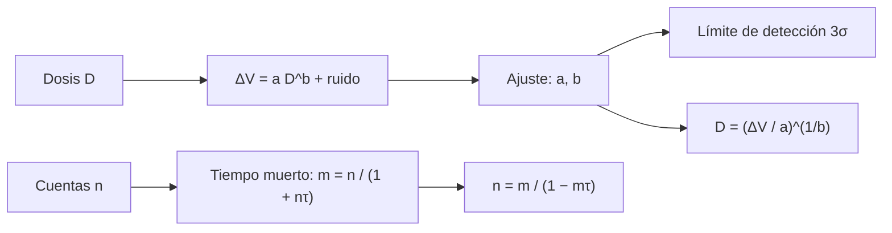

# B85-C23 — Dosímetros y monitores de radiación a bordo

<!-- nav:top -->
[🏠 Programa](../../../../README.md) · [📚 Bloque B85](../../../tronco-comun/B85-gestion-termica-y-entorno-espacial.md) · [← Anterior: B85-C22 — Modelos de exposición a radiación en órbita](../B85-C22-modelos-de-exposicion-a-radiacion-en-orbita/CLASE.md) · [Siguiente: B85-C24 — Efectos de la radiación ionizante en materiales y electrónica →](../B85-C24-efectos-de-la-radiacion-ionizante-en-materiales-y-electronica/CLASE.md)
<!-- /nav -->

## 1. Ubicación, nivel y alcance

Clase 23 del bloque B85. Nivel N3. Un monitor de radiación a bordo convierte una señal (tensión de un RadFET, cuentas de un detector) en dosis. Aquí calibras un RadFET sintético con datos ruidosos, comparas dos ajustes, calculas el límite de detección y corriges el tiempo muerto de un contador. Todo es sintético y la dosimetría personal de tripulaciones queda fuera.

## 2. Por qué esta clase existe

Un monitor mal calibrado no distingue una dosis real del ruido. La decisión central: **¿cuál es la relación señal–dosis, desde qué dosis es fiable y hasta qué tasa de cuentas se puede corregir el tiempo muerto?** La decisión central: **¿cuál es la relación señal–dosis, desde qué dosis es fiable y hasta qué tasa de cuentas se puede corregir el tiempo muerto?**

## 3. Lo que podrás hacer al terminar

1. Ajustar una ley de potencias `ΔV = a D^b` por dos vías.
2. Calcular la sensibilidad y el límite de detección a `3σ`.
3. Invertir la calibración para obtener la dosis desde una lectura.
4. Corregir el tiempo muerto de un contador.
5. Calcular la incertidumbre de Poisson de un conteo.
6. Rotular los datos como sintéticos.

La evidencia es la **ficha de calibración de un monitor de radiación** del ejercicio 12 (sección 20).

## 4. Con qué llegas y cómo comprobarlo

1. ¿Qué es un RadFET?
2. ¿Qué es el límite de detección?
3. ¿Qué es el tiempo muerto?
4. ¿Cuál es la incertidumbre de contar `N` eventos?
5. ¿Qué es una verificación por segunda vía?

<details>
<summary>Ver respuestas</summary>

1. Un transistor MOS cuya tensión umbral cambia con la dosis ionizante. 2. La señal mínima distinguible del ruido, aquí `3σ`. 3. El intervalo tras un pulso en que el detector no registra otro. 4. `√N`, es decir `1/√N` en relativo. 5. Calcular lo mismo con otro método y comparar.
</details>

Con cuatro o cinco aciertos, sigue; si no, repasa los prerrequisitos.

## 5. Un caso de contexto y casos de referencia

Un RadFET sintético con `ΔV = 0,012 D^0,85` y ruido de `2 mV` se calibra con `10` dosis; los ajustes dan `a = 0,01201`, `b = 0,850` y un límite de detección de `0,44 Gy`. Es el **ejemplo conductor**. Todo es **sintético**.

## 6. Vocabulario

La **calibración** `ΔV = a D^b` relaciona señal y dosis. El **ajuste log-log** linealiza con logaritmos; el **ajuste directo** minimiza `Σ(ΔV − a D^b)²`. El **límite de detección** `D_min = (3σ/a)^(1/b)`. El **tiempo muerto no paralizable** `m = n/(1 + nτ)` se corrige con `n = m/(1 − mτ)`. La **incertidumbre de Poisson** es `1/√N`.

## 7. Modelo mental



*Descripción textual:* la dosis produce una señal con ruido; el ajuste da la calibración, el límite de detección y la inversa; el contador pierde cuentas por el tiempo muerto, que se corrige con la fórmula inversa.

Analogía: una balanza cuyo valor leído sube con el peso pero no linealmente y con un temblor: la calibración es la curva que une lectura y peso. Límite: la respuesta real depende de la tasa de dosis, la temperatura y el recocido del dispositivo.

## 8. La explicación, paso a paso

### 8.1 Datos

Con `a = 0,012`, `b = 0,85` y ruido gaussiano de `2 mV` (semilla `20261110`):

| `D` (Gy) | `ΔV` (V) |
|---|---|
| 0,5 | 0,0063 |
| 1,0 | 0,0132 |
| 2,0 | 0,0233 |
| 5,0 | 0,0444 |
| 10,0 | 0,0847 |
| 20,0 | 0,1512 |
| 50,0 | 0,3344 |
| 100,0 | 0,6030 |
| 200,0 | 1,0843 |
| 500,0 | 2,3639 |

### 8.2 Ajustes

El ajuste log-log da `a = 0,01214`, `b = 0,8472`; el directo, `a = 0,01201`, `b = 0,8500`. Los dos se acercan a los verdaderos; el log-log da más peso relativo a las dosis bajas, donde el ruido pesa más. El RMS del residuo es `1,35 mV`.

### 8.3 Detección y uso

La sensibilidad en `1 Gy` es `a b = 0,01021 V/Gy`. El límite de detección a `3σ` es `D_min = (3 × 0,002/a)^(1/b) = 0,442 Gy`. Una lectura de `20 mV` corresponde a `1,822 Gy`; bajo `0,4 Gy` la lectura no es fiable.

### 8.4 Contador

Con `τ = 5 µs`: `1000/s` verdadero → `995,0/s` medido; `10000/s` verdadero → `9523,8/s` medido; `50000/s` verdadero → `40000,0/s` medido; `100000/s` verdadero → `66666,7/s` medido. La corrección `n = m/(1 − mτ)` recupera el valor exacto en el modelo no paralizable. La incertidumbre de contar `100`, `1000` y `10 000` eventos es `10 %`, `3,2 %` y `1 %`.

## 9. Magnitudes, símbolos y unidades

| Símbolo | Qué es | Unidad | Valor / nota |
|---|---|---|---|
| `a`, `b` | coeficientes de calibración | V/Gyᵇ; — | 0,01201; 0,850 |
| `σ` | ruido | mV | 2 (sintético) |
| `D_min` | límite de detección | Gy | 0,442 |
| `τ` | tiempo muerto | µs | 5 (sintético) |
| RMS | residuo del ajuste | mV | 1,35 |
| `1/√N` | incertidumbre de Poisson | % | 10; 3,2; 1 |

## 10. Convenciones y referencias

Datos sintéticos con semilla `20261110`; respuesta tipo ley de potencias; tiempo muerto no paralizable. No se consultó ninguna fuente. Dosis en grays; tensiones en voltios.

## 11. De dónde sale lo que afirmamos

| ID | Fuente | Localizador | Respalda | Estado |
|---|---|---|---|---|
| — | Ajuste por mínimos cuadrados de una ley de potencias, corrección de tiempo muerto y estadística de Poisson | — | las verifica el laboratorio con una segunda vía | No consultada en una fuente concreta |

Límites: no se consultó ninguna fuente para esta clase; los coeficientes no son de un dispositivo real; no se tratan la dependencia con la tasa de dosis ni la temperatura; la dosimetría personal es de tripulación y no se aborda.

## 12. Cómo ver el resultado

| Magnitud | Valor |
|---|---|
| `a`, `b` (directo) | 0,01201, 0,850 |
| `a`, `b` (log-log) | 0,01214, 0,847 |
| `D_min` | 0,442 Gy |
| RMS | 1,35 mV |
| corrección de tiempo muerto | exacta en el modelo |

Descripción larga: los dos ajustes recuperan la calibración; por debajo de unos 0,4 Gy la lectura se confunde con el ruido.

## 13. Ejemplo trabajado

**Paso 1 · Sensibilidad.** `a b = 0,01021 V/Gy`.

**Paso 2 · Límite.** `D_min = (0,006/0,01201)^(1/0,850) = 0,442 Gy`.

**Paso 3 · Lectura.** `20 mV → D = (0,020/0,01201)^(1/0,850) = 1,822 Gy`.

## 14. Distintas formas de describir el problema

**Por ley:** `ΔV = a D^b`. **Por límite:** `3σ`. **Por inversa:** `D(ΔV)`. **Por cuentas:** `n` y `τ`.

## 15. Práctica guiada

**Ejercicio 1 · con los pasos indicados.** Calcula `ΔV` a `10 Gy` con `a = 0,012` y `b = 0,85`. *Pasos:* `a D^b`.

<details><summary>Solución comentada</summary>

`0,0850 V`.
</details>

**Ejercicio 2 · con una pista.** Predice la dosis de una lectura de `0,1 V`. *Pista:* invierte la ley.

<details><summary>Solución comentada</summary>

`12,10 Gy`.
</details>

**Ejercicio 3 · casi autónomo.** ¿Por qué el ajuste log-log pesa distinto que el directo? Piensa en el logaritmo.

<details><summary>Solución comentada</summary>

El logaritmo da peso relativo, que favorece las dosis bajas con más ruido relativo.
</details>

## 16. Práctica autónoma, transferencia e integrador

**Ejercicio 4 · autónomo.** Calcula el límite de detección con ruido de `1 mV`.

<details><summary>Solución comentada</summary>

`0,196 Gy`.
</details>

**Ejercicio 5 · autónomo.** Calcula `m` con `n = 2×10⁴/s` y `τ = 5 µs`.

<details><summary>Solución comentada</summary>

`18181,8/s`.
</details>

**Ejercicio 6 · autónomo.** Corrige `m = 8000/s` con `τ = 5 µs`.

<details><summary>Solución comentada</summary>

`8333,3/s`.
</details>

**Ejercicio 7 · autónomo.** ¿Cuántas cuentas hacen falta para `1 %` de incertidumbre?

<details><summary>Solución comentada</summary>

`10 000`.
</details>

**Ejercicio 8 · autónomo.** ¿Qué tasa de cuentas verdadera pierde un `10 %` por tiempo muerto?

<details><summary>Solución comentada</summary>

`n τ = 0,111`: `n = 22222/s`.
</details>

**Ejercicio 9 · transferencia.** **Transferencia.** Un monitor satura a alta dosis. ¿Qué haces?

<details><summary>Solución comentada</summary>

Cambias a un rango menos sensible o a otro sensor, y compruebas la calibración cerca de la saturación.
</details>

**Ejercicio 10 · transferencia.** **Transferencia.** ¿Qué falta para usar el RadFET de la clase en una misión?

<details><summary>Solución comentada</summary>

Calibración con fuente trazable, dependencia con la temperatura y la tasa, y recocido; todo verificado.
</details>

**Ejercicio 11 · transferencia.** **Transferencia.** Un colega presenta `0,44 Gy` como «el umbral del monitor de nuestra misión». ¿Qué corriges?

<details><summary>Solución comentada</summary>

Es un límite calculado con ruido y calibración sintéticos.
</details>

**Ejercicio 12 · integrador.** **Integrador.** Elabora tu *ficha de calibración de un monitor de radiación*: tabla de datos, ajustes, límite de detección, inversa, corrección de tiempo muerto y lista de lo sintético.

<details><summary>Solución comentada</summary>

Secciones 8.1–8.4 y la salida del laboratorio.
</details>

## 17. Laboratorio: calibración de un dosímetro

El script [dosimetros.py](dosimetros.py) genera datos sintéticos, ajusta por dos vías, calcula el límite de detección y corrige el tiempo muerto (**comprueba** `b` a 0,05, `a` a 10 % y corrección exacta de tiempo muerto).

**Datos:** todo **sintético** (respuesta, ruido, semilla, `τ`). **Predice antes de ejecutar:** ¿recuperan los ajustes `b = 0,85`? (sí, `0,850` y `0,847`.) **Ejecución del 2026-11-10 (Python 3.12.9):**

```text
Python 3.12.9 (biblioteca estandar)
Respuesta SINTETICA: dV = 0.012 D^0.85 V (D en Gy), ruido gaussiano 2 mV, semilla 20261110
D [Gy]    dV [V]
    0.5   0.0063
    1.0   0.0132
    2.0   0.0233
    5.0   0.0444
   10.0   0.0847
   20.0   0.1512
   50.0   0.3344
  100.0   0.6030
  200.0   1.0843
  500.0   2.3639
Ajuste log-log: a = 0.01214, b = 0.8472 ; ajuste directo: a = 0.01201, b = 0.8500 (verdaderos 0.012, 0.85)
RMS del residuo = 1.35 mV ; limite de deteccion (3 sigma) = 0.442 Gy ; D para 20 mV = 1.822 Gy
Tiempo muerto 5 us: verdadera 1000/s -> medida 995.0/s -> corregida 1000.0/s; verdadera 10000/s -> medida 9523.8/s -> corregida 10000.0/s; verdadera 50000/s -> medida 40000.0/s -> corregida 50000.0/s; verdadera 100000/s -> medida 66666.7/s -> corregida 100000.0/s
Incertidumbre de Poisson: N = 100: 10.0 %; N = 1000: 3.2 %; N = 10000: 1.0 %
Pruebas superadas.
```

```bash
python programa/clases/B85/B85-C23-dosimetros-y-monitores-de-radiacion-a-bordo/dosimetros.py
```

**Límites:** respuesta de potencia, sin dependencia de tasa de dosis ni temperatura, tiempo muerto no paralizable.

## 18. Errores frecuentes y cómo corregirlos

**Leer por debajo del límite de detección.** no es distinguible del ruido (8.3)

**Aplicar la corrección de tiempo muerto a tasas altas sin límite.** el modelo falla cerca de `1/τ` (8.4)

**Calibrar con muy pocos puntos.** aumenta la incertidumbre de `a`, `b` (8.2)

**Presentar la calibración como de un dispositivo real.** se corrige con la sección 10

## 19. Cómo sabrás que vas bien

Tras la sección 8: ¿qué resultado esperabas (el límite de detección) y cuál obtuviste? Si dudas, repasa el ejemplo 13. Tras el laboratorio: ¿qué comprueba? (ver la sección 17).

## 20. Qué entregas y cómo se evalúa

El producto es tu **ficha de calibración de un monitor de radiación** (ejercicio 12).

| Criterio | Inicial | En desarrollo | Logrado | Destacado |
|---|---|---|---|---|
| Conceptos | Los confunde | Parciales | Calibra y calcula el límite | Explica los límites |
| Cálculo | Sin unidades | Con errores | Tablas completas con unidades | Calcula casos nuevos |
| Numérico | Sin comprobar | Un caso | Contraste con una segunda vía | Interpreta las diferencias |
| Fuentes | Sin fuente | Sin fecha | Fuentes con fecha y estado | Declara lo ilustrativo y lo no consultado |
| Límites | No los nombra | Uno | Tres | Discute qué falta del modelo |

**Condiciones críticas (no se compensan con promedio):** rotular los datos ilustrativos o sintéticos como tales; no presentar un resultado modelado como medición; citar solo lo consultado.

## 21. Ética, seguridad y límites

Clase educativa: los modelos son simplificados y sus datos son sintéticos o ilustrativos; ningún resultado describe una nave real, ni sustituye a los estándares de proyecto, a la verificación con datos de misión ni a una revisión disciplinar. Los valores de este texto no son requisitos de ningún proyecto. Accesibilidad: tablas equivalentes a las gráficas, fórmulas en texto, ejercicios sin conexión.

## 22. Para cerrar y seguir

Con datos sintéticos, el RadFET se calibra con `b = 0,85` y no distingue dosis menores de `0,44 Gy`. Queda una pregunta: ¿qué hace la radiación ionizante a los materiales y a las celdas solares?

**Glosario español–inglés.** dosímetro · *dosimeter*; RadFET · *RadFET*; límite de detección · *detection limit*; tiempo muerto · *dead time*; calibración · *calibration*.

**Continuidad.** [B85-C24](../B85-C24-efectos-de-la-radiacion-ionizante-en-materiales-y-electronica/CLASE.md) estudia los efectos de la radiación ionizante en materiales y electrónica.

**Referencias:** ver sección 11.

<!-- nav:bottom -->
---

[← Anterior: B85-C22 — Modelos de exposición a radiación en órbita](../B85-C22-modelos-de-exposicion-a-radiacion-en-orbita/CLASE.md) · [📚 Bloque B85](../../../tronco-comun/B85-gestion-termica-y-entorno-espacial.md) · [Siguiente: B85-C24 — Efectos de la radiación ionizante en materiales y electrónica →](../B85-C24-efectos-de-la-radiacion-ionizante-en-materiales-y-electronica/CLASE.md)
<!-- /nav -->
