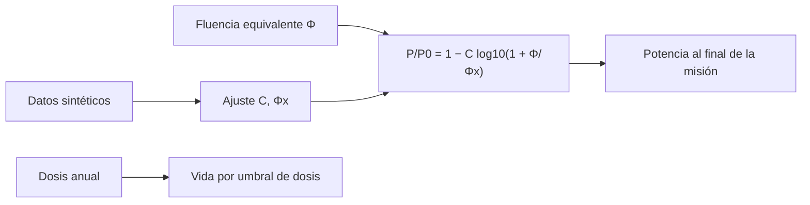

# B85-C24 — Efectos de la radiación ionizante en materiales y electrónica

<!-- nav:top -->
[🏠 Programa](../../../../README.md) · [📚 Bloque B85](../../../tronco-comun/B85-gestion-termica-y-entorno-espacial.md) · [← Anterior: B85-C23 — Dosímetros y monitores de radiación a bordo](../B85-C23-dosimetros-y-monitores-de-radiacion-a-bordo/CLASE.md) · [Siguiente: B85-C25 — Sensores y telemetría térmica →](../B85-C25-sensores-y-telemetria-termica/CLASE.md)
<!-- /nav -->

## 1. Ubicación, nivel y alcance

Clase 24 del bloque B85. Nivel N3. La radiación ionizante degrada los materiales y la electrónica de forma acumulativa: la dosis rompe enlaces en polímeros y el daño por desplazamiento reduce la potencia de las celdas solares. Aquí ajustas la pérdida de potencia de una celda sintética con una ley logarítmica de fluencia equivalente, la extrapolas a la misión y calculas la vida de materiales por umbral de dosis. No se consultó ninguna fuente y todos los parámetros son sintéticos.

## 2. Por qué esta clase existe

Una celda solar o un polímero no fallan de golpe: pierden prestaciones con la exposición. La decisión central: **¿cuánta potencia queda al final de la misión y cuánto cambia con un blindaje que reduce la fluencia?** La decisión central: **¿cuánta potencia queda al final de la misión y cuánto cambia con un blindaje que reduce la fluencia?**

## 3. Lo que podrás hacer al terminar

1. Ajustar `P/P₀ = 1 − C log₁₀(1 + Φ/Φₓ)` a datos sintéticos.
2. Extrapolar la potencia a la misión y calcular la inversa.
3. Calcular el efecto de un blindaje que reduce la fluencia.
4. Estimar la vida de materiales por umbral de dosis.
5. Contrastar el ajuste con los parámetros verdaderos.
6. Rotular todo como sintético.

La evidencia es la **ficha de daño por radiación en una celda** del ejercicio 12 (sección 20).

## 4. Con qué llegas y cómo comprobarlo

1. ¿Qué es el daño por desplazamiento?
2. ¿Qué es la fluencia equivalente?
3. ¿Qué es una dosis ionizante?
4. ¿Qué es una ley logarítmica de degradación?
5. ¿Qué es una verificación por segunda vía?

<details>
<summary>Ver respuestas</summary>

1. El desplazamiento de átomos de la red cristalina por partículas, que reduce el rendimiento de las celdas. 2. La fluencia de una partícula de referencia que causa el mismo daño que un espectro dado. 3. La energía absorbida por unidad de masa, en grays. 4. Una en que la pérdida crece con el logaritmo de la fluencia. 5. Calcular lo mismo con otro método y comparar.
</details>

Con cuatro o cinco aciertos, sigue; si no, repasa los prerrequisitos.

## 5. Un caso de contexto y casos de referencia

Con datos sintéticos, una celda pierde `5,8 %` de potencia tras 5 años con una tasa de `2 × 10¹¹ cm⁻²/año`; una matriz de `100 W` termina en `94,2 W`. El ajuste recupera `C = 0,188` y `Φₓ = 9,55 × 10¹¹ cm⁻²` frente a `0,19` y `10¹²`. Es el **ejemplo conductor**. Todo es **sintético**.

## 6. Vocabulario

La **ley de degradación** `P/P₀ = 1 − C log₁₀(1 + Φ/Φₓ)` (forma convencional de fluencia equivalente). El **NIEL** es la energía no ionizante depositada por unidad de longitud. La **dosis total ionizante** acumulada se compara con **umbrales** de material. La **inversa** `Φ = Φₓ(10^((1 − P/P₀)/C) − 1)` da la fluencia para una pérdida dada.

## 7. Modelo mental



*Descripción textual:* la fluencia entra en una ley logarítmica cuyos parámetros salen del ajuste; de ahí sale la potencia al final de la misión; la dosis anual y los umbrales dan la vida de los materiales.

Analogía: una pelota de tenis que pierde bote con cada partido, rápido al principio y luego más despacio. Límite: la ley de la clase es una forma convencional con parámetros sintéticos; las celdas reales se caracterizan con ensayos y con espectros de partículas.

## 8. La explicación, paso a paso

### 8.1 Datos

Datos sintéticos (`C = 0,19`, `Φₓ = 10¹² cm⁻²`, ruido `0,004`, semilla `20261110`):

| Fluencia (cm⁻²) | `P/P₀` |
|---|---|
| 1,00 × 10¹¹ | 0,9914 |
| 2,78 × 10¹¹ | 0,9821 |
| 7,74 × 10¹¹ | 0,9561 |
| 2,15 × 10¹² | 0,8998 |
| 5,99 × 10¹² | 0,8389 |
| 1,67 × 10¹³ | 0,7591 |
| 4,64 × 10¹³ | 0,6831 |
| 1,29 × 10¹⁴ | 0,6015 |
| 3,59 × 10¹⁴ | 0,5147 |
| 1,00 × 10¹⁵ | 0,4335 |

### 8.2 Ajuste y extrapolación

El ajuste da `C = 0,1877`, `Φₓ = 9,550 × 10¹¹ cm⁻²` y `RMS = 0,0025`. Con la tasa sintética `2 × 10¹¹ cm⁻²/año`, `P/P₀` a 5 años es `0,9416` (verdadera `0,9428`) y a 15 años `0,8842`. La fluencia para `P/P₀ = 0,80` es `1,015 × 10¹³ cm⁻²`, es decir `50,7` años; el residuo de la inversa es `0`.

### 8.3 Blindaje

Con un vidrio de cubierta que reduce la fluencia a la mitad, `P/P₀` a 5 años es `0,9657` en vez de `0,9416`; una matriz de `100 W` entrega `94,2 W` en lugar de `96,6 W`.

### 8.4 Materiales

Con una dosis anual sintética de `400 Gy` y umbrales sintéticos: polimero A (sintetico): `5` años; polimero B (sintetico): `50` años; elastomero (sintetico): `10` años. El umbral manda: el polímero A llega a su límite en 5 años y requiere blindaje o sustitución.

## 9. Magnitudes, símbolos y unidades

| Símbolo | Qué es | Unidad | Valor / nota |
|---|---|---|---|
| `C` | coeficiente de degradación | — | 0,1877 |
| `Φₓ` | fluencia característica | cm⁻² | 9,55 × 10¹¹ |
| `P/P₀` | potencia relativa a 5 años | — | 0,9416 |
| tasa | fluencia equivalente anual | cm⁻²/año | 2 × 10¹¹ (sintética) |
| dosis anual | dosis ionizante | Gy/año | 400 (sintética) |
| umbral | dosis de falla de un polímero | Gy | 2000; 20 000; 4000 (sintéticos) |

## 10. Convenciones y referencias

Todo sintético: ley logarítmica `C`, `Φₓ`, ruido `0,004`, semilla `20261110`, tasa de fluencia, dosis anual y umbrales. No se consultó ninguna fuente. Fluencia equivalente en cm⁻²; dosis en grays.

## 11. De dónde sale lo que afirmamos

| ID | Fuente | Localizador | Respalda | Estado |
|---|---|---|---|---|
| — | Ley logarítmica de degradación por fluencia equivalente, mínimos cuadrados y umbral de dosis | — | las verifica el laboratorio con una segunda vía | No consultada en una fuente concreta |

Límites: no se consultó ninguna fuente para esta clase; la ley y sus parámetros no son de una celda real ni de un material real; no se calcula NIEL a partir de un espectro; los umbrales de dosis no corresponden a ningún material.

## 12. Cómo ver el resultado

| Magnitud | Valor |
|---|---|
| `C` ajustado | 0,1877 |
| `Φₓ` ajustado | 9,55 × 10¹¹ cm⁻² |
| `P/P₀` a 5 años | 0,9416 |
| potencia EOL (100 W) | 94,2 W |
| vida polímero A | 5 años |

Descripción larga: el ajuste recupera la ley sintética; una matriz pierde alrededor del 6 % en 5 años con esta tasa y el polímero A llega a su umbral en 5 años.

## 13. Ejemplo trabajado

**Paso 1 · Fluencia a 5 años.** `5 × 2 × 10¹¹ = 10¹² cm⁻²`.

**Paso 2 · Potencia relativa.** `1 − 0,188 log₁₀(1 + 10¹²/9,55 × 10¹¹) = 0,9416`.

**Paso 3 · Matriz.** `100 × 0,9416 = 94,2 W`.

## 14. Distintas formas de describir el problema

**Por ley:** `P/P₀`. **Por ajuste:** `C`, `Φₓ`. **Por inversa:** `Φ(P/P₀)`. **Por umbral:** `años = umbral/dosis`.

## 15. Práctica guiada

**Ejercicio 1 · con los pasos indicados.** Calcula `P/P₀` con `Φ = Φₓ` y `C = 0,19`. *Pasos:* `1 − 0,19 log₁₀ 2`.

<details><summary>Solución comentada</summary>

`0,9428`.
</details>

**Ejercicio 2 · con una pista.** Predice si `P/P₀` a `10¹⁴` es menor que `0,6`. *Pista:* `log₁₀(100)`.

<details><summary>Solución comentada</summary>

`1 − 0,19 × 2,0 = 0,62`; no es menor que `0,6`.
</details>

**Ejercicio 3 · casi autónomo.** ¿Por qué el ajuste recupera `C` con error de 1 %? Piensa en el ruido y en los puntos.

<details><summary>Solución comentada</summary>

El ruido es pequeño frente a la señal y hay diez puntos en cuatro décadas.
</details>

## 16. Práctica autónoma, transferencia e integrador

**Ejercicio 4 · autónomo.** Calcula la fluencia para `P/P₀ = 0,9`.

<details><summary>Solución comentada</summary>

`2,30 × 10¹² cm⁻²`.
</details>

**Ejercicio 5 · autónomo.** Calcula `P/P₀` si la tasa es `4 × 10¹¹` y la misión de 10 años.

<details><summary>Solución comentada</summary>

`0,8658`.
</details>

**Ejercicio 6 · autónomo.** ¿Cuántos años a `2 × 10¹¹` hasta `0,85`?

<details><summary>Solución comentada</summary>

`25,3`.
</details>

**Ejercicio 7 · autónomo.** Calcula la vida de un material con umbral `10⁴ Gy` y `250 Gy/año`.

<details><summary>Solución comentada</summary>

`40` años.
</details>

**Ejercicio 8 · autónomo.** ¿Qué blindaje reduce la fluencia a un tercio? Calcula `P/P₀` a 5 años.

<details><summary>Solución comentada</summary>

`0,9756`.
</details>

**Ejercicio 9 · transferencia.** **Transferencia.** Una celda de otro tipo tiene `C = 0,3`. ¿Qué pasa?

<details><summary>Solución comentada</summary>

`P/P₀ = 0,9067` a 5 años: pierde más.
</details>

**Ejercicio 10 · transferencia.** **Transferencia.** ¿Por qué la pérdida crece menos que linealmente con la fluencia?

<details><summary>Solución comentada</summary>

La forma logarítmica satura: los defectos nuevos importan menos cuando ya hay muchos.
</details>

**Ejercicio 11 · transferencia.** **Transferencia.** Un colega presenta `94 W` como «la potencia de nuestra matriz al final de la vida». ¿Qué corriges?

<details><summary>Solución comentada</summary>

Es un cálculo con una ley sintética, no una predicción de una celda real.
</details>

**Ejercicio 12 · integrador.** **Integrador.** Elabora tu *ficha de daño por radiación en una celda*: datos, ajuste, extrapolación, efecto del blindaje, vida de materiales y lista de lo sintético.

<details><summary>Solución comentada</summary>

Secciones 8.1–8.4 y la salida del laboratorio.
</details>

## 17. Laboratorio: degradación de una celda solar

El script [radiacion_ionizante.py](radiacion_ionizante.py) genera datos sintéticos, ajusta `C` y `Φₓ`, extrapola a 5 y 15 años, calcula la inversa y la vida de materiales (**comprueba** `C` a 0,02, residuo de la inversa < 1e-9 y extrapolación a 0,01).

**Datos:** todo **sintético** (ley, ruido, semilla, tasa, umbrales). **Predice antes de ejecutar:** ¿cuánta potencia queda a 5 años? (94 %.) **Ejecución del 2026-11-10 (Python 3.12.9):**

```text
Python 3.12.9 (biblioteca estandar)
Celda SINTETICA: P/P0 = 1 - 0.19 log10(1 + F/1e+12) ; ruido 0.004 ; semilla 20261110
Fluencia [cm-2]   P/P0
   1.000e+11   0.9914
   2.783e+11   0.9821
   7.743e+11   0.9561
   2.154e+12   0.8998
   5.995e+12   0.8389
   1.668e+13   0.7591
   4.642e+13   0.6831
   1.292e+14   0.6015
   3.594e+14   0.5147
   1.000e+15   0.4335
Ajuste: C = 0.1877 (verdadero 0.19) ; Fx = 9.550e+11 (verdadero 1e+12) ; RMS = 0.0025
Tasa SINTETICA 2.0e+11 cm-2/anio: P/P0 a 5 anios = 0.9416 (verdadera 0.9428) ; a 15 anios = 0.8842
Fluencia para P/P0 = 0.80: 1.015e+13 cm-2 = 50.7 anios ; residuo de la inversa = 0.0e+00
Con un blindaje que reduce la fluencia a la mitad, P/P0 a 5 anios = 0.9657 ; potencia EOL de una matriz de 100 W = 94.2 W
Vida por umbral de dosis (dosis anual SINTETICA 400 Gy): polimero A (sintetico): 5 anios; polimero B (sintetico): 50 anios; elastomero (sintetico): 10 anios
Pruebas superadas.
```

```bash
python programa/clases/B85/B85-C24-efectos-de-la-radiacion-ionizante-en-materiales-y-electronica/radiacion_ionizante.py
```

**Límites:** forma convencional con parámetros sintéticos; sin espectro de partículas ni dependencia de temperatura.

## 18. Errores frecuentes y cómo corregirlos

**Extrapolar sin validar.** la ley se ajusta en un rango (8.2)

**Confundir dosis ionizante con fluencia equivalente.** son cantidades distintas (sección 6)

**Aplicar un umbral sin margen.** se necesita margen (8.4)

**Presentar la ley como de una celda real.** se corrige con la sección 10

## 19. Cómo sabrás que vas bien

Tras la sección 8: ¿qué resultado esperabas (la potencia relativa a 5 años) y cuál obtuviste? Si dudas, repasa el ejemplo 13. Tras el laboratorio: ¿qué comprueba? (ver la sección 17).

## 20. Qué entregas y cómo se evalúa

El producto es tu **ficha de daño por radiación en una celda** (ejercicio 12).

| Criterio | Inicial | En desarrollo | Logrado | Destacado |
|---|---|---|---|---|
| Conceptos | Los confunde | Parciales | Ajusta y extrapola | Explica los límites |
| Cálculo | Sin unidades | Con errores | Tablas completas con unidades | Calcula casos nuevos |
| Numérico | Sin comprobar | Un caso | Contraste con una segunda vía | Interpreta las diferencias |
| Fuentes | Sin fuente | Sin fecha | Fuentes con fecha y estado | Declara lo ilustrativo y lo no consultado |
| Límites | No los nombra | Uno | Tres | Discute qué falta del modelo |

**Condiciones críticas (no se compensan con promedio):** rotular los datos ilustrativos o sintéticos como tales; no presentar un resultado modelado como medición; citar solo lo consultado.

## 21. Ética, seguridad y límites

Clase educativa: los modelos son simplificados y sus datos son sintéticos o ilustrativos; ningún resultado describe una nave real, ni sustituye a los estándares de proyecto, a la verificación con datos de misión ni a una revisión disciplinar. Los valores de este texto no son requisitos de ningún proyecto. Accesibilidad: tablas equivalentes a las gráficas, fórmulas en texto, ejercicios sin conexión.

## 22. Para cerrar y seguir

Con una ley sintética, una matriz de 100 W termina en `94 W` tras 5 años y el polímero A alcanza su umbral en `5` años. Queda una pregunta: ¿cómo se mide la temperatura en vuelo?

**Glosario español–inglés.** daño por desplazamiento · *displacement damage*; fluencia equivalente · *equivalent fluence*; dosis total ionizante · *total ionizing dose*; degradación · *degradation*; umbral · *threshold*.

**Continuidad.** [B85-C25](../B85-C25-sensores-y-telemetria-termica/CLASE.md) estudia los sensores y la telemetría térmica.

**Referencias:** ver sección 11.

<!-- nav:bottom -->
---

[← Anterior: B85-C23 — Dosímetros y monitores de radiación a bordo](../B85-C23-dosimetros-y-monitores-de-radiacion-a-bordo/CLASE.md) · [📚 Bloque B85](../../../tronco-comun/B85-gestion-termica-y-entorno-espacial.md) · [Siguiente: B85-C25 — Sensores y telemetría térmica →](../B85-C25-sensores-y-telemetria-termica/CLASE.md)
<!-- /nav -->
