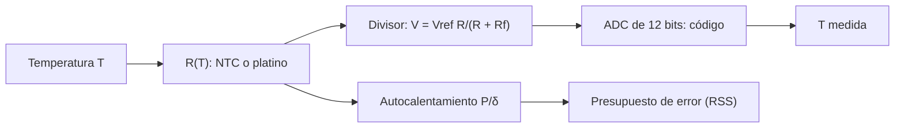

# B85-C25 — Sensores y telemetría térmica

<!-- nav:top -->
[🏠 Programa](../../../../README.md) · [📚 Bloque B85](../../../tronco-comun/B85-gestion-termica-y-entorno-espacial.md) · [← Anterior: B85-C24 — Efectos de la radiación ionizante en materiales y electrónica](../B85-C24-efectos-de-la-radiacion-ionizante-en-materiales-y-electronica/CLASE.md) · [Siguiente: B85-C26 — Análisis térmico transitorio y casos extremos →](../B85-C26-analisis-termico-transitorio-y-casos-extremos/CLASE.md)
<!-- /nav -->

## 1. Ubicación, nivel y alcance

Clase 25 del bloque B85. Nivel N3. La telemetría térmica convierte la resistencia de un sensor en una temperatura con un divisor de tensión y un conversor analógico-digital. Aquí modelas un termistor NTC y un sensor de platino, calculas el código del ADC, la resolución en kelvin, el autocalentamiento y un presupuesto de error en `300 K`. Los parámetros del sensor son ilustrativos y no se consultaron; solo se consultó que los calentadores se controlan con termostato o sensor.

## 2. Por qué esta clase existe

Una temperatura mal medida lleva a una decisión errónea de control o de margen. La decisión central: **¿qué error total tiene la cadena de medida a una temperatura dada y qué término lo domina?** La decisión central: **¿qué error total tiene la cadena de medida a una temperatura dada y qué término lo domina?**

## 3. Lo que podrás hacer al terminar

1. Modelar un NTC con la ecuación `β` y su inversa.
2. Calcular el código del ADC en un divisor de tensión.
3. Calcular la resolución en K por cuenta según la temperatura.
4. Calcular el autocalentamiento.
5. Modelar un sensor de platino con Callendar–Van Dusen y su inversa cuadrática.
6. Sumar errores en cuadratura (RSS).

La evidencia es la **presupuesto de error de una cadena de medida** del ejercicio 12 (sección 20).

## 4. Con qué llegas y cómo comprobarlo

1. ¿Cómo varía la resistencia de un NTC?
2. ¿Qué es un divisor de tensión?
3. ¿Cuántos códigos tiene un ADC de 12 bits?
4. ¿Qué es el autocalentamiento?
5. ¿Qué es una suma en cuadratura?

<details>
<summary>Ver respuestas</summary>

1. Disminuye al subir la temperatura, aproximadamente `R = R₀ exp(β(1/T − 1/T₀))`. 2. Dos resistencias en serie: `V = V_ref R/(R + R_f)`. 3. `2¹² = 4096`. 4. El calentamiento del sensor por la corriente de medida, `P/δ`. 5. La raíz de la suma de cuadrados de errores independientes.
</details>

Con cuatro o cinco aciertos, sigue; si no, repasa los prerrequisitos.

## 5. Un caso de contexto y casos de referencia

Un NTC de `10 kΩ`, `β = 3950 K`, en un divisor de `10 kΩ` con `3,3 V` y un ADC de 12 bits, mide a `300 K` con un error de `0,24 K` (RSS), dominado por el autocalentamiento (`0,181 K`). Es el **ejemplo conductor**. Todo es **ilustrativo y no consultado**.

## 6. Vocabulario

La **ecuación `β`** `R = R₀ exp(β(1/T − 1/T₀))`. El **divisor** entrega `V = V_ref R/(R + R_f)`. La **cuantización** da pasos de `V_ref/2¹²`. El **autocalentamiento** `ΔT = P/δ` con `δ` la constante de disipación. **Callendar–Van Dusen**: `R = R₀(1 + A T + B T²)` para `T > 0 °C`. El **RSS** suma errores independientes en cuadratura.

## 7. Modelo mental



*Descripción textual:* la temperatura define la resistencia del sensor, que el divisor convierte en tensión y el ADC en un código; de ahí se invierte la temperatura; el autocalentamiento y otros términos forman el presupuesto de error.

Analogía: medir la temperatura de un vaso con un termómetro tibio: el propio termómetro altera lo que mide, y la regla tiene marcas. Límite: el modelo `β` es una aproximación en un rango; el termistor real se calibra con Steinhart–Hart o con tablas.

## 8. La explicación, paso a paso

### 8.1 NTC y código

| `T` (K) | `R` (Ω) | `V` (V) | código | paso (K/cuenta) |
|---|---|---|---|---|
| 200,00 | 6662300,8 | 3,2951 | 4089 | 2,0000 |
| 250,00 | 128280,6 | 3,0614 | 3799 | 0,0588 |
| 298,15 | 10000,0 | 1,6500 | 2048 | 0,0220 |
| 350,00 | 1404,9 | 0,4065 | 504 | 0,0690 |
| 400,00 | 342,7 | 0,1094 | 135 | 0,2857 |

La ida y vuelta `T → R → T` se recupera con error `1,0 × 10⁻³⁰ K`. A `200 K` el divisor se satura (`R` de `6,7 MΩ` frente a `10 kΩ`) y el paso es de `2 K` por cuenta; el máximo de resolución está cerca de `T₀`.

### 8.2 Autocalentamiento

Con `δ = 1,5 mW/K`: `250 K`: `73,1 µW` → `48,71 mK`; `300 K`: `271,8 µW` → `181,20 mK`; `350 K`: `117,6 µW` → `78,41 mK`. El máximo está donde `R = R_f`, que aquí es cerca de `T₀`.

### 8.3 Platino

`R(0 °C) = 100 Ω`; `0 °C`: `100,000 Ω`; `50 °C`: `119,397 Ω`; `100 °C`: `138,505 Ω`; `150 °C`: `157,325 Ω`. La inversa cuadrática cerrada devuelve la temperatura con error `3,1 × 10⁻¹³ °C` (`A` y `B` tomados de memoria, no consultados).

### 8.4 Presupuesto a 300 K

Cuantización `0,0111 K`, autocalentamiento `0,1812 K`, tolerancia de `β` (1 %) `0,0186 K` y referencia (`0,1 %`) `0,150 K`: RSS `0,2362 K`. Domina el autocalentamiento; se reduce bajando la tensión de excitación o usando un pulso de medida.

## 9. Magnitudes, símbolos y unidades

| Símbolo | Qué es | Unidad | Valor / nota |
|---|---|---|---|
| `R₀` | resistencia a `T₀` | Ω | 10 000 a 298,15 K |
| `β` | parámetro del NTC | K | 3950 (ilustrativo) |
| `V_ref` | tensión de referencia | V | 3,3 |
| ADC | resolución | bits | 12 |
| `δ` | constante de disipación | mW/K | 1,5 (ilustrativa) |
| RSS | error total a 300 K | K | 0,236 |

## 10. Convenciones y referencias

Todos los parámetros son ilustrativos y no consultados (`β`, `R₀`, `A`, `B` del platino, `δ`, tolerancias); IEC 60751 no se consultó. NTC en la rama baja del divisor. Temperaturas en kelvin salvo el platino, en °C.

## 11. De dónde sale lo que afirmamos

| ID | Fuente | Localizador | Respalda | Estado |
|---|---|---|---|---|
| S1 | NASA, State-of-the-Art of Small Spacecraft Technology, capítulo Thermal Control — https://www.nasa.gov/smallsat-institute/sst-soa/thermal-control/ (consultada 2026-11-10) | sección de calentadores | los calentadores se controlan con termostato o sensor de temperatura; la página no da tipos ni precisiones de sensores | Consultada |
| — | Ecuación `β` de un NTC, divisor de tensión, cuantización y relación de Callendar–Van Dusen | — | las verifica el laboratorio con una segunda vía | No consultada en una fuente concreta |

Límites: los parámetros de los sensores y sus tolerancias no se consultaron; no se dan precisiones de sensores de ningún fabricante; no se trata el ruido electrónico ni la deriva; no se trata la calibración Steinhart–Hart.

## 12. Cómo ver el resultado

| Magnitud | Valor |
|---|---|
| código a 300 K | 2048 |
| paso a 298 K | 0,0220 K/cuenta |
| autocalentamiento 300 K | 0,181 K |
| RSS | 0,236 K |
| ida y vuelta | 1,0 × 10⁻³⁰ K |

Descripción larga: la resolución es mejor cerca de `T₀` y mala en los extremos; el autocalentamiento domina el error a 300 K.

## 13. Ejemplo trabajado

**Paso 1 · Resistencia.** `R = 10 000 exp(3950(1/300 − 1/298,15)) = 9215,5 Ω`.

**Paso 2 · Tensión y código.** `V = 1,5826 V`; código `1964`.

**Paso 3 · Error.** `√(0,0111² + 0,1812² + 0,0186² + 0,150²) = 0,236 K`.

## 14. Distintas formas de describir el problema

**Por modelo:** `R(T)`. **Por electrónica:** `V` y código. **Por inversa:** `T(código)`. **Por error:** RSS.

## 15. Práctica guiada

**Ejercicio 1 · con los pasos indicados.** Calcula `R` del NTC a `298,15 K`. *Pasos:* `T = T₀`.

<details><summary>Solución comentada</summary>

`10 000 Ω`.
</details>

**Ejercicio 2 · con una pista.** Predice `V` cuando `R = R_f`. *Pista:* divisor simétrico.

<details><summary>Solución comentada</summary>

`1,65 V`, la mitad de `V_ref`.
</details>

**Ejercicio 3 · casi autónomo.** ¿Por qué el paso es de `2 K` a `200 K`? Piensa en el divisor saturado.

<details><summary>Solución comentada</summary>

Casi no cambia `V` con `T`: la cuenta del ADC apenas varía.
</details>

## 16. Práctica autónoma, transferencia e integrador

**Ejercicio 4 · autónomo.** Calcula el paso de cuantización en voltios.

<details><summary>Solución comentada</summary>

`3,3/4096 = 8,06 × 10⁻⁴ V`.
</details>

**Ejercicio 5 · autónomo.** Calcula `R` del platino a `100 °C`.

<details><summary>Solución comentada</summary>

`138,505 Ω`.
</details>

**Ejercicio 6 · autónomo.** Calcula el autocalentamiento a `298,15 K` con `δ = 3 mW/K`.

<details><summary>Solución comentada</summary>

`90,6 mK` (aprox.).
</details>

**Ejercicio 7 · autónomo.** ¿Cómo cambia el autocalentamiento si la excitación baja a la mitad?

<details><summary>Solución comentada</summary>

Se divide por 4: `P ∝ V²`.
</details>

**Ejercicio 8 · autónomo.** Calcula el RSS sin el autocalentamiento.

<details><summary>Solución comentada</summary>

`0,152 K`.
</details>

**Ejercicio 9 · transferencia.** **Transferencia.** Un sensor de platino mide `119,4 Ω`. ¿Qué temperatura?

<details><summary>Solución comentada</summary>

`50,01 °C`.
</details>

**Ejercicio 10 · transferencia.** **Transferencia.** Un NTC es poco sensible a `200 K`. ¿Qué alternativa hay para criogenia?

<details><summary>Solución comentada</summary>

Sensores diseñados para esa banda (diodos de silicio, platino hasta bajas temperaturas); aquí no se calcularon ni se consultaron.
</details>

**Ejercicio 11 · transferencia.** **Transferencia.** Un colega presenta `0,24 K` como «la exactitud de nuestro sensor». ¿Qué corriges?

<details><summary>Solución comentada</summary>

Es un presupuesto con parámetros ilustrativos, no una especificación ni una calibración.
</details>

**Ejercicio 12 · integrador.** **Integrador.** Elabora tu *presupuesto de error de una cadena de medida*: código, resolución, autocalentamiento, platino, RSS y lista de lo consultado, ilustrativo y no consultado.

<details><summary>Solución comentada</summary>

Secciones 8.1–8.4 y la salida del laboratorio.
</details>

## 17. Laboratorio: cadena de medida con NTC y platino

El script [sensores_termicos.py](sensores_termicos.py) calcula resistencia, código y resolución del NTC, el autocalentamiento, el platino con su inversa y el presupuesto de error (**comprueba** ida y vuelta a 1e-9, inversa del platino a 1e-9 y `R(0 °C) = 100 Ω`).

**Datos:** todo **ilustrativo y no consultado**. **Predice antes de ejecutar:** ¿dónde es mejor la resolución del NTC? (cerca de `T₀`, `0,022 K/cuenta`.) **Ejecución del 2026-11-10 (Python 3.12.9):**

```text
Python 3.12.9 (biblioteca estandar)
NTC ILUSTRATIVO: R0 = 10000 ohm a 298.15 K, beta = 3950 K ; divisor con 10000 ohm y Vref = 3.3 V ; ADC de 12 bits
  T [K]       R [ohm]    V [V]  codigo  paso [K/cuenta]
 200.00     6662300.8   3.2951    4089           2.0000
 250.00      128280.6   3.0614    3799           0.0588
 298.15       10000.0   1.6500    2048           0.0220
 350.00        1404.9   0.4065     504           0.0690
 400.00         342.7   0.1094     135           0.2857
Ida y vuelta T -> R -> T: error maximo = 0.00e+00 K
Autocalentamiento: 250 K: 73.1 uW -> 48.71 mK; 300 K: 271.8 uW -> 181.20 mK; 350 K: 117.6 uW -> 78.41 mK
Platino (A = 3.9083e-3, B = -5.775e-7, no consultados): 0 C: 100.000 ohm; 50 C: 119.397 ohm; 100 C: 138.505 ohm; 150 C: 157.325 ohm ; error de la inversa = 3.1e-13 C
Presupuesto de error a 300 K: cuantizacion = 0.0111 K; autocalentamiento = 0.1812 K; beta = 0.0186 K; referencia = 0.1500 K ; RSS = 0.2362 K
Pruebas superadas.
```

```bash
python programa/clases/B85/B85-C25-sensores-y-telemetria-termica/sensores_termicos.py
```

**Límites:** modelo `β` de un rango, sin ruido electrónico ni deriva.

## 18. Errores frecuentes y cómo corregirlos

**Medir con corriente alta.** el autocalentamiento domina (8.2)

**Usar el NTC fuera del rango del divisor.** se satura (8.1)

**Mezclar K y °C.** platino en °C, NTC en K (sección 10)

**Presentar el RSS como especificación.** se corrige con la sección 10

## 19. Cómo sabrás que vas bien

Tras la sección 8: ¿qué resultado esperabas (el error total a 300 K) y cuál obtuviste? Si dudas, repasa el ejemplo 13. Tras el laboratorio: ¿qué comprueba? (ver la sección 17).

## 20. Qué entregas y cómo se evalúa

El producto es tu **presupuesto de error de una cadena de medida** (ejercicio 12).

| Criterio | Inicial | En desarrollo | Logrado | Destacado |
|---|---|---|---|---|
| Conceptos | Los confunde | Parciales | Calcula la cadena y el error | Explica los límites |
| Cálculo | Sin unidades | Con errores | Tablas completas con unidades | Calcula casos nuevos |
| Numérico | Sin comprobar | Un caso | Contraste con una segunda vía | Interpreta las diferencias |
| Fuentes | Sin fuente | Sin fecha | Fuentes con fecha y estado | Declara lo ilustrativo y lo no consultado |
| Límites | No los nombra | Uno | Tres | Discute qué falta del modelo |

**Condiciones críticas (no se compensan con promedio):** rotular los datos ilustrativos o sintéticos como tales; no presentar un resultado modelado como medición; citar solo lo consultado.

## 21. Ética, seguridad y límites

Clase educativa: los modelos son simplificados y sus datos son sintéticos o ilustrativos; ningún resultado describe una nave real, ni sustituye a los estándares de proyecto, a la verificación con datos de misión ni a una revisión disciplinar. Los valores de este texto no son requisitos de ningún proyecto. Accesibilidad: tablas equivalentes a las gráficas, fórmulas en texto, ejercicios sin conexión.

## 22. Para cerrar y seguir

A 300 K el NTC ilustrativo mide con `0,24 K` de error total, dominado por el autocalentamiento. Queda una pregunta: ¿qué ocurre con la temperatura en los transitorios y en los casos extremos?

**Glosario español–inglés.** termistor · *thermistor*; divisor de tensión · *voltage divider*; cuantización · *quantization*; autocalentamiento · *self-heating*; telemetría · *telemetry*.

**Continuidad.** [B85-C26](../B85-C26-analisis-termico-transitorio-y-casos-extremos/CLASE.md) estudia el análisis térmico transitorio y los casos extremos.

**Referencias:** ver sección 11.

<!-- nav:bottom -->
---

[← Anterior: B85-C24 — Efectos de la radiación ionizante en materiales y electrónica](../B85-C24-efectos-de-la-radiacion-ionizante-en-materiales-y-electronica/CLASE.md) · [📚 Bloque B85](../../../tronco-comun/B85-gestion-termica-y-entorno-espacial.md) · [Siguiente: B85-C26 — Análisis térmico transitorio y casos extremos →](../B85-C26-analisis-termico-transitorio-y-casos-extremos/CLASE.md)
<!-- /nav -->
