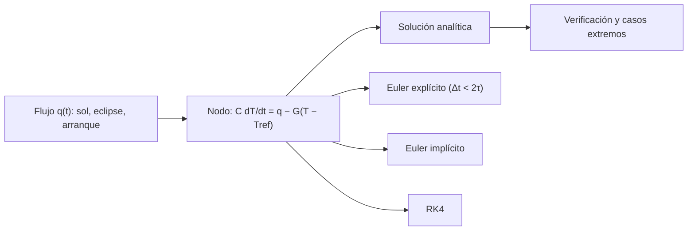

# B85-C26 — Análisis térmico transitorio y casos extremos

<!-- nav:top -->
[🏠 Programa](../../../../README.md) · [📚 Bloque B85](../../../tronco-comun/B85-gestion-termica-y-entorno-espacial.md) · [← Anterior: B85-C25 — Sensores y telemetría térmica](../B85-C25-sensores-y-telemetria-termica/CLASE.md) · [Siguiente: B85-C27 — Márgenes y correlación térmica →](../B85-C27-margenes-y-correlacion-termica/CLASE.md)
<!-- /nav -->

## 1. Ubicación, nivel y alcance

Clase 26 del bloque B85. Nivel N3. Los casos de diseño térmico son transitorios: un eclipse largo, el arranque de un instrumento. Aquí obtienes la respuesta analítica de un nodo, la comparas con Euler explícito, Euler implícito y RK4 para varios pasos, ves el límite de estabilidad `Δt < 2τ` y calculas la mínima de un eclipse extendido y el tiempo que tarda un instrumento en alcanzar un límite tras arrancar. Todo es sintético.

## 2. Por qué esta clase existe

El peor caso de temperatura casi nunca es el de régimen. La decisión central: **¿qué paso de tiempo y qué esquema dan una respuesta fiable y cuál es la temperatura extrema en el eclipse o en el arranque?** La decisión central: **¿qué paso de tiempo y qué esquema dan una respuesta fiable y cuál es la temperatura extrema en el eclipse o en el arranque?**

## 3. Lo que podrás hacer al terminar

1. Obtener la respuesta analítica de un nodo a un escalón.
2. Comparar Euler explícito, implícito y RK4 con distintos pasos.
3. Reconocer el límite de estabilidad `Δt < 2τ`.
4. Calcular la oscilación periódica y el caso de eclipse extendido.
5. Calcular el tiempo hasta un límite tras un arranque.
6. Rotular los datos como sintéticos.

La evidencia es la **ficha de análisis transitorio de un caso extremo** del ejercicio 12 (sección 20).

## 4. Con qué llegas y cómo comprobarlo

1. ¿Qué es la constante de tiempo de un nodo?
2. ¿Qué es Euler explícito?
3. ¿Qué es la estabilidad numérica?
4. ¿Qué es un caso extremo?
5. ¿Qué es una verificación por segunda vía?

<details>
<summary>Ver respuestas</summary>

1. `τ = C/G`. 2. Un esquema `x₊ = x + Δt f(x)`. 3. Que los errores no crezcan al avanzar en el tiempo. 4. El caso de diseño que más exige a un límite de temperatura. 5. Calcular lo mismo con otro método y comparar.
</details>

Con cuatro o cinco aciertos, sigue; si no, repasa los prerrequisitos.

## 5. Un caso de contexto y casos de referencia

Un nodo de `1000 J/K` y `1 W/K` (`τ = 1000 s`) sigue un escalón de `40 W` con error de `0,022 K` con Euler explícito de `10 s`; con `2100 s` (más de `2τ`) el explícito da `323 K` frente a `288,5 K` real. Un eclipse un `50 %` más largo baja la mínima a `256,7 K`. Es el **ejemplo conductor**. Todo es **sintético**.

## 6. Vocabulario

La **respuesta a un escalón** `T(t) = T_eq + (T₀ − T_eq)e^(−t/τ)`. **Euler explícito** es estable si `Δt < 2τ`. **Euler implícito** es estable siempre (aquí, `x₊ = (x + Δt(q + G T_ref)/C)/(1 + Δt G/C)`). **RK4** es de cuarto orden. El **caso extremo** es el de menor o mayor temperatura de diseño. El **tiempo de asentamiento al 95 %** es `τ ln 20`.

## 7. Modelo mental



*Descripción textual:* el flujo en cada tramo entra en el nodo; la solución analítica sirve de referencia para los tres esquemas numéricos; con ella se evalúan los casos extremos.

Analogía: llenar una bañera con desagüe: el nivel tiende a un equilibrio con la constante `τ`; si miras el nivel solo cada muchas horas, el cálculo con una regla simple se descontrola. Límite: nodo lineal con una sola constante de tiempo; un modelo real tiene muchas.

## 8. La explicación, paso a paso

### 8.1 Esquemas y pasos

Escalón de `40 W` desde `260 K` durante `3000 s` (`T_eq = 290 K`, referencia `288,5064 K`):

| `Δt` (s) | explícito (K) | implícito (K) | RK4 (K) |
|---|---|---|---|
| 10 | 288,5288 | 288,4840 | 288,5064 |
| 100 | 288,7283 | 288,2807 | 288,5064 |
| 500 | 289,5312 | 287,3663 | 288,5028 |
| 1000 | 290,0000 | 286,2500 | 288,4180 |
| 2100 | 323,0000 | 280,3226 | 278,8449 |

Con `Δt = 10 s`, ambos esquemas simples están a menos de `0,05 K`; RK4 es casi exacto (`1e-6`). Con `Δt = 2100 s` (`> 2τ = 2000 s`) el explícito se aparta `34 K` por inestabilidad; el implícito sigue estable pero impreciso.

### 8.2 Órbita periódica

Con `3300 s` al sol (`45 W`) y `2100 s` en eclipse (`5 W`), el nodo oscila entre `259,739 K` y `293,699 K`. Un eclipse un `50 %` más largo (`3150 s`) baja la mínima a `256,658 K`: `3,081 K` menos.

### 8.3 Arranque

Un instrumento de `30 W` arranca con la temperatura mínima: el equilibrio es `325,0 K` y el nodo llega a `300 K` en `960 s`: hay `~16 min` para actuar antes del límite.

### 8.4 Qué decide

El `95 %` del cambio se completa en `2996 s`. Para un análisis fiable se usa un paso menor que `τ/10` en explícito, o implícito con control del error; el caso extremo se busca variando duración y fase del eclipse y tiempos de arranque.

## 9. Magnitudes, símbolos y unidades

| Símbolo | Qué es | Unidad | Valor / nota |
|---|---|---|---|
| `τ` | constante de tiempo | s | 1000 |
| `Δt` | paso de integración | s | 10–2100 |
| `T_eq` | equilibrio del escalón | K | 290 |
| `T_min` | mínima periódica | K | 259,74 |
| `T_min` extremo | eclipse 1,5× | K | 256,66 |
| `t_lim` | tiempo al límite tras arranque | s | 960 |

## 10. Convenciones y referencias

Nodo con `C = 1000 J/K`, `G = 1 W/K`, `T_ref = 250 K`; órbita y arranque sintéticos; límite de `300 K` ilustrativo. No se consultó ninguna fuente. Esquemas con paso fijo.

## 11. De dónde sale lo que afirmamos

| ID | Fuente | Localizador | Respalda | Estado |
|---|---|---|---|---|
| — | Respuesta exponencial de primer orden y estabilidad de Euler, implícito y RK4 | — | las verifica el laboratorio con una segunda vía | No consultada en una fuente concreta |

Límites: no se consultó ninguna fuente para esta clase; el nodo y los casos son sintéticos; no se analiza un diseño real; ECSS no se consultó.

## 12. Cómo ver el resultado

| Magnitud | Valor |
|---|---|
| referencia a 3000 s | 288,5064 K |
| explícito `Δt = 10 s` | 288,5288 K |
| RK4 `Δt = 10 s` | 288,5064 K |
| `T_min` extremo | 256,66 K |
| tiempo al límite | 960 s |

Descripción larga: los tres esquemas coinciden con pasos chicos; el explícito se descontrola por encima de `2τ`; un eclipse más largo baja la mínima unos 3 K.

## 13. Ejemplo trabajado

**Paso 1 · Equilibrio.** `T_eq = 250 + 40/1 = 290 K`.

**Paso 2 · Analítica.** `290 + (260 − 290) e^(−3) = 288,5064 K`.

**Paso 3 · Explícito `Δt = 100 s`.** `288,7283 K`, error `0,222 K`.

## 14. Distintas formas de describir el problema

**Por analítica:** exponencial. **Por esquema:** explícito, implícito, RK4. **Por estabilidad:** `Δt < 2τ`. **Por caso:** extremo.

## 15. Práctica guiada

**Ejercicio 1 · con los pasos indicados.** Calcula `τ` con `C = 1000` y `G = 1`. *Pasos:* `C/G`.

<details><summary>Solución comentada</summary>

`1000 s`.
</details>

**Ejercicio 2 · con una pista.** Predice si Euler explícito con `Δt = 500 s` es estable. *Pista:* `2τ`.

<details><summary>Solución comentada</summary>

Sí: `500 < 2000`.
</details>

**Ejercicio 3 · casi autónomo.** ¿Por qué RK4 coincide a `1e-6` con `Δt = 10 s`? Piensa en el orden.

<details><summary>Solución comentada</summary>

Es de cuarto orden; el error global es `O(Δt⁴)`.
</details>

## 16. Práctica autónoma, transferencia e integrador

**Ejercicio 4 · autónomo.** Calcula el tiempo de asentamiento al `99 %`.

<details><summary>Solución comentada</summary>

`τ ln 100 = 4605 s`.
</details>

**Ejercicio 5 · autónomo.** Calcula `T` a `t = τ` para un escalón de `30 K` desde `T_eq − 30`.

<details><summary>Solución comentada</summary>

`T_eq − 30 e^(−1) = T_eq − 11,04 K`.
</details>

**Ejercicio 6 · autónomo.** ¿Qué pasa si `C = 4000 J/K`?

<details><summary>Solución comentada</summary>

`τ = 4000 s` y el análisis explícito admite pasos mayores (`< 8000 s`).
</details>

**Ejercicio 7 · autónomo.** Calcula `T_min` con un eclipse `2×` más largo.

<details><summary>Solución comentada</summary>

`255,580 K`.
</details>

**Ejercicio 8 · autónomo.** ¿Cuánto tiempo al límite si el instrumento es de `20 W`?

<details><summary>Solución comentada</summary>

`T_eq = 315,0 K`; `t = 1304 s`.
</details>

**Ejercicio 9 · transferencia.** **Transferencia.** Un ingeniero usa explícito con `Δt = 3000 s`. ¿Qué pasa?

<details><summary>Solución comentada</summary>

Es inestable (`> 2τ`); el resultado oscila y diverge.
</details>

**Ejercicio 10 · transferencia.** **Transferencia.** ¿Qué paso se usa en explícito para tener error menor que `0,1 K` en este caso?

<details><summary>Solución comentada</summary>

Con `Δt = 10 s` el error es `0,02 K`; con `100 s`, `0,22 K`; hace falta `Δt ≲ 40 s`.
</details>

**Ejercicio 11 · transferencia.** **Transferencia.** Un colega presenta `256,7 K` como «la mínima del eclipse extendido de nuestra nave». ¿Qué corriges?

<details><summary>Solución comentada</summary>

Es un resultado de un nodo sintético.
</details>

**Ejercicio 12 · integrador.** **Integrador.** Elabora tu *ficha de análisis transitorio de un caso extremo*: tabla de esquemas y pasos, oscilación periódica, eclipse extendido, arranque y lista de lo sintético.

<details><summary>Solución comentada</summary>

Secciones 8.1–8.4 y la salida del laboratorio.
</details>

## 17. Laboratorio: esquemas de integración y casos extremos

El script [transitorio.py](transitorio.py) compara Euler explícito, implícito y RK4 con la solución analítica para cinco pasos, y calcula la mínima extrema y el tiempo al límite (**comprueba** pasos pequeños a 0,5 K, RK4 a 1e-6 y apartamiento del explícito con `Δt = 2,1τ`).

**Datos:** todo **sintético**. **Predice antes de ejecutar:** ¿qué hace Euler explícito con `Δt = 2100 s`? (se aparta más de 30 K.) **Ejecución del 2026-11-10 (Python 3.12.9):**

```text
Python 3.12.9 (biblioteca estandar)
Nodo ILUSTRATIVO: C = 1000 J/K, G = 1.0 W/K, T_ref = 250 K ; tau = 1000 s ; limite de estabilidad de Euler explicito dt < 2 tau = 2000 s
Escalon de 40 W desde 260 K durante 3000 s: analitico = 288.5064 K
  dt [s]   explicito [K]   implicito [K]     RK4 [K]
      10        288.5288        288.4840    288.5064
     100        288.7283        288.2807    288.5064
     500        289.5312        287.3663    288.5028
    1000        290.0000        286.2500    288.4180
    2100        323.0000        280.3226    278.8449
Orbita periodica (sol 3300 s con 45 W, eclipse 2100 s con 5 W): Tmin = 259.739 K ; Tmax = 293.699 K
Eclipse extendido 1.5x: Tmin = 256.658 K (baja 3.081 K)
Arranque de un instrumento de 30 W: T de equilibrio = 325.0 K ; tiempo para alcanzar 300 K = 960 s
Tiempo de asentamiento al 95 % = 2996 s
Pruebas superadas.
```

```bash
python programa/clases/B85/B85-C26-analisis-termico-transitorio-y-casos-extremos/transitorio.py
```

**Límites:** nodo de primera orden, paso fijo, flujos constantes por tramo.

## 18. Errores frecuentes y cómo corregirlos

**Usar explícito con paso grande.** inestable sobre `2τ` (8.1)

**Confiar solo en el régimen.** el extremo es transitorio (8.2)

**No variar la fase del eclipse.** el peor caso depende de la fase (8.4)

**Presentar el resultado como de una nave.** se corrige con la sección 10

## 19. Cómo sabrás que vas bien

Tras la sección 8: ¿qué resultado esperabas (la mínima del eclipse extendido) y cuál obtuviste? Si dudas, repasa el ejemplo 13. Tras el laboratorio: ¿qué comprueba? (ver la sección 17).

## 20. Qué entregas y cómo se evalúa

El producto es tu **ficha de análisis transitorio de un caso extremo** (ejercicio 12).

| Criterio | Inicial | En desarrollo | Logrado | Destacado |
|---|---|---|---|---|
| Conceptos | Los confunde | Parciales | Compara esquemas y casos extremos | Explica los límites |
| Cálculo | Sin unidades | Con errores | Tablas completas con unidades | Calcula casos nuevos |
| Numérico | Sin comprobar | Un caso | Contraste con una segunda vía | Interpreta las diferencias |
| Fuentes | Sin fuente | Sin fecha | Fuentes con fecha y estado | Declara lo ilustrativo y lo no consultado |
| Límites | No los nombra | Uno | Tres | Discute qué falta del modelo |

**Condiciones críticas (no se compensan con promedio):** rotular los datos ilustrativos o sintéticos como tales; no presentar un resultado modelado como medición; citar solo lo consultado.

## 21. Ética, seguridad y límites

Clase educativa: los modelos son simplificados y sus datos son sintéticos o ilustrativos; ningún resultado describe una nave real, ni sustituye a los estándares de proyecto, a la verificación con datos de misión ni a una revisión disciplinar. Los valores de este texto no son requisitos de ningún proyecto. Accesibilidad: tablas equivalentes a las gráficas, fórmulas en texto, ejercicios sin conexión.

## 22. Para cerrar y seguir

Con `τ = 1000 s`, RK4 reproduce la analítica y un eclipse un 50 % más largo baja la mínima a `256,7 K`; el instrumento llega a `300 K` en `16` minutos tras arrancar. Queda una pregunta: ¿cuánto margen hay y cómo se correlaciona el modelo con el ensayo?

**Glosario español–inglés.** análisis transitorio · *transient analysis*; estabilidad · *stability*; caso extremo · *worst case*; Euler implícito · *implicit Euler*; constante de tiempo · *time constant*.

**Continuidad.** [B85-C27](../B85-C27-margenes-y-correlacion-termica/CLASE.md) estudia los márgenes y la correlación térmica.

**Referencias:** ver sección 11.

<!-- nav:bottom -->
---

[← Anterior: B85-C25 — Sensores y telemetría térmica](../B85-C25-sensores-y-telemetria-termica/CLASE.md) · [📚 Bloque B85](../../../tronco-comun/B85-gestion-termica-y-entorno-espacial.md) · [Siguiente: B85-C27 — Márgenes y correlación térmica →](../B85-C27-margenes-y-correlacion-termica/CLASE.md)
<!-- /nav -->
