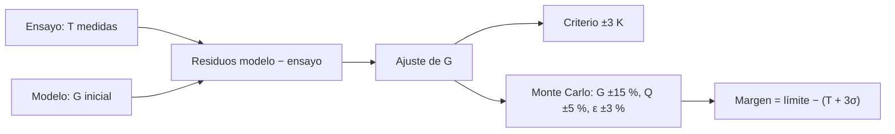

# B85-C27 — Márgenes y correlación térmica

<!-- nav:top -->
[🏠 Programa](../../../../README.md) · [📚 Bloque B85](../../../tronco-comun/B85-gestion-termica-y-entorno-espacial.md) · [← Anterior: B85-C26 — Análisis térmico transitorio y casos extremos](../B85-C26-analisis-termico-transitorio-y-casos-extremos/CLASE.md) · [Siguiente: B85-C28 — Protección pasiva frente al ambiente espacial →](../B85-C28-proteccion-pasiva-frente-al-ambiente-espacial/CLASE.md)
<!-- /nav -->

## 1. Ubicación, nivel y alcance

Clase 27 del bloque B85. Nivel N3. Aceptar un diseño térmico exige dos cosas: que el modelo reproduzca el ensayo (correlación) y que quede margen sobre los límites de los componentes. Aquí correlacionas un modelo sintético con seis casos de ensayo sintéticos ajustando una conductancia, evalúas el criterio de `±3 K` y calculas el margen por Monte Carlo y por propagación lineal de varianzas. El criterio y la política de margen no están consultados y son ilustrativos.

## 2. Por qué esta clase existe

Un modelo sin correlación no sirve para predecir y un margen sin incertidumbre es una apuesta. La decisión central: **¿el modelo reproduce el ensayo dentro del criterio y cuánto margen queda tras la incertidumbre?** La decisión central: **¿el modelo reproduce el ensayo dentro del criterio y cuánto margen queda tras la incertidumbre?**

## 3. Lo que podrás hacer al terminar

1. Calcular sesgo, RMS y máximo de los residuos modelo–ensayo.
2. Ajustar una conductancia con sección áurea y contrastar con una malla.
3. Evaluar un criterio de correlación.
4. Propagar incertidumbres por Monte Carlo y por varianzas lineales.
5. Calcular el margen tras `3σ`.
6. Rotular el criterio y los datos como ilustrativos y sintéticos.

La evidencia es la **informe de correlación y margen térmico** del ejercicio 12 (sección 20).

## 4. Con qué llegas y cómo comprobarlo

1. ¿Qué es un residuo?
2. ¿Qué es el sesgo?
3. ¿Qué es la sección áurea?
4. ¿Qué es la propagación lineal de varianzas?
5. ¿Qué es una verificación por segunda vía?

<details>
<summary>Ver respuestas</summary>

1. La diferencia entre el valor del modelo y el medido. 2. El promedio de los residuos. 3. Un método de búsqueda de mínimos de una función unimodal. 4. `σ² = Σ (∂T/∂p_i σ_i)²` para parámetros independientes. 5. Calcular lo mismo con otro método y comparar.
</details>

Con cuatro o cinco aciertos, sigue; si no, repasa los prerrequisitos.

## 5. Un caso de contexto y casos de referencia

Con `G = 1,2 W/K` el modelo se aparta hasta `17,2 K` del ensayo sintético (RMS `11,0 K`); tras ajustar `G = 1,818 W/K`, el máximo es `0,68 K`. En el caso de `60 W`, el margen nominal es `60,8 K` y tras `3σ` (`σ = 7,4 K`) queda `38,5 K`. Es el **ejemplo conductor**. Todo es **sintético**.

## 6. Vocabulario

La **correlación** ajusta parámetros inciertos para que el modelo reproduzca el ensayo. El **sesgo** es el residuo medio; el **RMS**, su raíz cuadrática media. El **criterio de correlación** (aquí `|ΔT| ≤ 3 K`, ilustrativo) acepta o rechaza el modelo. El **margen** es el límite menos la temperatura predicha más `3σ`. **Monte Carlo** muestrea los parámetros inciertos.

## 7. Modelo mental



*Descripción textual:* los residuos entre modelo y ensayo guían el ajuste de la conductancia; el modelo correlacionado se evalúa con el criterio y se usa para calcular el margen con la incertidumbre de los parámetros.

Analogía: afinar una guitarra con un afinador (correlación) y luego tocar con margen para que una cuerda algo floja no desafine la pieza. Límite: un solo parámetro ajustado puede absorber errores de otro; la correlación no prueba que el modelo sea correcto, solo que concuerda en los casos ensayados.

## 8. La explicación, paso a paso

### 8.1 Residuos

Datos sintéticos (`G` verdadero `1,8 W/K`, ruido `0,6 K`, semilla `20261110`) y modelo con `G = 1,2 W/K`:

| `Q` (W) | `T` medida (K) | residuo inicial (K) | residuo ajustado (K) |
|---|---|---|---|
| 10 | 156,36 | 2,89 | 0,06 |
| 20 | 190,93 | 5,20 | -0,46 |
| 30 | 215,79 | 7,82 | -0,68 |
| 40 | 234,83 | 11,93 | 0,60 |
| 50 | 253,36 | 13,97 | -0,19 |
| 60 | 268,95 | 17,24 | 0,24 |

Inicial: sesgo `9,84 K`, RMS `11,04 K`, máximo `17,24 K`: **no cumple** `±3 K`.

### 8.2 Ajuste

La sección áurea sobre el RMS da `G = 1,8180 W/K`, igual que una malla fina (`1,8180`). El RMS baja a `0,43 K` y el máximo a `0,68 K`: **cumple** `±3 K`. El residuo restante es el ruido sembrado.

### 8.3 Margen

En el caso de `60 W`, `T_nom = 269,20 K`. Con `G ±15 %`, `Q ±5 %` y `ε ±3 %` (`1σ`), Monte Carlo (20 000 muestras) da media `269,99 K` y `σ = 7,43 K`; la propagación lineal, `6,99 K`. Con un límite de `330 K`, el margen nominal es `60,8 K` y, tras `3σ`, `38,5 K`.

### 8.4 Cuidado

Ajustar un solo parámetro puede ocultar errores de otros (por ejemplo, la emisividad). La correlación se valida en casos no usados en el ajuste. Aquí `G` es la única incógnita por construcción, de modo que el resultado es optimista.

## 9. Magnitudes, símbolos y unidades

| Símbolo | Qué es | Unidad | Valor / nota |
|---|---|---|---|
| `G` | conductancia caja–radiador | W/K | 1,818 (ajustada; verdadera 1,8) |
| RMS | residuo cuadrático medio | K | 11,04 → 0,43 |
| `σ` | incertidumbre de `T` | K | 7,43 |
| límite | temperatura máxima | K | 330 (ilustrativo) |
| margen 3σ | límite − (T + 3σ) | K | 38,5 |
| criterio | correlación | K | ±3 (ilustrativo) |

## 10. Convenciones y referencias

Todo sintético: cadena de nodos, `G` verdadero, ruido `0,6 K`, semilla `20261110`; criterio `±3 K`, límite `330 K` y desviaciones `15 %`, `5 %`, `3 %` ilustrativas y no consultadas (no son las de ECSS ni de un proyecto). Temperaturas en kelvin.

## 11. De dónde sale lo que afirmamos

| ID | Fuente | Localizador | Respalda | Estado |
|---|---|---|---|---|
| — | Residuos, ajuste por sección áurea, Monte Carlo y propagación lineal de varianzas | — | las verifica el laboratorio con una segunda vía | No consultada en una fuente concreta |

Límites: no se consultó ninguna fuente para esta clase; el criterio de correlación y la política de margen son ilustrativos; ECSS y NASA no se consultaron; el modelo no corresponde a una nave.

## 12. Cómo ver el resultado

| Magnitud | Valor |
|---|---|
| RMS inicial → ajustado | 11,04 → 0,43 K |
| `G` ajustada | 1,818 W/K |
| `σ` MC / lineal | 7,43 / 6,99 K |
| margen nominal | 60,8 K |
| margen tras 3σ | 38,5 K |

Descripción larga: el ajuste lleva el máximo de 17 a 0,7 K y el margen tras 3σ, de 61 a 39 K.

## 13. Ejemplo trabajado

**Paso 1 · Residuo.** A `60 W`: `17,24 K` con `G = 1,2`.

**Paso 2 · Ajuste.** `G = 1,818 W/K` y residuo `0,24 K`.

**Paso 3 · Margen.** `330 − (269,20 + 3 × 7,43) = 38,5 K`.

## 14. Distintas formas de describir el problema

**Por residuos:** sesgo, RMS, máximo. **Por ajuste:** `G`. **Por criterio:** `±3 K`. **Por margen:** `3σ`.

## 15. Práctica guiada

**Ejercicio 1 · con los pasos indicados.** Calcula el sesgo de los residuos `+2, −1, +3`. *Pasos:* promedio.

<details><summary>Solución comentada</summary>

`+1,33 K`.
</details>

**Ejercicio 2 · con una pista.** Predice si un `G` mayor que `1,8` empeora el RMS. *Pista:* mínimo en `1,818`.

<details><summary>Solución comentada</summary>

Sí, se aleja del mínimo.
</details>

**Ejercicio 3 · casi autónomo.** ¿Por qué la sección áurea y la malla coinciden a `1e-3`? Piensa en que ambas buscan el mismo mínimo.

<details><summary>Solución comentada</summary>

Son dos métodos para el mismo problema unimodal.
</details>

## 16. Práctica autónoma, transferencia e integrador

**Ejercicio 4 · autónomo.** Calcula el RMS de `+1, −1, +2, −2`.

<details><summary>Solución comentada</summary>

`1,581 K`.
</details>

**Ejercicio 5 · autónomo.** Calcula el margen tras `2σ`.

<details><summary>Solución comentada</summary>

`45,9 K`.
</details>

**Ejercicio 6 · autónomo.** ¿Qué pasa con el margen si `σ` de `G` sube a `25 %`?

<details><summary>Solución comentada</summary>

`σ` de `T` crece; el margen tras `3σ` baja.
</details>

**Ejercicio 7 · autónomo.** Calcula `T` de la caja con `Q = 60` y `G = 2`.

<details><summary>Solución comentada</summary>

`266,19 K`.
</details>

**Ejercicio 8 · autónomo.** ¿Cuántos casos de ensayo hacen falta para ajustar un parámetro?

<details><summary>Solución comentada</summary>

Al menos uno, pero conviene varios y reservar casos para validar.
</details>

**Ejercicio 9 · transferencia.** **Transferencia.** El modelo cumple `±3 K` solo en los casos de ajuste. ¿Qué haces?

<details><summary>Solución comentada</summary>

Validas con casos no usados; si falla, el modelo tiene un error estructural que el ajuste oculta.
</details>

**Ejercicio 10 · transferencia.** **Transferencia.** Un criterio de correlación de `±3 K` ¿es universal?

<details><summary>Solución comentada</summary>

No: es ilustrativo y no consultado; el requisito lo fija el proyecto.
</details>

**Ejercicio 11 · transferencia.** **Transferencia.** Un colega presenta `38,5 K` como «el margen térmico de la nave». ¿Qué corriges?

<details><summary>Solución comentada</summary>

Es un cálculo con ensayo y modelo sintéticos y una política de margen ilustrativa.
</details>

**Ejercicio 12 · integrador.** **Integrador.** Elabora tu *informe de correlación y margen térmico*: residuos, ajuste, criterio, Monte Carlo, margen y lista de lo sintético.

<details><summary>Solución comentada</summary>

Secciones 8.1–8.4 y la salida del laboratorio.
</details>

## 17. Laboratorio: correlación modelo–ensayo y margen

El script [margenes_correlacion.py](margenes_correlacion.py) calcula residuos, ajusta `G` con sección áurea y malla, evalúa el criterio y calcula el margen por Monte Carlo y por varianzas lineales (**comprueba** áurea frente a malla (1e-3), MC frente a lineal (8 %) y que el ajuste cumpla el criterio).

**Datos:** todo **sintético e ilustrativo**. **Predice antes de ejecutar:** ¿cumple el modelo inicial el criterio? (no: máximo 17 K.) **Ejecución del 2026-11-10 (Python 3.12.9):**

```text
Python 3.12.9 (biblioteca estandar)
Datos de ensayo SINTETICOS: T_caja = T_rad(Q) + Q/G con G verdadero = 1.8 W/K, ruido 0.6 K, semilla 20261110; modelo inicial G = 1.2 W/K
Q [W]   T medida [K]   residuo inicial [K]   residuo ajustado [K]
   10         156.36                 +2.89                  +0.06
   20         190.93                 +5.20                  -0.46
   30         215.79                 +7.82                  -0.68
   40         234.83                +11.93                  +0.60
   50         253.36                +13.97                  -0.19
   60         268.95                +17.24                  +0.24
Inicial: sesgo = +9.84 K ; RMS = 11.04 K ; maximo = 17.24 K ; cumple +-3 K: no
Ajuste: G = 1.8180 W/K (seccion aurea) ; 1.8180 W/K (malla) ; RMS = 0.43 K ; maximo = 0.68 K ; cumple +-3 K: si
Margen en el caso de 60 W (limite 330 K): T nominal = 269.20 K ; Monte Carlo: media = 269.99 K, sigma = 7.43 K (lineal 6.99 K)
Margen nominal = 60.80 K ; margen tras 3 sigma = 38.52 K
Pruebas superadas.
```

```bash
python programa/clases/B85/B85-C27-margenes-y-correlacion-termica/margenes_correlacion.py
```

**Límites:** un solo parámetro ajustado, ruido gaussiano, parámetros independientes.

## 18. Errores frecuentes y cómo corregirlos

**Ajustar sin casos de validación.** el ajuste puede ocultar errores (8.4)

**Ignorar la incertidumbre al calcular el margen.** el margen es tras `3σ` (8.3)

**Aplicar el criterio de otro proyecto.** es ilustrativo (sección 10)

**Presentar el margen como real.** se corrige con la sección 10

## 19. Cómo sabrás que vas bien

Tras la sección 8: ¿qué resultado esperabas (el margen tras 3σ) y cuál obtuviste? Si dudas, repasa el ejemplo 13. Tras el laboratorio: ¿qué comprueba? (ver la sección 17).

## 20. Qué entregas y cómo se evalúa

El producto es tu **informe de correlación y margen térmico** (ejercicio 12).

| Criterio | Inicial | En desarrollo | Logrado | Destacado |
|---|---|---|---|---|
| Conceptos | Los confunde | Parciales | Correlaciona y calcula el margen | Explica los límites |
| Cálculo | Sin unidades | Con errores | Tablas completas con unidades | Calcula casos nuevos |
| Numérico | Sin comprobar | Un caso | Contraste con una segunda vía | Interpreta las diferencias |
| Fuentes | Sin fuente | Sin fecha | Fuentes con fecha y estado | Declara lo ilustrativo y lo no consultado |
| Límites | No los nombra | Uno | Tres | Discute qué falta del modelo |

**Condiciones críticas (no se compensan con promedio):** rotular los datos ilustrativos o sintéticos como tales; no presentar un resultado modelado como medición; citar solo lo consultado.

## 21. Ética, seguridad y límites

Clase educativa: los modelos son simplificados y sus datos son sintéticos o ilustrativos; ningún resultado describe una nave real, ni sustituye a los estándares de proyecto, a la verificación con datos de misión ni a una revisión disciplinar. Los valores de este texto no son requisitos de ningún proyecto. Accesibilidad: tablas equivalentes a las gráficas, fórmulas en texto, ejercicios sin conexión.

## 22. Para cerrar y seguir

Un ajuste de `G` lleva el modelo sintético de `17 K` a `0,7 K` de error máximo y deja `39 K` de margen tras `3σ`. Queda una pregunta: ¿cómo se protege pasivamente la nave de los ambientes que degradan?

**Glosario español–inglés.** correlación · *correlation*; residuo · *residual*; margen · *margin*; Monte Carlo · *Monte Carlo*; incertidumbre · *uncertainty*.

**Continuidad.** [B85-C28](../B85-C28-proteccion-pasiva-frente-al-ambiente-espacial/CLASE.md) estudia la protección pasiva frente al ambiente espacial.

**Referencias:** ver sección 11.

<!-- nav:bottom -->
---

[← Anterior: B85-C26 — Análisis térmico transitorio y casos extremos](../B85-C26-analisis-termico-transitorio-y-casos-extremos/CLASE.md) · [📚 Bloque B85](../../../tronco-comun/B85-gestion-termica-y-entorno-espacial.md) · [Siguiente: B85-C28 — Protección pasiva frente al ambiente espacial →](../B85-C28-proteccion-pasiva-frente-al-ambiente-espacial/CLASE.md)
<!-- /nav -->
