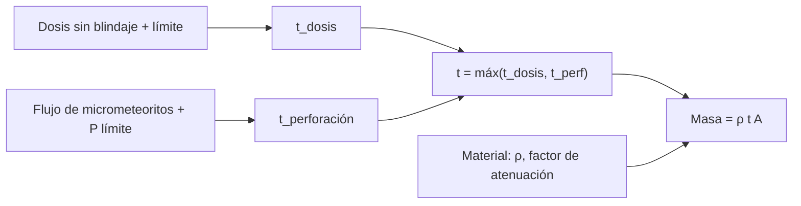

# B85-C28 — Protección pasiva frente al ambiente espacial

<!-- nav:top -->
[🏠 Programa](../../../../README.md) · [📚 Bloque B85](../../../tronco-comun/B85-gestion-termica-y-entorno-espacial.md) · [← Anterior: B85-C27 — Márgenes y correlación térmica](../B85-C27-margenes-y-correlacion-termica/CLASE.md) · [Siguiente: B85-C29 — Evaluación y modelado de la degradación en órbita →](../B85-C29-evaluacion-y-modelado-de-la-degradacion-en-orbita/CLASE.md)
<!-- /nav -->

## 1. Ubicación, nivel y alcance

Clase 28 del bloque B85. Nivel N3. Un blindaje pasivo debe cumplir varios requisitos a la vez: reducir la dosis ionizante, resistir micrometeoritos y limitar contaminación. Aquí diseñas el espesor mínimo de un panel con una curva de atenuación de dosis y un modelo de perforación por micrometeoritos, ambos sintéticos, comparas aluminio con polietileno y obtienes la masa mínima. Ningún dato es de un proyecto.

## 2. Por qué esta clase existe

Cada milímetro de blindaje cuesta masa, y el requisito que manda cambia con el entorno. La decisión central: **¿qué espesor y qué material cumplen la dosis y la probabilidad de perforación con la menor masa?** La decisión central: **¿qué espesor y qué material cumplen la dosis y la probabilidad de perforación con la menor masa?**

## 3. Lo que podrás hacer al terminar

1. Aplicar una curva de atenuación de dosis exponencial y obtener el espesor para un límite.
2. Calcular la probabilidad de perforación con Poisson y un límite balístico.
3. Obtener el espesor por cada requisito y el que gobierna.
4. Comparar materiales por masa.
5. Contrastar la probabilidad de Poisson con Monte Carlo.
6. Rotular todos los datos como sintéticos.

La evidencia es la **ficha de diseño de una protección pasiva** del ejercicio 12 (sección 20).

## 4. Con qué llegas y cómo comprobarlo

1. ¿Qué es una curva de atenuación?
2. ¿Qué es el límite balístico?
3. ¿Cómo se calcula la probabilidad de al menos un impacto?
4. ¿Qué es la masa por área?
5. ¿Qué es una verificación por segunda vía?

<details>
<summary>Ver respuestas</summary>

1. La dosis restante en función del espesor, aquí exponencial. 2. El espesor o diámetro de impactor en el que la perforación empieza. 3. `1 − e^(−F A T)`. 4. `ρ t`, en kg/m². 5. Calcular lo mismo con otro método y comparar.
</details>

Con cuatro o cinco aciertos, sigue; si no, repasa los prerrequisitos.

## 5. Un caso de contexto y casos de referencia

Con datos sintéticos, un panel de `0,5 m²` para `5 años` necesita `11,74 mm` de aluminio por dosis (`100 Gy`) y `21,5 mm` por perforación (`P ≤ 10⁻³`): gobierna la perforacion. En polietileno, `21,5 mm` y `10,2 kg` frente a `29,0 kg` de aluminio. Es el **ejemplo conductor**. Todo es **sintético**.

## 6. Vocabulario

La **atenuación** de dosis `D = D₀ e^(−t k/λ)` con `λ = 3 mm` de aluminio. El **flujo de micrometeoritos** `F(≥d) = F₁ (d/0,1 mm)^(−2)`. El **diámetro crítico** `d_c = t^0,9` (mm). La **probabilidad de perforación** `P = 1 − e^(−F(≥d_c) A T)`. El **espesor gobernante** es el mayor de los requeridos. La **masa** es `ρ t A`.

## 7. Modelo mental



*Descripción textual:* cada requisito da un espesor; el mayor gobierna el diseño; con la densidad del material se obtiene la masa, que decide entre materiales.

Analogía: abrigarse para la lluvia y el frío: el abrigo debe cumplir ambos y su peso lo decide el requisito más exigente. Límite: los modelos de atenuación y de perforación reales son mucho más complejos (energía, ángulo, blindaje en capas, Whipple).

## 8. La explicación, paso a paso

### 8.1 Requisitos por separado

Dosis: `D(t) = 5000 e^(−t/3)` Gy en 5 años (`D₀ = 1000 Gy/año`); para `100 Gy`, `t = 11,736 mm` (bisección `11,736 mm`). Perforación: `P(t)` baja lentamente con `t`; para `P = 10⁻³`, `t = 21,48 mm`.

| `t` (mm) | dosis (Gy) | `P` perforación | masa Al (kg) |
|---|---|---|---|
| 0,5 | 4232,4 | 5,81 × 10⁻¹ | 0,68 |
| 1,0 | 3582,7 | 2,21 × 10⁻¹ | 1,35 |
| 2,0 | 2567,1 | 6,93 × 10⁻² | 2,70 |
| 4,0 | 1318,0 | 2,04 × 10⁻² | 5,40 |
| 6,0 | 676,7 | 9,89 × 10⁻³ | 8,10 |
| 8,0 | 347,4 | 5,90 × 10⁻³ | 10,80 |

### 8.2 Qué manda

Gobierna la perforacion (`21,48 mm`): `29,0 kg` de aluminio. Es un resultado de los datos sintéticos: con un flujo menor mandaría la dosis.

### 8.3 Materiales

Con un factor de atenuación `2,2` veces el del aluminio por milímetro y densidad `950 kg/m³`, el polietileno cumple la dosis con `5,33 mm`, pero la perforación impone `21,5 mm` y el espesor gobernante es `21,5 mm`: masa `10,20 kg`, menos de la mitad.

### 8.4 Segunda vía

A `3 mm`, Poisson da `3,401 × 10⁻²` y Monte Carlo (con semilla), `3,850 × 10⁻²`; la diferencia es estadística. Un diseño real usa blindajes en capas y modelos de entorno validados.

## 9. Magnitudes, símbolos y unidades

| Símbolo | Qué es | Unidad | Valor / nota |
|---|---|---|---|
| `D₀` | dosis sin blindaje | Gy/año | 1000 (sintética) |
| `λ` | longitud de atenuación (Al) | mm | 3 (sintética) |
| `F₁` | flujo con `d ≥ 100 µm` | m⁻² año⁻¹ | 10 (sintético) |
| `t_dis` | espesor gobernante | mm | 21,48 |
| masa Al | masa de aluminio | kg | 29,0 |
| masa PE | masa de polietileno | kg | 10,20 |

## 10. Convenciones y referencias

Todo sintético: dosis `D₀`, atenuación, flujo y exponente de micrometeoritos, límite balístico `d_c = t^0,9`, límites de `100 Gy` y `P = 10⁻³`, `0,5 m²`, `5 años`. No se consultó ninguna fuente. Espesores en mm; masas en kg.

## 11. De dónde sale lo que afirmamos

| ID | Fuente | Localizador | Respalda | Estado |
|---|---|---|---|---|
| — | Atenuación exponencial de dosis, Poisson de impactos y masa por área | — | las verifica el laboratorio con una segunda vía | No consultada en una fuente concreta |

Límites: no se consultó ninguna fuente para esta clase; los modelos de dosis y de micrometeoritos son sintéticos; no se modelan blindajes Whipple ni protección contra contaminación; los límites no son de un proyecto.

## 12. Cómo ver el resultado

| Magnitud | Valor |
|---|---|
| `t_dosis` | 11,74 mm |
| `t_perf` | 21,5 mm |
| gobierna | perforacion |
| masa Al | 29,0 kg |
| masa PE | 10,20 kg |

Descripción larga: con estos datos sintéticos la perforación manda sobre la dosis y el polietileno pesa menos de la mitad que el aluminio.

## 13. Ejemplo trabajado

**Paso 1 · Por dosis.** `t = −3 ln(100/5000) = 11,74 mm`.

**Paso 2 · Por perforación.** `P(t) = 10⁻³` en `t = 21,5 mm`.

**Paso 3 · Masa.** `2700 × 0,02148 × 0,5 = 29,0 kg`.

## 14. Distintas formas de describir el problema

**Por dosis:** `t_dosis`. **Por perforación:** `t_perf`. **Por masa:** `ρ t A`. **Por material:** comparación.

## 15. Práctica guiada

**Ejercicio 1 · con los pasos indicados.** Calcula `D` con `t = 6 mm` de aluminio. *Pasos:* `5000 e^(−6/3)`.

<details><summary>Solución comentada</summary>

`676,7 Gy`.
</details>

**Ejercicio 2 · con una pista.** Predice si `t = 8 mm` cumple `100 Gy`. *Pista:* `t_dosis = 11,7`.

<details><summary>Solución comentada</summary>

No: `347 Gy`.
</details>

**Ejercicio 3 · casi autónomo.** ¿Por qué `P` baja tan lento con `t`? Piensa en `d_c = t^0,9` y el exponente 2.

<details><summary>Solución comentada</summary>

`F ∝ d_c⁻²` y `d_c` crece casi lineal con `t`: `P ∝ t^(−1,8)`.
</details>

## 16. Práctica autónoma, transferencia e integrador

**Ejercicio 4 · autónomo.** Calcula la masa de `5 mm` de polietileno en `0,5 m²`.

<details><summary>Solución comentada</summary>

`2,375 kg`.
</details>

**Ejercicio 5 · autónomo.** Calcula `P` a `10 mm`.

<details><summary>Solución comentada</summary>

`3,954 × 10⁻³`.
</details>

**Ejercicio 6 · autónomo.** Calcula la masa de aluminio por m² para `2 mm`.

<details><summary>Solución comentada</summary>

`5,4 kg/m²`.
</details>

**Ejercicio 7 · autónomo.** ¿Qué pasa si el límite de dosis baja a `50 Gy`?

<details><summary>Solución comentada</summary>

`t_dosis = 13,82 mm`.
</details>

**Ejercicio 8 · autónomo.** ¿Qué pasa con `t_perf` si el flujo `F₁` baja a `1`?

<details><summary>Solución comentada</summary>

Baja a `6,0 mm`.
</details>

**Ejercicio 9 · transferencia.** **Transferencia.** El polietileno cumple la dosis con `5,3 mm` pero hace falta más por perforación. ¿Qué haces?

<details><summary>Solución comentada</summary>

Combinas capas: polietileno para dosis y una capa dura (Whipple) para impactos; se evalúa con modelos validados.
</details>

**Ejercicio 10 · transferencia.** **Transferencia.** ¿Por qué no basta una sola cifra de espesor para una misión nueva?

<details><summary>Solución comentada</summary>

Cambian la órbita (dosis), el flujo de impactos y el tiempo; se recalcula.
</details>

**Ejercicio 11 · transferencia.** **Transferencia.** Un colega presenta `29 kg` como «la masa de blindaje de nuestro panel». ¿Qué corriges?

<details><summary>Solución comentada</summary>

Es un cálculo con datos sintéticos, no un diseño.
</details>

**Ejercicio 12 · integrador.** **Integrador.** Elabora tu *ficha de diseño de una protección pasiva*: espesores por requisito, gobernante, masa por material, contraste Poisson–Monte Carlo y lista de lo sintético.

<details><summary>Solución comentada</summary>

Secciones 8.1–8.4 y la salida del laboratorio.
</details>

## 17. Laboratorio: blindaje de dosis y perforación

El script [proteccion_pasiva.py](proteccion_pasiva.py) calcula los espesores por dosis y por perforación, el gobernante, la masa por material y contrasta Poisson con Monte Carlo (**comprueba** espesor por dosis frente a bisección, por perforación a 1e-6 y Poisson frente a Monte Carlo (0,01)).

**Datos:** todo **sintético**. **Predice antes de ejecutar:** ¿qué requisito manda? (la perforación, con 21,5 mm.) **Ejecución del 2026-11-10 (Python 3.12.9):**

```text
Python 3.12.9 (biblioteca estandar)
Datos SINTETICOS: dosis sin blindaje 1000 Gy/anio, atenuacion exp(-t/3.0 mm Al) ; F(>=100 um) = 1e+01 /(m2 anio), exponente 2.0; limites 100 Gy y P = 1e-03; area 0.5 m2, mision 5 anios
 t [mm]  dosis [Gy]   P perfora  masa Al [kg]
    0.5     4232.41   5.813e-01         0.675
    1.0     3582.66   2.212e-01         1.350
    2.0     2567.09   6.928e-02         2.700
    4.0     1317.99   2.041e-02         5.400
    6.0      676.68   9.888e-03         8.100
    8.0      347.42   5.903e-03        10.800
Espesor por dosis = 11.736 mm (biseccion 11.736 mm) ; por perforacion = 21.482 mm ; gobierna perforacion
Diseno de aluminio: 21.482 mm -> 29.000 kg ; polietileno (factor 2.2 por mm): 21.482 mm -> 10.204 kg
Prob. de perforacion a 3 mm: Poisson = 3.4012e-02 ; Monte Carlo = 3.8500e-02
Pruebas superadas.
```

```bash
python programa/clases/B85/B85-C28-proteccion-pasiva-frente-al-ambiente-espacial/proteccion_pasiva.py
```

**Límites:** atenuación exponencial, un solo material por vez, sin capas ni energía de impacto.

## 18. Errores frecuentes y cómo corregirlos

**Diseñar solo por un requisito.** manda el mayor espesor (8.2)

**Comparar materiales por espesor.** se compara por masa (8.3)

**Olvidar el tiempo de misión.** `P` y `D` crecen con él (8.1)

**Presentar el diseño como real.** se corrige con la sección 10

## 19. Cómo sabrás que vas bien

Tras la sección 8: ¿qué resultado esperabas (el espesor mínimo) y cuál obtuviste? Si dudas, repasa el ejemplo 13. Tras el laboratorio: ¿qué comprueba? (ver la sección 17).

## 20. Qué entregas y cómo se evalúa

El producto es tu **ficha de diseño de una protección pasiva** (ejercicio 12).

| Criterio | Inicial | En desarrollo | Logrado | Destacado |
|---|---|---|---|---|
| Conceptos | Los confunde | Parciales | Dimensiona y compara | Explica los límites |
| Cálculo | Sin unidades | Con errores | Tablas completas con unidades | Calcula casos nuevos |
| Numérico | Sin comprobar | Un caso | Contraste con una segunda vía | Interpreta las diferencias |
| Fuentes | Sin fuente | Sin fecha | Fuentes con fecha y estado | Declara lo ilustrativo y lo no consultado |
| Límites | No los nombra | Uno | Tres | Discute qué falta del modelo |

**Condiciones críticas (no se compensan con promedio):** rotular los datos ilustrativos o sintéticos como tales; no presentar un resultado modelado como medición; citar solo lo consultado.

## 21. Ética, seguridad y límites

Clase educativa: los modelos son simplificados y sus datos son sintéticos o ilustrativos; ningún resultado describe una nave real, ni sustituye a los estándares de proyecto, a la verificación con datos de misión ni a una revisión disciplinar. Los valores de este texto no son requisitos de ningún proyecto. Accesibilidad: tablas equivalentes a las gráficas, fórmulas en texto, ejercicios sin conexión.

## 22. Para cerrar y seguir

Con datos sintéticos, un panel necesita `21 mm` de aluminio (`29 kg`) o `10 kg` de polietileno. Queda una pregunta: ¿cómo se predice la vida de un material expuesto a todos estos efectos a la vez?

**Glosario español–inglés.** blindaje · *shielding*; atenuación · *attenuation*; micrometeoroide · *micrometeoroid*; límite balístico · *ballistic limit*; protección pasiva · *passive protection*.

**Continuidad.** [B85-C29](../B85-C29-evaluacion-y-modelado-de-la-degradacion-en-orbita/CLASE.md) estudia la evaluación y el modelado de la degradación en órbita.

**Referencias:** ver sección 11.

<!-- nav:bottom -->
---

[← Anterior: B85-C27 — Márgenes y correlación térmica](../B85-C27-margenes-y-correlacion-termica/CLASE.md) · [📚 Bloque B85](../../../tronco-comun/B85-gestion-termica-y-entorno-espacial.md) · [Siguiente: B85-C29 — Evaluación y modelado de la degradación en órbita →](../B85-C29-evaluacion-y-modelado-de-la-degradacion-en-orbita/CLASE.md)
<!-- /nav -->
