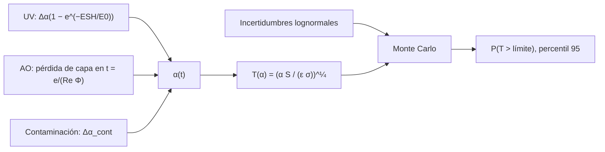

# B85-C29 — Evaluación y modelado de la degradación en órbita

<!-- nav:top -->
[🏠 Programa](../../../../README.md) · [📚 Bloque B85](../../../tronco-comun/B85-gestion-termica-y-entorno-espacial.md) · [← Anterior: B85-C28 — Protección pasiva frente al ambiente espacial](../B85-C28-proteccion-pasiva-frente-al-ambiente-espacial/CLASE.md) · [Siguiente: B86-C01 — Balance de potencia eléctrica →](../../B86/B86-C01-balance-de-potencia-electrica/CLASE.md)
<!-- /nav -->

## 1. Ubicación, nivel y alcance

Clase 29 del bloque B85. Nivel N3. Predecir la vida de un material expuesto exige combinar efectos: el ultravioleta oscurece, el oxígeno atómico erosiona la capa protectora y la contaminación añade una película. Aquí modelas la absortividad de un radiador en el tiempo con esos tres efectos, ves cuándo cruza un límite de temperatura y propagas incertidumbres con Monte Carlo para dar una probabilidad de exceder el límite. Todo es sintético y reutiliza las leyes de las clases C13, C14 y C16.

## 2. Por qué esta clase existe

La vida de un recubrimiento depende de varios efectos que se suman y de parámetros inciertos. La decisión central: **¿cuál es la probabilidad de que la temperatura supere el límite al final de la vida y qué incertidumbre la domina?** La decisión central: **¿cuál es la probabilidad de que la temperatura supere el límite al final de la vida y qué incertidumbre la domina?**

## 3. Lo que podrás hacer al terminar

1. Combinar UV, erosión de una capa protectora y contaminación en `α(t)`.
2. Calcular la temperatura de un radiador a lo largo de la vida.
3. Propagar incertidumbres lognormales por Monte Carlo.
4. Obtener media, desviación, percentil 95 y probabilidad de exceder un límite.
5. Calcular la sensibilidad `dT/dα`.
6. Rotular todo como sintético.

La evidencia es la **ficha de vida de un material en órbita** del ejercicio 12 (sección 20).

## 4. Con qué llegas y cómo comprobarlo

1. ¿Qué es una distribución lognormal?
2. ¿Qué es el percentil 95?
3. ¿Qué es la sensibilidad?
4. ¿Qué es un efecto escalón en `α`?
5. ¿Qué es una verificación por segunda vía?

<details>
<summary>Ver respuestas</summary>

1. Una en que el logaritmo de la variable es normal; no admite valores negativos. 2. El valor que deja el `95 %` de los casos por debajo. 3. La derivada de una salida respecto de un parámetro. 4. Un cambio brusco, por ejemplo al perder una capa protectora. 5. Calcular lo mismo con otro método y comparar.
</details>

Con cuatro o cinco aciertos, sigue; si no, repasa los prerrequisitos.

## 5. Un caso de contexto y casos de referencia

Un radiador sintético sube de `270,25 K` a `341,50 K` en cinco años; con las incertidumbres de los parámetros, la media es `341,37 K`, `σ = 4,57 K` y la probabilidad de superar `345 K` es `15,8 %`. Es el **ejemplo conductor**. Todo es **sintético**.

## 6. Vocabulario

La **absortividad acumulada** `α(t) = α₀ + Δα(1 − e^(−ESH/E₀)) + Δα_capa·[t > t_capa] + Δα_cont·min(1, t/2)`. El **tiempo de pérdida de la capa** `t_capa = e/(Re Φ)`. La **sensibilidad** `dT/dα = T/(4α)`. **Monte Carlo** muestrea `E₀`, `Δα`, `Φ`, `Re` y `Δα_cont` como lognormales. La **probabilidad de exceder** es la fracción de muestras sobre el límite.

## 7. Modelo mental



*Descripción textual:* tres efectos suman `α(t)`; la temperatura sale del balance; Monte Carlo propaga las incertidumbres de los parámetros y da la probabilidad de exceder el límite.

Analogía: una pared que se pinta, se ensucia y pierde el barniz protector: su aspecto depende de las tres cosas y de cuándo ocurre cada una. Límite: los efectos se tratan como independientes y aditivos; en la realidad interactúan (por ejemplo la contaminación aumenta el daño UV).

## 8. La explicación, paso a paso

### 8.1 Evolución determinista

Con `α₀ = 0,20`, UV de `0,18` (`E₀ = 1500` ESH, `5000` ESH/año), una capa de `100 nm` que dura `1,38 años` con el flujo de oxígeno de la clase C13, un escalón de `0,12` al perderse y `0,01` de contaminación:

| Años | `α` | `T` (K) |
|---|---|---|
| 0,0 | 0,2000 | 270,25 |
| 1,0 | 0,3786 | 316,99 |
| 2,0 | 0,5098 | 341,46 |
| 5,0 | 0,5100 | 341,50 |
| 10,0 | 0,5100 | 341,50 |
| 15,0 | 0,5100 | 341,50 |

La temperatura sube de `270,25` a `341,50 K` y se estabiliza al saturar el UV y perderse la capa.

### 8.2 Incertidumbre

Con `E₀` (`σ_ln = 0,2`), `Δα` (`0,1`), flujo de O (`0,5`), `Re` (`0,4`) y contaminación (`0,5`), Monte Carlo (`20 000` muestras, semilla `20261110`) da a 5 años: media `341,37 K`, `σ = 4,57 K`, percentil 95 `347,22 K` y `P(T > 345 K) = 15,8 %`; a 10 años, `16,2 %`. La media coincide con el determinista (`341,50 K`).

### 8.3 Sensibilidad

`dT/dα = 167,4 K` por unidad de `α`: un error de `0,02` en `α` mueve `T` `3,3 K`. Sin erosión de la capa (flujo `10¹⁵`), `T` a 10 años es `319,35 K`, unos `22 K` menos: el oxígeno atómico es el efecto que más pesa.

### 8.4 Cómo se usa

La probabilidad de exceder el límite es una medida de riesgo, no una predicción: el diseño decide si acepta `16 %` o cambia la capa, el recubrimiento o el límite. La combinación de efectos es la parte débil: aquí se suman sin interacción.

## 9. Magnitudes, símbolos y unidades

| Símbolo | Qué es | Unidad | Valor / nota |
|---|---|---|---|
| `α₀` | absortividad inicial | — | 0,20 (sintética) |
| `t_capa` | pérdida de la capa protectora | años | 1,38 |
| `T_EOL` | temperatura a 5 años | K | 341,50 |
| `σ` | desviación de `T` (MC) | K | 4,57 |
| `P` | P(T > 345 K) a 5 años | % | 15,8 |
| `dT/dα` | sensibilidad | K | 167,4 |

## 10. Convenciones y referencias

`σ` y `S₀` consultadas. Leyes y parámetros sintéticos de C13, C14 y C16; distribuciones lognormales con las desviaciones indicadas; límite de `345 K` ilustrativo; placa de `1 m²` con `ε = 0,9`. Semilla `20261110`. Efectos independientes y aditivos.

## 11. De dónde sale lo que afirmamos

| ID | Fuente | Localizador | Respalda | Estado |
|---|---|---|---|---|
| S1 | NIST, CODATA 2022, Stefan–Boltzmann constant — https://physics.nist.gov/cgi-bin/cuu/Value?sigma (consultada 2026-11-10) | valor de `σ` | `σ` del balance | Consultada |
| S2 | NASA/NSSDC, Earth Fact Sheet — https://nssdc.gsfc.nasa.gov/planetary/factsheet/earthfact.html (consultada 2026-11-10) | ficha completa | `S₀ = 1361,0 W/m²` | Consultada |
| S3 | NASA, State-of-the-Art of Small Spacecraft Technology, capítulo Thermal Control — https://www.nasa.gov/smallsat-institute/sst-soa/thermal-control/ (consultada 2026-11-10) | sección de coatings | los coatings se oscurecen en órbita; el caso caliente usa valores de fin de vida | Consultada |
| — | Suma de efectos en `α`, Monte Carlo con distribuciones lognormales y sensibilidad `T/(4α)` | — | las verifica el laboratorio con una segunda vía | No consultada en una fuente concreta |

Límites: todos los parámetros y distribuciones son sintéticos; no se consultó ninguna fuente de degradación; los efectos se suponen independientes; el límite de `345 K` es ilustrativo; no es la vida de un material real.

## 12. Cómo ver el resultado

| Magnitud | Valor |
|---|---|
| `T` a 5 años (determinista) | 341,50 K |
| media MC | 341,37 K |
| percentil 95 | 347,22 K |
| P(T > 345 K) | 15,8 % |
| sin erosión de la capa | 319,35 K |

Descripción larga: la erosión de la capa protectora es el efecto dominante y la incertidumbre da casi un 16 % de probabilidad de superar el límite.

## 13. Ejemplo trabajado

**Paso 1 · Capa.** `t_capa = 100 nm/(3×10⁻³⁴ × 7,67×10¹⁸ × 3,156×10⁷) = 1,38 años`.

**Paso 2 · `α` a 5 años.** `0,20 + 0,18 + 0,12 + 0,01 = 0,5100`.

**Paso 3 · `T`.** `341,50 K`; el límite de `345 K` deja `3,5 K`.

## 14. Distintas formas de describir el problema

**Por efectos:** UV, AO, contaminación. **Por tiempo:** `α(t)`. **Por incertidumbre:** MC. **Por riesgo:** `P(T > límite)`.

## 15. Práctica guiada

**Ejercicio 1 · con los pasos indicados.** Calcula el aumento UV a `2` años. *Pasos:* `0,18(1 − e^(−10000/1500))`.

<details><summary>Solución comentada</summary>

`0,1798`.
</details>

**Ejercicio 2 · con una pista.** Predice si `T` a 1 año es mayor que a 0. *Pista:* `α` sube.

<details><summary>Solución comentada</summary>

Sí: `316,99 > 270,25 K`.
</details>

**Ejercicio 3 · casi autónomo.** ¿Por qué `T` es igual de 2 a 15 años? Mira qué satura.

<details><summary>Solución comentada</summary>

El UV y la contaminación saturan y la capa ya se perdió: `α` es constante.
</details>

## 16. Práctica autónoma, transferencia e integrador

**Ejercicio 4 · autónomo.** Calcula `dT/dα` a `α = 0,51`.

<details><summary>Solución comentada</summary>

`167,4 K`.
</details>

**Ejercicio 5 · autónomo.** ¿Qué `T` da `α = 0,40`?

<details><summary>Solución comentada</summary>

`321,38 K`.
</details>

**Ejercicio 6 · autónomo.** Si el flujo de O se duplica, ¿cuándo se pierde la capa?

<details><summary>Solución comentada</summary>

`0,69 años`.
</details>

**Ejercicio 7 · autónomo.** ¿Qué `α` máximo cumple `T ≤ 345 K`?

<details><summary>Solución comentada</summary>

`0,5312`.
</details>

**Ejercicio 8 · autónomo.** Estima `P` si el límite fuese `350 K`.

<details><summary>Solución comentada</summary>

Menor que `15,8 %`: el percentil 95 está en `347 K`, así que la probabilidad baja a pocos puntos.
</details>

**Ejercicio 9 · transferencia.** **Transferencia.** ¿Qué mitigación reduce más el riesgo según el modelo?

<details><summary>Solución comentada</summary>

Una capa que dure toda la misión (menor `Re` o más espesor), porque la erosión es el efecto dominante.
</details>

**Ejercicio 10 · transferencia.** **Transferencia.** ¿Qué supone el modelo sobre la independencia de efectos?

<details><summary>Solución comentada</summary>

Que se suman sin interacción; es una simplificación y puede subestimar el daño.
</details>

**Ejercicio 11 · transferencia.** **Transferencia.** Un colega presenta `15,8 %` como «la probabilidad de falla de nuestro radiador». ¿Qué corriges?

<details><summary>Solución comentada</summary>

Es un riesgo calculado con parámetros y distribuciones sintéticos, no una probabilidad de falla real.
</details>

**Ejercicio 12 · integrador.** **Integrador.** Elabora tu *ficha de vida de un material en órbita*: `α(t)`, `T(t)`, Monte Carlo con percentil y probabilidad, sensibilidad y lista de lo consultado y sintético.

<details><summary>Solución comentada</summary>

Secciones 8.1–8.4 y la salida del laboratorio.
</details>

## 17. Laboratorio: degradación acumulada con incertidumbre

El script [degradacion_en_orbita.py](degradacion_en_orbita.py) combina UV, erosión de capa y contaminación en `α(t)`, calcula `T(t)`, propaga incertidumbres por Monte Carlo y obtiene la probabilidad de exceder el límite (**comprueba** media del Monte Carlo cercana a la determinista (< 2σ) y `T` creciente).

**Datos:** `σ` y `S₀` consultadas; leyes, parámetros, distribuciones y límite **sintéticos e ilustrativos**. **Predice antes de ejecutar:** ¿cruza el límite el caso determinista? (no, queda a 3,5 K.) **Ejecución del 2026-11-10 (Python 3.12.9):**

```text
Python 3.12.9 (biblioteca estandar)
Radiador SINTETICO: alfa0 = 0.2, eps = 0.9; UV: +0.18 con E0 = 1500 ESH (5000 ESH/anio); capa de 100 nm que dura 1.38 anios con flujo de O 7.67e+18 m-2 s-1; limite 345 K
Anios   alfa     T [K]  (determinista)
  0.0   0.2000   270.25
  1.0   0.3786   316.99
  2.0   0.5098   341.46
  5.0   0.5100   341.50
 10.0   0.5100   341.50
 15.0   0.5100   341.50
Cruce del limite (determinista): None anios
Monte Carlo a 5 anios: media = 341.37 K ; sigma = 4.57 K ; percentil 95 = 347.22 K ; P(T > 345 K) = 15.8 %
Monte Carlo a 10 anios: media = 341.84 K ; sigma = 3.26 K ; percentil 95 = 347.24 K ; P(T > 345 K) = 16.2 %
Determinista a 5 y 10 anios: 341.50 K y 341.50 K ; dT/dalfa a 5 anios = 167.4 K
Sin erosion de la capa (flujo de O 1e15): T a 10 anios = 319.35 K
Pruebas superadas.
```

```bash
python programa/clases/B85/B85-C29-evaluacion-y-modelado-de-la-degradacion-en-orbita/degradacion_en_orbita.py
```

**Límites:** efectos independientes y aditivos, un solo recubrimiento, parámetros lognormales independientes.

## 18. Errores frecuentes y cómo corregirlos

**Sumar efectos que interactúan sin avisarlo.** es una simplificación (8.4)

**Dar solo el caso determinista.** falta la incertidumbre (8.2)

**Ignorar la erosión de la capa.** es el efecto dominante (8.3)

**Presentar la probabilidad como real.** se corrige con la sección 10

## 19. Cómo sabrás que vas bien

Tras la sección 8: ¿qué resultado esperabas (la probabilidad de exceder el límite) y cuál obtuviste? Si dudas, repasa el ejemplo 13. Tras el laboratorio: ¿qué comprueba? (ver la sección 17).

## 20. Qué entregas y cómo se evalúa

El producto es tu **ficha de vida de un material en órbita** (ejercicio 12).

| Criterio | Inicial | En desarrollo | Logrado | Destacado |
|---|---|---|---|---|
| Conceptos | Los confunde | Parciales | Combina efectos y propaga incertidumbre | Explica los límites |
| Cálculo | Sin unidades | Con errores | Tablas completas con unidades | Calcula casos nuevos |
| Numérico | Sin comprobar | Un caso | Contraste con una segunda vía | Interpreta las diferencias |
| Fuentes | Sin fuente | Sin fecha | Fuentes con fecha y estado | Declara lo ilustrativo y lo no consultado |
| Límites | No los nombra | Uno | Tres | Discute qué falta del modelo |

**Condiciones críticas (no se compensan con promedio):** rotular los datos ilustrativos o sintéticos como tales; no presentar un resultado modelado como medición; citar solo lo consultado.

## 21. Ética, seguridad y límites

Clase educativa: los modelos son simplificados y sus datos son sintéticos o ilustrativos; ningún resultado describe una nave real, ni sustituye a los estándares de proyecto, a la verificación con datos de misión ni a una revisión disciplinar. Los valores de este texto no son requisitos de ningún proyecto. Accesibilidad: tablas equivalentes a las gráficas, fórmulas en texto, ejercicios sin conexión.

## 22. Para cerrar y seguir

Con parámetros sintéticos, la temperatura del radiador llega a `342 K` a 5 años y la probabilidad de superar `345 K` es `16 %`, dominada por la pérdida de la capa protectora. Esta clase cierra el bloque: del balance de energía a la predicción de vida con incertidumbre.

**Glosario español–inglés.** degradación · *degradation*; vida en órbita · *on-orbit lifetime*; sensibilidad · *sensitivity*; lognormal · *lognormal*; percentil · *percentile*.

**Continuidad.** cierra el bloque B85; el siguiente bloque del programa trata sistemas de potencia y energía espacial.

**Referencias:** ver sección 11.

<!-- nav:bottom -->
---

[← Anterior: B85-C28 — Protección pasiva frente al ambiente espacial](../B85-C28-proteccion-pasiva-frente-al-ambiente-espacial/CLASE.md) · [📚 Bloque B85](../../../tronco-comun/B85-gestion-termica-y-entorno-espacial.md) · [Siguiente: B86-C01 — Balance de potencia eléctrica →](../../B86/B86-C01-balance-de-potencia-electrica/CLASE.md)
<!-- /nav -->
