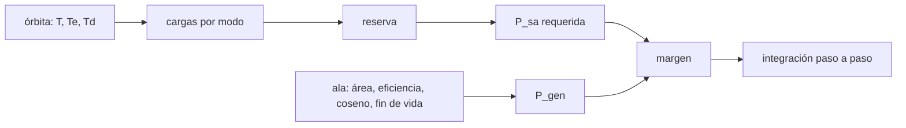

# B86-C01 — Balance de potencia eléctrica

<!-- nav:top -->
[🏠 Programa](../../../../README.md) · [📚 Bloque B86](../../../tronco-comun/B86-sistemas-de-potencia-y-energia-espacial.md) · [← Anterior: B85-C29 — Evaluación y modelado de la degradación en órbita](../../B85/B85-C29-evaluacion-y-modelado-de-la-degradacion-en-orbita/CLASE.md) · [Siguiente: B86-C02 — Celdas solares →](../B86-C02-celdas-solares/CLASE.md)
<!-- /nav -->

## 1. Ubicación, nivel y alcance

Clase 1 del bloque B86. Nivel N3. Primera clase del bloque de potencia. Antes de elegir una celda o una batería hay que saber cuánta energía consume la nave en cada punto de la órbita y cuánta genera. Aquí armas ese balance para un satélite sintético en órbita baja: tabla de cargas por modo, duración del eclipse, potencia de ala requerida y margen. Usas la mecánica orbital básica de [B73](../../../tronco-comun/B73-perturbaciones-orbitales-y-precision-de-trayectorias.md) solo para el periodo; la nave y todas sus cargas son sintéticas y no corresponden a ninguna misión real.

## 2. Por qué esta clase existe

Un satélite no consume lo mismo en la luz que en el eclipse, y la batería solo transfiere energía, no la crea. Si se dimensiona con la potencia instantánea y no con la energía por órbita, el ala queda corta o sobrada. La decisión central: **¿qué potencia debe entregar el ala solar para que la batería cierre cada órbita con las cargas del peor modo?**

## 3. Lo que podrás hacer al terminar

1. Calcular el periodo y la duración del eclipse de una órbita circular baja con sombra cilíndrica.
2. Sumar cargas por modo (luz y eclipse) y aplicar una reserva explícita.
3. Calcular la potencia de ala requerida con las eficiencias de camino de la batería.
4. Comparar la potencia requerida con la generada al fin de vida y expresar el margen.
5. Comprobar el balance de energía por orbita con una integración paso a paso.
6. Separar lo consultado (constante solar, `GM`, radio) de lo ilustrativo (cargas, eficiencias, área).

La evidencia es **la hoja de balance de potencia de un satélite sintético** del ejercicio 12 (sección 20).

## 4. Con qué llegas y cómo comprobarlo

1. ¿Qué diferencia hay entre potencia y energía y en qué unidades se miden?
2. ¿Qué es el periodo de una órbita circular?
3. ¿Por qué hay eclipse en una órbita baja?
4. ¿Qué es un dato sintético?
5. ¿Qué es una verificación por segunda vía?

<details>
<summary>Ver respuestas</summary>

1. La potencia es energía por unidad de tiempo, en W; la energía en J o Wh. 2. El tiempo de una vuelta, `T = 2π√(a³/GM)`. 3. Porque la Tierra tapa al Sol durante una parte de la órbita. 4. Un dato generado para el ejemplo, no medido. 5. Calcular lo mismo con otro método y comparar.
</details>

Con cuatro o cinco aciertos, sigue; si no, repasa los prerrequisitos.

## 5. Un caso de contexto y casos de referencia

Un satélite sintético en órbita circular de `600 km` con `β = 0` tiene un periodo de `5792,3 s` y un eclipse de `2125,6 s` (`36,70 %` de la órbita). Con cargas de `100,80 W` en la luz y `64,80 W` en el eclipse (reserva incluida) necesita un ala de `176,38 W`; un ala de `1,2 m²` entrega `243,67 W` al fin de vida, con un margen de `38,1 %`. Es el **ejemplo conductor** y es **ilustrativo**: ninguna cifra describe una nave real.

## 6. Vocabulario

El **balance de potencia** compara generación y consumo. El **modo** es una configuración de la nave con su consumo. La **reserva** es un porcentaje que se suma a las cargas por incertidumbre. La **eficiencia de camino** (`X_d` en luz, `X_e` en eclipse) es la fracción de potencia que llega a la carga por el camino indicado. El **margen** es `(P_generada − P_requerida)/P_requerida`.

## 7. Modelo mental: una cuenta corriente con sueldo y gastos



*Descripción textual:* la órbita da las duraciones de luz y eclipse; con las cargas y la reserva se obtiene la potencia requerida; el ala da la generada; su comparación es el margen y una integración paso a paso lo verifica.

Analogía: el sueldo entra solo durante la parte del mes en que se trabaja, pero los gastos siguen todo el mes; lo que importa es el saldo del ciclo, no un día suelto. Límite: aquí el «sueldo» (la luz) y el eclipse son fijos y periódicos, y las cargas se promedian por modo; una nave real tiene transitorios y fallas.

## 8. La explicación, paso a paso

### 8.1 La órbita

Con `GM = 398600 km³/s²` (NSSDC) y `a = 6371 + 600 = 6971 km`: `T = 2π√(a³/GM) = 5792,3 s`. Con sombra cilíndrica y `β = 0`, la fracción de eclipse es `f = asin(R/a)/π = 0,3670`, es decir `Te = 2125,6 s` y `Td = 3666,7 s`.

### 8.2 Cargas y potencia requerida

La suma de la tabla es `84 W` en la luz y `54 W` en el eclipse; con una reserva del `20 %` quedan `100,80 W` y `64,80 W`. La batería carga durante la luz y descarga durante el eclipse con pérdidas, así que el ala debe cubrir

`P_sa = (P_e·T_e/X_e + P_d·T_d/X_d)/T_d = 176,38 W`

con `X_d = 0,85` y `X_e = 0,65` (ilustrativos).

### 8.3 Generación y margen

`P_gen = G·A·η·f_emp·cosθ·f_EOL = 1361 × 1,2 × 0,295 × 0,85 × 0,70 × 0,85 = 243,67 W`. El margen es `38,1 %`. El `η = 0,295` es un valor de la tabla de celdas del estado del arte de la NASA; el resto de factores es ilustrativo.

### 8.4 Verificación por energía

La energía neta que entra a la batería en una orbita con la generación real es `68,5352 Wh` por la fórmula cerrada y `68,5352 Wh` por integración con paso de `1 s`; la diferencia es `4,04e-12 Wh`. Con la potencia requerida exacta el balance es cero: esa es la definición de «cerrar» el ciclo.

## 9. Magnitudes, símbolos y unidades

| Símbolo | Qué es | Unidad | Valor / nota |
|---|---|---|---|
| `T` | periodo orbital | s | 5792,3 |
| `T_e`, `T_d` | duración de eclipse y de luz | s | 2125,6; 3666,7 |
| `P_d`, `P_e` | carga en luz y en eclipse con reserva | W | 100,80; 64,80 |
| `X_d`, `X_e` | eficiencias de camino | — | 0,85; 0,65 (ilustrativas) |
| `P_sa` | potencia de ala requerida | W | 176,38 |
| `P_gen` | potencia generada al fin de vida | W | 243,67 |
| `G` | irradiancia solar | W/m² | 1361,0 (consultada) |

## 10. Convenciones y referencias

Órbita circular, sombra cilíndrica (sin penumbra), `β = 0`, Tierra esférica de radio medio `6371 km`, `GM` de la ficha de la NASA. La suma de cargas es promedio por modo. Altitud, cargas, eficiencias de camino, reserva, área, factor de empaquetado, coseno medio y factor de fin de vida son **ilustrativos**.

## 11. De dónde sale lo que afirmamos

| ID | Fuente | Localizador | Respalda | Estado |
|---|---|---|---|---|
| S1 | NASA/NSSDC, Earth Fact Sheet — https://nssdc.gsfc.nasa.gov/planetary/factsheet/earthfact.html (consultada 2026-11-10) | ficha completa leída | irradiancia solar 1361,0 W/m²; GM = 0,39860 × 10⁶ km³/s²; radio medio 6371,000 km; periodo orbital sideral 365,256 d | Consultada |
| S3 | NASA Small Spacecraft Systems Virtual Institute, State-of-the-Art of Small Spacecraft Technology, cap. 3 Power — https://www.nasa.gov/smallsat-institute/sst-soa/power-subsystems/ (consultada 2026-11-10) | primeros 100.000 de 119.638 caracteres y el resumen final; no se leyó el resto | eficiencias de celdas multiunión (29,5–34 % BOL), energía específica de baterías Li-ion (150–270 Wh/kg comerciales), bus de 8,2 V con salidas de 5,0 y 3,3 V, tensiones de 12, 28 y 50 V con convertidores GaN, PCDU de 960 W y 1500 W; la degradación se lista como factor sin cifra | Consultada (parcial) |
| — | Relación estándar: balance de energía por órbita y fórmula de potencia de ala con eficiencias de camino | — | la verifica el laboratorio con una segunda vía | No consultada en una fuente concreta |
| — | Datos sintéticos: tabla de cargas, área del ala, factores de empaquetado, coseno y fin de vida | — | valores generados para el ejemplo | Ilustrativo, no medido |

Límites: no se consultó el texto de ECSS-E-ST-20C ni de ninguna norma de balance de potencia; los factores de camino y la reserva son ilustrativos y no representan una política de proyecto.

## 12. Cómo ver el balance de una órbita

| Magnitud | Valor |
|---|---|
| Periodo | 5792,3 s |
| Eclipse | 36,70 % |
| `P_sa` requerida | 176,38 W |
| `P_gen` fin de vida | 243,67 W |
| Margen | 38,1 % |
| Diferencia entre vías | 4,04e-12 Wh |

Descripción larga: el ala entrega más que la requerida y la integración numérica, con pasos que no cruzan el límite luz/eclipse, coincide con la fórmula cerrada hasta el redondeo.

## 13. Ejemplo trabajado: la potencia requerida en el eclipse

**Paso 1 · Cargas.** En el eclipse la suma es `12 + 20 + 6 + 0 + 16 = 54 W`.

**Paso 2 · Reserva.** `54 × 1,2 = 64,80 W`.

**Paso 3 · Energía.** `E = P_e·T_e = 64,80 × 2125,6 s = 38,26 Wh`.

**Paso 4 · Desde la batería.** Con `X_e = 0,65` hay que sacar `58,86 Wh` de la ruta de generación.

## 14. Distintas formas de describir un balance

**Por potencia:** `P_d`, `P_e`. **Por energía:** `E = P·T`. **Por modo:** luz y eclipse. **Por margen:** `(P_gen − P_sa)/P_sa`. **Por cierre:** energía neta por órbita igual a cero.

## 15. Práctica guiada

**Ejercicio 1 · con los pasos indicados.** Calcula la fracción de eclipse para `h = 600 km`. *Pasos:* `R/a`, arcoseno, divide por `π`.

<details><summary>Solución comentada</summary>

`R/a = 0,9139`; `asin(R/a) = 1,1529 rad`; `f = 0,3670`.
</details>

**Ejercicio 2 · con una pista.** Predice si subir la reserva de `20 %` a `30 %` sube o baja `P_sa`. *Pista:* `P_sa` es lineal en las cargas.

<details><summary>Solución comentada</summary>

Sube en proporción: `P_sa × 1,3/1,2`; `176,38 × 1,0833 = 191,08 W`.
</details>

**Ejercicio 3 · casi autónomo.** ¿Por qué `X_e` pesa más que `X_d` en la fórmula?

<details><summary>Solución comentada</summary>

Porque la energía del eclipse pasa por la batería dos veces (carga y descarga), con más pérdidas.
</details>

## 16. Práctica autónoma, transferencia e integrador

**Ejercicio 4 · autónomo.** `E_e` en Wh si `P_e = 50 W` y `T_e = 2100 s`.

<details><summary>Solución comentada</summary>

`50 × 2100/3600 = 29,17 Wh`.
</details>

**Ejercicio 5 · autónomo.** Margen si `P_gen = 200 W` y `P_sa = 160 W`.

<details><summary>Solución comentada</summary>

`(200 − 160)/160 = 25 %`.
</details>

**Ejercicio 6 · autónomo.** ¿Qué área de ala (`η·f_emp·cos·f_EOL` igual) da margen cero?

<details><summary>Solución comentada</summary>

`A = 1,2 × P_sa/P_gen = 0,869 m²`.
</details>

**Ejercicio 7 · autónomo.** Efecto en `Te` de subir `h` a `1000 km` (conceptual).

<details><summary>Solución comentada</summary>

`R/a` baja, `f` baja y el eclipse se acorta, aunque el periodo crece.
</details>

**Ejercicio 8 · autónomo.** ¿Qué pasa con el balance si `β` aumenta?

<details><summary>Solución comentada</summary>

El eclipse se acorta y desaparece pasado el `β` crítico; ver la clase de orientación solar y eclipses.
</details>

**Ejercicio 9 · transferencia.** **Transferencia.** Un colega suma las cargas máximas de todos los modos en un solo número. ¿Qué error comete?

<details><summary>Solución comentada</summary>

Sobredimensiona el ala porque los modos no son simultáneos; hay que balancear por modo y por energía.
</details>

**Ejercicio 10 · transferencia.** **Transferencia.** Un equipo dimensiona el ala con la potencia a inicio de vida. ¿Qué ocurre al final?

<details><summary>Solución comentada</summary>

La degradación (ver la clase de envejecimiento) reduce la generación y el margen puede volverse negativo.
</details>

**Ejercicio 11 · transferencia.** **Transferencia.** Alguien presenta `Pgen` como telemetría de una misión. ¿Qué corriges?

<details><summary>Solución comentada</summary>

Es un cálculo con datos ilustrativos; la telemetría no se consultó y no se debe simular como observada.
</details>

**Ejercicio 12 · integrador.** **Integrador.** Elabora tu *hoja de balance de potencia de un satélite sintético*: periodo, eclipse, tabla de cargas con reserva, `P_sa`, `P_gen`, margen y rótulos.

<details><summary>Solución comentada</summary>

Secciones 8.1–8.4 y la salida del laboratorio, con consultado e ilustrativo diferenciados.
</details>

## 17. Laboratorio: balance de potencia de un satélite sintético

El script [balance.py](balance.py) calcula el periodo, el eclipse, las cargas con reserva, la potencia de ala requerida y la generada, y verifica el balance de energía por órbita (**comprueba** que luz más eclipse suman el periodo, que la integración de 1 s coincide con la fórmula y que con `P_sa` exacta la energía neta es cero).

**Datos:** `GM`, radio y constante solar de la NASA/NSSDC (consultados); altitud, cargas, eficiencias, reserva y factores del ala **ilustrativos**. **Predice antes de ejecutar:** ¿el margen será positivo? (sí, de `38,1 %`). **Ejecución del 2026-11-10 (Python 3.12.9):**

```text
Python 3.12.9 (biblioteca estandar)
Orbita circular SINTETICA h = 600 km, beta = 0: T = 5792.3 s (96.54 min)
Eclipse Te = 2125.6 s (36.70 % de la orbita); luz Td = 3666.7 s
 carga                    P_luz [W]  P_eclipse [W]
 Ordenador de a bordo         12.0        12.0
 Control de actitud           20.0        20.0
 Radio (valor medio)          18.0         6.0
 Carga util                   30.0         0.0
 Calefactores                  4.0        16.0
Con reserva del 20 %: P_luz = 100.80 W ; P_eclipse = 64.80 W
Potencia de ala requerida (formula SMAD, eficiencias Xd=0.85, Xe=0.65) = 176.38 W
Potencia generada al fin de vida = 243.67 W ; margen = 38.1 %
Energia neta a la bateria por orbita (formula) = 68.5352 Wh ; (integracion) = 68.5352 Wh
Diferencia entre las dos vias = 4.04e-12 Wh
Energia neta con P_sa exacta = -3.55e-14 Wh
Pruebas superadas.
```

```bash
python programa/clases/B86/B86-C01-balance-de-potencia-electrica/balance.py
```

**Límites:** sombra cilíndrica sin penumbra, cargas promedio por modo y factores constantes; la formula de `P_sa` supone que toda la energía del eclipse pasa por la batería.

## 18. Errores frecuentes y cómo corregirlos

**Dimensionar con la potencia instantánea.** Se corrige con 8.2: el balance es de energía por órbita.

**Olvidar las eficiencias de camino.** Se corrige con 8.2 y el ejemplo 13.

**Usar el valor inicial de vida.** Se corrige con 8.3 y la clase de envejecimiento.

**Presentar una nave sintética como real.** Se corrige con la sección 10.

## 19. Cómo sabrás que vas bien

Tras la sección 8: ¿qué potencia de ala esperabas y cuál obtuviste? Si dudas, repasa el ejemplo 13. Tras el laboratorio: ¿qué compara la integración con la fórmula? (ver la sección 17).

## 20. Qué entregas y cómo se evalúa

El producto es **la hoja de balance de potencia de un satélite sintético** (ejercicio 12).

| Criterio | Inicial | En desarrollo | Logrado | Destacado |
|---|---|---|---|---|
| Conceptos | Los confunde | Parciales | Calcula `P_sa` y el margen | Explica los límites |
| Cálculo | Sin unidades | Con errores | Tablas completas con unidades | Calcula casos nuevos |
| Numérico | Sin comprobar | Un caso | Contraste con una segunda vía | Interpreta las diferencias |
| Fuentes | Sin fuente | Sin fecha | Fuentes con fecha y estado | Declara lo ilustrativo y lo no consultado |
| Límites | No los nombra | Uno | Tres | Discute qué falta del modelo |

**Condiciones críticas (no se compensan con promedio):** rotular la nave, las cargas y los factores como ilustrativos; calcular el balance por energía y no por potencia instantánea; citar solo lo consultado.

## 21. Ética, seguridad y límites

Clase educativa: los modelos son simplificados y sus datos son sintéticos o ilustrativos; ningún resultado describe una nave real ni sustituye a la ingeniería de una misión ni a una norma aplicada.  Accesibilidad: tablas equivalentes a las gráficas, fórmulas en texto, ejercicios sin conexión.

## 22. Para cerrar y seguir

Con `100,80 W` en la luz y `64,80 W` en el eclipse, el ala necesita `176,38 W` y entrega `243,67 W`. Queda una pregunta: ¿cómo se convierte la luz en corriente en una celda?

**Glosario español–inglés.** balance de potencia · *power budget*; ala solar · *solar array*; eclipse · *eclipse*; reserva · *contingency*; margen · *margin*; eficiencia de camino · *path efficiency*.

**Continuidad.** [B86-C02](../B86-C02-celdas-solares/CLASE.md) estudia la celda solar y su curva corriente-tensión.

**Referencias:** ver sección 11.

<!-- nav:bottom -->
---

[← Anterior: B85-C29 — Evaluación y modelado de la degradación en órbita](../../B85/B85-C29-evaluacion-y-modelado-de-la-degradacion-en-orbita/CLASE.md) · [📚 Bloque B86](../../../tronco-comun/B86-sistemas-de-potencia-y-energia-espacial.md) · [Siguiente: B86-C02 — Celdas solares →](../B86-C02-celdas-solares/CLASE.md)
<!-- /nav -->
