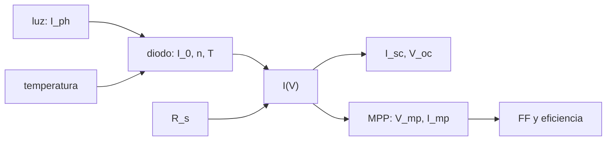

# B86-C02 — Celdas solares

<!-- nav:top -->
[🏠 Programa](../../../../README.md) · [📚 Bloque B86](../../../tronco-comun/B86-sistemas-de-potencia-y-energia-espacial.md) · [← Anterior: B86-C01 — Balance de potencia eléctrica](../B86-C01-balance-de-potencia-electrica/CLASE.md) · [Siguiente: B86-C03 — Arreglos fotovoltaicos desplegables →](../B86-C03-arreglos-fotovoltaicos-desplegables/CLASE.md)
<!-- /nav -->

## 1. Ubicación, nivel y alcance

Clase 2 del bloque B86. Nivel N3. Segunda clase del bloque. Del balance de la clase anterior queda pendiente cuánta potencia entrega una celda por unidad de área. Aquí calculas la curva corriente-tensión de una celda sintética con el modelo de diodo único y de ella sacas la corriente de cortocircuito, la tensión de circuito abierto, el punto de máxima potencia, el factor de llenado y el efecto de la temperatura. La celda es sintética: sus parámetros no describen ningún producto comercial.

## 2. Por qué esta clase existe

La potencia de una celda no es un número fijo: depende de la tensión a la que se la haga trabajar y de su temperatura. Elegir mal el punto de operación o ignorar la temperatura del ala cambia la potencia entregada. La decisión central: **¿a qué tensión debe operar una celda para extraer su máxima potencia, y cuánto pierde cuando se calienta?**

## 3. Lo que podrás hacer al terminar

1. Escribir la ecuación de diodo único con resistencia en serie y resolverla con Newton.
2. Obtener `I_sc` y `V_oc` y contrastar `V_oc` numérico con su forma cerrada.
3. Encontrar el punto de máxima potencia con búsqueda de sección áurea y con una rejilla.
4. Calcular el factor de llenado y la eficiencia frente a la irradiancia de `1361 W/m²`.
5. Estimar el coeficiente de temperatura de la potencia máxima.
6. Separar lo consultado (constantes, irradiancia, orden de magnitud de eficiencias) de lo ilustrativo (parámetros del diodo).

La evidencia es **la curva I-V y la tabla de rendimiento de una celda sintética** del ejercicio 12 (sección 20).

## 4. Con qué llegas y cómo comprobarlo

1. ¿Qué es una unión p-n?
2. ¿Qué es la tensión térmica `kT/q`?
3. ¿Qué mide una curva I-V?
4. ¿Qué es la eficiencia de una celda?
5. ¿Qué es una verificación por segunda vía?

<details>
<summary>Ver respuestas</summary>

1. La interfaz entre un semiconductor tipo p y uno tipo n que se comporta como diodo. 2. Unos `26 mV` a temperatura ambiente. 3. La corriente de un dispositivo para cada tensión aplicada. 4. La potencia eléctrica máxima dividida por la potencia luminosa incidente. 5. Calcular lo mismo con otro método y comparar.
</details>

Con cuatro o cinco aciertos, sigue; si no, repasa los prerrequisitos.

## 5. Un caso de contexto y casos de referencia

Una celda sintética de `30 cm²` bajo `1361 W/m²` y `28 °C` entrega `0,5200 A` en cortocircuito, `2,694 V` en circuito abierto y una potencia máxima de `1,1456 W` a `2,315 V`, con un factor de llenado de `0,818` y una eficiencia de `28,1 %`. Es el **ejemplo conductor** y es **ilustrativo**: los parámetros se eligieron para quedar en el orden de magnitud de las celdas multiunión de la tabla de la NASA, pero no describen ningún producto.

## 6. Vocabulario

La **corriente fotogenerada** `I_ph` es proporcional a la irradiancia. La **corriente de saturación** `I_0` fija la tensión de circuito abierto. El **factor de idealidad** `n` ajusta la pendiente exponencial. La **resistencia en serie** `R_s` reduce la tensión útil. El **punto de máxima potencia** (MPP) es el máximo de `P = V I`. El **factor de llenado** es `FF = P_max/(V_oc I_sc)`.

## 7. Modelo mental: una manguera con una válvula



*Descripción textual:* la luz fija `I_ph`; el diodo y la resistencia en serie dan la curva `I(V)`; de ella salen los extremos, el punto de máxima potencia, el factor de llenado y la eficiencia; la temperatura modifica el diodo.

Analogía: una manguera con presión fija y una válvula; con la válvula cerrada hay presión y no hay caudal, con la válvula abierta hay caudal y no hay presión, y la potencia máxima está en un punto intermedio. Límite: el diodo único agrupa tres uniones en una; una celda multiunión real tiene una curva con varios codos.

## 8. La explicación, paso a paso

### 8.1 La ecuación

`I = I_ph − I_0 (exp((V + I R_s)/(n k T/q)) − 1)`. Como `I` aparece a ambos lados, se resuelve con Newton para cada `V`. La tensión térmica con `n = 4,5` y `T = 301,15 K` es `n k T/q = 0,1168 V`.

### 8.2 Extremos

En cortocircuito `I_sc = 0,52000 A`. En circuito abierto `V_oc = n k T/q · ln(I_ph/I_0 + 1) = 2,69354 V` en forma cerrada; la bisección da `2,69354 V` (diferencia `0,0e+00 V`).

### 8.3 Máxima potencia

La búsqueda de sección áurea da `V_mp = 2,3154 V`, `I_mp = 0,49478 A` y `P_max = 1,14561 W`. La rejilla de `10 µV` da `1,14561 W` en `2,3154 V`. El factor de llenado es `0,8179` y la eficiencia `P_max/(G A) = 28,06 %`.

### 8.4 Temperatura

| `T` (K) | `V_oc` (V) | `P_max` (W) |
|---|---|---|
| 233,15 | 3,0542 | 1,3127 |
| 301,15 | 2,6935 | 1,1456 |
| 353,15 | 2,4067 | 1,0064 |

La potencia cae con el calor: el coeficiente de la potencia máxima es `-0,223 %/K`. El comportamiento (`V_oc` baja y `I_sc` sube un poco al calentar) es cualitativo; los coeficientes de este modelo son ilustrativos.

## 9. Magnitudes, símbolos y unidades

| Símbolo | Qué es | Unidad | Valor / nota |
|---|---|---|---|
| `I_sc` | corriente de cortocircuito | A | 0,5200 |
| `V_oc` | tensión de circuito abierto | V | 2,694 |
| `V_mp`, `I_mp` | punto de máxima potencia | V; A | 2,315; 0,4948 |
| `P_max` | potencia máxima | W | 1,1456 |
| `FF` | factor de llenado | — | 0,818 |
| `η` | eficiencia | — | 0,2806 |
| `k` | constante de Boltzmann | J/K | 1,380649 × 10⁻²³ (consultada) |

## 10. Convenciones y referencias

Modelo de diodo único con resistencia en serie y sin resistencia en derivación. Irradiancia `1361,0 W/m²` (ficha de la Tierra de la NASA), área activa `30 cm²`, temperatura de referencia `301,15 K`. `I_ph`, `I_0`, `n`, `R_s`, `E_g` efectiva y el coeficiente de `I_ph` son **ilustrativos**. La carga elemental es un valor exacto del SI que no se consultó en esta clase.

## 11. De dónde sale lo que afirmamos

| ID | Fuente | Localizador | Respalda | Estado |
|---|---|---|---|---|
| S1 | NASA/NSSDC, Earth Fact Sheet — https://nssdc.gsfc.nasa.gov/planetary/factsheet/earthfact.html (consultada 2026-11-10) | ficha completa leída | irradiancia solar 1361,0 W/m²; GM = 0,39860 × 10⁶ km³/s²; radio medio 6371,000 km; periodo orbital sideral 365,256 d | Consultada |
| S2 | NIST, CODATA 2022 — constante de Boltzmann — https://physics.nist.gov/cgi-bin/cuu/Value?k (consultada 2026-11-10) | valor recomendado leído | k = 1,380649 × 10⁻²³ J/K | Consultada |
| S3 | NASA Small Spacecraft Systems Virtual Institute, State-of-the-Art of Small Spacecraft Technology, cap. 3 Power — https://www.nasa.gov/smallsat-institute/sst-soa/power-subsystems/ (consultada 2026-11-10) | primeros 100.000 de 119.638 caracteres y el resumen final; no se leyó el resto | eficiencias de celdas multiunión (29,5–34 % BOL), energía específica de baterías Li-ion (150–270 Wh/kg comerciales), bus de 8,2 V con salidas de 5,0 y 3,3 V, tensiones de 12, 28 y 50 V con convertidores GaN, PCDU de 960 W y 1500 W; la degradación se lista como factor sin cifra | Consultada (parcial) |
| — | Relación estándar: modelo de diodo único de una celda solar | — | la verifica el laboratorio con una segunda vía | No consultada en una fuente concreta |
| — | Datos sintéticos: parámetros del diodo, resistencia serie y coeficientes de temperatura | — | valores generados para el ejemplo | Ilustrativo, no medido |

Límites: el modelo de diodo único no se consultó en un texto concreto; las eficiencias de la NASA se citan como orden de magnitud, no como validación de esta celda sintética.

## 12. Cómo ver la curva de una celda

| Magnitud | Valor |
|---|---|
| `I_sc` | 0,52000 A |
| `V_oc` | 2,69354 V |
| `P_max` | 1,14561 W |
| `FF` | 0,8179 |
| Eficiencia | 28,06 % |
| Coeficiente de `P_max` | -0,223 %/K |

Descripción larga: la corriente es casi plana hasta cerca de la tensión de circuito abierto y luego cae de golpe; la potencia máxima está en el codo.

## 13. Ejemplo trabajado: la potencia en el punto de máxima potencia

**Paso 1 · Punto.** `V_mp = 2,3154 V`, `I_mp = 0,49478 A`.

**Paso 2 · Potencia.** `P_max = V_mp I_mp = 1,14561 W`.

**Paso 3 · Incidente.** `G A = 1361 × 30 × 10⁻⁴ = 4,0830 W`.

**Paso 4 · Eficiencia.** `η = 1,14561/4,0830 = 28,06 %`.

## 14. Distintas formas de describir una celda

**Por extremos:** `I_sc`, `V_oc`. **Por punto de trabajo:** `V_mp`, `I_mp`. **Por forma:** `FF`. **Por rendimiento:** `η`. **Por temperatura:** `%/K`.

## 15. Práctica guiada

**Ejercicio 1 · con los pasos indicados.** Calcula la potencia incidente sobre `30 cm²` a `1361 W/m²`. *Pasos:* convierte el área a m² y multiplica.

<details><summary>Solución comentada</summary>

`30 × 10⁻⁴ × 1361 = 4,0830 W`.
</details>

**Ejercicio 2 · con una pista.** Predice `FF` sabiendo `P_max`, `V_oc` e `I_sc`. *Pista:* divide.

<details><summary>Solución comentada</summary>

`1,14561/(2,6935 × 0,52000) = 0,8179`.
</details>

**Ejercicio 3 · casi autónomo.** ¿Por qué `P(V)` tiene un máximo interior?

<details><summary>Solución comentada</summary>

En `V = 0` la potencia es nula y en `V = V_oc` también; entre ambos es positiva y por tanto hay un máximo.
</details>

## 16. Práctica autónoma, transferencia e integrador

**Ejercicio 4 · autónomo.** Potencia de una celda que opera a `1,0 V` (no en el MPP).

<details><summary>Solución comentada</summary>

`1,0 × I(1,0) = 0,5200 W`, menos que `P_max`.
</details>

**Ejercicio 5 · autónomo.** Si dos celdas iguales se ponen en serie, ¿qué `V_oc` e `I_sc` tiene el conjunto?

<details><summary>Solución comentada</summary>

`V_oc` se duplica e `I_sc` no cambia.
</details>

**Ejercicio 6 · autónomo.** Si se ponen en paralelo?

<details><summary>Solución comentada</summary>

`I_sc` se duplica y `V_oc` no cambia.
</details>

**Ejercicio 7 · autónomo.** ¿Cuántas celdas en serie para un bus de `28 V` en el MPP?

<details><summary>Solución comentada</summary>

`28/2,315 = 12,1`, es decir `13` celdas (entero hacia arriba).
</details>

**Ejercicio 8 · autónomo.** `P_max` de un ala de `1,2 m²` con empaquetado `0,85` y esta eficiencia, sin coseno.

<details><summary>Solución comentada</summary>

`1361 × 1,2 × 0,85 × 0,2806 = 389,5 W`.
</details>

**Ejercicio 9 · transferencia.** **Transferencia.** Un fabricante anuncia `32 %` pero la celda opera a `70 °C`. ¿Qué haces?

<details><summary>Solución comentada</summary>

Corregir la potencia con el coeficiente de temperatura; el valor de hoja se da a una temperatura de referencia.
</details>

**Ejercicio 10 · transferencia.** **Transferencia.** Un colega usa `V_oc` como tensión de operación del ala. ¿Qué error comete?

<details><summary>Solución comentada</summary>

A `V_oc` la corriente es nula y la potencia es cero: hay que operar cerca de `V_mp`.
</details>

**Ejercicio 11 · transferencia.** **Transferencia.** Se publica la curva de este modelo como datos de una celda comercial. ¿Qué corriges?

<details><summary>Solución comentada</summary>

Es una celda sintética con parámetros ilustrativos; no se debe presentar como medición ni como producto.
</details>

**Ejercicio 12 · integrador.** **Integrador.** Elabora tu *curva I-V y tabla de rendimiento de una celda sintética*: `I_sc`, `V_oc`, MPP, `FF`, `η`, efecto de la temperatura y rótulos.

<details><summary>Solución comentada</summary>

Secciones 8.1–8.4 y la salida del laboratorio.
</details>

## 17. Laboratorio: curva I-V de una celda sintética

El script [celda_iv.py](celda_iv.py) resuelve el modelo de diodo único con Newton, halla `I_sc`, `V_oc` y el MPP (**comprueba** `V_oc` frente a su forma cerrada < 1e-9 V y `P_max` de sección áurea frente a una rejilla < 1e-6 W) y barre la temperatura.

**Datos:** constante de Boltzmann del NIST, irradiancia de la NASA/NSSDC (consultadas); parámetros del diodo, área y coeficientes **ilustrativos**. **Predice antes de ejecutar:** ¿qué temperatura da más potencia? (la más fría). **Ejecución del 2026-11-10 (Python 3.12.9):**

```text
Python 3.12.9 (biblioteca estandar)
Celda SINTETICA: area = 30 cm2, G = 1361.0 W/m2, T = 28.0 C; potencia incidente = 4.0830 W
Isc = 0.52000 A ; Voc = 2.69354 V (cerrado 2.69354 V; diferencia 0.0e+00 V)
Punto de maxima potencia: Vmp = 2.3154 V ; Imp = 0.49478 A ; Pmax = 1.14561 W
Pmax por rejilla = 1.14561 W en V = 2.3154 V ; diferencia = 4.0e-12 W
Factor de llenado FF = 0.8179 ; eficiencia = 28.06 %
 T [K]   Voc [V]   Pmax [W]
 233.15   3.0542    1.3127
 301.15   2.6935    1.1456
 353.15   2.4067    1.0064
Coeficiente de temperatura de Pmax = -0.223 %/K
Pruebas superadas.
```

```bash
python programa/clases/B86/B86-C02-celdas-solares/celda_iv.py
```

**Límites:** un solo diodo, sin resistencia en derivación, sin espectro, sin ángulo de incidencia ni degradación; los coeficientes de temperatura no corresponden a un producto.

## 18. Errores frecuentes y cómo corregirlos

**Operar la celda a `V_oc`.** Se corrige con 8.3.

**Ignorar la temperatura de operación.** Se corrige con 8.4.

**Confundir eficiencia de celda con eficiencia de ala.** Se corrige con el ejemplo 13 y la clase de arreglos desplegables.

**Presentar la celda sintética como un producto.** Se corrige con la sección 10.

## 19. Cómo sabrás que vas bien

Tras la sección 8: ¿qué `P_max` esperabas y cuál obtuviste? Si dudas, repasa el ejemplo 13. Tras el laboratorio: ¿qué compara la rejilla con la sección áurea? (ver la sección 17).

## 20. Qué entregas y cómo se evalúa

El producto es **la curva I-V y la tabla de rendimiento de una celda sintética** (ejercicio 12).

| Criterio | Inicial | En desarrollo | Logrado | Destacado |
|---|---|---|---|---|
| Conceptos | Los confunde | Parciales | Calcula MPP, `FF` y `η` | Explica los límites |
| Cálculo | Sin unidades | Con errores | Tablas completas con unidades | Calcula casos nuevos |
| Numérico | Sin comprobar | Un caso | Contraste con una segunda vía | Interpreta las diferencias |
| Fuentes | Sin fuente | Sin fecha | Fuentes con fecha y estado | Declara lo ilustrativo y lo no consultado |
| Límites | No los nombra | Uno | Tres | Discute qué falta del modelo |

**Condiciones críticas (no se compensan con promedio):** rotular los parámetros de la celda como ilustrativos; no presentarla como un producto; citar solo lo consultado.

## 21. Ética, seguridad y límites

Clase educativa: los modelos son simplificados y sus datos son sintéticos o ilustrativos; ningún resultado describe una nave real ni sustituye a la ingeniería de una misión ni a una norma aplicada.  Accesibilidad: tablas equivalentes a las gráficas, fórmulas en texto, ejercicios sin conexión.

## 22. Para cerrar y seguir

Una celda sintética de `30 cm²` entrega `1,146 W` a `2,315 V` y pierde potencia al calentarse. Queda una pregunta: ¿cómo se agrupan muchas celdas en un ala que se despliega?

**Glosario español–inglés.** celda solar · *solar cell*; curva I-V · *I-V curve*; punto de máxima potencia · *maximum power point*; factor de llenado · *fill factor*; circuito abierto · *open circuit*.

**Continuidad.** [B86-C03](../B86-C03-arreglos-fotovoltaicos-desplegables/CLASE.md) estudia el ala desplegable y su dimensionamiento.

**Referencias:** ver sección 11.

<!-- nav:bottom -->
---

[← Anterior: B86-C01 — Balance de potencia eléctrica](../B86-C01-balance-de-potencia-electrica/CLASE.md) · [📚 Bloque B86](../../../tronco-comun/B86-sistemas-de-potencia-y-energia-espacial.md) · [Siguiente: B86-C03 — Arreglos fotovoltaicos desplegables →](../B86-C03-arreglos-fotovoltaicos-desplegables/CLASE.md)
<!-- /nav -->
