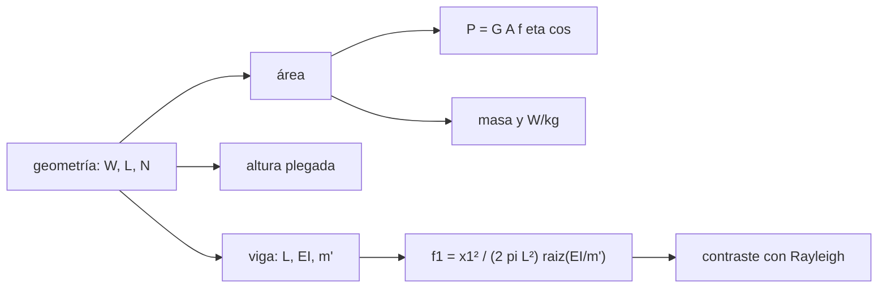

# B86-C03 — Arreglos fotovoltaicos desplegables

<!-- nav:top -->
[🏠 Programa](../../../../README.md) · [📚 Bloque B86](../../../tronco-comun/B86-sistemas-de-potencia-y-energia-espacial.md) · [← Anterior: B86-C02 — Celdas solares](../B86-C02-celdas-solares/CLASE.md) · [Siguiente: B86-C04 — Orientación solar y eclipses →](../B86-C04-orientacion-solar-y-eclipses/CLASE.md)
<!-- /nav -->

## 1. Ubicación, nivel y alcance

Clase 3 del bloque B86. Nivel N3. Tercera clase del bloque. La celda de la clase anterior se agrupa en paneles que viajan plegados y se despliegan en órbita. Aquí dimensionas un ala sintética: su área y su potencia, la pérdida cuando el Sol no incide de frente, la altura que ocupa plegada y su primera frecuencia de flexión como viga en voladizo. Usas la estructura solo en forma de viga uniforme; para materiales y diseño estructural véase [B84](../../../tronco-comun/B84-estructuras-materiales-y-fabricacion-espacial.md). Las dimensiones son sintéticas.

## 2. Por qué esta clase existe

El ala es el mayor elemento del satélite y su geometría define la potencia, el volumen de lanzamiento y la dinámica. Un ala mal orientada pierde potencia con el coseno y un ala demasiado flexible interactúa con el control de actitud. La decisión central: **¿cuántos paneles de qué tamaño hacen falta para la potencia pedida, y qué frecuencia tiene el ala desplegada?**

## 3. Lo que podrás hacer al terminar

1. Calcular el área de un ala y su potencia a inicio de vida con empaquetado y eficiencia.
2. Aplicar la pérdida por coseno cuando el Sol no incide de frente.
3. Calcular la potencia específica en W/kg.
4. Estimar la altura plegada de una pila de paneles con holgura.
5. Calcular la primera frecuencia de flexión de una viga en voladizo y contrastarla con la raíz tabulada y con el cociente de Rayleigh.
6. Separar lo consultado (irradiancia, eficiencia típica) de lo ilustrativo (dimensiones, masa, rigidez).

La evidencia es **la ficha de dimensionamiento de un ala de cuatro paneles** del ejercicio 12 (sección 20).

## 4. Con qué llegas y cómo comprobarlo

1. ¿Qué es el factor de empaquetado?
2. ¿Cuánta potencia cae si el Sol incide a 60° de la normal?
3. ¿Qué es una viga en voladizo?
4. ¿Qué es la rigidez a flexión `EI`?
5. ¿Qué es un dato sintético?

<details>
<summary>Ver respuestas</summary>

1. La fracción del área del panel cubierta por celdas. 2. La mitad, porque `cos 60° = 0,5`. 3. Una viga empotrada en un extremo y libre en el otro. 4. El producto del módulo de Young por el momento de inercia de la sección, en N·m². 5. Un dato generado para el ejemplo, no medido.
</details>

Con cuatro o cinco aciertos, sigue; si no, repasa los prerrequisitos.

## 5. Un caso de contexto y casos de referencia

Un satélite sintético lleva `2` alas de `2` paneles de `0,5 m × 0,6 m`: `1,20 m²` y `409,5 W` al inicio de vida con el Sol de frente (`354,7 W` a `30°`), con una masa de `2,64 kg` (`155,1 W/kg`). Plegado ocupa `0,085 m` de altura y, desplegada, cada ala vibra a `4,059 Hz` en su primer modo de flexión. Es el **ejemplo conductor** y es **ilustrativo**.

## 6. Vocabulario

Un **panel** es la placa con celdas. Un **ala** es un conjunto de paneles unidos por bisagras. El **desplegado** es el paso de la pila plegada al ala extendida. La **potencia específica** es `P/m`. El **primer modo** es la forma de vibrar de menor frecuencia, `f1`. El **cociente de Rayleigh** estima `f1` con una forma de prueba y da una cota superior.

## 7. Modelo mental: un abanico y una regla en voladizo



*Descripción textual:* la geometría da el área, la potencia, la masa y la altura plegada; como viga da `f1`, que se contrasta con el cociente de Rayleigh.

Analogía: un abanico que se pliega en poco espacio y, abierto, se mueve como una regla sujeta a un borde de la mesa. Límite: se ignoran la flexibilidad de las bisagras, la torsión y el acoplamiento con el satélite, que bajan la frecuencia real.

## 8. La explicación, paso a paso

### 8.1 Área y potencia

`A = 2 × 2 × 0,5 × 0,6 = 1,20 m²`. Con `G = 1361 W/m²`, `f_emp = 0,85` y `η = 0,295`: `P = 409,52 W` normal al Sol. Con incidencia `θ` la potencia es `P cosθ`: `354,66 W` a `30°` y `204,76 W` a `60°` (la mitad).

### 8.2 Masa y plegado

Con `2,2 kg/m²`, la masa es `2,64 kg` y la potencia específica `155,1 W/kg` (solo paneles). La pila de `2` paneles de `25 mm` con `5 mm` de holgura entre ellos ocupa `0,060 m`, y `0,085 m` con una tapa adicional.

### 8.3 Frecuencia de la viga

La viga uniforme en voladizo tiene `f1 = (x1²/(2π L²))√(EI/m')`, con `x1` raíz de `cosh x · cos x = −1`. La bisección da `x1 = 1,8751040687`, igual al valor tabulado con una diferencia de `1,2e-11`. Con `L = 1,20 m`, `m' = 1,10 kg/m` y `EI = 120 N·m²`: `f1 = 4,0588 Hz`.

### 8.4 Segunda vía: Rayleigh

El cociente de Rayleigh con la forma estática `3ξ² − ξ³` da `4,1183 Hz` (`+1,465 %` sobre `f1`): una cota superior, como debe ser.

## 9. Magnitudes, símbolos y unidades

| Símbolo | Qué es | Unidad | Valor / nota |
|---|---|---|---|
| `A` | área del ala | m² | 1,20 |
| `P` | potencia a inicio de vida | W | 409,5 |
| `θ` | ángulo de incidencia | ° | 0, 30, 60 |
| `P/m` | potencia específica | W/kg | 155,1 |
| `EI` | rigidez a flexión | N·m² | 120 (ilustrativa) |
| `x1` | raíz de la ecuación de la viga | — | 1,875104 |
| `f1` | primera frecuencia de flexión | Hz | 4,059 |

## 10. Convenciones y referencias

Ala plana con celdas uniformes, Sol de frente salvo indicación, empaquetado `0,85`, eficiencia de celda `0,295` (valor típico de la tabla de la NASA). Viga de Euler–Bernoulli uniforme y empotrada, sin amortiguamiento, bisagras rígidas. Dimensiones, densidad de área y rigidez son **ilustrativas**.

## 11. De dónde sale lo que afirmamos

| ID | Fuente | Localizador | Respalda | Estado |
|---|---|---|---|---|
| S1 | NASA/NSSDC, Earth Fact Sheet — https://nssdc.gsfc.nasa.gov/planetary/factsheet/earthfact.html (consultada 2026-11-10) | ficha completa leída | irradiancia solar 1361,0 W/m²; GM = 0,39860 × 10⁶ km³/s²; radio medio 6371,000 km; periodo orbital sideral 365,256 d | Consultada |
| S3 | NASA Small Spacecraft Systems Virtual Institute, State-of-the-Art of Small Spacecraft Technology, cap. 3 Power — https://www.nasa.gov/smallsat-institute/sst-soa/power-subsystems/ (consultada 2026-11-10) | primeros 100.000 de 119.638 caracteres y el resumen final; no se leyó el resto | eficiencias de celdas multiunión (29,5–34 % BOL), energía específica de baterías Li-ion (150–270 Wh/kg comerciales), bus de 8,2 V con salidas de 5,0 y 3,3 V, tensiones de 12, 28 y 50 V con convertidores GaN, PCDU de 960 W y 1500 W; la degradación se lista como factor sin cifra | Consultada (parcial) |
| — | Relación estándar: viga de Euler–Bernoulli en voladizo y cociente de Rayleigh | — | la verifica el laboratorio con una segunda vía | No consultada en una fuente concreta |
| — | Datos sintéticos: dimensiones de paneles, masa por área y rigidez | — | valores generados para el ejemplo | Ilustrativo, no medido |

Límites: no se consultó ningún diseño real de ala desplegable ni su norma de ensayo; la raíz de la viga se contrasta con el valor de tablas recordado por el autor, no con una fuente consultada en esta clase.

## 12. Cómo ver la potencia de un ala según el ángulo

| Magnitud | Valor |
|---|---|
| Área | 1,20 m² |
| `P` a 0° | 409,5 W |
| `P` a 30° | 354,7 W |
| `P` a 60° | 204,8 W |
| `f1` | 4,059 Hz |
| Rayleigh / `f1` | +1,465 % |

Descripción larga: la potencia cae con el coseno (a `60°` es la mitad) y el cociente de Rayleigh queda apenas por encima de la frecuencia exacta.

## 13. Ejemplo trabajado: la potencia con el Sol a 30°

**Paso 1 · Área.** `1,20 m²`.

**Paso 2 · Normal.** `1361 × 1,20 × 0,85 × 0,295 = 409,52 W`.

**Paso 3 · Coseno.** `cos 30° = 0,8660`.

**Paso 4 · Resultado.** `409,52 × 0,8660 = 354,66 W`.

## 14. Distintas formas de describir un ala

**Por geometría:** `W`, `L`, `N`. **Por potencia:** `P`, `P/m`. **Por orientación:** `cosθ`. **Por volumen:** altura plegada. **Por dinámica:** `f1`.

## 15. Práctica guiada

**Ejercicio 1 · con los pasos indicados.** Calcula el área de un ala de 3 paneles de `0,4 × 0,5 m`. *Pasos:* multiplica y cuenta.

<details><summary>Solución comentada</summary>

`3 × 0,4 × 0,5 = 0,6 m²`.
</details>

**Ejercicio 2 · con una pista.** Predice la potencia a `45°`. *Pista:* `cos 45°`.

<details><summary>Solución comentada</summary>

`409,5 × 0,7071 = 289,6 W`.
</details>

**Ejercicio 3 · casi autónomo.** ¿Por qué el cociente de Rayleigh da una cota superior?

<details><summary>Solución comentada</summary>

Porque una forma de prueba impone una restricción adicional y eso nunca baja la energía de deformación del modo real.
</details>

## 16. Práctica autónoma, transferencia e integrador

**Ejercicio 4 · autónomo.** Potencia específica si la masa sube a `3,0 kg/m²`.

<details><summary>Solución comentada</summary>

`409,5/(3,0 × 1,20) = 113,8 W/kg`.
</details>

**Ejercicio 5 · autónomo.** `f1` si `EI` se cuadruplica.

<details><summary>Solución comentada</summary>

Se duplica: `f1 ∝ √EI`, `4,059 × 2 = 8,118 Hz`.
</details>

**Ejercicio 6 · autónomo.** `f1` si la longitud se duplica.

<details><summary>Solución comentada</summary>

Baja a una cuarta parte: `f1 ∝ 1/L²`, `4,059/4 = 1,015 Hz`.
</details>

**Ejercicio 7 · autónomo.** Altura plegada con 3 paneles por ala.

<details><summary>Solución comentada</summary>

`3 × (25 + 5) + 25 = 115 mm`.
</details>

**Ejercicio 8 · autónomo.** Área necesaria para `300 W` normal al Sol con este empaquetado y eficiencia.

<details><summary>Solución comentada</summary>

`300/(1361 × 0,85 × 0,295) = 0,879 m²`.
</details>

**Ejercicio 9 · transferencia.** **Transferencia.** Un diseñador usa solo `cosθ` medio de `0,5` para toda la órbita. ¿Qué advertencia haces?

<details><summary>Solución comentada</summary>

Que el coseno varía con la orientación; ver la clase de orientación solar y eclipses para su promedio con y sin seguimiento.
</details>

**Ejercicio 10 · transferencia.** **Transferencia.** Un colega afirma que el ala real vibra a `f1`. ¿Qué respondes?

<details><summary>Solución comentada</summary>

Que `f1` es el de una viga ideal; la flexibilidad de las bisagras y la masa del satélite lo bajan.
</details>

**Ejercicio 11 · transferencia.** **Transferencia.** Se presenta `409,5 W` como la potencia de un satélite real. ¿Qué corriges?

<details><summary>Solución comentada</summary>

Es un cálculo con dimensiones ilustrativas, no la potencia de una nave.
</details>

**Ejercicio 12 · integrador.** **Integrador.** Elabora tu *ficha de dimensionamiento de un ala de cuatro paneles*: área, potencia, masa, altura plegada, `f1`, contraste y rótulos.

<details><summary>Solución comentada</summary>

Secciones 8.1–8.4 y la salida del laboratorio.
</details>

## 17. Laboratorio: ala desplegable sintética

El script [ala_desplegable.py](ala_desplegable.py) calcula área, potencia, masa, altura plegada y la frecuencia de flexión de la viga (**comprueba** que `x1` coincide con el valor tabulado < 1e-8, que el cociente de Rayleigh es cota superior dentro de `2 %` y que a `60°` la potencia es la mitad).

**Datos:** irradiancia y eficiencia típica de la NASA (consultadas); dimensiones, masa y rigidez **ilustrativas**. **Predice antes de ejecutar:** ¿el cociente de Rayleigh quedará por encima o por debajo de `f1`? (por encima, en `+1,465 %`). **Ejecución del 2026-11-10 (Python 3.12.9):**

```text
Python 3.12.9 (biblioteca estandar)
Ala SINTETICA: 2 alas x 2 paneles de 0.5 m x 0.6 m; area total = 1.200 m2 ; masa = 2.64 kg
Potencia BOL normal al Sol = 409.52 W ; potencia especifica = 155.1 W/kg
Con el Sol a 30 grados = 354.66 W ; a 60 grados = 204.76 W
Altura plegada por ala = 85 mm (paneles de 25 mm con holgura de 5 mm)
Viga en voladizo L = 1.20 m, masa lineal = 1.10 kg/m, EI = 120 N m2
x1 numerico = 1.8751040687 ; tabulado = 1.8751040687 ; diferencia = 1.2e-11
f1 = 4.0588 Hz ; cociente de Rayleigh = 4.1183 Hz (+1.465 %)
Pruebas superadas.
```

```bash
python programa/clases/B86/B86-C03-arreglos-fotovoltaicos-desplegables/ala_desplegable.py
```

**Límites:** viga uniforme sin bisagras flexibles, sin torsión ni acoplamiento con el satélite, y sin tolerancias de fabricación.

## 18. Errores frecuentes y cómo corregirlos

**Olvidar el coseno.** Se corrige con 8.1.

**Confundir potencia específica de paneles con la del subsistema.** Se corrige con 8.2: aquí solo cuentan los paneles.

**Tomar `f1` ideal como frecuencia real.** Se corrige con 8.3 y los límites.

**Presentar el ala sintética como un diseño.** Se corrige con la sección 10.

## 19. Cómo sabrás que vas bien

Tras la sección 8: ¿qué potencia esperabas a `30°` y cuál obtuviste? Si dudas, repasa el ejemplo 13. Tras el laboratorio: ¿qué comprueba el cociente de Rayleigh? (ver la sección 17).

## 20. Qué entregas y cómo se evalúa

El producto es **la ficha de dimensionamiento de un ala de cuatro paneles** (ejercicio 12).

| Criterio | Inicial | En desarrollo | Logrado | Destacado |
|---|---|---|---|---|
| Conceptos | Los confunde | Parciales | Calcula `P`, `P/m` y `f1` | Explica los límites |
| Cálculo | Sin unidades | Con errores | Tablas completas con unidades | Calcula casos nuevos |
| Numérico | Sin comprobar | Un caso | Contraste con una segunda vía | Interpreta las diferencias |
| Fuentes | Sin fuente | Sin fecha | Fuentes con fecha y estado | Declara lo ilustrativo y lo no consultado |
| Límites | No los nombra | Uno | Tres | Discute qué falta del modelo |

**Condiciones críticas (no se compensan con promedio):** rotular las dimensiones como ilustrativas; no presentar el ala como un diseño real; citar solo lo consultado.

## 21. Ética, seguridad y límites

Clase educativa: los modelos son simplificados y sus datos son sintéticos o ilustrativos; ningún resultado describe una nave real ni sustituye a la ingeniería de una misión ni a una norma aplicada.  Accesibilidad: tablas equivalentes a las gráficas, fórmulas en texto, ejercicios sin conexión.

## 22. Para cerrar y seguir

Un ala sintética de `1,20 m²` entrega `409,5 W` de frente y `204,8 W` a `60°`. Queda una pregunta: ¿cómo se orienta el ala y cuánto dura el eclipse?

**Glosario español–inglés.** ala desplegable · *deployable array*; panel · *panel*; potencia específica · *specific power*; viga en voladizo · *cantilever beam*; cociente de Rayleigh · *Rayleigh quotient*.

**Continuidad.** [B86-C04](../B86-C04-orientacion-solar-y-eclipses/CLASE.md) estudia la orientación solar y la duración de los eclipses.

**Referencias:** ver sección 11.

<!-- nav:bottom -->
---

[← Anterior: B86-C02 — Celdas solares](../B86-C02-celdas-solares/CLASE.md) · [📚 Bloque B86](../../../tronco-comun/B86-sistemas-de-potencia-y-energia-espacial.md) · [Siguiente: B86-C04 — Orientación solar y eclipses →](../B86-C04-orientacion-solar-y-eclipses/CLASE.md)
<!-- /nav -->
