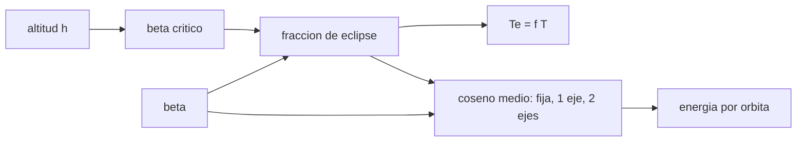

# B86-C04 — Orientación solar y eclipses

<!-- nav:top -->
[🏠 Programa](../../../../README.md) · [📚 Bloque B86](../../../tronco-comun/B86-sistemas-de-potencia-y-energia-espacial.md) · [← Anterior: B86-C03 — Arreglos fotovoltaicos desplegables](../B86-C03-arreglos-fotovoltaicos-desplegables/CLASE.md) · [Siguiente: B86-C05 — Baterías de ion-litio →](../B86-C05-baterias-de-ion-litio/CLASE.md)
<!-- /nav -->

## 1. Ubicación, nivel y alcance

Clase 4 del bloque B86. Nivel N3. Cuarta clase del bloque. La clase anterior supuso que el Sol incide de frente; aquí ves cuándo no. Calculas cuánto dura el eclipse de una órbita baja según el ángulo `β` entre el Sol y el plano de la órbita, el `β` crítico a partir del cual deja de haber eclipse y cuánta potencia se pierde por el coseno según cómo esté orientada el ala. Usas la geometría orbital de [B73](../../../tronco-comun/B73-perturbaciones-orbitales-y-precision-de-trayectorias.md) solo para el periodo. La órbita y la nave son sintéticas.

## 2. Por qué esta clase existe

El eclipse más largo fija el tamaño de la batería y el peor `β` fija el de la ala. Un diseño que mire solo `β = 0` ignora que a `β` alto no hay eclipse pero el coseno cae. La decisión central: **¿cuánto dura el eclipse en el peor y en el mejor `β`, y qué orientación del ala conviene?**

## 3. Lo que podrás hacer al terminar

1. Calcular el periodo y el `β` crítico de una órbita circular.
2. Calcular la fracción y la duración del eclipse con la fórmula cerrada para varios `β`.
3. Verificarla con un muestreo geométrico de la sombra cilíndrica.
4. Calcular el coseno medio por órbita para un ala fija, de un eje y de dos ejes.
5. Explicar por qué a `β` alto no hay eclipse y la ala fija pierde energía.
6. Separar lo consultado (`GM`, radio) de lo ilustrativo (altitud y ángulos elegidos).

La evidencia es **la tabla de eclipse y pérdida geométrica frente al ángulo beta** del ejercicio 12 (sección 20).

## 4. Con qué llegas y cómo comprobarlo

1. ¿Qué es el ángulo `β` de una órbita?
2. ¿Qué es la sombra cilíndrica?
3. ¿Qué es el coseno de incidencia?
4. ¿Qué es la penumbra?
5. ¿Qué es una verificación por segunda vía?

<details>
<summary>Ver respuestas</summary>

1. El ángulo entre el vector al Sol y el plano de la órbita. 2. La aproximación de la sombra de la Tierra como un cilindro de radio igual al de la Tierra. 3. El coseno del ángulo entre el rayo solar y la normal del panel; multiplica la potencia. 4. La zona de sombra parcial que esta clase no modela. 5. Calcular lo mismo con otro método y comparar.
</details>

Con cuatro o cinco aciertos, sigue; si no, repasa los prerrequisitos.

## 5. Un caso de contexto y casos de referencia

En la órbita sintética de `600 km` (`T = 5792,3 s`) el eclipse ocupa `36,70 %` con `β = 0` (`2126 s`), `34,47 %` con `β = 30°`, `28,25 %` con `β = 50°` y desaparece con `β = 70°`, porque el `β` crítico es `66,05°`. Es el **ejemplo conductor** y es **ilustrativo**.

## 6. Vocabulario

El **ángulo beta** `β` es el ángulo entre el Sol y el plano orbital. El **β crítico** `β* = asin(R/(R+h))` es el `β` desde el cual no hay eclipse. La **sombra cilíndrica** supone rayos paralelos. La **ala fija** no se mueve respecto del cuerpo; **un eje** gira para seguir al Sol en el plano; **dos ejes** lo siguen siempre.

## 7. Modelo mental: una luz que roza el borde de una mesa



*Descripción textual:* la altitud da el `β` crítico; con `β` se obtiene la fracción de eclipse y su duración; `β` y el eclipse dan el coseno medio y con él la energía por órbita.

Analogía: una lámpara y un objeto sobre la mesa: si la lámpara está al nivel de la mesa la sombra es larga y si sube la sombra deja de alcanzar al objeto. Límite: la sombra cilíndrica ignora la penumbra y la forma achatada de la Tierra, y el `β` varía a lo largo del año.

## 8. La explicación, paso a paso

### 8.1 Eclipse

`f(β) = acos(√(h² + 2Rh)/((R+h) cosβ))/π`. Con `h = 600 km`, `R = 6371 km`: `β* = asin(R/a) = 66,054°`; para `β = 0`, `f = 0,36697` (`2125,6 s`); para `30°`, `0,34474`; para `50°`, `0,28247`; para `70°`, cero.

### 8.2 Muestreo

El muestreo de `10⁶` puntos de la órbita con la prueba de distancia al eje del cilindro da `0,366968` con `β = 0` y `0,282470` con `β = 50°`, con diferencias de `7,5e-07` y `6,8e-07` respecto a la fórmula cerrada.

### 8.3 Coseno medio por órbita

Con la órbita completa (el eclipse cuenta como cero):

| Orientación | `β = 0` | `β = 50°` |
|---|---|---|
| Fija al cenit | 0,3183 | 0,2046 |
| Un eje | 0,6330 | 0,4612 |
| Dos ejes | 0,6330 | 0,7175 |

Con dos ejes el coseno medio es `1 − f`; con un eje es `(1 − f) cosβ`; con el ala fija al cenit es mucho menor (`≈ cosβ/π` antes de restar el eclipse).

### 8.4 Qué significa para el diseño

El eclipse es lo que dimensiona la batería (peor caso: `β = 0`); la pérdida por coseno dimensiona el ala (peor caso: `β` alto con un solo eje). El `0,70` de la clase de balance es un valor **ilustrativo** entre esos extremos.

## 9. Magnitudes, símbolos y unidades

| Símbolo | Qué es | Unidad | Valor / nota |
|---|---|---|---|
| `h` | altitud | km | 600 (ilustrativa) |
| `T` | periodo | s | 5792,3 |
| `β` | ángulo Sol–plano orbital | ° | 0; 30; 50; 70 |
| `β*` | β crítico | ° | 66,054 |
| `f` | fracción de eclipse | — | 0,3670 (β = 0) |
| `T_e` | duración del eclipse | s | 2125,6 (β = 0) |
| `cosθ` | coseno medio de incidencia | — | ver 8.3 |

## 10. Convenciones y referencias

Órbita circular, sombra cilíndrica sin penumbra, Tierra esférica de radio medio `6371 km`, `GM` de la ficha de la NASA, `β` constante durante la órbita, Sol en el infinito. Altitud y ángulos son **ilustrativos**.

## 11. De dónde sale lo que afirmamos

| ID | Fuente | Localizador | Respalda | Estado |
|---|---|---|---|---|
| S1 | NASA/NSSDC, Earth Fact Sheet — https://nssdc.gsfc.nasa.gov/planetary/factsheet/earthfact.html (consultada 2026-11-10) | ficha completa leída | irradiancia solar 1361,0 W/m²; GM = 0,39860 × 10⁶ km³/s²; radio medio 6371,000 km; periodo orbital sideral 365,256 d | Consultada |
| — | Relación estándar: geometría de la sombra cilíndrica y fracción de eclipse en función de β | — | la verifica el laboratorio con una segunda vía | No consultada en una fuente concreta |
| — | Datos sintéticos: altitud y ángulos beta del ejemplo | — | valores generados para el ejemplo | Ilustrativo, no medido |

Límites: no se consultó ninguna norma de cálculo de eclipse ni efemérides reales de ángulo beta; no se modela la penumbra ni el achatamiento terrestre.

## 12. Cómo ver el eclipse según el ángulo beta

| Magnitud | Valor |
|---|---|
| `β*` | 66,054° |
| Eclipse con β = 0 | 36,70 % |
| Eclipse con β = 50° | 28,25 % |
| Eclipse con β = 70° | 0 % |
| Diferencia con el muestreo | 7,5e-07 |

Descripción larga: el eclipse es máximo con `β = 0`, decrece al subir `β` y se anula en `β*`; el muestreo geométrico coincide con la fórmula.

## 13. Ejemplo trabajado: el β crítico

**Paso 1 · Semieje.** `a = 6371 + 600 = 6971 km`.

**Paso 2 · Cociente.** `R/a = 0,91393`.

**Paso 3 · Arcoseno.** `β* = asin(0,91393) = 66,054°`.

**Paso 4 · Lectura.** Con `β` mayor que `β*` la órbita no entra en sombra.

## 14. Distintas formas de describir el eclipse

**Por fracción:** `f`. **Por tiempo:** `T_e = f T`. **Por ángulo:** `β*`. **Por orientación:** coseno medio. **Por energía:** energía por órbita con eclipse.

## 15. Práctica guiada

**Ejercicio 1 · con los pasos indicados.** Calcula `β*` para `h = 600 km`. *Pasos:* `R/a` y arcoseno.

<details><summary>Solución comentada</summary>

`66,054°`.
</details>

**Ejercicio 2 · con una pista.** Predice si el eclipse con `β = 0` aumenta o disminuye si `h` sube. *Pista:* `R/a`.

<details><summary>Solución comentada</summary>

Disminuye: `R/a` baja y la fracción de eclipse baja.
</details>

**Ejercicio 3 · casi autónomo.** Duración del eclipse con `β = 30°`.

<details><summary>Solución comentada</summary>

`0,34474 × 5792,3 = 1996,8 s`.
</details>

## 16. Práctica autónoma, transferencia e integrador

**Ejercicio 4 · autónomo.** Fracción de eclipse con `β = 50°`.

<details><summary>Solución comentada</summary>

`0,28247`.
</details>

**Ejercicio 5 · autónomo.** Energía relativa por órbita de un ala de dos ejes con `β = 0` frente a `β = 50°`.

<details><summary>Solución comentada</summary>

`(1 − f0)/(1 − f50) = 0,8822`: con `β = 50°` hay más luz por órbita.
</details>

**Ejercicio 6 · autónomo.** Energía relativa por órbita de un ala de un eje a `β = 50°` frente a `β = 0`.

<details><summary>Solución comentada</summary>

`0,4612/0,6330 = 0,7286`: la ganancia de luz queda parcialmente anulada por el coseno.
</details>

**Ejercicio 7 · autónomo.** ¿Por qué la ala fija al cenit rinde tan poco?

<details><summary>Solución comentada</summary>

Porque solo recibe luz con coseno positivo durante la mitad de la órbita y con coseno decreciente.
</details>

**Ejercicio 8 · autónomo.** ¿Qué `β` da `f = 0,25`?

<details><summary>Solución comentada</summary>

El que resuelve `acos(c/cosβ)/π = 0,25`, es decir `cosβ = c/cos(0,25π)`; se obtiene `54,97°`.
</details>

**Ejercicio 9 · transferencia.** **Transferencia.** Un colega dimensiona la batería con el eclipse de `β = 50°`. ¿Qué error comete?

<details><summary>Solución comentada</summary>

Subdimensiona: el peor caso es `β = 0`, el eclipse más largo.
</details>

**Ejercicio 10 · transferencia.** **Transferencia.** Un colega dimensiona el ala con `β = 0` y un eje. ¿Qué advertencia haces?

<details><summary>Solución comentada</summary>

A `β` alto el coseno baja y el ala puede quedar corta; hay que evaluar el rango completo de `β` de la misión.
</details>

**Ejercicio 11 · transferencia.** **Transferencia.** Se presenta el eclipse calculado como el de una misión real. ¿Qué corriges?

<details><summary>Solución comentada</summary>

Es una órbita sintética con sombra cilíndrica; una misión real requiere efemérides y penumbra.
</details>

**Ejercicio 12 · integrador.** **Integrador.** Elabora tu *tabla de eclipse y pérdida geométrica frente al ángulo beta*: `β*`, `f` y `T_e` para cuatro `β`, cosenos medios y rótulos.

<details><summary>Solución comentada</summary>

Secciones 8.1–8.4 y la salida del laboratorio.
</details>

## 17. Laboratorio: eclipse y orientación solar de una órbita sintética

El script [eclipse_beta.py](eclipse_beta.py) calcula `β*`, la fracción y la duración del eclipse para varios `β`, la verifica con un muestreo geométrico y calcula cosenos medios (**comprueba** diferencia < 1e-5, que no hay eclipse a `β = 70°` y que el coseno medio de dos ejes es `1 − f`).

**Datos:** `GM` y radio de la NASA/NSSDC (consultados); altitud y `β` **ilustrativos**. **Predice antes de ejecutar:** ¿cuánto eclipse habrá con `β = 70°`? (ninguno). **Ejecución del 2026-11-10 (Python 3.12.9):**

```text
Python 3.12.9 (biblioteca estandar)
Orbita SINTETICA h = 600 km: T = 5792.3 s ; beta critico = 66.054 grados
 beta [gr]  eclipse [%]  eclipse [s]
        0       36.697       2125.6
       30       34.474       1996.8
       50       28.247       1636.2
       70        0.000          0.0
Fraccion de eclipse beta = 0: cerrada 0.366967 ; muestreo 0.366968 ; diferencia 7.5e-07
Fraccion de eclipse beta = 50: cerrada 0.282469 ; muestreo 0.282470 ; diferencia 6.8e-07
Cosenos medios por orbita (incluye el eclipse como cero):
  beta = 0 : fija al cenit 0.3183 ; un eje 0.6330 ; dos ejes 0.6330
  beta = 50: fija al cenit 0.2046 ; un eje 0.4612 ; dos ejes 0.7175
Pruebas superadas.
```

```bash
python programa/clases/B86/B86-C04-orientacion-solar-y-eclipses/eclipse_beta.py
```

**Límites:** sombra cilíndrica sin penumbra, Tierra esférica y `β` constante durante la órbita.

## 18. Errores frecuentes y cómo corregirlos

**Dimensionar la batería con un `β` alto.** Se corrige con 8.4.

**Creer que sin eclipse el ala rinde al máximo.** Se corrige con 8.3: el coseno cae.

**Usar el periodo como duración del eclipse.** Se corrige con 8.1: `T_e = f T`.

**Presentar la órbita sintética como una misión real.** Se corrige con la sección 10.

## 19. Cómo sabrás que vas bien

Tras la sección 8: ¿qué eclipse esperabas con `β = 30°` y cuál obtuviste? Si dudas, repasa el ejemplo 13. Tras el laboratorio: ¿qué verifica el muestreo? (ver la sección 17).

## 20. Qué entregas y cómo se evalúa

El producto es **la tabla de eclipse y pérdida geométrica frente al ángulo beta** (ejercicio 12).

| Criterio | Inicial | En desarrollo | Logrado | Destacado |
|---|---|---|---|---|
| Conceptos | Los confunde | Parciales | Calcula `β*`, `f` y cosenos medios | Explica los límites |
| Cálculo | Sin unidades | Con errores | Tablas completas con unidades | Calcula casos nuevos |
| Numérico | Sin comprobar | Un caso | Contraste con una segunda vía | Interpreta las diferencias |
| Fuentes | Sin fuente | Sin fecha | Fuentes con fecha y estado | Declara lo ilustrativo y lo no consultado |
| Límites | No los nombra | Uno | Tres | Discute qué falta del modelo |

**Condiciones críticas (no se compensan con promedio):** rotular la órbita y los ángulos como ilustrativos; dimensionar el eclipse con el peor `β`; citar solo lo consultado.

## 21. Ética, seguridad y límites

Clase educativa: los modelos son simplificados y sus datos son sintéticos o ilustrativos; ningún resultado describe una nave real ni sustituye a la ingeniería de una misión ni a una norma aplicada.  Accesibilidad: tablas equivalentes a las gráficas, fórmulas en texto, ejercicios sin conexión.

## 22. Para cerrar y seguir

El eclipse de la órbita sintética dura `2126 s` con `β = 0` y desaparece pasado `66,05°`. Queda una pregunta: ¿con qué se almacena la energía que cubre ese eclipse?

**Glosario español–inglés.** ángulo beta · *beta angle*; eclipse · *eclipse*; sombra cilíndrica · *cylindrical shadow*; seguimiento solar · *sun tracking*; penumbra · *penumbra*.

**Continuidad.** [B86-C05](../B86-C05-baterias-de-ion-litio/CLASE.md) estudia las baterías de ion-litio que cubren el eclipse.

**Referencias:** ver sección 11.

<!-- nav:bottom -->
---

[← Anterior: B86-C03 — Arreglos fotovoltaicos desplegables](../B86-C03-arreglos-fotovoltaicos-desplegables/CLASE.md) · [📚 Bloque B86](../../../tronco-comun/B86-sistemas-de-potencia-y-energia-espacial.md) · [Siguiente: B86-C05 — Baterías de ion-litio →](../B86-C05-baterias-de-ion-litio/CLASE.md)
<!-- /nav -->
