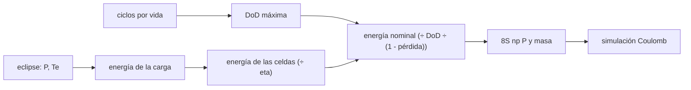

# B86-C05 — Baterías de ion-litio

<!-- nav:top -->
[🏠 Programa](../../../../README.md) · [📚 Bloque B86](../../../tronco-comun/B86-sistemas-de-potencia-y-energia-espacial.md) · [← Anterior: B86-C04 — Orientación solar y eclipses](../B86-C04-orientacion-solar-y-eclipses/CLASE.md) · [Siguiente: B86-C06 — Gestión de carga →](../B86-C06-gestion-de-carga/CLASE.md)
<!-- /nav -->

## 1. Ubicación, nivel y alcance

Clase 5 del bloque B86. Nivel N3. Quinta clase del bloque. La clase de eclipses dio cuánto dura la noche orbital; la batería la cubre. Aquí dimensionas una batería de ion-litio sintética: la energía que debe entregar, la profundidad de descarga que permite la vida en ciclos, el número de celdas y la masa, y compruebas la descarga con una simulación por cuenta de Coulomb. La celda y la ley de vida son sintéticas.

## 2. Por qué esta clase existe

Una batería de órbita baja hace unos `5400` ciclos al año. Dimensionarla por la energía de un solo eclipse sin mirar la profundidad de descarga la agota mucho antes del fin de la misión. La decisión central: **¿cuánta energía instalada hace falta para que la batería sobreviva a todos los ciclos de la misión?**

## 3. Lo que podrás hacer al terminar

1. Calcular los ciclos de carga y descarga de una misión en órbita baja.
2. Obtener la profundidad de descarga máxima que da esa vida con una ley de ciclos y contrastarla por bisección.
3. Calcular la energía nominal necesaria con eficiencia de descarga y pérdida de capacidad.
4. Dimensionar el paquete en serie y en paralelo y estimar su masa.
5. Simular la descarga por cuenta de Coulomb y comparar el DoD simulado con el planificado.
6. Separar lo consultado (rangos de energía específica) de lo ilustrativo (celda, ley de vida).

La evidencia es **la ficha de dimensionamiento de la batería** del ejercicio 12 (sección 20).

## 4. Con qué llegas y cómo comprobarlo

1. ¿Qué es la profundidad de descarga (DoD)?
2. ¿Qué es la energía específica?
3. ¿Qué es un ciclo?
4. ¿Qué es la cuenta de Coulomb?
5. ¿Qué es un dato sintético?

<details>
<summary>Ver respuestas</summary>

1. La fracción de la capacidad que se descarga en un ciclo. 2. La energía por unidad de masa, en Wh/kg. 3. Una carga y una descarga completas de la operación. 4. Integrar la corriente en el tiempo para seguir la carga que sale o entra. 5. Un dato generado para el ejemplo, no medido.
</details>

Con cuatro o cinco aciertos, sigue; si no, repasa los prerrequisitos.

## 5. Un caso de contexto y casos de referencia

Con un eclipse de `2125,6 s` y una carga de `64,8 W`, la carga pide `38,26 Wh`; en `5` años hay `27241` ciclos, de modo que la ley ilustrativa permite un DoD de `20,15 %`. Un paquete de `24` celdas (`8S3P`) guarda `259,2 Wh`, pesa `2,16 kg` y trabaja con un DoD de `15,54 %`. Es el **ejemplo conductor** y es **ilustrativo**.

## 6. Vocabulario

La **capacidad** se mide en Ah y la **energía** en Wh. El **DoD** es la fracción descargada. El **estado de carga** (SOC) es la fracción restante. La **tensión de circuito abierto** (OCV) depende del SOC. La **vida en ciclos** `N(DoD)` es el número de ciclos hasta el fin de vida. La **pérdida de capacidad** reduce la energía disponible con los ciclos.

## 7. Modelo mental: un depósito que se vacía y se rellena cada día



*Descripción textual:* el eclipse da la energía de la carga y de las celdas; los ciclos de la misión dan el DoD máximo; ambos dan la energía nominal, el paquete y su masa, que una simulación de Coulomb verifica.

Analogía: un depósito que se vacía cada noche; si se vacía casi entero cada día se desgasta antes que si solo se usa un cuarto. Límite: la ley de ciclos, la tensión y la resistencia son ilustrativas; una celda real depende de temperatura, corriente y química.

## 8. La explicación, paso a paso

### 8.1 Ciclos y DoD

El periodo es `T = 5792,3 s`; por año hay `5448` ciclos y en `5` años `27241`. Con la ley ilustrativa `N = 3000 (0,8/DoD)^1,6`, el DoD que da esa vida es `0,8 (3000/N)^(1/1,6) = 20,15 %` en forma cerrada y por bisección `0,201501` en fracción (diferencia `0,0e+00`). Para comparar, la misma ley da `14410` ciclos a `30 %` y `6364` a `50 %`.

### 8.2 Energía y paquete

La carga pide `38,26 Wh`; con eficiencia de descarga `0,95`, de las celdas salen `40,27 Wh`. Con pérdida de capacidad del `20 %` al fin de vida la energía nominal es `249,8 Wh`, es decir `8,67 Ah` a `28,8 V` (`8S`), lo que exige `3` ramas en paralelo de celdas de `3 Ah`: `24` celdas, `259,2 Wh` instalados y `2,160 kg` a `120 Wh/kg` (dentro del rango de `91` a `250 Wh/kg` de paquetes citado por la NASA).

### 8.3 Simulación

La descarga a potencia constante con `OCV = 3,3 + 0,8 s` por celda y `0,05 Ω` por celda da un DoD de `13,95 %` frente al planificado de `15,54 %`: diferencia relativa de `10,20 %`. El plan usa `3,6 V` nominales por celda, pero a SOC alto la OCV es de unos `4 V`: la misma energía descarga menos fracción de la carga, de modo que la planificación con tensión nominal es conservadora. La tensión mínima del paquete es `31,62 V` y la corriente máxima `2,16 A`.

### 8.4 Cómo leer el resultado

El DoD planificado queda por debajo del límite de vida porque el número de celdas en paralelo es entero (hay holgura). Al fin de vida la energía utilizable cae a `207,4 Wh`.

## 9. Magnitudes, símbolos y unidades

| Símbolo | Qué es | Unidad | Valor / nota |
|---|---|---|---|
| `N` | ciclos de la misión | — | 27241 |
| `DoD` | profundidad de descarga | — | 0,2015 (máx.) |
| `E` | energía nominal | Wh | 259,2 (instalada) |
| `C` | capacidad | Ah | 8,67 |
| `N_s`, `N_p` | celdas en serie y en paralelo | — | 8; 3 |
| `m` | masa del paquete | kg | 2,160 |
| `V_min` | tensión mínima del paquete | V | 31,62 |

## 10. Convenciones y referencias

Descarga a potencia constante en el eclipse (`β = 0`, `600 km`), OCV lineal con el SOC, resistencia interna constante, temperatura fija. Celda, resistencia, ley de vida, eficiencia, pérdida de capacidad y densidad del paquete son **ilustrativos**; los rangos de energía específica de la NASA solo sirven de comparación.

## 11. De dónde sale lo que afirmamos

| ID | Fuente | Localizador | Respalda | Estado |
|---|---|---|---|---|
| S1 | NASA/NSSDC, Earth Fact Sheet — https://nssdc.gsfc.nasa.gov/planetary/factsheet/earthfact.html (consultada 2026-11-10) | ficha completa leída | irradiancia solar 1361,0 W/m²; GM = 0,39860 × 10⁶ km³/s²; radio medio 6371,000 km; periodo orbital sideral 365,256 d | Consultada |
| S3 | NASA Small Spacecraft Systems Virtual Institute, State-of-the-Art of Small Spacecraft Technology, cap. 3 Power — https://www.nasa.gov/smallsat-institute/sst-soa/power-subsystems/ (consultada 2026-11-10) | primeros 100.000 de 119.638 caracteres y el resumen final; no se leyó el resto | eficiencias de celdas multiunión (29,5–34 % BOL), energía específica de baterías Li-ion (150–270 Wh/kg comerciales), bus de 8,2 V con salidas de 5,0 y 3,3 V, tensiones de 12, 28 y 50 V con convertidores GaN, PCDU de 960 W y 1500 W; la degradación se lista como factor sin cifra | Consultada (parcial) |
| — | Relación estándar: cuenta de Coulomb y relación `P = V I` con resistencia interna | — | la verifica el laboratorio con una segunda vía | No consultada en una fuente concreta |
| — | Datos sintéticos: celda de 3,0 Ah, ley de ciclos `N(DoD)`, resistencia interna y pérdida de capacidad | — | valores generados para el ejemplo | Ilustrativo, no medido |

Límites: la ley de vida en ciclos y los parámetros de la celda no se consultaron; no se tratan temperatura, tasa de corriente ni química concreta; la NASA solo da rangos de energía específica.

## 12. Cómo ver el dimensionamiento de la batería

| Magnitud | Valor |
|---|---|
| Ciclos en 5 años | 27241 |
| DoD máxima | 20,15 % |
| Energía instalada | 259,2 Wh |
| Celdas | 24 |
| Masa | 2,160 kg |
| DoD simulado | 13,95 % |

Descripción larga: la vida en ciclos limita el DoD y por eso la batería instalada es varias veces la energía de un eclipse; la simulación confirma el DoD planificado.

## 13. Ejemplo trabajado: la energía nominal

**Paso 1 · Carga.** `E = 64,8 × 2125,6/3600 = 38,26 Wh`.

**Paso 2 · Celdas.** `38,26/0,95 = 40,27 Wh`.

**Paso 3 · DoD de vida.** `0,2015` y pérdida de `20 %`.

**Paso 4 · Nominal.** `40,27/(0,2015 × 0,8) = 249,8 Wh`.

## 14. Distintas formas de describir una batería

**Por energía:** Wh. **Por capacidad:** Ah. **Por uso:** DoD y ciclos. **Por masa:** Wh/kg. **Por configuración:** `N_s S N_p P`.

## 15. Práctica guiada

**Ejercicio 1 · con los pasos indicados.** Calcula los ciclos de un año con `T = 5792,3 s`. *Pasos:* segundos por año entre `T`.

<details><summary>Solución comentada</summary>

`365,25 × 86400/5792,3 = 5448`.
</details>

**Ejercicio 2 · con una pista.** Predice si un DoD mayor sube o baja la vida. *Pista:* ley con exponente negativo.

<details><summary>Solución comentada</summary>

La baja: `N ∝ DoD^(−1,6)`.
</details>

**Ejercicio 3 · casi autónomo.** `N` a DoD `40 %` con la ley ilustrativa.

<details><summary>Solución comentada</summary>

`3000 (0,8/0,4)^1,6 = 9094`.
</details>

## 16. Práctica autónoma, transferencia e integrador

**Ejercicio 4 · autónomo.** Capacidad en Ah de un paquete de `161 Wh` a `28,8 V`.

<details><summary>Solución comentada</summary>

`161/28,8 = 5,59 Ah`.
</details>

**Ejercicio 5 · autónomo.** ¿Cuántas celdas de `3 Ah` en paralelo para `7 Ah`?

<details><summary>Solución comentada</summary>

`⌈7/3⌉ = 3`.
</details>

**Ejercicio 6 · autónomo.** Masa de `200 Wh` a `150 Wh/kg`.

<details><summary>Solución comentada</summary>

`200/150 = 1,333 kg`.
</details>

**Ejercicio 7 · autónomo.** Si la eficiencia de descarga baja a `0,90`, ¿cómo cambia `E_celdas`?

<details><summary>Solución comentada</summary>

`38,26/0,90 = 42,51 Wh`.
</details>

**Ejercicio 8 · autónomo.** ¿Qué pasa con la energía nominal si la pérdida de capacidad sube a `30 %`?

<details><summary>Solución comentada</summary>

`E_nom = 40,27/(0,2015 × 0,7) = 285,5 Wh`.
</details>

**Ejercicio 9 · transferencia.** **Transferencia.** Un diseñador dimensiona la batería solo con la energía del eclipse (`DoD = 100 %`). ¿Qué ocurre?

<details><summary>Solución comentada</summary>

Con la ley ilustrativa da `2099` ciclos, muy por debajo de los `27241` de la misión.
</details>

**Ejercicio 10 · transferencia.** **Transferencia.** Un colega añade más celdas en paralelo y dice que la tensión sube. ¿Qué corriges?

<details><summary>Solución comentada</summary>

El paralelo suma capacidad, no tensión; la tensión depende de las celdas en serie.
</details>

**Ejercicio 11 · transferencia.** **Transferencia.** Se presenta esta batería como la de una nave real. ¿Qué corriges?

<details><summary>Solución comentada</summary>

Es un paquete sintético con ley de vida ilustrativa; no es un producto ni una medición.
</details>

**Ejercicio 12 · integrador.** **Integrador.** Elabora tu *ficha de dimensionamiento de la batería*: ciclos, DoD, energía, paquete, masa, simulación y rótulos.

<details><summary>Solución comentada</summary>

Secciones 8.1–8.4 y la salida del laboratorio.
</details>

## 17. Laboratorio: batería de ion-litio para el eclipse

El script [bateria_eclipse.py](bateria_eclipse.py) calcula los ciclos de la misión, el DoD máximo, la energía nominal, el paquete y su masa, y simula la descarga (**comprueba** DoD cerrada frente a bisección < 1e-12 y DoD simulado menor que el planificado y a menos de `15 %`).

**Datos:** `GM`, radio y rangos de energía específica de la NASA (consultados); celda, ley de vida, resistencia y pérdida de capacidad **ilustrativos**. **Predice antes de ejecutar:** ¿la batería instalada será mayor o menor que la energía de un eclipse? (mayor, unas `6,8` veces). **Ejecución del 2026-11-10 (Python 3.12.9):**

```text
Python 3.12.9 (biblioteca estandar)
Orbita SINTETICA h = 600 km: T = 5792.3 s ; eclipse = 2125.6 s ; ciclos por ano = 5448
Ciclos en 5 anos = 27241 ; DoD maxima segun la ley ilustrativa = 20.15 % (biseccion 20.15 %; dif 0.0e+00)
Energia pedida por la carga en el eclipse = 38.26 Wh ; desde las celdas = 40.27 Wh
Energia nominal necesaria (DoD fin de vida con 20 % de perdida) = 249.8 Wh ; capacidad = 8.67 Ah a 28.8 V
Paquete: 8S3P = 24 celdas de 3.0 Ah ; energia instalada = 259.2 Wh ; masa = 2.160 kg a 120 Wh/kg
DoD planificado = 15.54 % ; DoD simulado (Coulomb con OCV y R) = 13.95 % ; diferencia relativa = 10.20 %
Tension minima del paquete = 31.62 V ; corriente maxima = 2.16 A
Referencia de la ley: 14410 ciclos a DoD 30 % ; 6364 ciclos a DoD 50 %
Pruebas superadas.
```

```bash
python programa/clases/B86/B86-C05-baterias-de-ion-litio/bateria_eclipse.py
```

**Límites:** ley de vida única, sin temperatura ni tasa de corriente, OCV lineal y resistencia constante.

## 18. Errores frecuentes y cómo corregirlos

**Dimensionar con DoD de `100 %`.** Se corrige con 8.1.

**Confundir capacidad con energía.** Se corrige con 8.2: Ah por tensión da Wh.

**Olvidar la pérdida de capacidad.** Se corrige con el ejemplo 13.

**Presentar la batería sintética como un producto.** Se corrige con la sección 10.

## 19. Cómo sabrás que vas bien

Tras la sección 8: ¿qué DoD esperabas y cuál obtuviste? Si dudas, repasa el ejemplo 13. Tras el laboratorio: ¿qué verifica la simulación? (ver la sección 17).

## 20. Qué entregas y cómo se evalúa

El producto es **la ficha de dimensionamiento de la batería** (ejercicio 12).

| Criterio | Inicial | En desarrollo | Logrado | Destacado |
|---|---|---|---|---|
| Conceptos | Los confunde | Parciales | Calcula DoD, energía nominal y paquete | Explica los límites |
| Cálculo | Sin unidades | Con errores | Tablas completas con unidades | Calcula casos nuevos |
| Numérico | Sin comprobar | Un caso | Contraste con una segunda vía | Interpreta las diferencias |
| Fuentes | Sin fuente | Sin fecha | Fuentes con fecha y estado | Declara lo ilustrativo y lo no consultado |
| Límites | No los nombra | Uno | Tres | Discute qué falta del modelo |

**Condiciones críticas (no se compensan con promedio):** rotular la celda y la ley de vida como ilustrativas; dimensionar por ciclos y no solo por energía; citar solo lo consultado.

## 21. Ética, seguridad y límites

Clase educativa: los modelos son simplificados y sus datos son sintéticos o ilustrativos; ningún resultado describe una nave real ni sustituye a la ingeniería de una misión ni a una norma aplicada.  Accesibilidad: tablas equivalentes a las gráficas, fórmulas en texto, ejercicios sin conexión.

## 22. Para cerrar y seguir

Una batería sintética de `259,2 Wh` y `2,16 kg` cubre un eclipse de `38,26 Wh` con un DoD de `15,5 %` durante `27241` ciclos. Queda una pregunta: ¿cómo se carga sin dañarla?

**Glosario español–inglés.** batería · *battery*; profundidad de descarga · *depth of discharge*; estado de carga · *state of charge*; vida en ciclos · *cycle life*; energía específica · *specific energy*.

**Continuidad.** [B86-C06](../B86-C06-gestion-de-carga/CLASE.md) estudia la gestión de carga de la batería.

**Referencias:** ver sección 11.

<!-- nav:bottom -->
---

[← Anterior: B86-C04 — Orientación solar y eclipses](../B86-C04-orientacion-solar-y-eclipses/CLASE.md) · [📚 Bloque B86](../../../tronco-comun/B86-sistemas-de-potencia-y-energia-espacial.md) · [Siguiente: B86-C06 — Gestión de carga →](../B86-C06-gestion-de-carga/CLASE.md)
<!-- /nav -->
