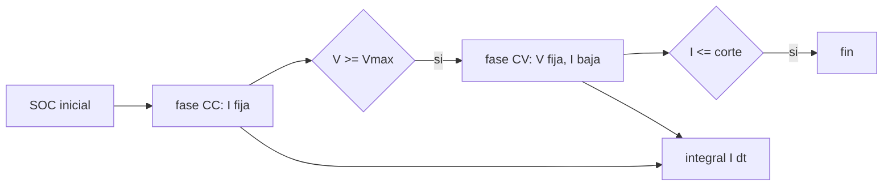

# B86-C06 — Gestión de carga

<!-- nav:top -->
[🏠 Programa](../../../../README.md) · [📚 Bloque B86](../../../tronco-comun/B86-sistemas-de-potencia-y-energia-espacial.md) · [← Anterior: B86-C05 — Baterías de ion-litio](../B86-C05-baterias-de-ion-litio/CLASE.md) · [Siguiente: B86-C07 — Distribución de potencia →](../../../tronco-comun/B86-sistemas-de-potencia-y-energia-espacial.md#b86-c07)
<!-- /nav -->

## 1. Ubicación, nivel y alcance

Clase 6 del bloque B86. Nivel N3. Sexta clase del bloque. La batería de la clase anterior se descarga en el eclipse y debe recargarse en la parte iluminada sin sobrepasar su tensión máxima. Aquí simulas la carga corriente constante–tensión constante de un paquete sintético 8S3P y ves cuánto tarda, cuánta energía se pierde y si cabe en la luz de la órbita. El paquete es sintético y la carga se simula, no se mide.

## 2. Por qué esta clase existe

Cargar más rápido reduce el tiempo pero eleva el calor y la tensión sobre la celda; cargar más lento puede no completar el ciclo antes del siguiente eclipse. El perfil de carga decide si la batería vuelve a su estado de carga en cada órbita. La decisión central: **¿con qué corriente de carga la batería queda recargada dentro de la luz de la órbita sin pasar la tensión máxima?**

## 3. Lo que podrás hacer al terminar

1. Describir las fases CC y CV de una carga de ion-litio.
2. Simular la carga con cuenta de Coulomb y una OCV con resistencia interna.
3. Obtener el tiempo de la fase CC en forma cerrada y contrastarlo con la simulación.
4. Comprobar el balance de carga integral `I dt` frente al cambio de SOC.
5. Calcular la energía de entrada, la almacenada y la eficiencia de energía de la carga.
6. Separar lo consultado (periodo y luz de la órbita) de lo ilustrativo (paquete y curvas).

La evidencia es **la curva de carga simulada y los tiempos por corriente** del ejercicio 12 (sección 20).

## 4. Con qué llegas y cómo comprobarlo

1. ¿Qué es una carga a corriente constante?
2. ¿Qué es una carga a tensión constante?
3. ¿Qué es la eficiencia de energía de una carga?
4. ¿Por qué hay una tensión máxima por celda?
5. ¿Qué es un dato sintético?

<details>
<summary>Ver respuestas</summary>

1. Una carga en la que el cargador mantiene la corriente fija mientras la tensión sube. 2. Una carga en la que se mantiene la tensión y la corriente decae sola. 3. La energía almacenada dividida por la energía entregada. 4. Porque sobrepasarla degrada la celda y es un riesgo de seguridad. 5. Un dato generado para el ejemplo, no medido.
</details>

Con cuatro o cinco aciertos, sigue; si no, repasa los prerrequisitos.

## 5. Un caso de contexto y casos de referencia

El paquete sintético 8S3P (`9 Ah`, `Vmax = 32,8 V`) parte de un SOC de `84,46 %` y debe reponer `1,399 Ah`. Con `1 A` tarda `4899 s` (`4360 s` en CC), con `2 A` tarda `2849 s` y con `3 A` tarda `2283 s`; la luz de la órbita dura `3666,7 s`. Es el **ejemplo conductor** y es **ilustrativo**.

## 6. Vocabulario

La **fase CC** mantiene la corriente; la **fase CV** mantiene la tensión máxima. La **corriente de corte** (`C/20`) termina la carga. La **tasa C** es la corriente dividida por la capacidad. La **eficiencia de energía** es energía almacenada entre energía de entrada. La **cuenta de Coulomb** integra la corriente.

## 7. Modelo mental: llenar un vaso con un grifo que se va cerrando



*Descripción textual:* la carga empieza a corriente constante hasta alcanzar la tensión máxima; luego sigue a tensión constante con corriente decreciente hasta la corriente de corte; la integral de la corriente da la carga repuesta.

Analogía: se llena un vaso con el grifo abierto hasta cerca del borde y luego se va cerrando para no derramar. Límite: el modelo no incluye temperatura, compensación de tensión ni balanceo entre celdas.

## 8. La explicación, paso a paso

### 8.1 Fases

En CC la tensión del paquete es `V = N_s(OCV(s) + I R/N_p)`; cuando alcanza `V_max = 32,8 V` empieza la CV, con `I = N_p(V_max/N_s − OCV)/R`, decreciente. La carga termina cuando `I ≤ 0,45 A`.

### 8.2 Tiempos

| `I_CC` (A) | `t_CC` simulado (s) | `t_CC` cerrado (s) | `t` total (s) | `Q` (Ah) | `E` entrada (Wh) |
|---|---|---|---|---|---|
| 1 | 4360,0 | 4360,0 | 4899,0 | 1,314 | 42,59 |
| 2 | 1843,0 | 1842,5 | 2849,0 | 1,314 | 42,74 |
| 3 | 1004,0 | 1003,3 | 2283,0 | 1,314 | 42,86 |

La forma cerrada es `t_CC = (s_cv − s_0) C·3600/I` con `s_cv = (V_max/N_s − 3,3 − I R/N_p)/0,8`. Coincide con la simulación a menos de `1 s`. Con `1 A` la carga tarda `4899 s` y **no** cabe en la luz de `3667 s`; con `2 A` y `3 A` sí cabe.

### 8.3 Balance

La fase CV termina en la corriente de corte y repone `1,314 Ah` de los `1,399 Ah` (quedan `0,084 Ah`, que se recuperan en la órbita siguiente o con un corte más bajo). La carga integrada coincide con la variación de SOC por la capacidad con un residuo menor de `10⁻⁶ Ah`. La energía almacenada (integral de la OCV) con `1 A` es `42,42 Wh` y la de entrada `42,59 Wh`: la eficiencia de energía es `99,60 %`, y la diferencia se disipa como calor en la resistencia interna.

### 8.4 Qué lectura dejar

Más corriente acorta la fase CC pero eleva la pérdida `I²R` y deja una fase CV proporcionalmente más larga (`89 %` del tiempo es CC con `1 A`).

## 9. Magnitudes, símbolos y unidades

| Símbolo | Qué es | Unidad | Valor / nota |
|---|---|---|---|
| `V_max` | tensión máxima del paquete | V | 32,8 |
| `I_CC` | corriente de la fase CC | A | 1; 2; 3 |
| `I_corte` | corriente de fin de carga | A | 0,45 |
| `t` | tiempo de carga | s | 4899 (1 A) |
| `Q` | carga repuesta | Ah | 1,314 |
| `η_E` | eficiencia de energía | — | 0,9960 |
| `T_d` | duración de la luz | s | 3666,7 |

## 10. Convenciones y referencias

Paquete 8S3P sin balanceo, temperatura fija, OCV lineal con el SOC, resistencia interna constante, paso de `1 s`. Luz de la órbita de `600 km` con `β = 0` (periodo y eclipse de la ficha de la Tierra). Todo el paquete es **ilustrativo**.

## 11. De dónde sale lo que afirmamos

| ID | Fuente | Localizador | Respalda | Estado |
|---|---|---|---|---|
| S1 | NASA/NSSDC, Earth Fact Sheet — https://nssdc.gsfc.nasa.gov/planetary/factsheet/earthfact.html (consultada 2026-11-10) | ficha completa leída | irradiancia solar 1361,0 W/m²; GM = 0,39860 × 10⁶ km³/s²; radio medio 6371,000 km; periodo orbital sideral 365,256 d | Consultada |
| S3 | NASA Small Spacecraft Systems Virtual Institute, State-of-the-Art of Small Spacecraft Technology, cap. 3 Power — https://www.nasa.gov/smallsat-institute/sst-soa/power-subsystems/ (consultada 2026-11-10) | primeros 100.000 de 119.638 caracteres y el resumen final; no se leyó el resto | eficiencias de celdas multiunión (29,5–34 % BOL), energía específica de baterías Li-ion (150–270 Wh/kg comerciales), bus de 8,2 V con salidas de 5,0 y 3,3 V, tensiones de 12, 28 y 50 V con convertidores GaN, PCDU de 960 W y 1500 W; la degradación se lista como factor sin cifra | Consultada (parcial) |
| — | Relación estándar: perfil de carga CC-CV y cuenta de Coulomb | — | la verifica el laboratorio con una segunda vía | No consultada en una fuente concreta |
| — | Datos sintéticos: paquete 8S3P, OCV, resistencia interna y corrientes de carga | — | valores generados para el ejemplo | Ilustrativo, no medido |

Límites: el perfil de carga CC–CV no se consultó en una norma ni en una hoja de datos de celda; la NASA se usa solo para el contexto de baterías Li-ion.

## 12. Cómo ver la curva de carga

| Magnitud | Valor |
|---|---|
| Carga a reponer | 1,399 Ah |
| `t` con 1 A | 4899 s |
| `t` con 3 A | 2283 s |
| Luz disponible | 3667 s |
| Eficiencia de energía | 99,60 % |

Descripción larga: la corriente de carga es constante hasta alcanzar la tensión máxima y luego decae; subir la corriente acorta la carga pero la eficiencia no mejora.

## 13. Ejemplo trabajado: el tiempo de la fase CC con 2 A

**Paso 1 · SOC de cambio.** `s_cv = (4,1 − 3,3 − 2 × 0,05/3)/0,8 = 0,9583`.

**Paso 2 · Carga.** `(s_cv − 0,8446) × 9 Ah = 1,024 Ah`.

**Paso 3 · Tiempo.** `1,024 × 3600/2 = 1842,5 s`.

**Paso 4 · Contraste.** La simulación da `1843,0 s`.

## 14. Distintas formas de describir una carga

**Por fase:** CC y CV. **Por tasa:** C. **Por tiempo:** `t`. **Por carga:** `Q`. **Por energía:** `η_E`.

## 15. Práctica guiada

**Ejercicio 1 · con los pasos indicados.** Calcula la carga a reponer si el DoD fue `15,54 %` y la capacidad es `9 Ah`. *Pasos:* multiplica.

<details><summary>Solución comentada</summary>

`0,1554 × 9 = 1,399 Ah`.
</details>

**Ejercicio 2 · con una pista.** Predice el tiempo CC con `1 A`. *Pista:* carga entre corriente, sin CV.

<details><summary>Solución comentada</summary>

Aproximadamente `4360 s` (cerrado).
</details>

**Ejercicio 3 · casi autónomo.** ¿Por qué la corriente decae en la fase CV?

<details><summary>Solución comentada</summary>

Porque la tensión está fija y la OCV sube; la diferencia entre ambas, dividida por la resistencia, es la corriente.
</details>

## 16. Práctica autónoma, transferencia e integrador

**Ejercicio 4 · autónomo.** Tasa C de `3 A` en `9 Ah`.

<details><summary>Solución comentada</summary>

`3/9 = C/3`.
</details>

**Ejercicio 5 · autónomo.** Corriente de corte `C/20` en `9 Ah`.

<details><summary>Solución comentada</summary>

`9/20 = 0,45 A`.
</details>

**Ejercicio 6 · autónomo.** Tiempo total con `3 A` frente a `1 A`.

<details><summary>Solución comentada</summary>

`2283 s` frente a `4899 s`.
</details>

**Ejercicio 7 · autónomo.** ¿Qué fracción del tiempo de carga con `1 A` cabe en la luz?

<details><summary>Solución comentada</summary>

`3667/4899 = 0,75`.
</details>

**Ejercicio 8 · autónomo.** Energía disipada con `1 A`.

<details><summary>Solución comentada</summary>

`42,59 − 42,42 = 0,17 Wh`.
</details>

**Ejercicio 9 · transferencia.** **Transferencia.** Se sube `V_max` por celda para cargar más. ¿Qué riesgo introduce?

<details><summary>Solución comentada</summary>

Más estrés y degradación de la celda y un riesgo de seguridad; el límite lo fija el fabricante, no el cálculo.
</details>

**Ejercicio 10 · transferencia.** **Transferencia.** Un colega carga a `3 A` sin límite de potencia del ala. ¿Qué verificas?

<details><summary>Solución comentada</summary>

Que el ala entregue `V·I` además de las cargas de la luz; ver el balance de la primera clase.
</details>

**Ejercicio 11 · transferencia.** **Transferencia.** Se presenta esta curva como medición de una batería real. ¿Qué corriges?

<details><summary>Solución comentada</summary>

Es una simulación con un paquete sintético; no es una medición.
</details>

**Ejercicio 12 · integrador.** **Integrador.** Elabora tu *curva de carga simulada y tabla de tiempos por corriente*: tiempos CC y totales, balance de carga, eficiencia y rótulos.

<details><summary>Solución comentada</summary>

Secciones 8.1–8.4 y la salida del laboratorio.
</details>

## 17. Laboratorio: carga CC-CV de un paquete sintético

El script [carga_cccv.py](carga_cccv.py) simula la carga con tres corrientes, calcula el tiempo CC en forma cerrada y el balance de carga (**comprueba** tiempo CC < 1 s de diferencia y balance de carga < 1e-6 Ah).

**Datos:** periodo y luz de la órbita con los datos de la NASA/NSSDC (consultados); paquete, OCV, resistencia y corrientes **ilustrativos**. **Predice antes de ejecutar:** ¿qué corriente deja más margen de luz? (`3 A`) ¿cabe la carga con `1 A`? (no). **Ejecución del 2026-11-10 (Python 3.12.9):**

```text
Python 3.12.9 (biblioteca estandar)
Paquete SINTETICO 8S3P: 9.0 Ah ; Vmax = 32.8 V ; corte CV = 0.45 A ; luz disponible Td = 3666.7 s
Carga a reponer desde SOC = 84.46 % : 1.399 Ah
 I_CC [A]   t_CC [s]  cerrado [s]   t_total [s]   Q [Ah]   E [Wh]   cabe en la luz
      1.0     4360.0      4360.0        4899.0    1.314    42.59   no
      2.0     1843.0      1842.5        2849.0    1.314    42.74   si
      3.0     1004.0      1003.3        2283.0    1.314    42.86   si
Energia almacenada (integral de OCV) con I = 1 A = 42.42 Wh ; energia de entrada = 42.59 Wh ; eficiencia = 99.60 %
Pruebas superadas.
```

```bash
python programa/clases/B86/B86-C06-gestion-de-carga/carga_cccv.py
```

**Límites:** un solo paquete sin balanceo ni temperatura, OCV lineal y resistencia constante.

## 18. Errores frecuentes y cómo corregirlos

**Cargar siempre a tensión máxima sin fase CV.** Se corrige con 8.1.

**Creer que más corriente es más eficiente.** Se corrige con 8.3 y 8.4.

**Ignorar el tiempo disponible de luz.** Se corrige con 8.2.

**Presentar la simulación como medida.** Se corrige con la sección 10.

## 19. Cómo sabrás que vas bien

Tras la sección 8: ¿qué tiempo esperabas con `2 A` y cuál obtuviste? Si dudas, repasa el ejemplo 13. Tras el laboratorio: ¿qué comprueba el balance de carga? (ver la sección 17).

## 20. Qué entregas y cómo se evalúa

El producto es **la curva de carga simulada y los tiempos por corriente** (ejercicio 12).

| Criterio | Inicial | En desarrollo | Logrado | Destacado |
|---|---|---|---|---|
| Conceptos | Los confunde | Parciales | Distingue CC y CV y calcula tiempos | Explica los límites |
| Cálculo | Sin unidades | Con errores | Tablas completas con unidades | Calcula casos nuevos |
| Numérico | Sin comprobar | Un caso | Contraste con una segunda vía | Interpreta las diferencias |
| Fuentes | Sin fuente | Sin fecha | Fuentes con fecha y estado | Declara lo ilustrativo y lo no consultado |
| Límites | No los nombra | Uno | Tres | Discute qué falta del modelo |

**Condiciones críticas (no se compensan con promedio):** rotular el paquete como sintético; no presentar la simulación como medición; citar solo lo consultado.

## 21. Ética, seguridad y límites

Clase educativa: los modelos son simplificados y sus datos son sintéticos o ilustrativos; ningún resultado describe una nave real ni sustituye a la ingeniería de una misión ni a una norma aplicada.  Accesibilidad: tablas equivalentes a las gráficas, fórmulas en texto, ejercicios sin conexión.

## 22. Para cerrar y seguir

Con `2 A` el paquete sintético se recarga en `2849 s` de los `3667 s` de luz y con `1 A` no alcanza; la eficiencia de energía con `1 A` es de `99,6 %`. Queda una pregunta: ¿cómo se reparte esa energía a todas las cargas de la nave?

**Glosario español–inglés.** gestión de carga · *charge management*; corriente constante · *constant current*; tensión constante · *constant voltage*; corriente de corte · *termination current*; estado de carga · *state of charge*.

**Continuidad.** [B86-C07](../B86-C07-distribucion-de-potencia/CLASE.md) estudia la distribución de potencia por el bus.

**Referencias:** ver sección 11.

<!-- nav:bottom -->
---

[← Anterior: B86-C05 — Baterías de ion-litio](../B86-C05-baterias-de-ion-litio/CLASE.md) · [📚 Bloque B86](../../../tronco-comun/B86-sistemas-de-potencia-y-energia-espacial.md) · [Siguiente: B86-C07 — Distribución de potencia →](../../../tronco-comun/B86-sistemas-de-potencia-y-energia-espacial.md#b86-c07)
<!-- /nav -->
