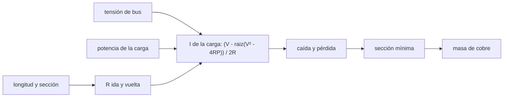

# B86-C07 — Distribución de potencia

<!-- nav:top -->
[🏠 Programa](../../../../README.md) · [📚 Bloque B86](../../../tronco-comun/B86-sistemas-de-potencia-y-energia-espacial.md) · [← Anterior: B86-C06 — Gestión de carga](../B86-C06-gestion-de-carga/CLASE.md) · [Siguiente: B86-C08 — Convertidores DC-DC →](../B86-C08-convertidores-dc-dc/CLASE.md)
<!-- /nav -->

## 1. Ubicación, nivel y alcance

Clase 7 del bloque B86. Nivel N3. Séptima clase del bloque. La energía de la batería y del ala llega a cada equipo por el arnés. Aquí calculas la caída de tensión y las pérdidas óhmicas de un arnés de cobre que alimenta cinco cargas sintéticas de potencia constante, dimensionas la sección de cada cable con un criterio de caída máxima y comparas buses de `12`, `28` y `50 V`. Usas las cargas de la primera clase. Los valores de resistividad y de secciones son ilustrativos.

## 2. Por qué esta clase existe

Un cable largo y fino desperdicia potencia y baja la tensión que ve el equipo; uno grueso pesa. La tensión del bus cambia la corriente, y por tanto las pérdidas, con el cuadrado. La decisión central: **¿qué sección de cable y qué tensión de bus minimizan masa de cobre y pérdidas respetando una caída máxima?**

## 3. Lo que podrás hacer al terminar

1. Calcular la resistencia de ida y vuelta de un cable de cobre.
2. Resolver la corriente de una carga de potencia constante con caída en el arnés.
3. Dimensionar la sección mínima que cumple una caída máxima.
4. Comparar pérdidas y masa de cobre en buses de 12, 28 y 50 V.
5. Comprobar el balance de potencia de la fuente y la aproximación `I = P/V`.
6. Separar lo consultado (tensiones de bus habituales) de lo ilustrativo (cargas, longitudes y propiedades del cobre).

La evidencia es **la tabla de pérdidas de distribución a 12, 28 y 50 V** del ejercicio 12 (sección 20).

## 4. Con qué llegas y cómo comprobarlo

1. ¿Qué dice la ley de Ohm?
2. ¿Qué potencia disipa una resistencia?
3. ¿De qué depende la resistencia de un cable?
4. ¿Qué es una carga de potencia constante?
5. ¿Qué es un dato sintético?

<details>
<summary>Ver respuestas</summary>

1. `V = I R`. 2. `P = I² R`. 3. De la resistividad, la longitud y la sección: `R = ρL/A`. 4. Una carga que consume la misma potencia aunque cambie su tensión (por ejemplo un convertidor). 5. Un dato generado para el ejemplo, no medido.
</details>

Con cuatro o cinco aciertos, sigue; si no, repasa los prerrequisitos.

## 5. Un caso de contexto y casos de referencia

Cinco cargas sintéticas suman `84 W`. Dimensionadas con una caída máxima del `2 %`, un bus de `28 V` pierde `1,039 W` (`1,24 %`) con `12,3 g` de cobre; a `12 V` pierde `1,380 W` con `51,8 g` y a `50 V` pierde `0,809 W` con `5,5 g`. Es el **ejemplo conductor** y es **ilustrativo**.

## 6. Vocabulario

El **arnés** es el conjunto de cables. La **caída de tensión** es `ΔV = R I`. La **carga de potencia constante** demanda más corriente si baja su tensión. El **colapso de tensión** ocurre si la potencia pedida supera `V²/(4R)`. El **bus regulado** mantiene una tensión fija en la fuente.

## 7. Modelo mental: una manguera de riego larga



*Descripción textual:* la tensión, la potencia y la resistencia del cable dan la corriente de la carga; de ella salen la caída y la pérdida, que fijan la sección mínima y la masa de cobre.

Analogía: una manguera larga y fina entrega menos agua con la misma presión; una más gruesa entrega más pero pesa más. Límite: se ignoran la temperatura del cable, la resistencia de los conectores y los transitorios de conexión.

## 8. La explicación, paso a paso

### 8.1 La corriente exacta

Una carga de potencia constante cumple `P = (V − R I) I` (con `R` de ida y vuelta), lo que da `I = (V − √(V² − 4RP))/(2R)`. La aproximación `I = P/V` ignora la caída y subestima la corriente: a `28 V` difiere como máximo `1,503 %` de la exacta.

### 8.2 Dimensionamiento

Para cada carga se elige la sección más pequeña de la lista cuya caída `R I/V` no pasa del `2 %`. Los resultados por bus:

| Bus (V) | Secciones elegidas (mm²) | Pérdida total (W) | Pérdida (%) | Cobre (g) | Caída máx. (%) |
|---|---|---|---|---|---|
| 12 | 0,13; 0,32; 0,5; 0,82; 0,05 | 1,380 | 1,64 | 51,8 | 1,825 |
| 28 | 0,05; 0,08; 0,08; 0,2; 0,05 | 1,039 | 1,24 | 12,3 | 1,503 |
| 50 | 0,05; 0,05; 0,05; 0,05; 0,05 | 0,809 | 0,96 | 5,5 | 1,679 |

### 8.3 Balance y bus de 12 V con cables de 28 V

El balance de potencia (`V I_bus = ΣP + ΣR I²`) se cumple con un residuo menor de `10⁻⁹ W`. Si se usan en `12 V` las secciones elegidas para `28 V`, la caída máxima sube a `8,84 %` y la pérdida a `6,466 W`: la tensión baja obliga a cables más gruesos.

### 8.4 Colapso

Con `R = 1,376 Ω` (`2 m`, `0,05 mm²`) y `28 V`, una carga de potencia constante no puede pedir más de `V²/(4R) = 142,4 W`; por encima de eso la ecuación no tiene solución.

## 9. Magnitudes, símbolos y unidades

| Símbolo | Qué es | Unidad | Valor / nota |
|---|---|---|---|
| `R` | resistencia de ida y vuelta | Ω | `2ρL/A` |
| `I` | corriente de la carga | A | ver tabla del laboratorio |
| `ΔV/V` | caída relativa | — | ≤ 0,02 |
| `P_perd` | pérdida del arnés | W | 1,039 (28 V) |
| `ρ` | resistividad del cobre | Ω·m | 1,72 × 10⁻⁸ (ilustrativa) |
| `m` | masa de cobre | g | 12,3 (28 V) |
| `P_max` | colapso de tensión | W | 142,4 |

## 10. Convenciones y referencias

Bus regulado en la fuente, cargas de potencia constante, ida y vuelta (`2L`), cobre a temperatura constante, secciones de una lista ilustrativa. Las tensiones de `12`, `28` y `50 V` son las citadas como habituales por la NASA. Cargas, longitudes, `ρ` y densidad son **ilustrativos** y no se consultaron.

## 11. De dónde sale lo que afirmamos

| ID | Fuente | Localizador | Respalda | Estado |
|---|---|---|---|---|
| S3 | NASA Small Spacecraft Systems Virtual Institute, State-of-the-Art of Small Spacecraft Technology, cap. 3 Power — https://www.nasa.gov/smallsat-institute/sst-soa/power-subsystems/ (consultada 2026-11-10) | primeros 100.000 de 119.638 caracteres y el resumen final; no se leyó el resto | eficiencias de celdas multiunión (29,5–34 % BOL), energía específica de baterías Li-ion (150–270 Wh/kg comerciales), bus de 8,2 V con salidas de 5,0 y 3,3 V, tensiones de 12, 28 y 50 V con convertidores GaN, PCDU de 960 W y 1500 W; la degradación se lista como factor sin cifra | Consultada (parcial) |
| — | Relación estándar: ley de Ohm, resistencia de un conductor y carga de potencia constante | — | la verifica el laboratorio con una segunda vía | No consultada en una fuente concreta |
| — | Datos sintéticos: cargas, longitudes del arnés, resistividad y densidad del cobre | — | valores generados para el ejemplo | Ilustrativo, no medido |

Límites: no se consultó ninguna norma de cableado ni de dimensionamiento de arnés (por ejemplo, las de ECSS); la resistividad y la densidad del cobre son valores de manual no consultados en esta clase.

## 12. Cómo ver las pérdidas del arnés según el bus

| Magnitud | Valor |
|---|---|
| Pérdida a 12 V | 1,380 W |
| Pérdida a 28 V | 1,039 W |
| Pérdida a 50 V | 0,809 W |
| Cobre a 12 V | 51,8 g |
| Cobre a 50 V | 5,5 g |

Descripción larga: a mayor tensión de bus, la corriente cae, y con ella las pérdidas y la masa de cobre; con la sección fija, las pérdidas escalan con `1/V²`.

## 13. Ejemplo trabajado: el cable de la carga útil

**Paso 1 · Resistencia.** Con `L = 2,0 m` y la sección elegida, `R = 2ρL/A` (ver tabla del laboratorio).

**Paso 2 · Corriente.** `I = (V − √(V² − 4RP))/(2R)`, algo mayor que `P/V = 30/28 = 1,0714 A`.

**Paso 3 · Caída.** `ΔV/V = R I/V`, menor de `2 %`.

**Paso 4 · Pérdida.** `R I²`; en el bus de `28 V` el total del arnés es `1,039 W`.

## 14. Distintas formas de describir un arnés

**Por resistencia:** `R`. **Por caída:** `ΔV/V`. **Por pérdida:** `R I²`. **Por masa:** gramos de cobre. **Por tensión:** 12, 28, 50 V.

## 15. Práctica guiada

**Ejercicio 1 · con los pasos indicados.** Resistencia de ida y vuelta de `1,0 m` de cobre de `0,5 mm²`. *Pasos:* `2ρL/A`.

<details><summary>Solución comentada</summary>

`2 × 1,72×10⁻⁸ × 1,0/(0,5×10⁻⁶) = 0,0688 Ω`.
</details>

**Ejercicio 2 · con una pista.** Corriente aproximada de una carga de `30 W` a `28 V`. *Pista:* `P/V`.

<details><summary>Solución comentada</summary>

`30/28 = 1,0714 A`.
</details>

**Ejercicio 3 · casi autónomo.** Pérdida si esa corriente circula por `0,0688 Ω`.

<details><summary>Solución comentada</summary>

`0,0688 × 1,0714² = 0,0790 W`.
</details>

## 16. Práctica autónoma, transferencia e integrador

**Ejercicio 4 · autónomo.** ¿Cuántas veces baja la pérdida si se duplica la tensión (misma potencia, mismo cable)?

<details><summary>Solución comentada</summary>

Se divide por `4`: `P_perd ∝ 1/V²`.
</details>

**Ejercicio 5 · autónomo.** ¿Qué pasa con la caída relativa si se duplica la longitud?

<details><summary>Solución comentada</summary>

Se duplica.
</details>

**Ejercicio 6 · autónomo.** Pérdida del arnés de `12 V` dividida por la de `28 V`.

<details><summary>Solución comentada</summary>

`1,380/1,039 = 1,33`.
</details>

**Ejercicio 7 · autónomo.** Potencia máxima de una carga de potencia constante con `R = 0,1 Ω` a `28 V`.

<details><summary>Solución comentada</summary>

`28²/(4 × 0,1) = 1960 W`.
</details>

**Ejercicio 8 · autónomo.** Cobre de `3 m` de `1,3 mm²` en gramos.

<details><summary>Solución comentada</summary>

`2 × 3 × 1,3×10⁻⁶ × 8960 × 1000 = 69,9 g`.
</details>

**Ejercicio 9 · transferencia.** **Transferencia.** Un equipo opera a `5 V` regulados desde un bus de `28 V` con `5 m` de cable fino. ¿Dónde conviene distribuir la corriente alta?

<details><summary>Solución comentada</summary>

A `28 V`: se transporta con poca corriente y se convierte cerca de la carga.
</details>

**Ejercicio 10 · transferencia.** **Transferencia.** Un colega dimensiona con `I = P/V`. ¿Cuándo es insuficiente?

<details><summary>Solución comentada</summary>

Cuando la caída es grande: la corriente real es mayor y el colapso aparece cerca de `V²/(4R)`.
</details>

**Ejercicio 11 · transferencia.** **Transferencia.** Se presenta esta tabla como el arnés de un satélite real. ¿Qué corriges?

<details><summary>Solución comentada</summary>

Es un arnés sintético con cargas y longitudes ilustrativas.
</details>

**Ejercicio 12 · integrador.** **Integrador.** Elabora tu *tabla de pérdidas de distribución a 12, 28 y 50 V*: secciones, pérdidas, masa de cobre, balance de potencia y rótulos.

<details><summary>Solución comentada</summary>

Secciones 8.1–8.4 y la salida del laboratorio.
</details>

## 17. Laboratorio: arnés de cobre en buses de 12, 28 y 50 V

El script [arnes_bus.py](arnes_bus.py) dimensiona la sección de cinco cables para una caída máxima del `2 %`, calcula pérdidas y masa de cobre en tres buses y verifica el balance (**comprueba** balance de potencia < 1e-9 W, caída ≤ `2 %` y que `I = P/V` difiere menos de `2 %` de la exacta).

**Datos:** tensiones de bus habituales de la NASA (consultadas, solo contexto); cargas, longitudes, resistividad y densidad **ilustrativas**. **Predice antes de ejecutar:** ¿en qué bus es mayor la masa de cobre? (en el de `12 V`). **Ejecución del 2026-11-10 (Python 3.12.9):**

```text
Python 3.12.9 (biblioteca estandar)
Cargas SINTETICAS de potencia constante; criterio de caida maxima = 2 % ; cobre rho = 1.72e-8 ohm m (ilustrativo)
Bus de 12 V:
  carga          P [W]  L [m]  A [mm2]   R [ohm]   I [A]   caida [%]  perdida [W]  Cu [g]
  Ordenador       12.0    0.6     0.13     0.1588   1.014      1.341       0.1631    1.40
  Actitud         20.0    1.2     0.32     0.1290   1.698      1.825       0.3718    6.88
  Radio           18.0    1.5     0.50     0.1032   1.520      1.307       0.2384   13.44
  Carga util      30.0    2.0     0.82     0.0839   2.545      1.780       0.5436   29.39
  Calefactores     4.0    0.8     0.05     0.5504   0.339      1.553       0.0631    0.72
  Total: perdida = 1.3800 W (1.643 % de 84 W) ; cobre = 51.8 g ; caida maxima = 1.825 %
  Balance de potencia en el bus: residuo = 8.22e-14 W
Bus de 28 V:
  carga          P [W]  L [m]  A [mm2]   R [ohm]   I [A]   caida [%]  perdida [W]  Cu [g]
  Ordenador       12.0    0.6     0.05     0.4128   0.431      0.636       0.0768    0.54
  Actitud         20.0    1.2     0.08     0.5160   0.724      1.334       0.2704    1.72
  Radio           18.0    1.5     0.08     0.6450   0.653      1.503       0.2748    2.15
  Carga util      30.0    2.0     0.20     0.3440   1.086      1.334       0.4056    7.17
  Calefactores     4.0    0.8     0.05     0.5504   0.143      0.282       0.0113    0.72
  Total: perdida = 1.0389 W (1.237 % de 84 W) ; cobre = 12.3 g ; caida maxima = 1.503 %
  Balance de potencia en el bus: residuo = 1.93e-14 W
Bus de 50 V:
  carga          P [W]  L [m]  A [mm2]   R [ohm]   I [A]   caida [%]  perdida [W]  Cu [g]
  Ordenador       12.0    0.6     0.05     0.4128   0.240      0.199       0.0239    0.54
  Actitud         20.0    1.2     0.05     0.8256   0.403      0.665       0.1339    1.08
  Radio           18.0    1.5     0.05     1.0320   0.363      0.749       0.1358    1.34
  Carga util      30.0    2.0     0.05     1.3760   0.610      1.679       0.5124    1.79
  Calefactores     4.0    0.8     0.05     0.5504   0.080      0.088       0.0035    0.72
  Total: perdida = 0.8095 W (0.964 % de 84 W) ; cobre = 5.5 g ; caida maxima = 1.679 %
  Balance de potencia en el bus: residuo = 3.47e-14 W
Aproximacion I = P/V frente a la exacta (28 V): diferencia maxima = 1.503 %
Secciones de 28 V usadas en un bus de 12 V: caida maxima = 8.84 % ; perdida = 6.466 W
Colapso de tension: con R = 1.376 ohm (2.0 m, 0.05 mm2) a 28 V la potencia maxima de una carga de potencia constante es 142.4 W
Pruebas superadas.
```

```bash
python programa/clases/B86/B86-C07-distribucion-de-potencia/arnes_bus.py
```

**Límites:** sin temperatura, sin conectores, sin cortocircuitos ni transitorios; secciones de una lista ilustrativa.

## 18. Errores frecuentes y cómo corregirlos

**Usar `I = P/V` con caídas grandes.** Se corrige con 8.1 y 8.4.

**Olvidar la vuelta del cable.** Se corrige con 8.1: `R = 2ρL/A`.

**Creer que bajar la tensión reduce las pérdidas.** Se corrige con 8.2: suben.

**Presentar el arnés sintético como real.** Se corrige con la sección 10.

## 19. Cómo sabrás que vas bien

Tras la sección 8: ¿qué bus esperabas con menos pérdidas y cuál obtuviste? Si dudas, repasa el ejemplo 13. Tras el laboratorio: ¿qué comprueba el balance? (ver la sección 17).

## 20. Qué entregas y cómo se evalúa

El producto es **la tabla de pérdidas de distribución a 12, 28 y 50 V** (ejercicio 12).

| Criterio | Inicial | En desarrollo | Logrado | Destacado |
|---|---|---|---|---|
| Conceptos | Los confunde | Parciales | Calcula caída, pérdida y sección | Explica los límites |
| Cálculo | Sin unidades | Con errores | Tablas completas con unidades | Calcula casos nuevos |
| Numérico | Sin comprobar | Un caso | Contraste con una segunda vía | Interpreta las diferencias |
| Fuentes | Sin fuente | Sin fecha | Fuentes con fecha y estado | Declara lo ilustrativo y lo no consultado |
| Límites | No los nombra | Uno | Tres | Discute qué falta del modelo |

**Condiciones críticas (no se compensan con promedio):** rotular las cargas y las propiedades del cobre como ilustrativas; resolver la corriente con caída; citar solo lo consultado.

## 21. Ética, seguridad y límites

Clase educativa: los modelos son simplificados y sus datos son sintéticos o ilustrativos; ningún resultado describe una nave real ni sustituye a la ingeniería de una misión ni a una norma aplicada.  Accesibilidad: tablas equivalentes a las gráficas, fórmulas en texto, ejercicios sin conexión.

## 22. Para cerrar y seguir

Con una caída máxima del `2 %`, el arnés de `28 V` pierde `1,039 W` y el de `12 V` `1,380 W`. Queda una pregunta: ¿cómo se transforma una tensión de bus en la que pide cada equipo?

**Glosario español–inglés.** distribución de potencia · *power distribution*; arnés · *harness*; caída de tensión · *voltage drop*; carga de potencia constante · *constant-power load*; colapso de tensión · *voltage collapse*.

**Continuidad.** [B86-C08](../B86-C08-convertidores-dc-dc/CLASE.md) estudia los convertidores DC-DC.

**Referencias:** ver sección 11.

<!-- nav:bottom -->
---

[← Anterior: B86-C06 — Gestión de carga](../B86-C06-gestion-de-carga/CLASE.md) · [📚 Bloque B86](../../../tronco-comun/B86-sistemas-de-potencia-y-energia-espacial.md) · [Siguiente: B86-C08 — Convertidores DC-DC →](../B86-C08-convertidores-dc-dc/CLASE.md)
<!-- /nav -->
