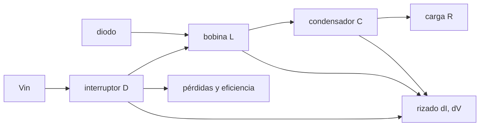

# B86-C08 — Convertidores DC-DC

<!-- nav:top -->
[🏠 Programa](../../../../README.md) · [📚 Bloque B86](../../../tronco-comun/B86-sistemas-de-potencia-y-energia-espacial.md) · [← Anterior: B86-C07 — Distribución de potencia](../B86-C07-distribucion-de-potencia/CLASE.md) · [Siguiente: B86-C09 — Electrónica de potencia →](../B86-C09-electronica-de-potencia/CLASE.md)
<!-- /nav -->

## 1. Ubicación, nivel y alcance

Clase 8 del bloque B86. Nivel N3. Octava clase del bloque. El bus entrega `28 V` y cada equipo pide su tensión: `5 V`, `3,3 V`. Aquí estudias el convertidor reductor, el elemento básico de la conversión DC-DC: calculas el ciclo de trabajo, el rizado de corriente y de tensión, y la eficiencia con pérdidas, y los contrastas con una simulación en el tiempo de la conmutación. El convertidor es sintético y la simulación no es una medición.

## 2. Por qué esta clase existe

Un convertidor que reduce la tensión con un interruptor y una bobina puede ser mucho más eficiente que un regulador lineal, pero introduce rizado, ruido y pérdidas de conmutación que hay que dimensionar. La decisión central: **¿qué ciclo de trabajo, bobina y condensador dan `5 V` desde `28 V` con rizado y eficiencia aceptables?**

## 3. Lo que podrás hacer al terminar

1. Calcular el ciclo de trabajo ideal y el real con pérdidas.
2. Calcular el rizado de corriente de la bobina y el de tensión del condensador.
3. Simular la conmutación y comparar el rizado y la tensión media con las fórmulas.
4. Verificar que el convertidor opera en conducción continua con la inductancia crítica.
5. Hacer el balance de pérdidas y calcular la eficiencia.
6. Separar lo consultado (tensiones habituales de salida) de lo ilustrativo (componentes y pérdidas).

La evidencia es **la ficha de diseño de un convertidor reductor** del ejercicio 12 (sección 20).

## 4. Con qué llegas y cómo comprobarlo

1. ¿Qué es el ciclo de trabajo?
2. ¿Qué relación hay entre tensión e inductancia?
3. ¿Qué hace un condensador de salida?
4. ¿Qué es la conducción continua?
5. ¿Qué es una verificación por segunda vía?

<details>
<summary>Ver respuestas</summary>

1. La fracción del periodo en que el interruptor está cerrado. 2. `v = L di/dt`. 3. Filtra la tensión; `i = C dv/dt`. 4. Cuando la corriente de la bobina no llega a cero en el periodo. 5. Calcular lo mismo con otro método y comparar.
</details>

Con cuatro o cinco aciertos, sigue; si no, repasa los prerrequisitos.

## 5. Un caso de contexto y casos de referencia

Un reductor sintético de `28 V` a `5 V` con carga de `2,5 Ω` (`2 A`), `200 kHz`, `22 µH` y `47 µF` necesita un ciclo de trabajo de `0,1929` (ideal `0,1786`), tiene un rizado de corriente de `1,009 A` y de tensión de `13,41 mV`, y una eficiencia de `91,2 %`. Es el **ejemplo conductor** y es **ilustrativo**.

## 6. Vocabulario

El **ciclo de trabajo** es `D = t_on/T`. El **rizado** es la variación pico a pico en un periodo. **CCM** es la conducción continua y **DCM** la discontinua. La **inductancia crítica** `L_c = (1−D)R/(2f)` separa ambas. Las **pérdidas de conducción** son `R I²`; las de **conmutación** son `½ V I (t_r + t_f) f`.

## 7. Modelo mental: empujar un columpio a intervalos



*Descripción textual:* el interruptor conecta la entrada a la bobina con ciclo `D`; el diodo conduce en el resto del periodo; la bobina y el condensador filtran y alimentan la carga; de ahí salen el rizado y las pérdidas.

Analogía: empujar un columpio con pequeños empujones periódicos: la energía llega en pulsos y la inercia (la bobina) la suaviza. Límite: el modelo es de un solo convertidor con componentes ideales salvo las resistencias indicadas; faltan los efectos parásitos de alta frecuencia y el control.

## 8. La explicación, paso a paso

### 8.1 Ciclo de trabajo

En CCM ideal `D = V_o/V_in = 5/28 = 0,1786`. Con la caída del diodo (`0,4 V`) y las resistencias, el ciclo que da `5 V` es `D = 0,1929`.

### 8.2 Rizado

`ΔI = (V_in − V_o) D/(L f) = 1,0085 A` y `ΔV = ΔI/(8 f C) = 13,411 mV`. La simulación de `800` periodos (con `1000` pasos por periodo) da `1,0021 A` y `13,329 mV`: la diferencia en corriente es de `0,64 %`.

### 8.3 Tensión media

La tensión de salida simulada es `5,0019 V`; la fórmula con pérdidas da `5,0000 V` (diferencia `0,038 %`). La inductancia crítica es `5,04 µH`, menor que `22 µH`: el convertidor opera en CCM.

### 8.4 Pérdidas

| Pérdida | Valor (W) |
|---|---|
| Conducción (interruptor y bobina) | 0,1621 |
| Diodo | 0,6459 |
| Conmutación | 0,1120 |
| Propia (puerta y control) | 0,0500 |
| **Total** | 0,9700 |

Con `10,008 W` de salida, la eficiencia es `91,16 %`. El diodo es la pérdida mayor: de ahí el interés de la rectificación síncrona (se ve en la clase de electrónica de potencia).

## 9. Magnitudes, símbolos y unidades

| Símbolo | Qué es | Unidad | Valor / nota |
|---|---|---|---|
| `D` | ciclo de trabajo | — | 0,1929 |
| `f` | frecuencia de conmutación | Hz | 200 000 (ilustrativa) |
| `L`, `C` | bobina y condensador | H; F | 22 µH; 47 µF |
| `ΔI` | rizado de corriente | A | 1,009 |
| `ΔV` | rizado de tensión | mV | 13,41 |
| `η` | eficiencia | — | 0,9116 |
| `L_c` | inductancia crítica | µH | 5,04 |

## 10. Convenciones y referencias

Convertidor reductor asíncrono (diodo), carga resistiva, rizado en régimen permanente, simulación con Euler semiimplícito y `1000` pasos por periodo. Las tensiones de salida de `5,0` y `3,3 V` provienen del contexto de la NASA; componentes, resistencias y tiempos de conmutación son **ilustrativos**.

## 11. De dónde sale lo que afirmamos

| ID | Fuente | Localizador | Respalda | Estado |
|---|---|---|---|---|
| S3 | NASA Small Spacecraft Systems Virtual Institute, State-of-the-Art of Small Spacecraft Technology, cap. 3 Power — https://www.nasa.gov/smallsat-institute/sst-soa/power-subsystems/ (consultada 2026-11-10) | primeros 100.000 de 119.638 caracteres y el resumen final; no se leyó el resto | eficiencias de celdas multiunión (29,5–34 % BOL), energía específica de baterías Li-ion (150–270 Wh/kg comerciales), bus de 8,2 V con salidas de 5,0 y 3,3 V, tensiones de 12, 28 y 50 V con convertidores GaN, PCDU de 960 W y 1500 W; la degradación se lista como factor sin cifra | Consultada (parcial) |
| — | Relación estándar: relaciones del convertidor reductor en conducción continua y pérdidas por conducción y conmutación | — | la verifica el laboratorio con una segunda vía | No consultada en una fuente concreta |
| — | Datos sintéticos: componentes, resistencias, caída del diodo y tiempos de conmutación | — | valores generados para el ejemplo | Ilustrativo, no medido |

Límites: no se consultó ninguna hoja de datos de convertidor ni norma de conversión espacial; el control (lazo cerrado) y los efectos de radiación no se tratan.

## 12. Cómo ver el rizado y las pérdidas de un reductor

| Magnitud | Valor |
|---|---|
| Ciclo de trabajo | 0,1929 |
| Rizado de corriente | 1,0021 A |
| Rizado de tensión | 13,329 mV |
| Tensión media | 5,0019 V |
| Eficiencia | 91,16 % |

Descripción larga: la corriente de la bobina sube mientras el interruptor está cerrado y baja cuando se abre; el condensador casi aplana la tensión y la eficiencia depende de la suma de pérdidas.

## 13. Ejemplo trabajado: el rizado de corriente

**Paso 1 · Ciclo.** `D = 0,1929`.

**Paso 2 · Tensión sobre L.** `V_in − V_o = 23 V` durante `D T`.

**Paso 3 · Tiempo.** `D T = 0,1929/200000 = 0,965 µs`.

**Paso 4 · Rizado.** `ΔI = 23 × 0,965 µs/22 µH = 1,0085 A`.

## 14. Distintas formas de describir un convertidor

**Por ciclo:** `D`. **Por rizado:** `ΔI`, `ΔV`. **Por régimen:** CCM o DCM. **Por pérdidas:** conducción, diodo, conmutación. **Por rendimiento:** `η`.

## 15. Práctica guiada

**Ejercicio 1 · con los pasos indicados.** Ciclo de trabajo ideal para `3,3 V` desde `28 V`. *Pasos:* divide.

<details><summary>Solución comentada</summary>

`3,3/28 = 0,1179`.
</details>

**Ejercicio 2 · con una pista.** Predice qué pasa con `ΔI` al duplicar `L`. *Pista:* `ΔI ∝ 1/L`.

<details><summary>Solución comentada</summary>

Se divide por dos: `1,0085/2 = 0,5043 A`.
</details>

**Ejercicio 3 · casi autónomo.** ¿Y con `ΔV` al duplicar `C`?

<details><summary>Solución comentada</summary>

Se divide por dos: `13,41/2 = 6,71 mV`.
</details>

## 16. Práctica autónoma, transferencia e integrador

**Ejercicio 4 · autónomo.** Duración del estado cerrado para `f = 100 kHz` y `D = 0,18`.

<details><summary>Solución comentada</summary>

`0,18/100000 = 1,8 µs`.
</details>

**Ejercicio 5 · autónomo.** `ΔI` con `f = 100 kHz` (mismos `L` y `D`).

<details><summary>Solución comentada</summary>

Se duplica: `2 × 1,0085 = 2,0170 A`.
</details>

**Ejercicio 6 · autónomo.** ¿Opera en CCM una carga de `20 Ω` con estos componentes?

<details><summary>Solución comentada</summary>

`L_c = (1 − D)R/(2f) = 40,35 µH`, mayor que `22 µH`: no (DCM).
</details>

**Ejercicio 7 · autónomo.** Eficiencia si las pérdidas totales son `0,6 W` y la salida `10 W`.

<details><summary>Solución comentada</summary>

`10/10,6 = 94,3 %`.
</details>

**Ejercicio 8 · autónomo.** Pérdida del diodo si `I = 2 A`, `Vf = 0,4 V` y `D = 0,2`.

<details><summary>Solución comentada</summary>

`0,8 × 0,4 × 2 = 0,64 W`.
</details>

**Ejercicio 9 · transferencia.** **Transferencia.** ¿Por qué un regulador lineal sería peor para `28 V → 5 V`?

<details><summary>Solución comentada</summary>

Disipa `(28 − 5) I` en calor: `η ≈ 5/28 = 17,9 %`.
</details>

**Ejercicio 10 · transferencia.** **Transferencia.** Un colega sube la frecuencia para reducir el rizado. ¿Qué compensación hay?

<details><summary>Solución comentada</summary>

Suben las pérdidas de conmutación `∝ f` y la interferencia electromagnética.
</details>

**Ejercicio 11 · transferencia.** **Transferencia.** Se presenta la eficiencia calculada como la de un convertidor espacial. ¿Qué corriges?

<details><summary>Solución comentada</summary>

Es un modelo con parámetros ilustrativos; la eficiencia real se mide y varía con la carga y la temperatura.
</details>

**Ejercicio 12 · integrador.** **Integrador.** Elabora tu *ficha de diseño de un convertidor reductor*: ciclo, rizados, régimen, pérdidas, eficiencia y rótulos.

<details><summary>Solución comentada</summary>

Secciones 8.1–8.4 y la salida del laboratorio.
</details>

## 17. Laboratorio: reductor 28 V a 5 V por simulación de conmutación

El script [reductor_buck.py](reductor_buck.py) calcula el ciclo, el rizado, la inductancia crítica y las pérdidas, y simula la conmutación (**comprueba** rizado de corriente simulado frente al analítico < `3 %`, `V_o` frente a la predicha con pérdidas < `0,5 %` y conducción continua).

**Datos:** tensiones de salida habituales de la NASA (consultadas, solo contexto); componentes, resistencias y tiempos **ilustrativos**. **Predice antes de ejecutar:** ¿cuál será la pérdida mayor? (la del diodo, `0,646 W`). **Ejecución del 2026-11-10 (Python 3.12.9):**

```text
Python 3.12.9 (biblioteca estandar)
Reductor SINTETICO: Vin = 28.0 V, Vo = 5 V, carga 2.5 ohm, fsw = 200 kHz, L = 22 uH, C = 47 uF
Ciclo de trabajo ideal D = Vo/Vin = 0.1786 ; con perdidas D = 0.1929
Rizado de corriente en L: analitico = 1.0085 A ; simulado = 1.0021 A ; diferencia = 0.64 %
Rizado de tension: analitico = 13.411 mV ; simulado = 13.329 mV
Tension de salida media simulada = 5.0019 V ; predicha con perdidas = 5.0000 V ; diferencia = 0.038 %
Inductancia critica CCM/DCM = 5.04 uH (L = 22 uH: conduccion continua)
Perdidas: conduccion = 0.1621 W ; diodo = 0.6459 W ; conmutacion = 0.1120 W ; propio = 0.0500 W ; total = 0.9700 W
Potencia de salida = 10.0076 W ; eficiencia = 91.16 %
Pruebas superadas.
```

```bash
python programa/clases/B86/B86-C08-convertidores-dc-dc/reductor_buck.py
```

**Límites:** un solo convertidor ideal con resistencias lineales, sin control, sin parásitos de alta frecuencia y sin radiación.

## 18. Errores frecuentes y cómo corregirlos

**Usar `D = V_o/V_in` sin pérdidas a baja tensión.** Se corrige con 8.1.

**Confundir rizado con valor medio.** Se corrige con 8.2 y 8.3.

**Ignorar CCM/DCM.** Se corrige con 8.3.

**Presentar la simulación como medición.** Se corrige con la sección 10.

## 19. Cómo sabrás que vas bien

Tras la sección 8: ¿qué `D` esperabas y cuál obtuviste? Si dudas, repasa el ejemplo 13. Tras el laboratorio: ¿qué comprueba la simulación? (ver la sección 17).

## 20. Qué entregas y cómo se evalúa

El producto es **la ficha de diseño de un convertidor reductor** (ejercicio 12).

| Criterio | Inicial | En desarrollo | Logrado | Destacado |
|---|---|---|---|---|
| Conceptos | Los confunde | Parciales | Calcula `D`, rizados y eficiencia | Explica los límites |
| Cálculo | Sin unidades | Con errores | Tablas completas con unidades | Calcula casos nuevos |
| Numérico | Sin comprobar | Un caso | Contraste con una segunda vía | Interpreta las diferencias |
| Fuentes | Sin fuente | Sin fecha | Fuentes con fecha y estado | Declara lo ilustrativo y lo no consultado |
| Límites | No los nombra | Uno | Tres | Discute qué falta del modelo |

**Condiciones críticas (no se compensan con promedio):** rotular los componentes y las pérdidas como ilustrativos; no presentar la simulación como medición; citar solo lo consultado.

## 21. Ética, seguridad y límites

Clase educativa: los modelos son simplificados y sus datos son sintéticos o ilustrativos; ningún resultado describe una nave real ni sustituye a la ingeniería de una misión ni a una norma aplicada.  Accesibilidad: tablas equivalentes a las gráficas, fórmulas en texto, ejercicios sin conexión.

## 22. Para cerrar y seguir

Un reductor sintético da `5 V` con `D = 0,193`, un rizado de `13,4 mV` y `91,2 %` de eficiencia. Queda una pregunta: ¿qué componentes de potencia lo hacen posible y cómo se calientan?

**Glosario español–inglés.** convertidor DC-DC · *DC-DC converter*; reductor · *buck converter*; ciclo de trabajo · *duty cycle*; rizado · *ripple*; conducción continua · *continuous conduction mode*.

**Continuidad.** [B86-C09](../B86-C09-electronica-de-potencia/CLASE.md) estudia la electrónica de potencia que compone el convertidor.

**Referencias:** ver sección 11.

<!-- nav:bottom -->
---

[← Anterior: B86-C07 — Distribución de potencia](../B86-C07-distribucion-de-potencia/CLASE.md) · [📚 Bloque B86](../../../tronco-comun/B86-sistemas-de-potencia-y-energia-espacial.md) · [Siguiente: B86-C09 — Electrónica de potencia →](../B86-C09-electronica-de-potencia/CLASE.md)
<!-- /nav -->
