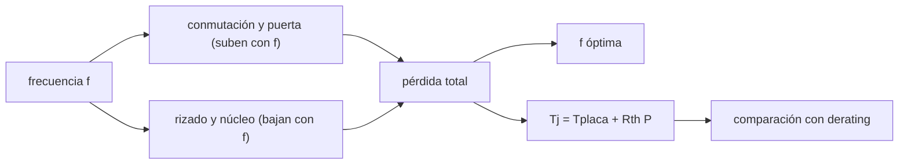

# B86-C09 — Electrónica de potencia

<!-- nav:top -->
[🏠 Programa](../../../../README.md) · [📚 Bloque B86](../../../tronco-comun/B86-sistemas-de-potencia-y-energia-espacial.md) · [← Anterior: B86-C08 — Convertidores DC-DC](../B86-C08-convertidores-dc-dc/CLASE.md) · [Siguiente: B86-C10 — Protección contra sobrecorriente →](../B86-C10-proteccion-contra-sobrecorriente/CLASE.md)
<!-- /nav -->

## 1. Ubicación, nivel y alcance

Clase 9 del bloque B86. Nivel N3. Novena clase del bloque. El convertidor de la clase anterior está hecho de transistores, diodos, bobinas y condensadores, y cada uno disipa calor. Aquí haces el presupuesto de pérdidas de un reductor sintético con rectificación asíncrona y síncrona, buscas la frecuencia de conmutación que minimiza las pérdidas y calculas la temperatura de unión del transistor. El convertidor y sus componentes son sintéticos.

## 2. Por qué esta clase existe

La eficiencia no se mejora subiendo o bajando la frecuencia sin más: las pérdidas de conmutación crecen con ella y las de rizado decrecen. La temperatura de unión marca además el límite de fiabilidad del componente. La decisión central: **¿qué topología de rectificación y qué frecuencia dejan el convertidor con la menor pérdida y la unión por debajo del límite de derating?**

## 3. Lo que podrás hacer al terminar

1. Desglosar las pérdidas de un reductor en conducción, conmutación, puerta, diodo, tiempo muerto y núcleo.
2. Comparar la rectificación asíncrona (diodo) y la síncrona (MOSFET).
3. Buscar la frecuencia óptima con sección áurea y contrastarla con un barrido.
4. Calcular la temperatura de unión con una resistencia térmica y compararla con un límite de derating.
5. Interpretar cómo cambia la pérdida total con la frecuencia.
6. Separar lo consultado (existencia del estándar ECSS-E-ST-20C; contexto de tensiones) de lo ilustrativo (todos los parámetros de los componentes).

La evidencia es **el presupuesto de pérdidas y la temperatura de unión** del ejercicio 12 (sección 20).

## 4. Con qué llegas y cómo comprobarlo

1. ¿Qué es la resistencia de conducción de un MOSFET (`R_on`)?
2. ¿Qué es una pérdida de conmutación?
3. ¿Qué es la resistencia térmica?
4. ¿Qué es un límite de derating?
5. ¿Qué es una verificación por segunda vía?

<details>
<summary>Ver respuestas</summary>

1. La resistencia del canal encendido; disipa `R_on I²`. 2. La energía disipada mientras la tensión y la corriente se cruzan en cada transición. 3. El aumento de temperatura por vatio disipado, en K/W. 4. Un límite de uso inferior al nominal para ganar fiabilidad. 5. Calcular lo mismo con otro método y comparar.
</details>

Con cuatro o cinco aciertos, sigue; si no, repasa los prerrequisitos.

## 5. Un caso de contexto y casos de referencia

El reductor sintético de la clase anterior pierde `0,959 W` con diodo y `0,419 W` con rectificación síncrona a `200 kHz`: `91,2 %` y `96,0 %` de eficiencia. La frecuencia óptima del síncrono es `90 kHz`, y la unión del MOSFET superior llega a `53,8 °C`, por debajo del límite ilustrativo de `110 °C`. Es el **ejemplo conductor** y es **ilustrativo**.

## 6. Vocabulario

La **rectificación síncrona** sustituye el diodo por un MOSFET. El **tiempo muerto** evita que los dos MOSFET conduzcan a la vez. La **carga de puerta** `Q_g` cuesta energía en cada ciclo. La **temperatura de unión** es `T_j = T_placa + R_θ P`. El **derating** limita el uso a una fracción del valor nominal.

## 7. Modelo mental: un grifo con fuga y un motor que se calienta



*Descripción textual:* la frecuencia sube las pérdidas de conmutación y baja las de rizado y núcleo; su suma tiene un mínimo; la pérdida del MOSFET fija su temperatura de unión, que se compara con un límite de derating.

Analogía: en un motor, ir más deprisa mejora una cosa (suavidad) y empeora otra (rozamiento); hay un régimen óptimo. Límite: los parámetros reales cambian con la temperatura y la tensión, y el modelo suma pérdidas independientes.

## 8. La explicación, paso a paso

### 8.1 Desglose a 200 kHz

| Pérdida | Asíncrono (W) | Síncrono (W) |
|---|---|---|
| Conducción MOSFET superior | 0,0291 | 0,0291 |
| Conducción MOSFET inferior | 0,0000 | 0,1004 |
| Diodo Schottky | 0,6571 | 0,0000 |
| Resistencia de bobina | 0,1222 | 0,1222 |
| Conmutación | 0,1198 | 0,1198 |
| Puerta | 0,0050 | 0,0100 |
| Tiempo muerto | 0,0000 | 0,0112 |
| Núcleo | 0,0261 | 0,0261 |
| **Total** | 0,9594 | 0,4188 |

La rectificación síncrona ahorra `0,541 W`: el diodo disipaba `0,4 V × I` durante `1 − D` del periodo.

### 8.2 Frecuencia óptima

La pérdida total del síncrono es `0,373 W` a `100 kHz`, `0,617 W` a `500 kHz` y `0,964 W` a `1 MHz`. El mínimo, por sección áurea, está en `90,18 kHz` (`0,3717 W`, eficiencia `96,42 %`); el barrido de `1 kHz` da `90 kHz`, con una diferencia de `180,3 Hz`.

### 8.3 Temperatura

La pérdida del MOSFET superior (conducción, conmutación y puerta) con `R_θ = 25 K/W` y placa a `50 °C` da `T_j = 53,8 °C` en el síncrono. El margen sobre el límite ilustrativo de derating (`110 °C`) es `56,2 K`.

### 8.4 Límites

Los límites de derating reales los fijan las normas y el proyecto (por ejemplo ECSS-E-ST-20C y sus normas relacionadas; en esta clase solo se consultó la ficha del estándar y no se leyó su texto), no este cálculo.

## 9. Magnitudes, símbolos y unidades

| Símbolo | Qué es | Unidad | Valor / nota |
|---|---|---|---|
| `R_on` | resistencia de conducción | Ω | 0,04; 0,03 (ilustrativas) |
| `f` | frecuencia de conmutación | Hz | 90180 (óptima síncrona) |
| `P` | pérdida total | W | 0,419 (síncrono, 200 kHz) |
| `η` | eficiencia | — | 0,9598 |
| `R_θ` | resistencia térmica unión-placa | K/W | 25 (ilustrativa) |
| `T_j` | temperatura de unión | °C | 53,8 |
| `Q_g` | carga de puerta | C | 5 × 10⁻⁹ |

## 10. Convenciones y referencias

Reductor de `28 V` a `5 V` con `2 A` y `L = 22 µH`; pérdidas independientes y sumadas; `D` ideal; placa a `50 °C`. Todos los parámetros de componentes y el límite de derating son **ilustrativos**; ECSS-E-ST-20C se cita solo por su ficha (existencia, fecha y alcance).

## 11. De dónde sale lo que afirmamos

| ID | Fuente | Localizador | Respalda | Estado |
|---|---|---|---|---|
| S6 | ECSS, ECSS-E-ST-20C Rev.2 Electrical and electronic (8 de abril de 2022) — https://ecss.nl/standard/ecss-e-st-20c-rev-2-electrical-and-electronic/ (consultada 2026-11-10) | solo la página del estándar (alcance y fecha) | existencia, fecha y alcance general del estándar; no se leyó su texto | Consultada (solo la ficha) |
| S3 | NASA Small Spacecraft Systems Virtual Institute, State-of-the-Art of Small Spacecraft Technology, cap. 3 Power — https://www.nasa.gov/smallsat-institute/sst-soa/power-subsystems/ (consultada 2026-11-10) | primeros 100.000 de 119.638 caracteres y el resumen final; no se leyó el resto | eficiencias de celdas multiunión (29,5–34 % BOL), energía específica de baterías Li-ion (150–270 Wh/kg comerciales), bus de 8,2 V con salidas de 5,0 y 3,3 V, tensiones de 12, 28 y 50 V con convertidores GaN, PCDU de 960 W y 1500 W; la degradación se lista como factor sin cifra | Consultada (parcial) |
| — | Relación estándar: pérdidas de conducción y conmutación de un convertidor y temperatura de unión por resistencia térmica | — | la verifica el laboratorio con una segunda vía | No consultada en una fuente concreta |
| — | Datos sintéticos: parámetros de MOSFET, diodos, bobina y límites de temperatura | — | valores generados para el ejemplo | Ilustrativo, no medido |

Límites: no se leyó el texto de ECSS-E-ST-20C ni de ninguna norma de derating; el límite de `110 °C` es ilustrativo y no representa una norma.

## 12. Cómo ver las pérdidas según la frecuencia

| Magnitud | Valor |
|---|---|
| Pérdida asíncrona | 0,959 W |
| Pérdida síncrona | 0,419 W |
| `f` óptima | 90,2 kHz |
| `T_j` síncrono | 53,8 °C |
| Diferencia de las dos vías | 180,3 Hz |

Descripción larga: la pérdida total tiene un mínimo entre las frecuencias bajas (rizado alto) y las altas (conmutación alta); la rectificación síncrona baja la curva.

## 13. Ejemplo trabajado: la pérdida del diodo

**Paso 1 · Ciclo.** `D = 5/28 = 0,1786`.

**Paso 2 · Fracción con diodo.** `1 − D = 0,8214`.

**Paso 3 · Potencia.** `P = 0,4 V × 2 A × 0,8214 = 0,6571 W`.

**Paso 4 · Lectura.** Es la mayor pérdida del convertidor asíncrono.

## 14. Distintas formas de describir la pérdida de un convertidor

**Por componente:** MOSFET, diodo, bobina. **Por tipo:** conducción, conmutación, puerta. **Por frecuencia:** sube o baja con `f`. **Por temperatura:** `T_j`. **Por eficiencia:** `η`.

## 15. Práctica guiada

**Ejercicio 1 · con los pasos indicados.** Pérdida de conducción de `0,04 Ω` con `2 A` y `D = 0,1786`. *Pasos:* `D R I²`.

<details><summary>Solución comentada</summary>

`0,1786 × 0,04 × 4 = 0,0286 W` (sin rizado).
</details>

**Ejercicio 2 · con una pista.** Predice si la rectificación síncrona ayuda más a `2 A` o a `0,2 A`. *Pista:* el diodo cae un valor fijo.

<details><summary>Solución comentada</summary>

A `2 A` en valor absoluto; relativamente ayuda más a baja carga si el diodo domina, aunque la pérdida de puerta se vuelve relevante.
</details>

**Ejercicio 3 · casi autónomo.** Energía de puerta por ciclo con `Q_g = 5 nC` y `5 V`.

<details><summary>Solución comentada</summary>

`25 nJ`.
</details>

## 16. Práctica autónoma, transferencia e integrador

**Ejercicio 4 · autónomo.** Potencia de puerta a `500 kHz`.

<details><summary>Solución comentada</summary>

`25 nJ × 500000 = 12,5 mW`.
</details>

**Ejercicio 5 · autónomo.** `T_j` si la pérdida del MOSFET es `0,3 W`, `R_θ = 25 K/W` y placa `50 °C`.

<details><summary>Solución comentada</summary>

`50 + 25 × 0,3 = 57,5 °C`.
</details>

**Ejercicio 6 · autónomo.** Pérdida admisible en el MOSFET para `T_j ≤ 110 °C`.

<details><summary>Solución comentada</summary>

`(110 − 50)/25 = 2,4 W`.
</details>

**Ejercicio 7 · autónomo.** ¿Por qué existe un tiempo muerto?

<details><summary>Solución comentada</summary>

Para que los dos MOSFET no conduzcan a la vez y no haya un cortocircuito de la entrada.
</details>

**Ejercicio 8 · autónomo.** Eficiencia con pérdida `0,5 W` y salida `10 W`.

<details><summary>Solución comentada</summary>

`10/10,5 = 95,2 %`.
</details>

**Ejercicio 9 · transferencia.** **Transferencia.** Un colega elige `1 MHz` para reducir el tamaño de la bobina. ¿Qué compensación hay?

<details><summary>Solución comentada</summary>

Sube la pérdida de conmutación y de puerta y baja la eficiencia; ver `P(1 MHz) = 0,964 W`.
</details>

**Ejercicio 10 · transferencia.** **Transferencia.** Un colega calcula `T_j` con la pérdida total del convertidor. ¿Qué corriges?

<details><summary>Solución comentada</summary>

La temperatura de un componente depende de su propia pérdida, no de la total.
</details>

**Ejercicio 11 · transferencia.** **Transferencia.** Se presenta el límite de `110 °C` como el de una norma. ¿Qué corriges?

<details><summary>Solución comentada</summary>

Es un límite ilustrativo; la norma aplicable se debe consultar y aplicar al componente.
</details>

**Ejercicio 12 · integrador.** **Integrador.** Elabora tu *presupuesto de pérdidas y temperatura de unión*: desglose, `f` óptima, `T_j`, margen y rótulos.

<details><summary>Solución comentada</summary>

Secciones 8.1–8.4 y la salida del laboratorio.
</details>

## 17. Laboratorio: pérdidas y temperatura de unión de un reductor

El script [perdidas_potencia.py](perdidas_potencia.py) calcula el desglose de pérdidas de un reductor asíncrono y uno síncrono, busca la frecuencia óptima y calcula la temperatura de unión (**comprueba** que las dos vías de la frecuencia óptima difieren menos de `1 kHz`, que el síncrono pierde menos y que `T_j` queda bajo el límite).

**Datos:** ficha de ECSS-E-ST-20C y tensiones de la NASA (consultadas); todos los parámetros de componentes **ilustrativos**. **Predice antes de ejecutar:** ¿qué pérdida baja al usar rectificación síncrona? (la del diodo). **Ejecución del 2026-11-10 (Python 3.12.9):**

```text
Python 3.12.9 (biblioteca estandar)
Reductor SINTETICO 28 V -> 5 V, 2 A, f = 200 kHz: D = 0.1786
 perdida [W]          asincrono   sincrono
 conduccion MOSFET sup.    0.0291      0.0291
 conduccion MOSFET inf.    0.0000      0.1004
 diodo Schottky            0.6571      0.0000
 resistencia bobina        0.1222      0.1222
 conmutacion               0.1198      0.1198
 puerta                    0.0050      0.0100
 tiempo muerto             0.0000      0.0112
 nucleo                    0.0261      0.0261
 TOTAL                     0.9594      0.4188
Eficiencia: asincrono = 91.25 % ; sincrono = 95.98 % ; ahorro = 0.5406 W
Temperatura de union del MOSFET superior: asincrono = 53.85 C ; sincrono = 53.85 C (limite de derating ilustrativo 110 C ; nominal 150 C)
Frecuencia optima (sincrono): seccion aurea = 90.18 kHz ; rejilla = 90 kHz ; diferencia = 180.3 Hz
Perdida total a 100 kHz = 0.3726 W ; a 500 kHz = 0.6170 W ; a 1 MHz = 0.9642 W ; en el optimo = 0.3717 W (96.42 %)
Pruebas superadas.
```

```bash
python programa/clases/B86/B86-C09-electronica-de-potencia/perdidas_potencia.py
```

**Límites:** pérdidas independientes y aditivas, parámetros constantes con la temperatura y sin efectos de radiación; el límite de derating es ilustrativo.

## 18. Errores frecuentes y cómo corregirlos

**Subir la frecuencia sin mirar las pérdidas de conmutación.** Se corrige con 8.2.

**Calcular `T_j` con la pérdida total.** Se corrige con 8.3.

**Tomar el límite de derating de la clase como norma.** Se corrige con 8.4.

**Presentar los parámetros como de un componente real.** Se corrige con la sección 10.

## 19. Cómo sabrás que vas bien

Tras la sección 8: ¿qué pérdida esperabas que baje con la síncrona y cuál bajó? Si dudas, repasa el ejemplo 13. Tras el laboratorio: ¿qué comparan las dos vías? (ver la sección 17).

## 20. Qué entregas y cómo se evalúa

El producto es **el presupuesto de pérdidas y la temperatura de unión** (ejercicio 12).

| Criterio | Inicial | En desarrollo | Logrado | Destacado |
|---|---|---|---|---|
| Conceptos | Los confunde | Parciales | Desglosa pérdidas y calcula `T_j` | Explica los límites |
| Cálculo | Sin unidades | Con errores | Tablas completas con unidades | Calcula casos nuevos |
| Numérico | Sin comprobar | Un caso | Contraste con una segunda vía | Interpreta las diferencias |
| Fuentes | Sin fuente | Sin fecha | Fuentes con fecha y estado | Declara lo ilustrativo y lo no consultado |
| Límites | No los nombra | Uno | Tres | Discute qué falta del modelo |

**Condiciones críticas (no se compensan con promedio):** rotular los parámetros y el límite de derating como ilustrativos; no atribuirlos a ECSS; citar solo lo consultado.

## 21. Ética, seguridad y límites

Clase educativa: los modelos son simplificados y sus datos son sintéticos o ilustrativos; ningún resultado describe una nave real ni sustituye a la ingeniería de una misión ni a una norma aplicada.  Accesibilidad: tablas equivalentes a las gráficas, fórmulas en texto, ejercicios sin conexión.

## 22. Para cerrar y seguir

El presupuesto sintético da `0,419 W` de pérdidas con rectificación síncrona, una frecuencia óptima de `90 kHz` y `T_j = 53,8 °C`. Queda una pregunta: ¿cómo se protege la fuente y la carga si algo falla y circula demasiada corriente?

**Glosario español–inglés.** electrónica de potencia · *power electronics*; rectificación síncrona · *synchronous rectification*; tiempo muerto · *dead time*; temperatura de unión · *junction temperature*; derating · *derating*.

**Continuidad.** [B86-C10](../B86-C10-proteccion-contra-sobrecorriente/CLASE.md) estudia la protección contra sobrecorriente.

**Referencias:** ver sección 11.

<!-- nav:bottom -->
---

[← Anterior: B86-C08 — Convertidores DC-DC](../B86-C08-convertidores-dc-dc/CLASE.md) · [📚 Bloque B86](../../../tronco-comun/B86-sistemas-de-potencia-y-energia-espacial.md) · [Siguiente: B86-C10 — Protección contra sobrecorriente →](../B86-C10-proteccion-contra-sobrecorriente/CLASE.md)
<!-- /nav -->
