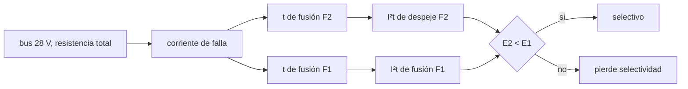

# B86-C10 — Protección contra sobrecorriente

<!-- nav:top -->
[🏠 Programa](../../../../README.md) · [📚 Bloque B86](../../../tronco-comun/B86-sistemas-de-potencia-y-energia-espacial.md) · [← Anterior: B86-C09 — Electrónica de potencia](../B86-C09-electronica-de-potencia/CLASE.md) · [Siguiente: B86-C11 — Redundancia eléctrica →](../B86-C11-redundancia-electrica/CLASE.md)
<!-- /nav -->

## 1. Ubicación, nivel y alcance

Clase 10 del bloque B86. Nivel N3. Décima clase del bloque. Una falla que cortocircuita un equipo hace circular una corriente muy superior a la nominal; la protección debe aislar solo lo averiado y dejar el resto del bus vivo. Aquí calculas la corriente de cortocircuito de un bus sintético, el tiempo de fusión de dos fusibles con un modelo térmico de primer orden y la selectividad entre ambos con la integral `I²t`. Los fusibles y el bus son sintéticos; no es un diseño de protección ni sustituye a una revisión de seguridad.

## 2. Por qué esta clase existe

Si el fusible aguas arriba se funde antes que el de la rama averiada, un fallo local deja sin energía a toda la nave. Una protección bien coordinada aísla la rama y conserva el resto. La decisión central: **¿qué fusible abre primero ante un cortocircuito en una rama, y cuándo se pierde la selectividad?**

## 3. Lo que podrás hacer al terminar

1. Calcular la corriente de cortocircuito de un bus con resistencia de fuente y de arnés.
2. Deducir el tiempo de fusión con un modelo térmico de primer orden y contrastarlo con la integración numérica.
3. Calcular la integral `I²t` de fusión y su límite a corriente alta.
4. Comprobar la selectividad entre un fusible aguas abajo y otro aguas arriba.
5. Explicar cómo cambia la selectividad con la resistencia de la falla.
6. Separar lo consultado (contexto) de lo ilustrativo (todos los parámetros).

La evidencia es **la verificación de coordinación de dos fusibles** del ejercicio 12 (sección 20).

## 4. Con qué llegas y cómo comprobarlo

1. ¿Qué es una sobrecorriente?
2. ¿Qué mide `I²t`?
3. ¿Qué es una constante térmica?
4. ¿Qué es selectividad?
5. ¿Qué es un dato sintético?

<details>
<summary>Ver respuestas</summary>

1. Una corriente mayor que la nominal del circuito. 2. La energía térmica por unidad de resistencia que el fusible absorbe, en A²·s. 3. El tiempo característico `τ = C/h` en que se calienta o enfría un elemento. 4. Que abra solo la protección más cercana a la falla. 5. Un dato generado para el ejemplo, no medido.
</details>

Con cuatro o cinco aciertos, sigue; si no, repasa los prerrequisitos.

## 5. Un caso de contexto y casos de referencia

En un bus sintético de `28 V` con `0,4333 Ω` de resistencia total, un cortocircuito franco hace circular `64,62 A`. El fusible de la rama (`3 A`, `τ = 0,5 s`) abre en `1,08 ms`; el fusible aguas arriba (`15 A`, `τ = 1,5 s`) habría abierto en `83,08 ms`. La relación de selectividad es `25,67`, de modo que la protección es selectiva. Es el **ejemplo conductor** y es **ilustrativo**; no es un diseño de protección.

## 6. Vocabulario

El **fusible** abre el circuito al fundirse un elemento. La **corriente de fusión** `I_f` es la mínima que lo funde. La **integral `I²t`** mide la energía de fusión. El **despeje** incluye la fusión y el arco. La **selectividad** (o coordinación) hace abrir solo la protección cercana a la falla. Un **limitador de corriente** electrónico cumple la misma función con un umbral y un retardo.

## 7. Modelo mental: un cable que se calienta hasta fundirse



*Descripción textual:* el bus da la corriente de falla; de ella salen los tiempos y las integrales `I²t` de cada fusible; si la de despeje del fusible de la rama es menor que la de fusión del de aguas arriba, es selectivo.

Analogía: dos cables finos en serie, uno más fino; el más fino se calienta antes y se funde primero. Límite: el modelo es térmico de primer orden con corriente constante; los fusibles reales tienen tolerancias, curvas por fabricante y comportamiento con la temperatura y la edad.

## 8. La explicación, paso a paso

### 8.1 Corriente de cortocircuito

`I = V/(R_fuente + R_arnés) = 28/(0,1333 + 0,30) = 64,62 A` en un cortocircuito franco. Una resistencia de falla la reduce.

### 8.2 Tiempo de fusión

El modelo `dθ/dt = (I²R − hθ)/C` con fusión en `θ_m` da `t = τ ln(I²/(I² − I_f²))`. A corriente alta `I²t → τ I_f²` (`4,50 A²s` para el fusible de `3 A`). La integración numérica reproduce el tiempo cerrado con un error máximo de `0,0002 %`.

| `I` (A) | `t` fusible de `3 A` (s) |
|---|---|
| 4 | 0,4133 |
| 6 | 0,1438 |
| 10 | 0,0472 |
| 30 | 0,00503 |
| 64,62 | 0,00108 |

### 8.3 Selectividad

Con la falla franca: `I²t` de fusión de F2 `4,505 A²s`, de despeje (`×3`) `13,515 A²s`; de fusión de F1 `346,933 A²s`. El cociente `25,67` es mayor que `1`: F2 despeja la falla antes de que F1 empiece a fundirse.

### 8.4 Falla con resistencia

| `R_falla` (Ω) | `I` (A) | `t` F2 (s) | `t` F1 (s) | Selectivo |
|---|---|---|---|---|
| 0,00 | 64,62 | 0,0011 | 0,0831 | sí |
| 0,30 | 38,18 | 0,0031 | 0,2514 | sí |
| 1,00 | 19,54 | 0,0119 | 1,3359 | sí |
| 3,00 | 8,16 | 0,0727 | inf | sí |

Con fallas de alta resistencia la corriente baja: por debajo de `15 A` el fusible de aguas arriba no llega a fundirse y la falla la despeja solo F2, que a su vez no actúa si `I ≤ 3 A`. Hay que revisar la selectividad en todo el rango de corrientes y complementar con un limitador electrónico las fallas que ningún fusible ve.

## 9. Magnitudes, símbolos y unidades

| Símbolo | Qué es | Unidad | Valor / nota |
|---|---|---|---|
| `I_sc` | corriente de cortocircuito | A | 64,62 |
| `I_f` | corriente de fusión | A | 3; 15 (ilustrativas) |
| `τ` | constante térmica | s | 0,5; 1,5 (ilustrativas) |
| `t` | tiempo de fusión | s | 0,00108 (F2) |
| `I²t` | integral de fusión | A²·s | 4,505 (F2) |
| `k` | factor de despeje | — | 3 (ilustrativo) |
| `S` | cociente de selectividad | — | 25,67 |

## 10. Convenciones y referencias

Modelo térmico de primer orden con corriente constante, sin arco explícito (factor de despeje fijo), bus con fuente de resistencia constante. Resistencias, corrientes de fusión, constantes de tiempo y factor de despeje son **ilustrativos**. ECSS-E-ST-20C se cita solo por su ficha.

## 11. De dónde sale lo que afirmamos

| ID | Fuente | Localizador | Respalda | Estado |
|---|---|---|---|---|
| S6 | ECSS, ECSS-E-ST-20C Rev.2 Electrical and electronic (8 de abril de 2022) — https://ecss.nl/standard/ecss-e-st-20c-rev-2-electrical-and-electronic/ (consultada 2026-11-10) | solo la página del estándar (alcance y fecha) | existencia, fecha y alcance general del estándar; no se leyó su texto | Consultada (solo la ficha) |
| S3 | NASA Small Spacecraft Systems Virtual Institute, State-of-the-Art of Small Spacecraft Technology, cap. 3 Power — https://www.nasa.gov/smallsat-institute/sst-soa/power-subsystems/ (consultada 2026-11-10) | primeros 100.000 de 119.638 caracteres y el resumen final; no se leyó el resto | eficiencias de celdas multiunión (29,5–34 % BOL), energía específica de baterías Li-ion (150–270 Wh/kg comerciales), bus de 8,2 V con salidas de 5,0 y 3,3 V, tensiones de 12, 28 y 50 V con convertidores GaN, PCDU de 960 W y 1500 W; la degradación se lista como factor sin cifra | Consultada (parcial) |
| — | Relación estándar: modelo térmico del fusible y selectividad por integral I²t | — | la verifica el laboratorio con una segunda vía | No consultada en una fuente concreta |
| — | Datos sintéticos: resistencias del bus y parámetros de los fusibles | — | valores generados para el ejemplo | Ilustrativo, no medido |

Límites: no se consultó ninguna hoja de datos de fusible, ni el texto de ECSS-E-ST-20C ni normas de protección; los parámetros son ilustrativos y el cálculo no es un diseño.

## 12. Cómo ver el tiempo de fusión según la corriente

| Magnitud | Valor |
|---|---|
| `I_sc` | 64,62 A |
| `t` F2 | 1,08 ms |
| `t` F1 | 83,08 ms |
| `I²t` F2 / F1 | 4,50 / 346,93 A²s |
| Selectividad | 25,67 |

Descripción larga: a corriente alta el tiempo de fusión cae como `1/I²`; el fusible de la rama abre antes y deja la corriente del bus principal intacta.

## 13. Ejemplo trabajado: el tiempo de fusión con 10 A

**Paso 1 · Cociente.** `I²/(I² − I_f²) = 100/(100 − 9) = 1,0989`.

**Paso 2 · Logaritmo.** `ln(1,0989) = 0,0943`.

**Paso 3 · Tiempo.** `t = 0,5 × 0,0943 = 0,0472 s`.

**Paso 4 · Lectura.** Con `10 A`, más de tres veces la corriente de fusión, el fusible abre en unas décimas de segundo.

## 14. Distintas formas de describir una protección

**Por corriente:** `I_f`. **Por tiempo:** `t(I)`. **Por energía:** `I²t`. **Por coordinación:** `S`. **Por seguridad:** apertura sin propagar la falla.

## 15. Práctica guiada

**Ejercicio 1 · con los pasos indicados.** Corriente de cortocircuito de `28 V` sobre `0,5 Ω`. *Pasos:* `V/R`.

<details><summary>Solución comentada</summary>

`56 A`.
</details>

**Ejercicio 2 · con una pista.** Predice si un fusible de mayor `I_f` abre antes o después con la misma corriente. *Pista:* `t = τ ln(I²/(I² − I_f²))`.

<details><summary>Solución comentada</summary>

Después: al subir `I_f` el argumento del logaritmo crece y el tiempo aumenta.
</details>

**Ejercicio 3 · casi autónomo.** `t` con `6 A` y el fusible de `3 A` (ver tabla).

<details><summary>Solución comentada</summary>

`0,1438 s`.
</details>

## 16. Práctica autónoma, transferencia e integrador

**Ejercicio 4 · autónomo.** `I²t` límite del fusible de `15 A` con `τ = 1,5 s`.

<details><summary>Solución comentada</summary>

`1,5 × 225 = 337,5 A²s`.
</details>

**Ejercicio 5 · autónomo.** ¿Qué `t` da el fusible de `3 A` con `I = 3,2 A`?

<details><summary>Solución comentada</summary>

`0,5 ln(10,24/(10,24 − 9)) = 1,056 s`.
</details>

**Ejercicio 6 · autónomo.** ¿Qué pasa si `I ≤ I_f`?

<details><summary>Solución comentada</summary>

El fusible nunca se funde (tiempo infinito).
</details>

**Ejercicio 7 · autónomo.** `I²t` de despeje de F2 con `k = 3` en la falla franca.

<details><summary>Solución comentada</summary>

`13,515 A²s`.
</details>

**Ejercicio 8 · autónomo.** ¿Cuántas veces mayor es `I²t` de F1 que el de despeje de F2?

<details><summary>Solución comentada</summary>

`25,67`.
</details>

**Ejercicio 9 · transferencia.** **Transferencia.** Un colega sustituye F2 por uno de `15 A` para evitar disparos. ¿Qué pierde?

<details><summary>Solución comentada</summary>

La selectividad: ambos fusibles abren a la vez o el principal antes.
</details>

**Ejercicio 10 · transferencia.** **Transferencia.** ¿Por qué una falla de alta resistencia es difícil de proteger?

<details><summary>Solución comentada</summary>

Su corriente queda cerca de las corrientes nominales y los fusibles tardan o no abren.
</details>

**Ejercicio 11 · transferencia.** **Transferencia.** Se presenta este fusible como el de una misión real. ¿Qué corriges?

<details><summary>Solución comentada</summary>

Es un modelo sintético; la protección real la diseñan especialistas con datos de los componentes y normas aplicables.
</details>

**Ejercicio 12 · integrador.** **Integrador.** Elabora tu *verificación de coordinación de dos fusibles*: corriente de falla, tiempos, `I²t`, selectividad con distintas resistencias y rótulos.

<details><summary>Solución comentada</summary>

Secciones 8.1–8.4 y la salida del laboratorio.
</details>

## 17. Laboratorio: coordinación de dos fusibles en un bus sintético

El script [fusible_seleccion.py](fusible_seleccion.py) calcula la corriente de cortocircuito, el tiempo de fusión con el modelo térmico, la integral `I²t` y la selectividad (**comprueba** tiempo de fusión numérico frente al cerrado < `0,5 %`, `I²t → τ I_f²` a corriente alta y selectividad en el cortocircuito franco).

**Datos:** ninguna cifra consultada; todos los parámetros **ilustrativos**. **Predice antes de ejecutar:** ¿qué fusible abre primero ante el cortocircuito franco? (F2, el de la rama). **Ejecución del 2026-11-10 (Python 3.12.9):**

```text
Python 3.12.9 (biblioteca estandar)
Bus SINTETICO de 28 V; fuente 0.1333 ohm + arnes 0.3 ohm; corriente de cortocircuito franco = 64.62 A
F2 (aguas abajo): I_f = 3.0 A, tau = 0.5 s ; F1 (aguas arriba): I_f = 15.0 A, tau = 1.5 s
 I [A]   t_fusion F2 [s]
   4.00      0.413339
   6.00      0.143841
  10.00      0.047155
  30.00      0.005025
  64.62      0.001079
Cortocircuito franco: F2 funde en 1.08 ms ; F1 fundiria en 83.08 ms
I2t de fusion de F2 = 4.505 A2s ; despeje (x3) = 13.515 A2s ; I2t de fusion de F1 = 346.933 A2s
Cociente de selectividad I2t(F1)/I2t_despeje(F2) = 25.67 -> SELECTIVO
 R_falla [ohm]  I_falla [A]  t_F2 [s]   t_F1 [s]   selectivo
         0.00       64.62     0.0011     0.0831   si
         0.30       38.18     0.0031     0.2514   si
         1.00       19.54     0.0119     1.3359   si
         3.00        8.16     0.0727        inf   si
Diferencia maxima entre el tiempo de fusion numerico y el cerrado = 0.0002 %
Pruebas superadas.
```

```bash
python programa/clases/B86/B86-C10-proteccion-contra-sobrecorriente/fusible_seleccion.py
```

**Límites:** modelo térmico simplificado a corriente constante, sin tolerancias, temperatura ambiente ni envejecimiento; no es un diseño de protección.

## 18. Errores frecuentes y cómo corregirlos

**Dimensionar solo con la corriente nominal.** Se corrige con 8.2.

**Verificar la selectividad solo en el cortocircuito franco.** Se corrige con 8.4.

**Aumentar el fusible para evitar disparos.** Se corrige con el ejercicio 9.

**Tomar el modelo como diseño de protección.** Se corrige con las secciones 1 y 21.

## 19. Cómo sabrás que vas bien

Tras la sección 8: ¿qué fusible esperabas que abriera primero y cuál abrió? Si dudas, repasa el ejemplo 13. Tras el laboratorio: ¿qué verifica la integración numérica? (ver la sección 17).

## 20. Qué entregas y cómo se evalúa

El producto es **la verificación de coordinación de dos fusibles** (ejercicio 12).

| Criterio | Inicial | En desarrollo | Logrado | Destacado |
|---|---|---|---|---|
| Conceptos | Los confunde | Parciales | Calcula `t`, `I²t` y selectividad | Explica los límites |
| Cálculo | Sin unidades | Con errores | Tablas completas con unidades | Calcula casos nuevos |
| Numérico | Sin comprobar | Un caso | Contraste con una segunda vía | Interpreta las diferencias |
| Fuentes | Sin fuente | Sin fecha | Fuentes con fecha y estado | Declara lo ilustrativo y lo no consultado |
| Límites | No los nombra | Uno | Tres | Discute qué falta del modelo |

**Condiciones críticas (no se compensan con promedio):** rotular los fusibles y el bus como sintéticos; no presentar el cálculo como diseño de protección; citar solo lo consultado.

## 21. Ética, seguridad y límites

Clase educativa: los modelos son simplificados y sus datos son sintéticos o ilustrativos; ningún resultado describe una nave real ni sustituye a la ingeniería de una misión ni a una norma aplicada. La protección eléctrica es una función de seguridad: este cálculo es didáctico y no sustituye a una revisión ni a los ensayos de un proyecto real. Accesibilidad: tablas equivalentes a las gráficas, fórmulas en texto, ejercicios sin conexión.

## 22. Para cerrar y seguir

Con `64,6 A` de cortocircuito, el fusible de rama abre en `1,1 ms` y la relación de selectividad es `25,7`. Queda una pregunta: ¿qué pasa si la fuente o el convertidor mismo falla?

**Glosario español–inglés.** protección contra sobrecorriente · *overcurrent protection*; fusible · *fuse*; cortocircuito · *short circuit*; selectividad · *selectivity*; limitador de corriente · *current limiter*.

**Continuidad.** [B86-C11](../B86-C11-redundancia-electrica/CLASE.md) estudia la redundancia eléctrica.

**Referencias:** ver sección 11.

<!-- nav:bottom -->
---

[← Anterior: B86-C09 — Electrónica de potencia](../B86-C09-electronica-de-potencia/CLASE.md) · [📚 Bloque B86](../../../tronco-comun/B86-sistemas-de-potencia-y-energia-espacial.md) · [Siguiente: B86-C11 — Redundancia eléctrica →](../B86-C11-redundancia-electrica/CLASE.md)
<!-- /nav -->
