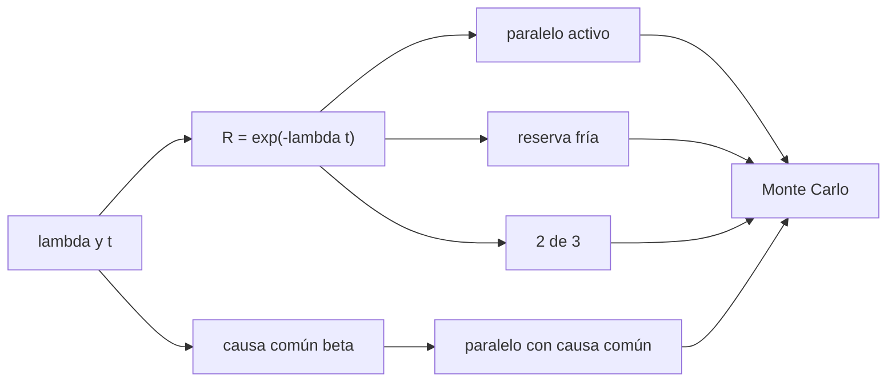

# B86-C11 — Redundancia eléctrica

<!-- nav:top -->
[🏠 Programa](../../../../README.md) · [📚 Bloque B86](../../../tronco-comun/B86-sistemas-de-potencia-y-energia-espacial.md) · [← Anterior: B86-C10 — Protección contra sobrecorriente](../B86-C10-proteccion-contra-sobrecorriente/CLASE.md) · [Siguiente: B86-C12 — Eficiencia y disipación →](../B86-C12-eficiencia-y-disipacion/CLASE.md)
<!-- /nav -->

## 1. Ubicación, nivel y alcance

Clase 11 del bloque B86. Nivel N3. Undécima clase del bloque. Las protecciones aíslan las fallas, pero la misión sigue necesitando la función que se perdió: para eso existe la redundancia. Aquí calculas la confiabilidad a cinco años de un regulador sintético con una sola unidad, paralelo activo, reserva fría, dos de tres y paralelo con causa común, y la contrastas con una simulación Monte Carlo con semilla fija. La tasa de falla es sintética; la clase no calcula MTBF de una pieza real (eso lo tratará la clase de confiabilidad de electrónica del bloque B93 cuando se redacte).

## 2. Por qué esta clase existe

Duplicar un equipo no duplica la confiabilidad ni resuelve todas las fallas: depende de cómo se conmuta, de si las unidades comparten una causa común y de cuánto cuesta en masa y en potencia. La decisión central: **¿qué arquitectura redundante da la confiabilidad necesaria sin pagar más masa y potencia de las debidas?**

## 3. Lo que podrás hacer al terminar

1. Calcular `R(t) = e^{−λt}` y su complemento, la probabilidad de falla.
2. Calcular la confiabilidad de un paralelo activo, una reserva fría, una arquitectura 2 de 3 y un paralelo con causa común.
3. Calcular el tiempo medio hasta la falla de cada arquitectura.
4. Verificar los resultados con Monte Carlo y con la desviación típica binomial.
5. Interpretar cuánto reduce la causa común la ventaja del paralelo.
6. Separar lo consultado (nada numérico) de lo ilustrativo (la tasa de falla y el factor `β`).

La evidencia es **la tabla de confiabilidad de cuatro arquitecturas** del ejercicio 12 (sección 20).

## 4. Con qué llegas y cómo comprobarlo

1. ¿Qué es la confiabilidad?
2. ¿Qué es una tasa de falla constante?
3. ¿Qué es una redundancia activa?
4. ¿Qué es una redundancia fría?
5. ¿Qué es una simulación Monte Carlo?

<details>
<summary>Ver respuestas</summary>

1. La probabilidad de que un sistema funcione durante un tiempo dado. 2. Una probabilidad de falla por hora que no cambia con el tiempo; da `R = e^{−λt}`. 3. Dos o más unidades funcionando a la vez. 4. Una unidad de reserva apagada hasta que la principal falla. 5. Repetir un experimento aleatorio muchas veces y promediar.
</details>

Con cuatro o cinco aciertos, sigue; si no, repasa los prerrequisitos.

## 5. Un caso de contexto y casos de referencia

Con `λ = 5 × 10⁻⁶ /h` (MTBF `22,8 años`, ilustrativo) y una misión de `5 años`, una unidad tiene `R = 0,8032`. Un paralelo activo sube a `0,9613`, una reserva fría perfecta a `0,9792`, un 2 de 3 a `0,8991`, y un paralelo con `10 %` de causa común cae a `0,9470`. Es el **ejemplo conductor** y es **ilustrativo**: la tasa de falla no describe ningún componente real.

## 6. Vocabulario

La **tasa de falla** `λ` es la probabilidad de falla por hora. El **MTBF** (o MTTF) es `1/λ` en el modelo exponencial. La **redundancia activa** (caliente) y la **fría** (reserva) se diferencian en si la unidad extra funciona desde el principio. La arquitectura **k de n** funciona si al menos `k` de `n` unidades funcionan. La **causa común** es una falla que afecta a varias unidades a la vez.

## 7. Modelo mental: llevar una rueda de repuesto



*Descripción textual:* de la tasa de falla y el tiempo salen la confiabilidad de una unidad y las de las arquitecturas redundantes, con o sin causa común; el Monte Carlo las verifica.

Analogía: llevar una rueda de repuesto ayuda con un pinchazo, pero no si el eje se rompe o si el repuesto está también pinchado. Límite: la tasa de falla constante no describe el desgaste ni la mortalidad infantil, y los modos de falla reales son más variados que un solo `λ`.

## 8. La explicación, paso a paso

### 8.1 Una unidad

`λ t = 5 × 10⁻⁶ × 43830 = 0,2192`, así que `R = e^{−λt} = 0,80320` y la probabilidad de falla es `0,19680`.

### 8.2 Arquitecturas

| Arquitectura | `R` analítica | `R` Monte Carlo | `z` |
|---|---|---|---|
| Una unidad | 0,803201 | 0,803262 | +0,10 |
| Paralelo activo `2R − R²` | 0,961270 | 0,961272 | +0,01 |
| Reserva fría perfecta | 0,979223 | 0,979258 | +0,15 |
| Reserva fría con `p = 0,99` | 0,977463 | 0,977527 | +0,28 |
| 2 de 3 `3R² − 2R³` | 0,899055 | 0,898935 | -0,25 |
| Paralelo con causa común | 0,946976 | 0,946677 | -0,84 |

`z` es la diferencia entre la simulación y la fórmula en desviaciones típicas binomiales (`400000` muestras, semilla `20261110`): todas por debajo de `4`.

### 8.3 Mejora y causa común

El paralelo activo reduce la probabilidad de falla `5,1` veces. Con `β = 0,10` de causa común, la probabilidad de falla del paralelo es `1,4` veces la del paralelo ideal: la mejora frente a una unidad baja de `5,1` a `3,7` veces.

### 8.4 Tiempo medio hasta la falla

| Arquitectura | MTTF analítico (h) | Monte Carlo (h) | Dif. (%) |
|---|---|---|---|
| Una unidad `1/λ` | 200000 | 200074 | 0,037 |
| Paralelo activo `1,5/λ` | 300000 | 299890 | 0,037 |
| Reserva fría `2/λ` | 400000 | 400115 | 0,029 |
| 2 de 3 `5/(6λ)` | 166667 | 166679 | 0,007 |

El 2 de 3 tiene un MTTF **menor** que una unidad aunque su confiabilidad a misión corta es mayor: la confiabilidad a un tiempo dado y el MTTF miden cosas distintas.

## 9. Magnitudes, símbolos y unidades

| Símbolo | Qué es | Unidad | Valor / nota |
|---|---|---|---|
| `λ` | tasa de falla | 1/h | 5 × 10⁻⁶ (ilustrativa) |
| `t` | duración de la misión | h | 43830 |
| `R` | confiabilidad | — | 0,8032 (una unidad) |
| `Q` | probabilidad de falla | — | 0,1968 |
| `β` | fracción de causa común | — | 0,10 (ilustrativa) |
| `p` | probabilidad de conmutación correcta | — | 0,99 (ilustrativa) |
| MTTF | tiempo medio hasta la falla | h | 200000 (una unidad) |

## 10. Convenciones y referencias

Tasa de falla constante (modelo exponencial), unidades idénticas e independientes salvo la causa común, conmutación instantánea con probabilidad `p`, misión de `5 años` de `8766 h`. `λ`, `β` y `p` son **ilustrativos**; Monte Carlo con semilla `20261110`.

## 11. De dónde sale lo que afirmamos

| ID | Fuente | Localizador | Respalda | Estado |
|---|---|---|---|---|
| S6 | ECSS, ECSS-E-ST-20C Rev.2 Electrical and electronic (8 de abril de 2022) — https://ecss.nl/standard/ecss-e-st-20c-rev-2-electrical-and-electronic/ (consultada 2026-11-10) | solo la página del estándar (alcance y fecha) | existencia, fecha y alcance general del estándar; no se leyó su texto | Consultada (solo la ficha) |
| — | Relación estándar: confiabilidad de sistemas con tasa de falla constante, redundancia y causa común | — | la verifica el laboratorio con una segunda vía | No consultada en una fuente concreta |
| — | Datos sintéticos: tasa de falla, factor de causa común y probabilidad de conmutación | — | valores generados para el ejemplo | Ilustrativo, no medido |

Límites: no se consultó ningún manual de confiabilidad ni el texto de ECSS-E-ST-20C ni normas de fiabilidad; los parámetros son ilustrativos y no hay datos de componentes reales.

## 12. Cómo ver la confiabilidad de cada arquitectura

| Magnitud | Valor |
|---|---|
| Una unidad | 0,8032 |
| Paralelo activo | 0,9613 |
| Reserva fría | 0,9792 |
| 2 de 3 | 0,8991 |
| Paralelo con causa común | 0,9470 |

Descripción larga: la redundancia reduce la probabilidad de falla, pero la causa común recorta la ventaja del paralelo.

## 13. Ejemplo trabajado: el paralelo activo

**Paso 1 · Una unidad.** `R = 0,80320`.

**Paso 2 · Probabilidad de falla.** `Q = 0,19680`.

**Paso 3 · Dos fallas independientes.** `Q² = 0,038730`.

**Paso 4 · Paralelo.** `R = 1 − Q² = 0,961270`.

## 14. Distintas formas de describir la confiabilidad

**Por unidad:** `R = e^{−λt}`. **Por arquitectura:** paralelo, reserva, `k` de `n`. **Por tiempo medio:** MTTF. **Por causa común:** `β`. **Por simulación:** Monte Carlo.

## 15. Práctica guiada

**Ejercicio 1 · con los pasos indicados.** Calcula `λ t` para `λ = 5 × 10⁻⁶ /h` y `43830 h`. *Pasos:* multiplica.

<details><summary>Solución comentada</summary>

`0,2192`.
</details>

**Ejercicio 2 · con una pista.** Predice si la reserva fría perfecta es mejor o peor que el paralelo activo. *Pista:* compara los MTTF.

<details><summary>Solución comentada</summary>

Mejor (`R = 0,9792` frente a `0,9613`), porque la unidad de reserva no envejece mientras espera.
</details>

**Ejercicio 3 · casi autónomo.** Confiabilidad de dos unidades en serie.

<details><summary>Solución comentada</summary>

`R² = 0,64513`: peor que una sola.
</details>

## 16. Práctica autónoma, transferencia e integrador

**Ejercicio 4 · autónomo.** Probabilidad de falla del 2 de 3.

<details><summary>Solución comentada</summary>

`1 − 0,899055 = 0,100945`.
</details>

**Ejercicio 5 · autónomo.** ¿Qué `p` de conmutación iguala la reserva fría al paralelo activo?

<details><summary>Solución comentada</summary>

`p = (0,96127/0,80320 − 1)/0,2192 = 0,898`.
</details>

**Ejercicio 6 · autónomo.** MTBF en años de una unidad.

<details><summary>Solución comentada</summary>

`1/λ = 22,8` años.
</details>

**Ejercicio 7 · autónomo.** ¿Qué le pasa a `R` de una unidad si `λ` se duplica?

<details><summary>Solución comentada</summary>

`R` pasa a `0,64513` (el cuadrado de `R`).
</details>

**Ejercicio 8 · autónomo.** Desviación típica binomial de la simulación para `R = 0,8032`.

<details><summary>Solución comentada</summary>

`√(R(1 − R)/400000) = 0,000629`.
</details>

**Ejercicio 9 · transferencia.** **Transferencia.** Un equipo duplica el regulador sin separar las alimentaciones ni las masas. ¿Qué riesgo no cubre?

<details><summary>Solución comentada</summary>

Las fallas de causa común (alimentación o tierra compartida) que dejan fuera a ambas unidades.
</details>

**Ejercicio 10 · transferencia.** **Transferencia.** Un colega elige el 2 de 3 por su MTTF. ¿Qué corriges?

<details><summary>Solución comentada</summary>

El MTTF del 2 de 3 es menor que el de una unidad; se elige por la confiabilidad a la duración de la misión.
</details>

**Ejercicio 11 · transferencia.** **Transferencia.** Se presenta `λ = 5 × 10⁻⁶ /h` como la tasa de un regulador real. ¿Qué corriges?

<details><summary>Solución comentada</summary>

Es un valor ilustrativo; las tasas reales vienen de datos de componentes y de ensayos.
</details>

**Ejercicio 12 · integrador.** **Integrador.** Elabora tu *tabla de confiabilidad de cuatro arquitecturas*: `R`, `Q`, MTTF, verificación Monte Carlo y rótulos.

<details><summary>Solución comentada</summary>

Secciones 8.1–8.4 y la salida del laboratorio.
</details>

## 17. Laboratorio: confiabilidad de arquitecturas redundantes por Monte Carlo

El script [confiabilidad.py](confiabilidad.py) calcula la confiabilidad analítica de seis arquitecturas, su MTTF y las contrasta con `400000` muestras con semilla fija (**comprueba** `|z| < 4` en cada arquitectura y MTTF simulado a menos de `1 %`).

**Datos:** ningún dato consultado; `λ`, `β` y `p` **ilustrativos**. **Predice antes de ejecutar:** ¿qué arquitectura de las seis tiene menor confiabilidad? (la de una unidad). **Ejecución del 2026-11-10 (Python 3.12.9):**

```text
Python 3.12.9 (biblioteca estandar)
Unidad SINTETICA: lambda = 5.0e-06 /h (MTBF = 200000 h = 22.82 anos) ; mision = 43830 h (5 anos) ; lambda t = 0.2192
Monte Carlo: 400000 muestras, semilla 20261110
 arquitectura           R analitica   R Monte Carlo   sigma      z
 una unidad               0.803201    0.803262     0.000629  +0.10
 paralelo activo          0.961270    0.961272     0.000305  +0.01
 reserva fria perfecta    0.979223    0.979258     0.000226  +0.15
 reserva fria p = 0.99    0.977463    0.977527     0.000235  +0.28
 2 de 3                   0.899055    0.898935     0.000476  -0.25
 paralelo con causa comun 0.946976    0.946677     0.000354  -0.84
Probabilidad de falla: una unidad = 0.19680 ; paralelo = 0.03873 (mejora x5.1) ; con causa comun beta = 0.1 = 0.05302 (1.4 veces la del paralelo ideal)
 MTTF [h]       analitico     Monte Carlo   dif [%]
 una unidad          200000        200074   0.037
 paralelo activo      300000        299890   0.037
 reserva fria        400000        400115   0.029
 2 de 3              166667        166679   0.007
Pruebas superadas.
```

```bash
python programa/clases/B86/B86-C11-redundancia-electrica/confiabilidad.py
```

**Límites:** tasa constante, unidades idénticas, conmutación sin retardo y modos de falla únicos; no hay datos de componentes.

## 18. Errores frecuentes y cómo corregirlos

**Creer que duplicar da el doble de confiabilidad.** Se corrige con 8.2.

**Ignorar la causa común.** Se corrige con 8.3.

**Confundir confiabilidad con MTTF.** Se corrige con 8.4.

**Presentar `λ` como dato real.** Se corrige con la sección 10.

## 19. Cómo sabrás que vas bien

Tras la sección 8: ¿qué arquitectura esperabas con mayor `R` y cuál resultó? Si dudas, repasa el ejemplo 13. Tras el laboratorio: ¿qué mide `z`? (ver la sección 17).

## 20. Qué entregas y cómo se evalúa

El producto es **la tabla de confiabilidad de cuatro arquitecturas** (ejercicio 12).

| Criterio | Inicial | En desarrollo | Logrado | Destacado |
|---|---|---|---|---|
| Conceptos | Los confunde | Parciales | Calcula `R`, `Q` y MTTF por arquitectura | Explica los límites |
| Cálculo | Sin unidades | Con errores | Tablas completas con unidades | Calcula casos nuevos |
| Numérico | Sin comprobar | Un caso | Contraste con una segunda vía | Interpreta las diferencias |
| Fuentes | Sin fuente | Sin fecha | Fuentes con fecha y estado | Declara lo ilustrativo y lo no consultado |
| Límites | No los nombra | Uno | Tres | Discute qué falta del modelo |

**Condiciones críticas (no se compensan con promedio):** rotular `λ`, `β` y `p` como ilustrativos; no presentar la simulación como datos de vuelo; citar solo lo consultado.

## 21. Ética, seguridad y límites

Clase educativa: los modelos son simplificados y sus datos son sintéticos o ilustrativos; ningún resultado describe una nave real ni sustituye a la ingeniería de una misión ni a una norma aplicada.  Accesibilidad: tablas equivalentes a las gráficas, fórmulas en texto, ejercicios sin conexión.

## 22. Para cerrar y seguir

Con `λ` ilustrativo, el paralelo activo baja la probabilidad de falla de `0,1968` a `0,03873` y la causa común la devuelve a `0,05302`. Queda una pregunta: ¿cuánto calor produce todo lo que no es eficiencia perfecta?

**Glosario español–inglés.** redundancia · *redundancy*; confiabilidad · *reliability*; tasa de falla · *failure rate*; causa común · *common cause failure*; reserva fría · *cold standby*.

**Continuidad.** [B86-C12](../B86-C12-eficiencia-y-disipacion/CLASE.md) estudia la eficiencia y la disipación de calor.

**Referencias:** ver sección 11.

<!-- nav:bottom -->
---

[← Anterior: B86-C10 — Protección contra sobrecorriente](../B86-C10-proteccion-contra-sobrecorriente/CLASE.md) · [📚 Bloque B86](../../../tronco-comun/B86-sistemas-de-potencia-y-energia-espacial.md) · [Siguiente: B86-C12 — Eficiencia y disipación →](../B86-C12-eficiencia-y-disipacion/CLASE.md)
<!-- /nav -->
