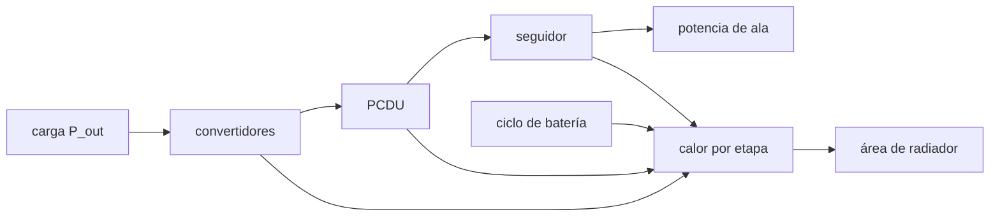

# B86-C12 — Eficiencia y disipación

<!-- nav:top -->
[🏠 Programa](../../../../README.md) · [📚 Bloque B86](../../../tronco-comun/B86-sistemas-de-potencia-y-energia-espacial.md) · [← Anterior: B86-C11 — Redundancia eléctrica](../B86-C11-redundancia-electrica/CLASE.md) · [Siguiente: B86-C13 — Energía durante eclipse →](../B86-C13-energia-durante-eclipse/CLASE.md)
<!-- /nav -->

## 1. Ubicación, nivel y alcance

Clase 12 del bloque B86. Nivel N3. Duodécima clase del bloque. Cada etapa de conversión pierde una fracción de la potencia en forma de calor, y ese calor se acumula en la nave. Aquí calculas la eficiencia de una cadena de etapas sintética, el calor que genera, el calor del ciclo de la batería y el área de radiador que lo evacúa con la ley de Stefan–Boltzmann. El balance térmico de la nave entera se trata en [B85](../../../tronco-comun/B85-gestion-termica-y-entorno-espacial.md); aquí se usa un sumidero equivalente ilustrativo. La cadena es sintética.

## 2. Por qué esta clase existe

Una eficiencia de `92 %` parece alta hasta que se multiplica por las demás etapas y se ve el calor que queda. Cada vatio perdido debe radiarse: el calor decide el tamaño del radiador y la potencia del ala. La decisión central: **¿cuánto calor produce la cadena de potencia y qué área de radiador lo evacúa a una temperatura dada?**

## 3. Lo que podrás hacer al terminar

1. Multiplicar eficiencias de etapa y obtener la potencia de entrada y el calor de cada una.
2. Comprobar el balance `P_in = P_out + calor`.
3. Calcular el calor del ciclo de la batería con las eficiencias de carga y descarga.
4. Calcular el área de radiador con la ley de Stefan–Boltzmann y comprobarla con Newton.
5. Estimar la sensibilidad del área a la temperatura y a la eficiencia.
6. Separar lo consultado (`σ` de CODATA) de lo ilustrativo (eficiencias, emisividad, sumidero).

La evidencia es **el presupuesto de disipación con área de radiador** del ejercicio 12 (sección 20).

## 4. Con qué llegas y cómo comprobarlo

1. ¿Qué es la eficiencia de una etapa?
2. ¿Qué dice la ley de Stefan–Boltzmann?
3. ¿Qué es la emisividad?
4. ¿Dónde va la potencia que no llega a la carga?
5. ¿Qué es una verificación por segunda vía?

<details>
<summary>Ver respuestas</summary>

1. La potencia de salida dividida por la de entrada. 2. Un cuerpo negro emite `σ T⁴` por unidad de área. 3. La fracción de lo que emite un cuerpo negro a esa temperatura. 4. Se convierte en calor dentro del equipo. 5. Calcular lo mismo con otro método y comparar.
</details>

Con cuatro o cinco aciertos, sigue; si no, repasa los prerrequisitos.

## 5. Un caso de contexto y casos de referencia

Una carga sintética de `100,8 W` pasa por convertidores (`0,92`), PCDU (`0,95`) y seguidor (`0,97`): el ala debe dar `118,90 W` (eficiencia total `84,8 %`) y la cadena genera `18,10 W` de calor; la batería aporta `2,03 W` más como promedio. Evacuar `20,12 W` a `300 K` pide un radiador de `0,0725 m²`. Es el **ejemplo conductor** y es **ilustrativo**.

## 6. Vocabulario

La **eficiencia de cadena** es el producto de las eficiencias. La **disipación** es el calor generado. La **emisividad** `ε` mide cuánto emite una superficie. El **sumidero equivalente** `T_s` agrupa en una temperatura lo que el radiador ve. El **flujo** `q = ε σ (T⁴ − T_s⁴)` es el calor por unidad de área.

## 7. Modelo mental: una cañería con fugas en cada tramo



*Descripción textual:* de la carga se retrocede por las etapas hasta la potencia del ala; cada etapa y el ciclo de la batería aportan calor, y la suma fija el área de radiador.

Analogía: en una cañería con fugas en cada tramo hay que abrir más el grifo de origen, y el agua perdida moja el suelo (el calor). Límite: el sumidero equivalente no es un balance térmico: ignora la Tierra, el Sol y los intercambios radiativos entre superficies.

## 8. La explicación, paso a paso

### 8.1 La cadena

Se retrocede desde la carga: cada etapa divide por su eficiencia.

| Etapa | `η` | `P_in` (W) | `P_out` (W) | Calor (W) |
|---|---|---|---|---|
| Convertidores | 0,92 | 109,565 | 100,800 | 8,765 |
| PCDU | 0,95 | 115,332 | 109,565 | 5,767 |
| Seguidor | 0,97 | 118,899 | 115,332 | 3,567 |

La potencia de ala es `118,899 W`, la eficiencia total `84,78 %` y el calor total de la cadena `18,099 W`, con un residuo del balance de `0,0e+00 W`.

### 8.2 El ciclo de la batería

En el eclipse la carga consume `38,26 Wh`. Con eficiencias de descarga `0,95` y de carga `0,97`, hay que cargar `41,52 Wh`; la diferencia, `3,26 Wh`, es calor, que promediado por órbita son `2,026 W`.

### 8.3 El radiador

Con `Q = 20,124 W`, `ε = 0,85`, `T = 300 K` y un sumidero equivalente de `220 K`: `A = Q/(ε σ (T⁴ − T_s⁴)) = 0,0725 m²` (`q = 277,5 W/m²`). Con `280 K` hacen falta `0,1098 m²` y con `320 K` bastan `0,0513 m²`. Newton devuelve `300,000000 K` para esa área (diferencia `0,0e+00 K`); con la mitad del área el radiador se calienta a `343,1 K`.

### 8.4 Sensibilidad a la eficiencia

Si los convertidores bajan a `0,85`, el calor de la cadena sube a `27,89 W` y el área a `0,1078 m²`.

## 9. Magnitudes, símbolos y unidades

| Símbolo | Qué es | Unidad | Valor / nota |
|---|---|---|---|
| `η` | eficiencia de una etapa | — | 0,92; 0,95; 0,97 (ilustrativas) |
| `η_total` | eficiencia de la cadena | — | 0,8478 |
| `Q` | calor a evacuar | W | 20,12 |
| `ε` | emisividad | — | 0,85 (ilustrativa) |
| `σ` | constante de Stefan–Boltzmann | W m⁻² K⁻⁴ | 5,670374419 × 10⁻⁸ (consultada) |
| `A` | área de radiador | m² | 0,0725 |
| `T`, `T_s` | temperatura del radiador y del sumidero | K | 300; 220 |

## 10. Convenciones y referencias

Régimen permanente, cadena en serie, calor promedio por órbita, radiador isotermo con emisividad constante y un sumidero equivalente de `220 K` que **no** es un balance térmico. `σ` de CODATA 2022; eficiencias, `ε`, temperaturas y carga son **ilustrativas**.

## 11. De dónde sale lo que afirmamos

| ID | Fuente | Localizador | Respalda | Estado |
|---|---|---|---|---|
| S1 | NIST, CODATA 2022 — constante de Stefan–Boltzmann — https://physics.nist.gov/cgi-bin/cuu/Value?sigma (consultada 2026-11-10) | valor recomendado leído | σ = 5,670374419 × 10⁻⁸ W m⁻² K⁻⁴ | Consultada |
| — | Relación estándar: cadena de eficiencias y ley de Stefan–Boltzmann para un radiador | — | la verifica el laboratorio con una segunda vía | No consultada en una fuente concreta |
| — | Datos sintéticos: eficiencias de etapa, emisividad, temperatura del radiador y sumidero equivalente | — | valores generados para el ejemplo | Ilustrativo, no medido |

Límites: no se consultó ninguna hoja de datos de convertidor ni de radiador, ni norma térmica; el sumidero equivalente es ilustrativo y no sustituye a un modelo térmico de la nave.

## 12. Cómo ver el calor de la cadena y el radiador

| Magnitud | Valor |
|---|---|
| Potencia de ala | 118,90 W |
| Eficiencia total | 84,8 % |
| Calor total | 20,12 W |
| Área de radiador | 0,0725 m² |
| Diferencia de Newton | 0,0e+00 K |

Descripción larga: cada etapa suma calor y el radiador debe evacuar el total; el área crece al bajar su temperatura y al bajar la eficiencia.

## 13. Ejemplo trabajado: el calor de los convertidores

**Paso 1 · Entrada.** `100,8/0,92 = 109,565 W`.

**Paso 2 · Calor.** `109,565 − 100,8 = 8,765 W`.

**Paso 3 · Siguiente etapa.** Esa entrada es la salida de la PCDU: `109,565/0,95 = 115,332 W`.

**Paso 4 · Lectura.** El calor de una etapa depende de la potencia que debe entregar.

## 14. Distintas formas de describir la disipación

**Por etapa:** `P_in − P_out`. **Por total:** producto de eficiencias. **Por ciclo:** carga y descarga de la batería. **Por área:** `A = Q/(εσ(T⁴ − T_s⁴))`. **Por temperatura:** `T` de equilibrio.

## 15. Práctica guiada

**Ejercicio 1 · con los pasos indicados.** Calor de una etapa de `0,90` que entrega `50 W`. *Pasos:* `50/0,9 − 50`.

<details><summary>Solución comentada</summary>

`5,56 W`.
</details>

**Ejercicio 2 · con una pista.** Predice qué pasa con el área si la emisividad baja de `0,85` a `0,5`. *Pista:* `A ∝ 1/ε`.

<details><summary>Solución comentada</summary>

Crece en `0,85/0,5 = 1,7` veces: `0,0725 × 1,7 = 0,1233 m²`.
</details>

**Ejercicio 3 · casi autónomo.** Eficiencia total de tres etapas de `0,9`.

<details><summary>Solución comentada</summary>

`0,729`.
</details>

## 16. Práctica autónoma, transferencia e integrador

**Ejercicio 4 · autónomo.** `σ T⁴` a `300 K`.

<details><summary>Solución comentada</summary>

`5,670374419×10⁻⁸ × 8,1×10⁹ = 459,3 W/m²`.
</details>

**Ejercicio 5 · autónomo.** Flujo neto de un radiador a `300 K` con sumidero a `220 K` y `ε = 0,85`.

<details><summary>Solución comentada</summary>

`277,5 W/m²`.
</details>

**Ejercicio 6 · autónomo.** Área para `10 W` a `300 K` (mismo `ε` y sumidero).

<details><summary>Solución comentada</summary>

`10/277,5 = 0,0360 m²`.
</details>

**Ejercicio 7 · autónomo.** ¿Qué pasa con `A` al subir `T` de `300` a `320 K`?

<details><summary>Solución comentada</summary>

Baja: `0,0725` → `0,0513 m²`.
</details>

**Ejercicio 8 · autónomo.** Calor del ciclo de batería con eficiencia de ciclo `0,92` y `40 Wh`.

<details><summary>Solución comentada</summary>

`40/0,92 − 40 = 3,48 Wh`.
</details>

**Ejercicio 9 · transferencia.** **Transferencia.** Un colega ignora el calor del ciclo de la batería. ¿Qué subestima?

<details><summary>Solución comentada</summary>

El calor medio de `2,03 W`, que se suma a la cadena.
</details>

**Ejercicio 10 · transferencia.** **Transferencia.** Un colega usa `T_s = 0 K` como sumidero. ¿Qué corriges?

<details><summary>Solución comentada</summary>

Que el radiador ve la Tierra y el Sol; esta clase usa un sumidero equivalente ilustrativo y no sustituye a un modelo térmico.
</details>

**Ejercicio 11 · transferencia.** **Transferencia.** Se presenta el radiador de `0,073 m²` como diseño de una nave. ¿Qué corriges?

<details><summary>Solución comentada</summary>

Es un cálculo con datos ilustrativos; el diseño térmico requiere el balance de B85.
</details>

**Ejercicio 12 · integrador.** **Integrador.** Elabora tu *presupuesto de disipación con área de radiador*: etapas, calor, ciclo de batería, área, sensibilidad y rótulos.

<details><summary>Solución comentada</summary>

Secciones 8.1–8.4 y la salida del laboratorio.
</details>

## 17. Laboratorio: cadena de eficiencias y radiador

El script [eficiencia_disipacion.py](eficiencia_disipacion.py) calcula la cadena de eficiencias, el calor de cada etapa y del ciclo de la batería, y el área de radiador con Stefan–Boltzmann (**comprueba** balance de potencia < 1e-9 W, `T` de Newton frente a la nominal < 1e-6 K y que el área baja al subir la temperatura).

**Datos:** `σ` del NIST (consultada); eficiencias, emisividad, temperaturas y sumidero **ilustrativos**. **Predice antes de ejecutar:** ¿qué área pide un radiador a `320 K` frente a `300 K`? (menos). **Ejecución del 2026-11-10 (Python 3.12.9):**

```text
Python 3.12.9 (biblioteca estandar)
Cadena SINTETICA de potencia en luz: carga util = 100.8 W
 etapa                                  eta     P_in [W]  P_out [W]  calor [W]
 Convertidores DC-DC                     0.92     109.565    100.800      8.765
 PCDU (distribucion)                     0.95     115.332    109.565      5.767
 Seguidor del punto de maxima potencia   0.97     118.899    115.332      3.567
Potencia de ala necesaria = 118.899 W ; eficiencia total = 84.78 % ; calor de la cadena = 18.099 W ; residuo del balance = 0.0e+00 W
Camino de bateria en el eclipse: 38.26 Wh a la carga ; 41.52 Wh de carga ; calor del ciclo = 3.26 Wh (2.026 W promedio por orbita)
Calor medio a evacuar = 20.124 W
Radiador (eps = 0.85, T = 300 K, sumidero equivalente 220 K): A = 0.0725 m2 ; flujo = 277.5 W/m2 sobre 0.0725 m2
Con T = 280 K: A = 0.1098 m2 ; con T = 320 K: A = 0.0513 m2
Temperatura de Newton para esa area = 300.000000 K (dif 0.0e+00 K) ; con la mitad del area = 343.10 K
Si los convertidores bajan a eta = 0.85: calor de la cadena = 27.890 W ; A = 0.1078 m2
Pruebas superadas.
```

```bash
python programa/clases/B86/B86-C12-eficiencia-y-disipacion/eficiencia_disipacion.py
```

**Límites:** calor promedio, radiador isotermo, sumidero equivalente sin modelo de entorno y eficiencias constantes con la carga.

## 18. Errores frecuentes y cómo corregirlos

**Sumar eficiencias en lugar de multiplicarlas.** Se corrige con 8.1.

**Olvidar el calor del ciclo de la batería.** Se corrige con 8.2.

**Usar `T_s = 0 K` sin pensar en el entorno.** Se corrige con 8.3 y la sección 10.

**Presentar el radiador como un diseño.** Se corrige con la sección 21.

## 19. Cómo sabrás que vas bien

Tras la sección 8: ¿qué calor esperabas de los convertidores y cuál obtuviste? Si dudas, repasa el ejemplo 13. Tras el laboratorio: ¿qué comprueba Newton? (ver la sección 17).

## 20. Qué entregas y cómo se evalúa

El producto es **el presupuesto de disipación con área de radiador** (ejercicio 12).

| Criterio | Inicial | En desarrollo | Logrado | Destacado |
|---|---|---|---|---|
| Conceptos | Los confunde | Parciales | Calcula calor por etapa y área | Explica los límites |
| Cálculo | Sin unidades | Con errores | Tablas completas con unidades | Calcula casos nuevos |
| Numérico | Sin comprobar | Un caso | Contraste con una segunda vía | Interpreta las diferencias |
| Fuentes | Sin fuente | Sin fecha | Fuentes con fecha y estado | Declara lo ilustrativo y lo no consultado |
| Límites | No los nombra | Uno | Tres | Discute qué falta del modelo |

**Condiciones críticas (no se compensan con promedio):** rotular las eficiencias y el sumidero como ilustrativos; no presentar el radiador como diseño; citar solo lo consultado.

## 21. Ética, seguridad y límites

Clase educativa: los modelos son simplificados y sus datos son sintéticos o ilustrativos; ningún resultado describe una nave real ni sustituye a la ingeniería de una misión ni a una norma aplicada.  Accesibilidad: tablas equivalentes a las gráficas, fórmulas en texto, ejercicios sin conexión.

## 22. Para cerrar y seguir

La cadena sintética de `84,8 %` genera `20,12 W` de calor medio que un radiador de `0,073 m²` evacúa a `300 K`. Queda una pregunta: ¿qué ocurre con la energía durante el eclipse, cuando el ala no genera?

**Glosario español–inglés.** eficiencia · *efficiency*; disipación · *dissipation*; radiador · *radiator*; emisividad · *emissivity*; ley de Stefan–Boltzmann · *Stefan–Boltzmann law*.

**Continuidad.** [B86-C13](../B86-C13-energia-durante-eclipse/CLASE.md) estudia la energía durante el eclipse.

**Referencias:** ver sección 11.

<!-- nav:bottom -->
---

[← Anterior: B86-C11 — Redundancia eléctrica](../B86-C11-redundancia-electrica/CLASE.md) · [📚 Bloque B86](../../../tronco-comun/B86-sistemas-de-potencia-y-energia-espacial.md) · [Siguiente: B86-C13 — Energía durante eclipse →](../B86-C13-energia-durante-eclipse/CLASE.md)
<!-- /nav -->
