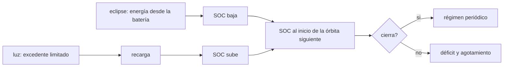

# B86-C13 — Energía durante eclipse

<!-- nav:top -->
[🏠 Programa](../../../../README.md) · [📚 Bloque B86](../../../tronco-comun/B86-sistemas-de-potencia-y-energia-espacial.md) · [← Anterior: B86-C12 — Eficiencia y disipación](../B86-C12-eficiencia-y-disipacion/CLASE.md) · [Siguiente: B86-C14 — Envejecimiento de paneles →](../B86-C14-envejecimiento-de-paneles/CLASE.md)
<!-- /nav -->

## 1. Ubicación, nivel y alcance

Clase 13 del bloque B86. Nivel N3. Decimotercera clase del bloque. Las clases de batería y de carga trataron un eclipse aislado; aquí cierras el ciclo orbita tras órbita: la energía que sale en el eclipse debe volver en la luz antes del siguiente. Simulas 40 órbitas de una nave sintética con el ala nominal y con un ala degradada, y compruebas dónde se cierra el ciclo y dónde la batería se agota. Todo es sintético.

## 2. Por qué esta clase existe

Una batería que cubre bien un eclipse puede fallar tras cien porque cada órbita pierde un poco más de lo que recupera. El cierre del ciclo es la prueba de que el diseño es sostenible. La decisión central: **¿con qué generación del ala la batería recupera en la luz lo que gasta en el eclipse, y en cuántas órbitas se agota si no es así?**

## 3. Lo que podrás hacer al terminar

1. Calcular la energía del eclipse a la carga y desde la batería.
2. Calcular el tiempo de recarga con una potencia máxima de carga.
3. Simular el SOC al inicio de cada órbita y reconocer el régimen periódico.
4. Calcular el déficit por órbita de un caso degradado y compararlo con la pendiente simulada.
5. Calcular la generación mínima que cierra el ciclo.
6. Separar lo consultado (periodo y eclipse de la órbita) de lo ilustrativo (batería, cargas y generación).

La evidencia es **la verificación de cierre del ciclo energético** del ejercicio 12 (sección 20).

## 4. Con qué llegas y cómo comprobarlo

1. ¿Qué es un régimen periódico?
2. ¿Qué es el SOC?
3. ¿Qué es el déficit por órbita?
4. ¿Por qué se limita la potencia de carga?
5. ¿Qué es un dato sintético?

<details>
<summary>Ver respuestas</summary>

1. Un estado que se repite igual cada ciclo. 2. La fracción de carga que queda en la batería. 3. La energía que se gasta menos la que se recupera en cada órbita. 4. Porque la celda no admite cualquier corriente de carga sin dañarse. 5. Un dato generado para el ejemplo, no medido.
</details>

Con cuatro o cinco aciertos, sigue; si no, repasa los prerrequisitos.

## 5. Un caso de contexto y casos de referencia

En la órbita sintética de `600 km` el eclipse dura `2125,6 s` y pide `40,27 Wh` a la batería (`15,54 %` de `259,2 Wh`); recargarla a `70 W` toma `2135 s` de los `3667 s` de luz. Con el ala nominal el SOC al inicio de cada órbita se estabiliza en `84,5 %`. Con un ala de `110 W` el déficit es de `31,185 Wh` por órbita y la batería se agota hacia la órbita `7`. Es el **ejemplo conductor** y es **ilustrativo**.

## 6. Vocabulario

El **cierre del ciclo** es que la energía recuperada iguale a la gastada. El **déficit por órbita** es la diferencia cuando no cierra. La **potencia máxima de carga** limita la recuperación. El **régimen periódico** es el SOC que se repite al inicio de cada órbita. La **generación mínima** es la que cierra el ciclo.

## 7. Modelo mental: una cuenta de ahorros con retiros nocturnos



*Descripción textual:* el eclipse baja el SOC y la luz lo recupera con potencia limitada; el SOC al inicio de la órbita siguiente decide si el ciclo cierra (régimen periódico) o si hay déficit y agotamiento.

Analogía: una cuenta de ahorros con un retiro cada noche y un depósito limitado cada día: si el depósito es menor que el retiro, el saldo cae un poco cada día. Límite: el modelo es de energía, sin la curva CC–CV ni la temperatura, y con eficiencias constantes.

## 8. La explicación, paso a paso

### 8.1 Un eclipse

La carga consume `38,26 Wh` durante `2125,6 s`; desde la batería, con eficiencia de descarga `0,95`, salen `40,27 Wh` (`15,54 %` de DoD). Recuperarlos a `70 W` con eficiencia de carga `0,97` toma `2135 s`, o `58,2 %` de la luz.

### 8.2 Caso nominal

Con el ala de `243,67 W`, el SOC al inicio de las órbitas `1`, `2`, `3` y `40` es `80,000 %`, `84,462 %`, `84,462 %` y `84,462 %`. La batería parte de `80 %`, se recarga a `100 %` en la primera luz y desde la segunda órbita el régimen es periódico: la variación entre las dos últimas órbitas es `0,0e+00`.

### 8.3 Caso degradado

Con `110 W` el excedente sobre `100,8 W` es de `9,2 W`: se recuperan `9,089 Wh` por órbita frente a `40,27 Wh` gastados. El déficit cerrado es `31,1851 Wh` por órbita y la pendiente simulada `31,1851 Wh` (diferencia `4,7e-13 Wh`). La energía inicial dura unas `7` órbitas, y la simulación agota la batería en la órbita `6`.

### 8.4 Cuánto debe generar el ala

La generación mínima que cierra el ciclo (con las cargas de luz) es `141,56 W`: cualquier valor por debajo desgasta la batería órbita tras órbita.

## 9. Magnitudes, símbolos y unidades

| Símbolo | Qué es | Unidad | Valor / nota |
|---|---|---|---|
| `T_e` | duración del eclipse | s | 2125,6 |
| `E_bat` | energía desde la batería en el eclipse | Wh | 40,27 |
| `t_rec` | tiempo de recarga | s | 2135 |
| `P_gen` | generación del ala | W | 243,67; 110 |
| `ΔE` | déficit por órbita | Wh | 31,185 (caso degradado) |
| `P_gen,min` | generación mínima de cierre | W | 141,56 |
| `η_c`, `η_d` | eficiencias de carga y descarga | — | 0,97; 0,95 |

## 10. Convenciones y referencias

Balance de energía con paso de `5 s`, batería de `259,2 Wh` sin curva CC–CV, potencia de carga limitada a `70 W`, órbita de `600 km` con `β = 0`. Batería, eficiencias, cargas y generación son **ilustrativas**.

## 11. De dónde sale lo que afirmamos

| ID | Fuente | Localizador | Respalda | Estado |
|---|---|---|---|---|
| S1 | NASA/NSSDC, Earth Fact Sheet — https://nssdc.gsfc.nasa.gov/planetary/factsheet/earthfact.html (consultada 2026-11-10) | ficha completa leída | irradiancia solar 1361,0 W/m²; GM = 0,39860 × 10⁶ km³/s²; radio medio 6371,000 km; periodo orbital sideral 365,256 d | Consultada |
| — | Relación estándar: balance de energía de una batería por órbita | — | la verifica el laboratorio con una segunda vía | No consultada en una fuente concreta |
| — | Datos sintéticos: batería, eficiencias, cargas, generación del ala y límite de carga | — | valores generados para el ejemplo | Ilustrativo, no medido |

Límites: no se consultó ninguna norma de cierre energético ni datos de vuelo; el modelo de energía no incluye temperatura ni la curva de carga.

## 12. Cómo ver el SOC órbita a órbita

| Magnitud | Valor |
|---|---|
| DoD por eclipse | 15,54 % |
| Tiempo de recarga | 2135 s |
| Variación periódica (nominal) | 0,0e+00 |
| Déficit (degradado) | 31,185 Wh/órbita |
| Generación mínima | 141,56 W |

Descripción larga: con el ala nominal el SOC vuelve a su valor cada órbita; con el ala degradada baja un poco cada órbita hasta agotarse.

## 13. Ejemplo trabajado: el déficit del caso degradado

**Paso 1 · Excedente.** `110 − 100,8 = 9,2 W`.

**Paso 2 · Recuperado.** `9,2 × 0,97 × 3666,7/3600 = 9,089 Wh`.

**Paso 3 · Gastado.** `40,27 Wh`.

**Paso 4 · Déficit.** `40,27 − 9,089 = 31,185 Wh` por órbita.

## 14. Distintas formas de describir un ciclo energético

**Por energía:** gastada y recuperada. **Por tiempo:** recarga frente a luz. **Por SOC:** régimen periódico. **Por déficit:** Wh por órbita. **Por generación:** mínima de cierre.

## 15. Práctica guiada

**Ejercicio 1 · con los pasos indicados.** Energía del eclipse desde la batería si la carga es `64,8 W` y dura `2125,6 s`. *Pasos:* `P t/3600/0,95`.

<details><summary>Solución comentada</summary>

`40,27 Wh`.
</details>

**Ejercicio 2 · con una pista.** Predice si con `P_chg = 35 W` la recarga cabe en la luz. *Pista:* el tiempo se duplica.

<details><summary>Solución comentada</summary>

`2 × 2135 = 4271 s`, menor que `3667 s`: cabe.
</details>

**Ejercicio 3 · casi autónomo.** DoD por eclipse en porcentaje.

<details><summary>Solución comentada</summary>

`15,54 %`.
</details>

## 16. Práctica autónoma, transferencia e integrador

**Ejercicio 4 · autónomo.** Déficit por órbita con un excedente de `5 W`.

<details><summary>Solución comentada</summary>

`40,27 − 5 × 0,97 × 3666,7/3600 = 35,335 Wh`.
</details>

**Ejercicio 5 · autónomo.** Órbitas hasta agotar `207 Wh` con déficit `1,5 Wh/órbita`.

<details><summary>Solución comentada</summary>

`138`.
</details>

**Ejercicio 6 · autónomo.** ¿Por qué el SOC no supera `100 %` en el caso nominal?

<details><summary>Solución comentada</summary>

Porque la recarga se detiene al llenarse la batería.
</details>

**Ejercicio 7 · autónomo.** Generación mínima si las cargas de luz suben a `120 W`.

<details><summary>Solución comentada</summary>

`120 + 40,27 × 3600/(0,97 × 3666,7) = 160,76 W`.
</details>

**Ejercicio 8 · autónomo.** ¿Qué cambia si el eclipse crece un `10 %`?

<details><summary>Solución comentada</summary>

El déficit y el DoD crecen en un `10 %`; la generación mínima sube.
</details>

**Ejercicio 9 · transferencia.** **Transferencia.** Un colega comprueba solo un eclipse y da el diseño por cerrado. ¿Qué falta?

<details><summary>Solución comentada</summary>

Verificar el cierre orbita a órbita con la recarga limitada y la degradación.
</details>

**Ejercicio 10 · transferencia.** **Transferencia.** Un colega usa la potencia pico de carga como promedio. ¿Qué error comete?

<details><summary>Solución comentada</summary>

Sobrestima la recuperación: la carga se reduce cerca de la carga plena (fase CV).
</details>

**Ejercicio 11 · transferencia.** **Transferencia.** Se presenta la simulación como telemetría de una misión. ¿Qué corriges?

<details><summary>Solución comentada</summary>

Es un modelo con datos sintéticos; la telemetría no se consultó y no se debe simular como observada.
</details>

**Ejercicio 12 · integrador.** **Integrador.** Elabora tu *verificación de cierre del ciclo energético*: energías, tiempos de recarga, régimen periódico, déficit, generación mínima y rótulos.

<details><summary>Solución comentada</summary>

Secciones 8.1–8.4 y la salida del laboratorio.
</details>

## 17. Laboratorio: cierre del ciclo energético a lo largo de 40 órbitas

El script [ciclo_eclipse.py](ciclo_eclipse.py) simula el SOC de una batería sintética con un ala nominal y otra degradada, calcula el déficit cerrado y la generación mínima (**comprueba** régimen periódico con variación < 1e-9, pendiente simulada frente al déficit cerrado < 1e-6 Wh y agotamiento del caso degradado).

**Datos:** periodo y eclipse de la NASA/NSSDC (consultados); batería, eficiencias, cargas y generación **ilustrativas**. **Predice antes de ejecutar:** ¿se agotará la batería con el ala de `110 W`? (sí, en la órbita `6`). **Ejecución del 2026-11-10 (Python 3.12.9):**

```text
Python 3.12.9 (biblioteca estandar)
Orbita SINTETICA 600 km, beta = 0: T = 5792.3 s ; eclipse = 2125.6 s (36.70 %) ; luz = 3666.7 s
Energia del eclipse a la carga = 38.26 Wh ; desde la bateria = 40.27 Wh ; DoD por eclipse = 15.54 %
Tiempo de recarga a 70 W = 2135 s (58.2 % de la luz)
Caso nominal (ala 243.67 W): SOC al inicio de cada orbita (orbitas 1, 2, 3, 40): 80.000 %, 84.462 %, 84.462 %, 84.462 %
  variacion del SOC entre las dos ultimas orbitas = 0.00e+00 ; SOC maximo = 84.462 %
Caso degradado (ala 110 W): SOC al inicio de las orbitas 1, 2, 3, 10: agotada antes de la orbita 10
  deficit por orbita (cerrado) = 31.1851 Wh ; pendiente simulada = 31.1851 Wh ; diferencia = 4.7e-13 Wh
  la bateria se agota hacia la orbita 6.6 ; (la simulacion la agota en la orbita 6)
Generacion minima del ala para cerrar el ciclo (con cargas de luz) = 141.56 W
Pruebas superadas.
```

```bash
python programa/clases/B86/B86-C13-energia-durante-eclipse/ciclo_eclipse.py
```

**Límites:** modelo de energía sin curva CC–CV, sin temperatura y con eficiencias constantes.

## 18. Errores frecuentes y cómo corregirlos

**Verificar un solo eclipse.** Se corrige con 8.2 y 8.3.

**Usar potencia pico de carga como promedio.** Se corrige con el ejercicio 10.

**Olvidar la eficiencia de descarga.** Se corrige con 8.1.

**Presentar la simulación como telemetría.** Se corrige con la sección 10.

## 19. Cómo sabrás que vas bien

Tras la sección 8: ¿qué SOC esperabas al inicio de la órbita 40 y cuál obtuviste? Si dudas, repasa el ejemplo 13. Tras el laboratorio: ¿qué comprueba la pendiente? (ver la sección 17).

## 20. Qué entregas y cómo se evalúa

El producto es **la verificación de cierre del ciclo energético** (ejercicio 12).

| Criterio | Inicial | En desarrollo | Logrado | Destacado |
|---|---|---|---|---|
| Conceptos | Los confunde | Parciales | Calcula déficit y cierre del ciclo | Explica los límites |
| Cálculo | Sin unidades | Con errores | Tablas completas con unidades | Calcula casos nuevos |
| Numérico | Sin comprobar | Un caso | Contraste con una segunda vía | Interpreta las diferencias |
| Fuentes | Sin fuente | Sin fecha | Fuentes con fecha y estado | Declara lo ilustrativo y lo no consultado |
| Límites | No los nombra | Uno | Tres | Discute qué falta del modelo |

**Condiciones críticas (no se compensan con promedio):** rotular la batería y la generación como ilustrativas; verificar el cierre órbita a órbita; citar solo lo consultado.

## 21. Ética, seguridad y límites

Clase educativa: los modelos son simplificados y sus datos son sintéticos o ilustrativos; ningún resultado describe una nave real ni sustituye a la ingeniería de una misión ni a una norma aplicada.  Accesibilidad: tablas equivalentes a las gráficas, fórmulas en texto, ejercicios sin conexión.

## 22. Para cerrar y seguir

Con el ala nominal el ciclo cierra; con `110 W` la batería sintética pierde `31,19 Wh` por órbita y se agota. Queda una pregunta: ¿cómo envejece el ala y cuánto margen pierde con los años?

**Glosario español–inglés.** cierre del ciclo · *cycle closure*; déficit de energía · *energy deficit*; régimen periódico · *periodic steady state*; estado de carga · *state of charge*; recarga · *recharge*.

**Continuidad.** [B86-C14](../B86-C14-envejecimiento-de-paneles/CLASE.md) estudia el envejecimiento de los paneles.

**Referencias:** ver sección 11.

<!-- nav:bottom -->
---

[← Anterior: B86-C12 — Eficiencia y disipación](../B86-C12-eficiencia-y-disipacion/CLASE.md) · [📚 Bloque B86](../../../tronco-comun/B86-sistemas-de-potencia-y-energia-espacial.md) · [Siguiente: B86-C14 — Envejecimiento de paneles →](../B86-C14-envejecimiento-de-paneles/CLASE.md)
<!-- /nav -->
