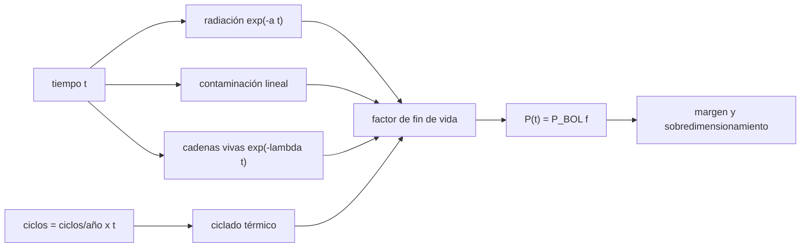

# B86-C14 — Envejecimiento de paneles

<!-- nav:top -->
[🏠 Programa](../../../../README.md) · [📚 Bloque B86](../../../tronco-comun/B86-sistemas-de-potencia-y-energia-espacial.md) · [← Anterior: B86-C13 — Energía durante eclipse](../B86-C13-energia-durante-eclipse/CLASE.md) · [Siguiente: B86-C15 — Sistemas de combustible como alternativa →](../B86-C15-sistemas-de-combustible-como-alternativa/CLASE.md)
<!-- /nav -->

## 1. Ubicación, nivel y alcance

Clase 14 del bloque B86. Nivel N3. Decimocuarta clase del bloque. Hasta ahora el ala entregaba su potencia de inicio de vida; con los años la radiación, los ciclos térmicos, la contaminación y las fallas de cadenas la reducen. Aquí proyectas la potencia de un ala sintética a cinco y diez años, calculas cuánto hay que sobredimensionarla y verificas la parte aleatoria con Monte Carlo. La NASA lista el envejecimiento como factor de diseño pero no da cifras en el capítulo consultado, así que todas las tasas son ilustrativas.

## 2. Por qué esta clase existe

Dimensionar un ala con su potencia de inicio de vida deja a la misión sin energía al final. El factor de fin de vida que se usó como `0,85` en la primera clase sale de un cálculo como este. La decisión central: **¿cuánta potencia de inicio de vida hace falta para que el ala cumpla el requisito al final de la misión?**

## 3. Lo que podrás hacer al terminar

1. Combinar factores multiplicativos de degradación por radiación, ciclado térmico, contaminación y fallas de cadenas.
2. Calcular la potencia a 1, 5 y 10 años y el margen sobre el requisito.
3. Calcular la potencia de inicio de vida necesaria (sobredimensionamiento).
4. Encontrar el año en que el ala deja de cumplir el requisito por bisección.
5. Verificar la esperanza de cadenas vivas con Monte Carlo y medir la sensibilidad a la radiación.
6. Separar lo consultado (que el envejecimiento es un factor de diseño) de lo ilustrativo (todas las tasas).

La evidencia es **la curva de potencia de fin de vida con sensibilidad** del ejercicio 12 (sección 20).

## 4. Con qué llegas y cómo comprobarlo

1. ¿Qué es un factor multiplicativo?
2. ¿Qué es el fin de vida (EOL)?
3. ¿Qué daña a una celda en el espacio?
4. ¿Qué es una cadena de celdas?
5. ¿Qué es un dato sintético?

<details>
<summary>Ver respuestas</summary>

1. Un porcentaje que se aplica sobre el resultado anterior; varios se multiplican. 2. El instante final de la misión, con la degradación acumulada. 3. La radiación de partículas, el ciclado térmico y la contaminación, entre otros. 4. Un conjunto de celdas en serie conectado en paralelo con otras. 5. Un dato generado para el ejemplo, no medido.
</details>

Con cuatro o cinco aciertos, sigue; si no, repasa los prerrequisitos.

## 5. Un caso de contexto y casos de referencia

Un ala sintética con `286,67 W` de inicio de vida conserva `88,6 %` a cinco años (`253,9 W`) y `78,4 %` a diez (`224,8 W`), frente a un requisito de `176,38 W`. Cumple hasta los `19,8 años`. Es el **ejemplo conductor** y es **ilustrativo**: ninguna tasa describe un producto.

## 6. Vocabulario

La **degradación** es la pérdida de potencia con el tiempo. La **radiación** daña la red cristalina. El **ciclado térmico** produce fatiga en soldaduras. La **contaminación** deposita películas que bloquean la luz. El **factor de fin de vida** es la potencia final dividida por la inicial. El **sobredimensionamiento** es la potencia extra de inicio de vida.

## 7. Modelo mental: un neumático que se desgasta por varias causas



*Descripción textual:* el tiempo y los ciclos alimentan cuatro factores que se multiplican en el factor de fin de vida; éste da la potencia a cada año, el margen y el sobredimensionamiento.

Analogía: un neumático se desgasta por kilómetros, por frenadas y por pinchazos aleatorios; el desgaste total es la combinación. Límite: las tasas son constantes e independientes; en la realidad dependen de la órbita, del blindaje y del propio material, y la radiación es mayor al inicio.

## 8. La explicación, paso a paso

### 8.1 Los factores

La órbita da `5448` ciclos térmicos por año. Con las tasas ilustrativas:

| `t` (años) | Radiación | Ciclado | Contaminación | Cadenas | Total (%) | `P` (W) |
|---|---|---|---|---|---|---|
| 1 | 0,9851 | 0,9978 | 0,9950 | 0,9980 | 97,61 | 279,82 |
| 5 | 0,9277 | 0,9891 | 0,9750 | 0,9900 | 88,58 | 253,93 |
| 10 | 0,8607 | 0,9782 | 0,9500 | 0,9802 | 78,40 | 224,75 |

### 8.2 Margen y sobredimensionamiento

Sobre `176,38 W`, el margen es `44,0 %` a cinco años y `27,4 %` a diez. Para cerrar el requisito al final hace falta `199,12 W` al inicio (`+12,9 %`) para cinco años y `224,97 W` (`+27,5 %`) para diez. La bisección da `19,83 años` como vida del cumplimiento.

### 8.3 Cadenas y Monte Carlo

La esperanza de cadenas vivas a diez años es `0,98020`; Monte Carlo (`200000` ensayos, semilla `20261110`) da `0,98022` con `z = +0,26`.

### 8.4 Sensibilidad

Con la tasa de radiación duplicada, el factor a diez años baja de `78,40 %` a `67,48 %`: la radiación domina la incertidumbre del modelo.

## 9. Magnitudes, símbolos y unidades

| Símbolo | Qué es | Unidad | Valor / nota |
|---|---|---|---|
| `a_rad` | tasa de radiación | 1/año | 0,015 (ilustrativa) |
| `a_ter` | pérdida por 10 000 ciclos | — | 0,004 (ilustrativa) |
| `a_con` | tasa de contaminación | 1/año | 0,005 (ilustrativa) |
| `λ_c` | tasa de falla de una cadena | 1/año | 0,002 (ilustrativa) |
| `f` | factor de fin de vida | — | 0,8858 (5 años) |
| `P` | potencia a `t` | W | 253,9 (5 años) |
| `t_v` | año en que deja de cumplir | años | 19,83 |

## 10. Convenciones y referencias

Factores independientes y multiplicativos; radiación exponencial, ciclado y contaminación lineales; cadenas con falla exponencial. Potencia requerida de fin de vida `176,38 W` (primera clase). **Todas las tasas son ilustrativas**; la NASA solo las menciona como factor.

## 11. De dónde sale lo que afirmamos

| ID | Fuente | Localizador | Respalda | Estado |
|---|---|---|---|---|
| S3 | NASA Small Spacecraft Systems Virtual Institute, State-of-the-Art of Small Spacecraft Technology, cap. 3 Power — https://www.nasa.gov/smallsat-institute/sst-soa/power-subsystems/ (consultada 2026-11-10) | primeros 100.000 de 119.638 caracteres y el resumen final; no se leyó el resto | eficiencias de celdas multiunión (29,5–34 % BOL), energía específica de baterías Li-ion (150–270 Wh/kg comerciales), bus de 8,2 V con salidas de 5,0 y 3,3 V, tensiones de 12, 28 y 50 V con convertidores GaN, PCDU de 960 W y 1500 W; la degradación se lista como factor sin cifra | Consultada (parcial) |
| S1 | NASA/NSSDC, Earth Fact Sheet — https://nssdc.gsfc.nasa.gov/planetary/factsheet/earthfact.html (consultada 2026-11-10) | ficha completa leída | irradiancia solar 1361,0 W/m²; GM = 0,39860 × 10⁶ km³/s²; radio medio 6371,000 km; periodo orbital sideral 365,256 d | Consultada |
| — | Relación estándar: degradación multiplicativa de una celda solar y esperanza de cadenas vivas | — | la verifica el laboratorio con una segunda vía | No consultada en una fuente concreta |
| — | Datos sintéticos: tasas de radiación, ciclado, contaminación y fallas de cadenas | — | valores generados para el ejemplo | Ilustrativo, no medido |

Límites: el capítulo de potencia de la NASA no da cifras de degradación; no se consultó ningún modelo de daño por radiación (por ejemplo, de fluencia equivalente) ni datos de vuelo.

## 12. Cómo ver la potencia del ala a lo largo de los años

| Magnitud | Valor |
|---|---|
| Factor a 1 año | 97,61 % |
| Factor a 5 años | 88,58 % |
| Factor a 10 años | 78,40 % |
| Sobredimensionamiento a 10 años | 27,5 % |
| Vida de cumplimiento | 19,83 años |

Descripción larga: la potencia decae de forma casi exponencial; el sobredimensionamiento necesario crece con la duración de la misión.

## 13. Ejemplo trabajado: el factor a cinco años

**Paso 1 · Radiación.** `exp(−0,015 × 5) = 0,9277`.

**Paso 2 · Ciclado.** `1 − 0,004 × (5448 × 5)/10000 = 0,9891`.

**Paso 3 · Contaminación y cadenas.** `0,9750` y `0,9900`.

**Paso 4 · Producto.** `0,8858`, es decir `88,58 %`.

## 14. Distintas formas de describir la degradación

**Por causa:** radiación, ciclado, contaminación, cadenas. **Por factor:** `f(t)`. **Por potencia:** `P(t)`. **Por diseño:** sobredimensionamiento. **Por azar:** Monte Carlo.

## 15. Práctica guiada

**Ejercicio 1 · con los pasos indicados.** Calcula `exp(−0,015 × 3)`. *Pasos:* exponente y exponencial.

<details><summary>Solución comentada</summary>

`0,9560`.
</details>

**Ejercicio 2 · con una pista.** Predice si `f` a 10 años será mayor o menor que `f` a 5 años al cuadrado. *Pista:* ciclado y contaminación son lineales.

<details><summary>Solución comentada</summary>

Mayor que `f5²`: los términos lineales decaen más despacio que los exponenciales (`0,7840` frente a `0,7846`).
</details>

**Ejercicio 3 · casi autónomo.** `P` a 5 años si `P_BOL = 286,7 W` y `f = 0,8858`.

<details><summary>Solución comentada</summary>

`253,93 W`.
</details>

## 16. Práctica autónoma, transferencia e integrador

**Ejercicio 4 · autónomo.** Ciclos térmicos en 10 años.

<details><summary>Solución comentada</summary>

`5448 × 10 = 54482`.
</details>

**Ejercicio 5 · autónomo.** Pérdida por ciclado a 10 años.

<details><summary>Solución comentada</summary>

`54482/10000 × 0,4 % = 2,18 %`.
</details>

**Ejercicio 6 · autónomo.** Cadenas vivas esperadas de `20` a 10 años.

<details><summary>Solución comentada</summary>

`20 × 0,9802 = 19,60`.
</details>

**Ejercicio 7 · autónomo.** ¿Qué sobredimensionamiento da `f = 0,75`?

<details><summary>Solución comentada</summary>

`1/0,75 − 1 = 33,3 %`.
</details>

**Ejercicio 8 · autónomo.** ¿Qué pasa con el margen si el requisito sube un `10 %`?

<details><summary>Solución comentada</summary>

Baja; la vida de cumplimiento se acorta.
</details>

**Ejercicio 9 · transferencia.** **Transferencia.** Un diseñador usa `f = 0,85` para 10 años. ¿Qué advertencia haces?

<details><summary>Solución comentada</summary>

Con estas tasas `f10 = 0,784`; `0,85` solo sirve para vidas más cortas.
</details>

**Ejercicio 10 · transferencia.** **Transferencia.** Un colega usa tasas de un ala distinta con otra órbita. ¿Qué error comete?

<details><summary>Solución comentada</summary>

La radiación depende de la órbita y del blindaje; las tasas no se transfieren sin justificación.
</details>

**Ejercicio 11 · transferencia.** **Transferencia.** Se presenta la curva como la degradación de una misión real. ¿Qué corriges?

<details><summary>Solución comentada</summary>

Es una proyección con tasas ilustrativas; no es una medición.
</details>

**Ejercicio 12 · integrador.** **Integrador.** Elabora tu *curva de potencia de fin de vida con sensibilidad*: factores por año, margen, sobredimensionamiento, Monte Carlo y rótulos.

<details><summary>Solución comentada</summary>

Secciones 8.1–8.4 y la salida del laboratorio.
</details>

## 17. Laboratorio: envejecimiento de un ala sintética

El script [envejecimiento.py](envejecimiento.py) calcula los cuatro factores de degradación a 1, 5 y 10 años, el margen, el sobredimensionamiento y el año de pérdida del cumplimiento, y verifica las cadenas vivas con Monte Carlo (**comprueba** `|z| < 4`, `f` decreciente y que la potencia en el año de cumplimiento iguala el requisito).

**Datos:** periodo orbital de la NASA/NSSDC (consultado); todas las tasas **ilustrativas**; el capítulo de la NASA no da cifras. **Predice antes de ejecutar:** ¿a los diez años cumplirá el requisito? (mira el margen de la tabla). **Ejecución del 2026-11-10 (Python 3.12.9):**

```text
Python 3.12.9 (biblioteca estandar)
Ala SINTETICA: P_BOL = 286.67 W ; requisito al fin de vida = 176.38 W ; ciclos termicos por ano = 5448
 t [a]   radiacion  ciclado   contam.   cadenas   total [%]   P [W]
     1     0.9851    0.9978    0.9950    0.9980      97.61   279.82
     5     0.9277    0.9891    0.9750    0.9900      88.58   253.93
    10     0.8607    0.9782    0.9500    0.9802      78.40   224.75
Margen sobre el requisito: 5 anos = 44.0 % ; 10 anos = 27.4 %
P_BOL necesaria para cerrar el requisito: 5 anos = 199.12 W (+12.9 %) ; 10 anos = 224.97 W (+27.5 %)
La potencia cruza el requisito a los 19.83 anos
Cadenas vivas a 10 anos: esperado = 0.98020 ; Monte Carlo = 0.98022 ; z = +0.26
Con la tasa de radiacion duplicada, el factor a 10 anos baja de 78.40 % a 67.48 %
Pruebas superadas.
```

```bash
python programa/clases/B86/B86-C14-envejecimiento-de-paneles/envejecimiento.py
```

**Límites:** factores independientes y constantes, sin dependencia de la órbita ni del blindaje, y sin datos de vuelo.

## 18. Errores frecuentes y cómo corregirlos

**Dimensionar con la potencia de inicio de vida.** Se corrige con 8.2.

**Sumar las pérdidas en vez de multiplicar los factores.** Se corrige con 8.1.

**Aplicar tasas de otra misión.** Se corrige con el ejercicio 10.

**Presentar las tasas como datos medidos.** Se corrige con la sección 10.

## 19. Cómo sabrás que vas bien

Tras la sección 8: ¿qué factor esperabas a cinco años y cuál obtuviste? Si dudas, repasa el ejemplo 13. Tras el laboratorio: ¿qué verifica Monte Carlo? (ver la sección 17).

## 20. Qué entregas y cómo se evalúa

El producto es **la curva de potencia de fin de vida con sensibilidad** (ejercicio 12).

| Criterio | Inicial | En desarrollo | Logrado | Destacado |
|---|---|---|---|---|
| Conceptos | Los confunde | Parciales | Calcula `f(t)` y sobredimensionamiento | Explica los límites |
| Cálculo | Sin unidades | Con errores | Tablas completas con unidades | Calcula casos nuevos |
| Numérico | Sin comprobar | Un caso | Contraste con una segunda vía | Interpreta las diferencias |
| Fuentes | Sin fuente | Sin fecha | Fuentes con fecha y estado | Declara lo ilustrativo y lo no consultado |
| Límites | No los nombra | Uno | Tres | Discute qué falta del modelo |

**Condiciones críticas (no se compensan con promedio):** rotular todas las tasas como ilustrativas; no presentarlas como datos medidos; citar solo lo consultado.

## 21. Ética, seguridad y límites

Clase educativa: los modelos son simplificados y sus datos son sintéticos o ilustrativos; ningún resultado describe una nave real ni sustituye a la ingeniería de una misión ni a una norma aplicada.  Accesibilidad: tablas equivalentes a las gráficas, fórmulas en texto, ejercicios sin conexión.

## 22. Para cerrar y seguir

El ala sintética conserva `88,6 %` a cinco años y cumple hasta los `19,8 años`. Queda una pregunta: ¿qué alternativas existen cuando el Sol no alcanza?

**Glosario español–inglés.** envejecimiento · *aging*; degradación · *degradation*; fin de vida · *end of life*; sobredimensionamiento · *oversizing*; ciclado térmico · *thermal cycling*.

**Continuidad.** [B86-C15](../B86-C15-sistemas-de-combustible-como-alternativa/CLASE.md) estudia los sistemas de combustible como alternativa.

**Referencias:** ver sección 11.

<!-- nav:bottom -->
---

[← Anterior: B86-C13 — Energía durante eclipse](../B86-C13-energia-durante-eclipse/CLASE.md) · [📚 Bloque B86](../../../tronco-comun/B86-sistemas-de-potencia-y-energia-espacial.md) · [Siguiente: B86-C15 — Sistemas de combustible como alternativa →](../B86-C15-sistemas-de-combustible-como-alternativa/CLASE.md)
<!-- /nav -->
