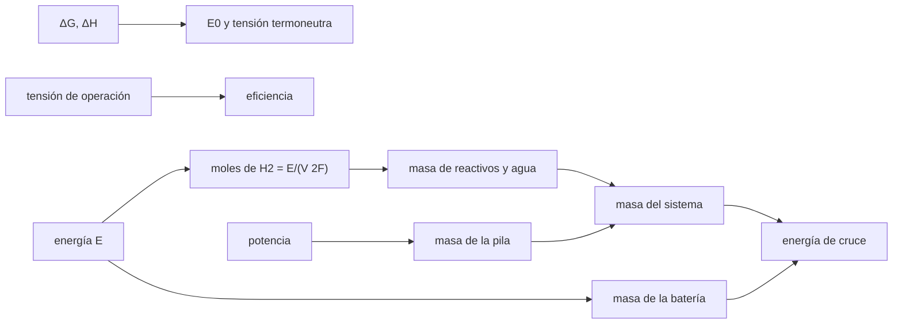

# B86-C15 — Sistemas de combustible como alternativa

<!-- nav:top -->
[🏠 Programa](../../../../README.md) · [📚 Bloque B86](../../../tronco-comun/B86-sistemas-de-potencia-y-energia-espacial.md) · [← Anterior: B86-C14 — Envejecimiento de paneles](../B86-C14-envejecimiento-de-paneles/CLASE.md) · [Siguiente: B86-C16 — Generadores radioisotópicos →](../B86-C16-generadores-radioisotopicos/CLASE.md)
<!-- /nav -->

## 1. Ubicación, nivel y alcance

Clase 15 del bloque B86. Nivel N3. Decimoquinta clase del bloque. Cuando la energía a almacenar crece (horas de operación sin Sol), una batería pesa más que unos reactivos y una pila. Aquí comparas, con un caso sintético de `500 W`, la masa de un sistema H₂/O₂ (pila, reactivos y tanques) con la de una batería, calculas la tensión y la eficiencia de la celda y el consumo de reactivos con la constante de Faraday, y encuentras la energía a partir de la cual la pila gana. Los valores termodinámicos de manual no se consultaron.

## 2. Por qué esta clase existe

Una batería guarda la energía y la entrega en la misma masa; una pila separa la potencia (la pila) de la energía (los reactivos). Para misiones largas esa separación puede ser más liviana, pero añade tanques, gestión del agua y complejidad. La decisión central: **¿a partir de qué cantidad de energía una pila de combustible pesa menos que una batería para la misma necesidad?**

## 3. Lo que podrás hacer al terminar

1. Calcular la tensión reversible y la eficiencia de una celda H₂/O₂ con la constante de Faraday.
2. Calcular los reactivos y el agua formada por kWh y comprobar el balance de masa.
3. Calcular la masa del sistema con pila, reactivos y factor de tanques.
4. Comparar con la masa de una batería de energía específica dada.
5. Encontrar la energía de cruce por bisección.
6. Separar lo consultado (`F`, rangos de baterías, mención de la herencia espacial) de lo ilustrativo (`ΔG`, tensión de operación, masas).

La evidencia es **la comparación de masa pila de combustible frente a batería** del ejercicio 12 (sección 20).

## 4. Con qué llegas y cómo comprobarlo

1. ¿Qué hace una pila de combustible?
2. ¿Qué es la constante de Faraday?
3. ¿Qué es la eficiencia de una pila?
4. ¿Qué productos da la reacción H₂ + ½O₂?
5. ¿Qué es la energía específica?

<details>
<summary>Ver respuestas</summary>

1. Convierte directamente la energía química de un combustible y un oxidante en electricidad. 2. La carga de un mol de electrones, `96485 C/mol`. 3. La energía eléctrica obtenida entre la energía química del combustible. 4. Agua, y calor. 5. La energía por unidad de masa, en Wh/kg.
</details>

Con cuatro o cinco aciertos, sigue; si no, repasa los prerrequisitos.

## 5. Un caso de contexto y casos de referencia

Una celda sintética que opera a `0,75 V` tiene una eficiencia de `50,6 %` sobre el poder calorífico superior y gasta `50,1 g` de H₂ y `398,0 g` de O₂ por kWh, produciendo `448,1 g` de agua. Con `500 W`, la pila pesa menos que una batería de `150 Wh/kg` a partir de `0,83 kWh`, o `1,7 h`. Es el **ejemplo conductor** y es **ilustrativo**.

## 6. Vocabulario

La **tensión reversible** `E₀ = −ΔG/(2F)` es el máximo de una celda ideal. La **tensión termoneutra** `−ΔH/(2F)` equivale al poder calorífico superior. Los **reactivos** son H₂ y O₂. El **balance de planta** son tanques, válvulas y gestión del agua. La **energía de cruce** es la que iguala las masas del sistema de pila y de la batería.

## 7. Modelo mental: un motor con depósito frente a un acumulador



*Descripción textual:* la termodinámica da las tensiones y la eficiencia; la energía y la tensión dan los reactivos; con la pila forman la masa del sistema, que se compara con la de la batería para hallar la energía de cruce.

Analogía: un motor pesa lo mismo trabaje una hora o cien, y el combustible aparte pesa por kilómetro; un acumulador pesa por kilómetro desde el principio. Límite: no se modelan la gestión del agua ni del calor, las purgas, la pérdida por almacenamiento criogénico ni la vida de la pila.

## 8. La explicación, paso a paso

### 8.1 La celda

`E₀ = −ΔG/(2F) = 1,2287 V` (con `ΔG = −237,1 kJ/mol`, valor de manual **no consultado**) y la tensión termoneutra `1,4811 V`. Operando a `0,75 V`: `η = 0,75/1,4811 = 50,6 %` sobre el poder calorífico superior (`61,0 %` sobre `ΔG`).

### 8.2 Reactivos

Por cada kWh a `0,75 V` se consumen `n = 3,6×10⁶/(0,75 × 2F) = 24,87 mol` de H₂, es decir `50,14 g` de H₂ y `397,96 g` de O₂ (`448,1 g` en total), y se forman `448,12 g` de agua. El balance de masa del agua cierra con una diferencia relativa de `2,2e-05` y el cálculo de H₂ por integral de la corriente coincide con una diferencia de `1,4e-16`.

### 8.3 Masa del sistema

Con `500 W` y `100 W/kg`, la pila pesa `5,00 kg`; con un factor `1,5` por tanques y planta los reactivos cuestan `0,672 kg/kWh`; la batería de `150 Wh/kg` cuesta `6,667 kg/kWh`.

| `E` (Wh) | Horas a `500 W` | Pila + reactivos (kg) | Batería (kg) |
|---|---|---|---|
| 500 | 1,0 | 5,336 | 3,333 |
| 2000 | 4,0 | 6,344 | 13,333 |
| 10000 | 20,0 | 11,722 | 66,667 |

### 8.4 Energía de cruce

La pila pesa menos que la batería desde `834,1 Wh` (`0,83 kWh`, `1,7 h` a `500 W`). Por debajo de eso la batería gana. La NASA señala que la pila de combustible es una tecnología de herencia espacial aún no miniaturizada para naves pequeñas.

## 9. Magnitudes, símbolos y unidades

| Símbolo | Qué es | Unidad | Valor / nota |
|---|---|---|---|
| `F` | constante de Faraday | C/mol | 96485,33212 (consultada) |
| `E₀` | tensión reversible | V | 1,2287 (ΔG no consultado) |
| `V` | tensión de operación | V | 0,75 (ilustrativa) |
| `η` | eficiencia sobre el PCS | — | 0,5064 |
| `m_react` | reactivos por kWh | g | 448,1 |
| `ρ_p` | potencia específica de la pila | W/kg | 100 (ilustrativa) |
| `E_cruce` | energía de cruce | kWh | 0,83 |

## 10. Convenciones y referencias

Celda H₂/O₂ con agua líquida, tensión de operación constante, reactivos al `100 %` de utilización, factor de tanques y planta `1,5`. `F` del NIST (CODATA 2022); `ΔG`, `ΔH` y masas molares son valores de manual **no consultados**; el resto es **ilustrativo**.

## 11. De dónde sale lo que afirmamos

| ID | Fuente | Localizador | Respalda | Estado |
|---|---|---|---|---|
| S1 | NIST, CODATA 2022 — constante de Faraday — https://physics.nist.gov/cgi-bin/cuu/Value?f (consultada 2026-11-10) | valor recomendado leído | F = 96485,33212 C/mol | Consultada |
| S3 | NASA Small Spacecraft Systems Virtual Institute, State-of-the-Art of Small Spacecraft Technology, cap. 3 Power — https://www.nasa.gov/smallsat-institute/sst-soa/power-subsystems/ (consultada 2026-11-10) | primeros 100.000 de 119.638 caracteres y el resumen final; no se leyó el resto | eficiencias de celdas multiunión (29,5–34 % BOL), energía específica de baterías Li-ion (150–270 Wh/kg comerciales), bus de 8,2 V con salidas de 5,0 y 3,3 V, tensiones de 12, 28 y 50 V con convertidores GaN, PCDU de 960 W y 1500 W; la degradación se lista como factor sin cifra | Consultada (parcial) |
| — | Relación estándar: termodinámica de la celda H₂/O₂ (ΔG, ΔH) y masas molares | — | la verifica el laboratorio con una segunda vía | No consultada en una fuente concreta |
| — | Datos sintéticos: tensión de operación, potencia específica de la pila y factor de tanques | — | valores generados para el ejemplo | Ilustrativo, no medido |

Límites: no se consultaron valores termodinámicos, hojas de datos de pilas ni los capítulos del estado del arte sobre pilas regenerativas (solo sus títulos de referencia); los valores de masa son ilustrativos y no representan un sistema real.

## 12. Cómo ver el cruce entre pila y batería

| Magnitud | Valor |
|---|---|
| Eficiencia (PCS) | 50,6 % |
| Reactivos por kWh | 448,1 g |
| Pila de 500 W | 5,00 kg |
| Energía de cruce | 0,83 kWh |
| Diferencia de balance | 2,2e-05 |

Descripción larga: la masa de la batería crece en proporción a la energía mientras la de la pila crece más despacio sobre una base fija; se cruzan en la energía de cruce.

## 13. Ejemplo trabajado: los moles de H₂ por kWh

**Paso 1 · Energía.** `1 kWh = 3,6×10⁶ J`.

**Paso 2 · Carga por mol.** `0,75 V × 2 × 96485 = 144728 J/mol`.

**Paso 3 · Moles.** `3,6×10⁶/144728 = 24,87 mol`.

**Paso 4 · Masa.** `24,87 × 2,01588 g/mol = 50,14 g`.

## 14. Distintas formas de describir un sistema de energía

**Por tensión:** `E₀`, `V`. **Por eficiencia:** `η`. **Por reactivos:** g/kWh. **Por masa:** pila más reactivos. **Por cruce:** energía donde igualan.

## 15. Práctica guiada

**Ejercicio 1 · con los pasos indicados.** Calcula `E₀` con `ΔG = −237,1 kJ/mol`. *Pasos:* `237100/(2 × 96485)`.

<details><summary>Solución comentada</summary>

`1,2287 V`.
</details>

**Ejercicio 2 · con una pista.** Predice si subir la tensión de operación sube o baja el consumo de H₂. *Pista:* `n = E/(V 2F)`.

<details><summary>Solución comentada</summary>

Lo baja: más tensión, menos corriente por kWh.
</details>

**Ejercicio 3 · casi autónomo.** H₂ por kWh a `0,70 V`.

<details><summary>Solución comentada</summary>

`53,73 g`.
</details>

## 16. Práctica autónoma, transferencia e integrador

**Ejercicio 4 · autónomo.** Agua formada por `1 g` de H₂.

<details><summary>Solución comentada</summary>

`18,015/2,016 = 8,94 g`.
</details>

**Ejercicio 5 · autónomo.** Masa de la batería para `4 kWh` a `150 Wh/kg`.

<details><summary>Solución comentada</summary>

`26,7 kg`.
</details>

**Ejercicio 6 · autónomo.** Masa del sistema de pila para `4 kWh`.

<details><summary>Solución comentada</summary>

`7,69 kg`.
</details>

**Ejercicio 7 · autónomo.** Si la pila pesara `10 kg` en vez de `5`, ¿cómo cambia la energía de cruce?

<details><summary>Solución comentada</summary>

Sube: `1,67 kWh`.
</details>

**Ejercicio 8 · autónomo.** ¿Y si el factor de tanques fuera `3`?

<details><summary>Solución comentada</summary>

Sube a `0,94 kWh`.
</details>

**Ejercicio 9 · transferencia.** **Transferencia.** Un colega compara solo la masa de los reactivos con la de la batería. ¿Qué omite?

<details><summary>Solución comentada</summary>

La masa de la pila, tanques y planta.
</details>

**Ejercicio 10 · transferencia.** **Transferencia.** Un colega ignora que el agua formada debe gestionarse. ¿Qué riesgo corre?

<details><summary>Solución comentada</summary>

Una pérdida de operación (inundación) o una masa extra de almacenamiento.
</details>

**Ejercicio 11 · transferencia.** **Transferencia.** Se presenta el cruce como válido para cualquier nave. ¿Qué corriges?

<details><summary>Solución comentada</summary>

Depende de la potencia, de la duración y de los valores ilustrativos de esta clase.
</details>

**Ejercicio 12 · integrador.** **Integrador.** Elabora tu *comparación de masa pila de combustible frente a batería*: reactivos por kWh, masas, cruce, balance y rótulos.

<details><summary>Solución comentada</summary>

Secciones 8.1–8.4 y la salida del laboratorio.
</details>

## 17. Laboratorio: pila de combustible H₂/O₂ y batería

El script [pila_combustible.py](pila_combustible.py) calcula la tensión y la eficiencia de la celda, los reactivos y el agua por kWh, la masa de pila y de batería y la energía de cruce (**comprueba** balance de masa del agua < 1e-4 (límite del redondeo de las masas molares), H₂ por energía frente a H₂ por carga < 1e-9 y que en el cruce las masas se igualan).

**Datos:** `F` del NIST y rangos de baterías de la NASA (consultados); `ΔG`, `ΔH` y masas molares **no consultados**; tensión, masas y factores **ilustrativos**. **Predice antes de ejecutar:** ¿qué pesa menos a `500 Wh`, la pila o la batería? (la batería). **Ejecución del 2026-11-10 (Python 3.12.9):**

```text
Python 3.12.9 (biblioteca estandar)
Tension reversible E0 = 1.2287 V ; tension termoneutra = 1.4811 V (valores de manual NO consultados, ilustrativos)
Celda sintetica a 0.75 V: eficiencia sobre HHV = 50.6 % ; sobre Delta G = 61.0 %
Reactivos por kWh a 0.75 V: H2 = 50.14 g ; O2 = 397.96 g ; agua formada = 448.12 g
Balance de masa del agua: diferencia relativa = 2.2e-05 ; H2 por integral de la corriente: diferencia relativa = 1.4e-16
Pila de 500 W a 100 W/kg = 5.00 kg ; reactivos con tanques = 0.672 kg/kWh ; bateria a 150 Wh/kg = 6.667 kg/kWh
 E [Wh]   t a 500 W [h]   m pila [kg]   m bateria [kg]
    500            1.0         5.336           3.333
   2000            4.0         6.344          13.333
  10000           20.0        11.722          66.667
Energia de cruce (la pila pesa menos que la bateria por encima de) = 834.1 Wh = 0.834 kWh
Pruebas superadas.
```

```bash
python programa/clases/B86/B86-C15-sistemas-de-combustible-como-alternativa/pila_combustible.py
```

**Límites:** sin gestión térmica ni del agua, con utilización total de los reactivos y sin degradación de la pila.

## 18. Errores frecuentes y cómo corregirlos

**Comparar solo reactivos y batería.** Se corrige con 8.3.

**Olvidar la masa de tanques.** Se corrige con 8.3 y el ejercicio 8.

**Tomar los valores de manual como consultados.** Se corrige con la sección 10.

**Generalizar el cruce a cualquier misión.** Se corrige con 8.4.

## 19. Cómo sabrás que vas bien

Tras la sección 8: ¿qué sistema esperabas más liviano a `2 kWh` y cuál lo fue? Si dudas, repasa el ejemplo 13. Tras el laboratorio: ¿qué verifica el balance de masa? (ver la sección 17).

## 20. Qué entregas y cómo se evalúa

El producto es **la comparación de masa pila de combustible frente a batería** (ejercicio 12).

| Criterio | Inicial | En desarrollo | Logrado | Destacado |
|---|---|---|---|---|
| Conceptos | Los confunde | Parciales | Calcula reactivos, masa y cruce | Explica los límites |
| Cálculo | Sin unidades | Con errores | Tablas completas con unidades | Calcula casos nuevos |
| Numérico | Sin comprobar | Un caso | Contraste con una segunda vía | Interpreta las diferencias |
| Fuentes | Sin fuente | Sin fecha | Fuentes con fecha y estado | Declara lo ilustrativo y lo no consultado |
| Límites | No los nombra | Uno | Tres | Discute qué falta del modelo |

**Condiciones críticas (no se compensan con promedio):** rotular `ΔG`, `ΔH` y las masas como no consultados o ilustrativos; no generalizar el cruce; citar solo lo consultado.

## 21. Ética, seguridad y límites

Clase educativa: los modelos son simplificados y sus datos son sintéticos o ilustrativos; ningún resultado describe una nave real ni sustituye a la ingeniería de una misión ni a una norma aplicada.  Accesibilidad: tablas equivalentes a las gráficas, fórmulas en texto, ejercicios sin conexión.

## 22. Para cerrar y seguir

La pila sintética gasta `448 g` de reactivos por kWh y pesa menos que la batería desde `0,8 kWh`. Queda una pregunta: ¿qué se usa cuando no hay Sol durante años?

**Glosario español–inglés.** pila de combustible · *fuel cell*; tensión reversible · *reversible voltage*; reactivo · *reactant*; constante de Faraday · *Faraday constant*; poder calorífico superior · *higher heating value*.

**Continuidad.** [B86-C16](../B86-C16-generadores-radioisotopicos/CLASE.md) estudia los generadores radioisotópicos.

**Referencias:** ver sección 11.

<!-- nav:bottom -->
---

[← Anterior: B86-C14 — Envejecimiento de paneles](../B86-C14-envejecimiento-de-paneles/CLASE.md) · [📚 Bloque B86](../../../tronco-comun/B86-sistemas-de-potencia-y-energia-espacial.md) · [Siguiente: B86-C16 — Generadores radioisotópicos →](../B86-C16-generadores-radioisotopicos/CLASE.md)
<!-- /nav -->
