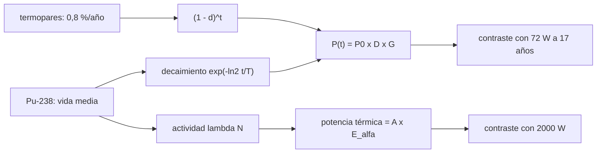

# B86-C16 — Generadores radioisotópicos

<!-- nav:top -->
[🏠 Programa](../../../../README.md) · [📚 Bloque B86](../../../tronco-comun/B86-sistemas-de-potencia-y-energia-espacial.md) · [← Anterior: B86-C15 — Sistemas de combustible como alternativa](../B86-C15-sistemas-de-combustible-como-alternativa/CLASE.md) · [Siguiente: B86-C17 — Energía nuclear espacial conceptual →](../B86-C17-energia-nuclear-espacial-conceptual/CLASE.md)
<!-- /nav -->

## 1. Ubicación, nivel y alcance

Clase 16 del bloque B86. Nivel N3. Decimosexta clase del bloque. Cuando el Sol es débil o falta durante meses, la nave lleva su propia fuente: un generador termoeléctrico radioisotópico convierte en electricidad el calor del decaimiento del plutonio-238. Aquí proyectas la potencia de un generador tipo MMRTG con las tasas de degradación de la NASA, la contrastas con la cifra publicada a 17 años y estimas la potencia térmica del plutonio desde su actividad. La clase trata el material radiactivo solo como concepto y orden de magnitud; no describe cómo manipular ni obtener fuentes.

## 2. Por qué esta clase existe

Un generador radioisotópico no depende de la distancia al Sol ni del eclipse, pero su potencia decae con el combustible y con los termopares y su eficiencia es baja. Entender esa curva decide qué misiones lo usan. La decisión central: **¿cuánta potencia entrega un generador radioisotópico al final de su vida y por qué difiere un modelo simple de la cifra publicada?**

## 3. Lo que podrás hacer al terminar

1. Modelar la potencia como decaimiento exponencial del Pu-238 por degradación del termopar.
2. Comparar la potencia a 17 años del modelo con la hoja técnica de la NASA y explicar la diferencia.
3. Despejar la degradación del termopar implícita en la cifra publicada.
4. Comprobar la identidad térmica de `8 × 250 W` y la eficiencia de `110/2000`.
5. Estimar la potencia térmica del plutonio desde su actividad.
6. Separar lo consultado (hoja del MMRTG, libro del JPL) de lo no consultado (vida media, energía alfa, masa molar).

La evidencia es **la curva de potencia de un generador radioisotópico frente a las cifras de la NASA** del ejercicio 12 (sección 20).

## 4. Con qué llegas y cómo comprobarlo

1. ¿Qué es la vida media?
2. ¿Qué es un termopar?
3. ¿Qué es la eficiencia de conversión?
4. ¿Qué es la actividad?
5. ¿Qué es un dato no consultado?

<details>
<summary>Ver respuestas</summary>

1. El tiempo en que la actividad de un isótopo se reduce a la mitad. 2. Una unión de dos materiales que genera tensión con una diferencia de temperatura. 3. La potencia eléctrica entre la térmica. 4. El número de desintegraciones por segundo, en becquereles. 5. Un dato de manual usado como valor ilustrativo sin haberlo leído en una fuente concreta.
</details>

Con cuatro o cinco aciertos, sigue; si no, repasa los prerrequisitos.

## 5. Un caso de contexto y casos de referencia

Con `110 W` al inicio y las dos tasas del libro del JPL (`≈ 0,8 %/año` por decaimiento y `0,8 %/año` por termopar), un modelo simple da `83,9 W` a `17 años`, mientras la hoja de la NASA estima `72 W`: la diferencia es de `+16,5 %`. Para que el modelo dé `72 W` el termopar tendría que degradarse `1,69 %/año`. Es el **ejemplo conductor**; las tasas y la hoja son consultadas, el modelo es **ilustrativo**.

## 6. Vocabulario

Un **RTG** (*radioisotope thermoelectric generator*) convierte el calor del decaimiento en electricidad sin partes móviles. El **GPHS** es el módulo que aloja el combustible y aporta `250 W` térmicos. La **vida media** del Pu-238 se toma como `87,7 años` (no consultada). La **degradación del termopar** es la pérdida de rendimiento de la conversión. La **eficiencia de sistema** es `P_e/P_t`.

## 7. Modelo mental: una hoguera que se apaga despacio y una estufa que pierde rendimiento



*Descripción textual:* el decaimiento y la degradación del termopar dan `P(t)`, que se contrasta con la cifra de la NASA a 17 años; la actividad y la energía alfa dan la potencia térmica, contrastada con `2000 W`.

Analogía: una hoguera que se apaga muy despacio calienta una estufa cuyo rendimiento también baja con los años. Límite: el modelo suma dos tasas constantes; la hoja de la NASA y el libro del JPL usan otros supuestos (por ejemplo, un ejemplo conservador de `4,8 %/año`), y no se reproducen entre sí.

## 8. La explicación, paso a paso

### 8.1 El modelo

`P(t) = P₀ exp(−ln2 · t/T½) (1 − d)^t`, con `P₀ = 110 W`, `T½ = 87,7 años` (no consultada) y `d = 0,8 %/año` (libro del JPL). El decaimiento solo es `0,787 %/año`.

| `t` (años) | `P` modelo (W) |
|---|---|
| 0 | 110,00 |
| 5 | 101,58 |
| 10 | 93,80 |
| 17 | 83,90 |
| 30 | 68,20 |

### 8.2 Contraste con la hoja de la NASA

A `17 años` la hoja estima `72 W`; el modelo da `83,90 W` (`+11,90 W`, `+16,5 %`). La degradación anual total implícita en `72 W` es `2,462 %/año`, y la del modelo `1,581 %/año`. El ejemplo conservador del libro (`107 W`, `4,8 %/año`) da `46,4 W`: tres cifras distintas para una misma pregunta, según los supuestos de cada fuente. La lección es que la cifra de misión hay que tomarla de la fuente del proyecto y no de un modelo simple.

### 8.3 Energía y eficiencia

La energía entregada en `17 años` según el modelo es `14360 kWh`. Los `8` módulos de `250 W` suman `2000 W` térmicos, igual que los `≈ 2000 W` de la hoja; `110/2000 = 5,5 %`, algo menos que el `6 %` de la hoja (que probablemente usa otra potencia térmica de referencia); con `2,8 W/kg` la masa es `39,3 kg`.

### 8.4 Potencia térmica desde la actividad

Con `4,8 kg` de dioxido de plutonio y `71 %` de Pu-238 hay `3408 g` (la fracción en peso es de la NASA; la masa molar `238,05 g/mol`, la vida media y la energía alfa de `5,59 MeV` **no se consultaron**). La actividad resulta `2,159 PBq`, y la potencia térmica `A × E_α = 1934 W` (`-3,3 %` frente a `2000 W`): un orden de magnitud coherente con la hoja.

## 9. Magnitudes, símbolos y unidades

| Símbolo | Qué es | Unidad | Valor / nota |
|---|---|---|---|
| `P₀` | potencia eléctrica inicial | W | 110 (consultada) |
| `P(17)` | potencia a 17 años | W | 72 (NASA); 83,9 (modelo) |
| `T½` | vida media del Pu-238 | años | 87,7 (no consultada) |
| `d` | degradación del termopar | 1/año | 0,008 (JPL) |
| `η` | eficiencia de sistema | — | 0,06 (NASA); 0,055 (110/2000) |
| `A` | actividad del Pu-238 | Bq | 2,16e+15 |
| `P_t` | potencia térmica | W | 2000 (NASA); 1934 (actividad) |

## 10. Convenciones y referencias

Decaimiento exponencial y degradación del termopar constante, sin otros isótopos ni helio acumulado. Cifras del MMRTG y de la degradación de la NASA/JPL (consultadas); `T½`, masa molar, `E_α` y `1 eV` son valores de manual **no consultados**; `N_A` es exacto en el SI y tampoco se consultó.

## 11. De dónde sale lo que afirmamos

| ID | Fuente | Localizador | Respalda | Estado |
|---|---|---|---|---|
| S4 | NASA/DOE, hoja técnica del MMRTG — https://mars.nasa.gov/internal_resources/788/ (consultada 2026-11-10) | hoja de 2 páginas leída con PyMuPDF | 110 W eléctricos al inicio, 72 W estimados a 17 años, eficiencia de sistema 6 %, 2,8 W/kg, 30 V de carga, 768 termopares, ~2000 W térmicos | Consultada |
| S5 | Lee, Y. y Bairstow, B., Radioisotope Power Systems Reference Book for Mission Designers and Planners, JPL Publication 15-6, septiembre de 2015 — https://ntrs.nasa.gov/api/citations/20160001769/downloads/20160001769.pdf (consultada 2026-11-10) | 94 páginas; leídas con PyMuPDF las secciones sobre degradación y conversión | degradación del termopar ~0,8 % por año y ~0,8 % por año por decaimiento del Pu-238; 250 W térmicos por módulo GPHS; el libro también usa 4,8 % por año de degradación total en un ejemplo conservador | Consultada (parcial) |
| S6 | NASA, Radioisotope Power Systems FAQ — https://science.nasa.gov/planetary-science/programs/radioisotope-power-systems/faq/ (consultada 2026-11-10) | página leída | 8 módulos GPHS con 4,8 kg de óxido de plutonio, ~71 % de Pu-238 en peso, forma cerámica | Consultada |
| — | Relación estándar: decaimiento radiactivo y potencia térmica A × E_α; vida media 87,7 años; masa molar y energía alfa | — | la verifica el laboratorio con una segunda vía | No consultada en una fuente concreta |
| — | Datos sintéticos: modelo de suma de tasas de degradación | — | valores generados para el ejemplo | Ilustrativo, no medido |

Límites: no se consultó la vida media del Pu-238 en una fuente; el libro del JPL y la hoja de la NASA dan degradaciones diferentes y el laboratorio solo reporta la diferencia; no se cita ninguna cifra de actividad de una fuente.

## 12. Cómo ver la potencia de un RTG en el tiempo

| Magnitud | Valor |
|---|---|
| `P` a 17 años (modelo) | 83,9 W |
| `P` a 17 años (NASA) | 72 W |
| Diferencia | +16,5 % |
| Térmico 8 × 250 W | 2000 W |
| Térmico por actividad | 1934 W |

Descripción larga: la potencia cae cerca de `1,6 %` por año en el modelo; la hoja de la NASA implica una caída mayor, de modo que el modelo simple es optimista.

## 13. Ejemplo trabajado: la potencia a 17 años

**Paso 1 · Decaimiento.** `exp(−ln2 × 17/87,7) = 0,8743`.

**Paso 2 · Termopar.** `0,992^17 = 0,8724`.

**Paso 3 · Producto.** `0,8743 × 0,8724 = 0,7627`.

**Paso 4 · Potencia.** `110 × 0,7627 = 83,90 W`.

## 14. Distintas formas de describir un generador radioisotópico

**Por potencia:** `P(t)`. **Por degradación:** decaimiento y termopar. **Por eficiencia:** `P_e/P_t`. **Por masa:** W/kg. **Por actividad:** Bq.

## 15. Práctica guiada

**Ejercicio 1 · con los pasos indicados.** Calcula `exp(−ln2 × 10/87,7)`. *Pasos:* exponente y exponencial.

<details><summary>Solución comentada</summary>

`0,9240`.
</details>

**Ejercicio 2 · con una pista.** Predice si `P` a 17 años sube o baja con una degradación de termopar de `1,5 %/año`. *Pista:* factor `(1 − d)^t`.

<details><summary>Solución comentada</summary>

Baja: `74,4 W`.
</details>

**Ejercicio 3 · casi autónomo.** Potencia a 5 años del modelo.

<details><summary>Solución comentada</summary>

`101,58 W`.
</details>

## 16. Práctica autónoma, transferencia e integrador

**Ejercicio 4 · autónomo.** Eficiencia de `110 W` sobre `2000 W`.

<details><summary>Solución comentada</summary>

`5,5 %`.
</details>

**Ejercicio 5 · autónomo.** Masa de un generador de `110 W` a `2,8 W/kg`.

<details><summary>Solución comentada</summary>

`39,3 kg`.
</details>

**Ejercicio 6 · autónomo.** Degradación total anual implícita en `72 W` a 17 años.

<details><summary>Solución comentada</summary>

`2,462 %`.
</details>

**Ejercicio 7 · autónomo.** ¿Qué potencia da el ejemplo conservador a 10 años?

<details><summary>Solución comentada</summary>

`107 × 0,952^10 = 65,4 W`.
</details>

**Ejercicio 8 · autónomo.** ¿Cuántos módulos de `250 W` dan `2000 W`?

<details><summary>Solución comentada</summary>

`8`.
</details>

**Ejercicio 9 · transferencia.** **Transferencia.** Un colega presenta `84 W` como la potencia a 17 años de una misión. ¿Qué corriges?

<details><summary>Solución comentada</summary>

Es un modelo con tasas sumadas; la misión usa la cifra del proyecto (la hoja da `72 W`) con sus supuestos.
</details>

**Ejercicio 10 · transferencia.** **Transferencia.** Un colega usa solo la vida media para la degradación. ¿Qué omite?

<details><summary>Solución comentada</summary>

La degradación del termopar, del mismo orden que el decaimiento.
</details>

**Ejercicio 11 · transferencia.** **Transferencia.** Se presentan las actividades calculadas como las de una fuente real. ¿Qué corriges?

<details><summary>Solución comentada</summary>

Son órdenes de magnitud con datos no consultados; la caracterización de una fuente real corresponde a sus autoridades.
</details>

**Ejercicio 12 · integrador.** **Integrador.** Elabora tu *curva de potencia de un generador radioisotópico frente a las cifras de la NASA*: tabla, diferencia con `72 W`, degradación implícita, térmico, actividad y rótulos.

<details><summary>Solución comentada</summary>

Secciones 8.1–8.4 y la salida del laboratorio.
</details>

## 17. Laboratorio: potencia de un RTG frente a las cifras de la NASA

El script [rtg_potencia.py](rtg_potencia.py) proyecta la potencia, la compara con la hoja de la NASA a 17 años, despeja la degradación del termopar implícita y estima la potencia térmica desde la actividad (**comprueba** solo identidades internas: `P(0) = P₀`, `P(T½)` y `8 × 250 W`; las diferencias con la NASA se **reportan**, no se fuerzan).

**Datos:** hoja del MMRTG y libro del JPL (consultados); `T½`, masa molar y `E_α` **no consultados**. **Predice antes de ejecutar:** ¿el modelo dará más o menos de `72 W` a 17 años? (más: es optimista). **Ejecución del 2026-11-10 (Python 3.12.9):**

```text
Python 3.12.9 (biblioteca estandar)
Modelo: P(t) = 110 W exp(-ln2 t/87.7) (1-0.008)^t ; decaimiento = 0.787 %/ano ; termopar = 0.8 %/ano
 t [a]   P modelo [W]
     0      110.00
     5      101.58
    10       93.80
    17       83.90
    30       68.20
A 17 anos: modelo = 83.90 W ; hoja de la NASA = 72 W ; diferencia = +11.90 W (+16.5 %)
Degradacion anual total implicita: NASA (72 W) = 2.462 %/ano ; modelo = 1.581 %/ano ; termopar necesario para 72 W = 1.688 %/ano
Ejemplo conservador (107 W, 4.8 %/ano): 46.37 W a 17 anos
Energia entregada en 17 anos (modelo) = 14360 kWh
Termico: 8 modulos x 250 W = 2000 W (hoja: ~2000 W) ; eficiencia 110/2000 = 5.5 % (hoja: 6 %) ; masa 110/2.8 = 39.3 kg
Pu-238: 3408 g ; actividad = 2.159 PBq ; potencia termica por actividad = 1934 W (-3.3 % frente a 2000 W) ; 0.567 W/g
Pruebas superadas.
```

```bash
python programa/clases/B86/B86-C16-generadores-radioisotopicos/rtg_potencia.py
```

**Límites:** dos tasas constantes y sin otros efectos; la actividad y la potencia térmica son órdenes de magnitud; no describe fuentes reales.

## 18. Errores frecuentes y cómo corregirlos

**Usar solo el decaimiento del combustible.** Se corrige con 8.1 y 8.2.

**Tomar el modelo como cifra de misión.** Se corrige con 8.2.

**Confundir potencia térmica con eléctrica.** Se corrige con 8.3.

**Presentar valores no consultados como consultados.** Se corrige con la sección 11.

## 19. Cómo sabrás que vas bien

Tras la sección 8: ¿qué potencia esperabas a 17 años y cuál obtuviste frente a la NASA? Si dudas, repasa el ejemplo 13. Tras el laboratorio: ¿qué se verifica y qué solo se reporta? (ver la sección 17).

## 20. Qué entregas y cómo se evalúa

El producto es **la curva de potencia de un generador radioisotópico frente a las cifras de la NASA** (ejercicio 12).

| Criterio | Inicial | En desarrollo | Logrado | Destacado |
|---|---|---|---|---|
| Conceptos | Los confunde | Parciales | Calcula `P(t)` y contrasta con la fuente | Explica los límites |
| Cálculo | Sin unidades | Con errores | Tablas completas con unidades | Calcula casos nuevos |
| Numérico | Sin comprobar | Un caso | Contraste con una segunda vía | Interpreta las diferencias |
| Fuentes | Sin fuente | Sin fecha | Fuentes con fecha y estado | Declara lo ilustrativo y lo no consultado |
| Límites | No los nombra | Uno | Tres | Discute qué falta del modelo |

**Condiciones críticas (no se compensan con promedio):** rotular lo no consultado; reportar la diferencia con la NASA sin forzar el acuerdo; no describir cómo manejar fuentes; citar solo lo consultado.

## 21. Ética, seguridad y límites

Clase educativa: los modelos son simplificados y sus datos son sintéticos o ilustrativos; ningún resultado describe una nave real ni sustituye a la ingeniería de una misión ni a una norma aplicada. Esta clase usa material radiactivo solo como concepto: calcula órdenes de magnitud con datos publicados y no orienta sobre manipulación, fabricación ni obtención de fuentes. Accesibilidad: tablas equivalentes a las gráficas, fórmulas en texto, ejercicios sin conexión.

## 22. Para cerrar y seguir

Un modelo simple da `84 W` a 17 años, la NASA estima `72 W` y el ejemplo conservador del JPL `46 W`: la diferencia es el tamaño de la incertidumbre de modelo. Queda una pregunta: ¿qué cambia con un reactor de fisión?

**Glosario español–inglés.** generador radioisotópico · *radioisotope generator*; vida media · *half-life*; termopar · *thermocouple*; degradación · *degradation*; actividad · *activity*.

**Continuidad.** [B86-C17](../B86-C17-energia-nuclear-espacial-conceptual/CLASE.md) estudia la energía nuclear espacial en el plano conceptual.

**Referencias:** ver sección 11.

<!-- nav:bottom -->
---

[← Anterior: B86-C15 — Sistemas de combustible como alternativa](../B86-C15-sistemas-de-combustible-como-alternativa/CLASE.md) · [📚 Bloque B86](../../../tronco-comun/B86-sistemas-de-potencia-y-energia-espacial.md) · [Siguiente: B86-C17 — Energía nuclear espacial conceptual →](../B86-C17-energia-nuclear-espacial-conceptual/CLASE.md)
<!-- /nav -->
