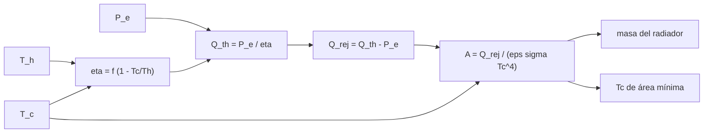

# B86-C17 — Energía nuclear espacial conceptual

<!-- nav:top -->
[🏠 Programa](../../../../README.md) · [📚 Bloque B86](../../../tronco-comun/B86-sistemas-de-potencia-y-energia-espacial.md) · [← Anterior: B86-C16 — Generadores radioisotópicos](../B86-C16-generadores-radioisotopicos/CLASE.md) · [Siguiente: B86-C18 — Seguridad y licenciamiento energético →](../B86-C18-seguridad-y-licenciamiento-energetico/CLASE.md)
<!-- /nav -->

## 1. Ubicación, nivel y alcance

Clase 17 del bloque B86. Nivel N3. Decimoséptima clase del bloque. Un reactor de fisión da potencia de decenas de kilovatios independiente del Sol, pero convierte calor en electricidad con un ciclo térmico y debe rechazar el resto al espacio. Aquí haces el dimensionamiento conceptual de esa conversión con un modelo de fracción de Carnot, calculas el área de radiador que minimiza la superficie y verificas el óptimo contra un resultado analítico. Es un orden de magnitud sintético: no se usan cifras de ningún programa real y la clase no describe diseño de reactores.

## 2. Por qué esta clase existe

En el espacio el único sumidero de calor es la radiación, y el calor rechazado de un ciclo térmico es grande. La temperatura del radiador y la del ciclo determinan la eficiencia y el área, y el área determina la masa. La decisión central: **¿a qué temperatura de rechazo conviene operar el radiador para minimizar su área con un ciclo de fracción de Carnot dada?**

## 3. Lo que podrás hacer al terminar

1. Calcular la eficiencia con una fracción de Carnot y las temperaturas caliente y fría.
2. Calcular el calor térmico y el rechazado para una potencia eléctrica dada.
3. Dimensionar el área y la masa de un radiador con la ley de Stefan–Boltzmann.
4. Encontrar la temperatura de rechazo que minimiza el área y verificarla con barrido y con el resultado analítico `3/4`.
5. Estimar la sensibilidad a la temperatura caliente.
6. Separar lo consultado (`σ`, el contexto de la NASA) de lo ilustrativo (toda la configuración).

La evidencia es **el dimensionamiento conceptual de un sistema de fisión superficial** del ejercicio 12 (sección 20).

## 4. Con qué llegas y cómo comprobarlo

1. ¿Qué es la eficiencia de Carnot?
2. ¿Qué es la fracción de Carnot?
3. ¿Por qué se rechaza calor?
4. ¿Cómo se rechaza calor en el espacio?
5. ¿Qué es un dato ilustrativo?

<details>
<summary>Ver respuestas</summary>

1. El máximo teórico `1 − T_c/T_h` de una máquina térmica entre dos temperaturas. 2. La relación entre la eficiencia real y la de Carnot. 3. Porque ninguna máquina térmica convierte todo el calor en trabajo. 4. Radiándolo, según `ε σ T⁴ A`. 5. Un dato inventado para el ejemplo, no tomado de un diseño real.
</details>

Con cuatro o cinco aciertos, sigue; si no, repasa los prerrequisitos.

## 5. Un caso de contexto y casos de referencia

Un sistema conceptual de `40 kW` eléctricos con ciclo a `900 K` y fracción de Carnot `0,5` necesita un radiador de área mínima operando a `703 K` (`T_c/T_h = 0,781`): la eficiencia es `11,0 %`, el calor rechazado `325 kW`, el área `28 m²` y la masa del radiador `138 kg` con `5 kg/m²`. Es el **ejemplo conductor** y es **ilustrativo**: no representa ningún programa.

## 6. Vocabulario

La **fracción de Carnot** `f` mide la calidad del ciclo. El **rechazo de calor** es `Q_rej = Q_th − P_e`. El **radiador** emite `ε σ T⁴` por unidad de área. La **densidad de área** es la masa por unidad de superficie. El **óptimo del radiador** es la `T_c` que minimiza el área para una potencia eléctrica dada.

## 7. Modelo mental: una cocina con un solo desagüe



*Descripción textual:* las temperaturas y la fracción de Carnot dan la eficiencia; con la potencia eléctrica se obtiene el calor térmico y el rechazado; este fija el área y la masa del radiador, y la temperatura fría óptima minimiza el área.

Analogía: una cocina que produce más agua sucia de la que entra limpia necesita un desagüe grande; calentar el desagüe (subir `T_c`) lo hace más eficaz pero baja el rendimiento. Límite: es un modelo de orden de magnitud sin reactor, blindaje, entorno ni ciclo real.

## 8. La explicación, paso a paso

### 8.1 Eficiencia y calor

`η = f(1 − T_c/T_h)`. Con `f = 0,5` y `T_c = 703 K`, `η = 10,96 %`; el calor térmico es `P_e/η = 364,9 kW` y el rechazado `324,9 kW`.

### 8.2 Área y masa

`A = Q_rej/(ε σ T_c⁴) = 27,6 m²`, y con `5 kg/m²` el radiador pesa `138 kg`. El radiador no ve ningún entorno (sumidero a `0 K`): es una cota favorable.

### 8.3 Óptimo y verificación

La sección áurea da `T_c = 702,70 K` y el barrido de `0,1 K` da `702,7 K` (diferencia `0,00 K`). Con `f = 1` el óptimo numérico es `T_c/T_h = 0,750000` frente al resultado analítico `0,75` (`2,6e-09`).

| `T_c` (K) | `η` (%) | `A` (m²) | Masa (kg) |
|---|---|---|---|
| 400 | 27,78 | 84,3 | 421 |
| 500 | 22,22 | 46,5 | 232 |
| 600 | 16,67 | 32,0 | 160 |
| 700 | 11,11 | 27,7 | 138 |

### 8.4 Sensibilidad

Con `T_h = 800 K` el óptimo es `T_c = 625 K` y `A = 44 m²`; con `1100 K`, `T_c = 859 K` y `A = 12 m²`: un ciclo más caliente reduce el área.

## 9. Magnitudes, símbolos y unidades

| Símbolo | Qué es | Unidad | Valor / nota |
|---|---|---|---|
| `P_e` | potencia eléctrica | kW | 40 (ilustrativa) |
| `T_h`, `T_c` | temperatura caliente y fría | K | 900; 703 |
| `f` | fracción de Carnot | — | 0,5 (ilustrativa) |
| `η` | eficiencia | — | 0,1096 |
| `Q_rej` | calor rechazado | kW | 324,9 |
| `A` | área de radiador | m² | 27,6 |
| `σ` | constante de Stefan–Boltzmann | W m⁻² K⁻⁴ | 5,670374419 × 10⁻⁸ (consultada) |

## 10. Convenciones y referencias

Ciclo con fracción de Carnot constante, radiador isotermo sin entorno (sumidero a `0 K`), potencia eléctrica fija. `σ` de CODATA 2022; el resto de la configuración es **ilustrativo** y no corresponde a un diseño ni a un programa. Las cifras del programa Fission Surface Power de la NASA no se consultaron.

## 11. De dónde sale lo que afirmamos

| ID | Fuente | Localizador | Respalda | Estado |
|---|---|---|---|---|
| S1 | NIST, CODATA 2022 — constante de Stefan–Boltzmann — https://physics.nist.gov/cgi-bin/cuu/Value?sigma (consultada 2026-11-10) | valor recomendado leído | σ = 5,670374419 × 10⁻⁸ W m⁻² K⁻⁴ | Consultada |
| S3 | NASA Small Spacecraft Systems Virtual Institute, State-of-the-Art of Small Spacecraft Technology, cap. 3 Power — https://www.nasa.gov/smallsat-institute/sst-soa/power-subsystems/ (consultada 2026-11-10) | primeros 100.000 de 119.638 caracteres y el resumen final; no se leyó el resto | eficiencias de celdas multiunión (29,5–34 % BOL), energía específica de baterías Li-ion (150–270 Wh/kg comerciales), bus de 8,2 V con salidas de 5,0 y 3,3 V, tensiones de 12, 28 y 50 V con convertidores GaN, PCDU de 960 W y 1500 W; la degradación se lista como factor sin cifra | Consultada (parcial) |
| — | Relación estándar: eficiencia de Carnot, balance de un ciclo térmico y óptimo `3/4` del radiador | — | la verifica el laboratorio con una segunda vía | No consultada en una fuente concreta |
| — | Datos sintéticos: potencia, temperaturas, fracción de Carnot y densidad de área | — | valores generados para el ejemplo | Ilustrativo, no medido |

Límites: no se consultó ninguna cifra de programas de fisión espacial (la página de Fission Surface Power de la NASA no se pudo abrir); la clase no trata reactores, blindaje ni seguridad de diseño.

## 12. Cómo ver el radiador según la temperatura de rechazo

| Magnitud | Valor |
|---|---|
| `T_c` óptima | 703 K |
| `η` | 11,0 % |
| `Q_rej` | 325 kW |
| `A` mínima | 28 m² |
| Masa del radiador | 138 kg |

Descripción larga: el área tiene un mínimo: a `T_c` baja el radiador emite poco por metro cuadrado, a `T_c` alta la eficiencia baja y hay que rechazar más calor.

## 13. Ejemplo trabajado: el calor rechazado

**Paso 1 · Eficiencia.** `0,5 × (1 − 703/900) = 0,1096`.

**Paso 2 · Calor térmico.** `40/0,1096 = 364,9 kW`.

**Paso 3 · Rechazo.** `364,9 − 40 = 324,9 kW`.

**Paso 4 · Área.** `324,9 × 10³/(0,85 σ T_c⁴) = 27,6 m²`.

## 14. Distintas formas de describir un sistema nuclear de potencia

**Por ciclo:** `η`, `f`. **Por calor:** `Q_th`, `Q_rej`. **Por radiador:** `A`, masa. **Por óptimo:** `T_c`. **Por sensibilidad:** `T_h`.

## 15. Práctica guiada

**Ejercicio 1 · con los pasos indicados.** Eficiencia con `f = 0,5`, `T_c = 450 K`, `T_h = 900 K`. *Pasos:* `0,5 × (1 − 0,5)`.

<details><summary>Solución comentada</summary>

`25 %`.
</details>

**Ejercicio 2 · con una pista.** Predice si subir `T_h` baja o sube el área. *Pista:* sube `η`.

<details><summary>Solución comentada</summary>

La baja: el calor rechazado disminuye.
</details>

**Ejercicio 3 · casi autónomo.** Calor rechazado si `P_e = 10 kW` y `η = 0,25`.

<details><summary>Solución comentada</summary>

`10/0,25 − 10 = 30 kW`.
</details>

## 16. Práctica autónoma, transferencia e integrador

**Ejercicio 4 · autónomo.** `σ T⁴` a `500 K`.

<details><summary>Solución comentada</summary>

`5,670374419×10⁻⁸ × 6,25×10¹⁰ = 3544 W/m²`.
</details>

**Ejercicio 5 · autónomo.** Área para `30 kW` a `500 K` con `ε = 0,85`.

<details><summary>Solución comentada</summary>

`30000/(0,85 × 3544) = 9,96 m²`.
</details>

**Ejercicio 6 · autónomo.** Masa del radiador de `9,96 m²` a `5 kg/m²`.

<details><summary>Solución comentada</summary>

`49,8 kg`.
</details>

**Ejercicio 7 · autónomo.** `T_c/T_h` óptimo con `f = 1`.

<details><summary>Solución comentada</summary>

`0,75`.
</details>

**Ejercicio 8 · autónomo.** ¿Por qué no conviene `T_c` muy alta?

<details><summary>Solución comentada</summary>

La eficiencia cae y hay que rechazar más calor.
</details>

**Ejercicio 9 · transferencia.** **Transferencia.** Un colega usa `T_c = 0 K`. ¿Qué corriges?

<details><summary>Solución comentada</summary>

La eficiencia de Carnot sería la máxima, pero el radiador no emitiría nada: el área sería infinita.
</details>

**Ejercicio 10 · transferencia.** **Transferencia.** Un colega calcula el área con la potencia eléctrica en vez del calor rechazado. ¿Qué error comete?

<details><summary>Solución comentada</summary>

Subdimensiona: lo que se radia es `Q_rej`, que es varias veces `P_e`.
</details>

**Ejercicio 11 · transferencia.** **Transferencia.** Se presentan estos números como el diseño de un programa real. ¿Qué corriges?

<details><summary>Solución comentada</summary>

Son órdenes de magnitud ilustrativos; no se consultó ninguna cifra de programas.
</details>

**Ejercicio 12 · integrador.** **Integrador.** Elabora tu *dimensionamiento conceptual de un sistema de fisión superficial*: eficiencia, calor, área, masa, óptimo, sensibilidad y rótulos.

<details><summary>Solución comentada</summary>

Secciones 8.1–8.4 y la salida del laboratorio.
</details>

## 17. Laboratorio: conversión y radiador de un sistema de fisión conceptual

El script [fision_conceptual.py](fision_conceptual.py) calcula la eficiencia, el calor rechazado, el área y la masa del radiador y busca la temperatura de rechazo de área mínima (**comprueba** sección áurea frente a barrido < `0,5 K` y, con `f = 1`, el óptimo `3/4` con diferencia < 1e-6).

**Datos:** `σ` del NIST (consultada); toda la configuración **ilustrativa**; ninguna cifra de programas de fisión. **Predice antes de ejecutar:** ¿el óptimo de `f = 1` será cercano a `0,75`? (sí, exactamente). **Ejecución del 2026-11-10 (Python 3.12.9):**

```text
Python 3.12.9 (biblioteca estandar)
Sistema CONCEPTUAL (ilustrativo): P_e = 40 kW ; T_h = 900 K ; f = 0.5 ; eps = 0.85 ; densidad de area = 5.0 kg/m2
Radiador de area minima: T_c = 702.70 K (barrido 702.7 K ; dif 0.00 K) ; T_c/T_h = 0.7808
  eta = 10.96 % ; Q_th = 364.9 kW ; Q_rechazado = 324.9 kW ; A = 27.6 m2 ; masa del radiador = 138 kg
 T_c [K]   eta [%]   A [m2]   masa radiador [kg]
    400     27.78      84.3          421
    500     22.22      46.5          232
    600     16.67      32.0          160
    700     11.11      27.7          138
Con f = 1 (Carnot ideal): T_c/T_h optimo = 0.750000 (analitico 0.75 ; dif 2.6e-09)
Sensibilidad a T_h: 800 K -> T_c = 624.6 K, A = 44.3 m2 ; 1100 K -> T_c = 858.9 K, A = 12.4 m2
Pruebas superadas.
```

```bash
python programa/clases/B86/B86-C17-energia-nuclear-espacial-conceptual/fision_conceptual.py
```

**Límites:** orden de magnitud sin reactor, blindaje ni entorno; fracción de Carnot constante; no es un diseño.

## 18. Errores frecuentes y cómo corregirlos

**Radiar solo la potencia eléctrica.** Se corrige con 8.1 y 8.2.

**Creer que mayor `T_c` siempre ayuda.** Se corrige con 8.3.

**Tomar el modelo como diseño.** Se corrige con la sección 10.

**Citar cifras de programas no consultadas.** Se corrige con la sección 11.

## 19. Cómo sabrás que vas bien

Tras la sección 8: ¿qué `T_c` esperabas óptima y cuál obtuviste? Si dudas, repasa el ejemplo 13. Tras el laboratorio: ¿qué verifica el caso `f = 1`? (ver la sección 17).

## 20. Qué entregas y cómo se evalúa

El producto es **el dimensionamiento conceptual de un sistema de fisión superficial** (ejercicio 12).

| Criterio | Inicial | En desarrollo | Logrado | Destacado |
|---|---|---|---|---|
| Conceptos | Los confunde | Parciales | Calcula `η`, `Q_rej` y `A` | Explica los límites |
| Cálculo | Sin unidades | Con errores | Tablas completas con unidades | Calcula casos nuevos |
| Numérico | Sin comprobar | Un caso | Contraste con una segunda vía | Interpreta las diferencias |
| Fuentes | Sin fuente | Sin fecha | Fuentes con fecha y estado | Declara lo ilustrativo y lo no consultado |
| Límites | No los nombra | Uno | Tres | Discute qué falta del modelo |

**Condiciones críticas (no se compensan con promedio):** rotular toda la configuración como ilustrativa; no atribuirla a ningún programa; citar solo lo consultado.

## 21. Ética, seguridad y límites

Clase educativa: los modelos son simplificados y sus datos son sintéticos o ilustrativos; ningún resultado describe una nave real ni sustituye a la ingeniería de una misión ni a una norma aplicada. La clase trata la energía nuclear solo como balance térmico de orden de magnitud: no describe diseño de reactores, combustibles ni blindaje. Accesibilidad: tablas equivalentes a las gráficas, fórmulas en texto, ejercicios sin conexión.

## 22. Para cerrar y seguir

El modelo conceptual rechaza `325 kW` con un radiador de `28 m²` a `703 K`. Queda una pregunta: ¿qué marco de seguridad y autorización rige el uso de estas fuentes?

**Glosario español–inglés.** energía nuclear espacial · *space nuclear power*; fracción de Carnot · *Carnot fraction*; calor rechazado · *rejected heat*; radiador · *radiator*; fisión · *fission*.

**Continuidad.** [B86-C18](../B86-C18-seguridad-y-licenciamiento-energetico/CLASE.md) estudia la seguridad y el licenciamiento energético.

**Referencias:** ver sección 11.

<!-- nav:bottom -->
---

[← Anterior: B86-C16 — Generadores radioisotópicos](../B86-C16-generadores-radioisotopicos/CLASE.md) · [📚 Bloque B86](../../../tronco-comun/B86-sistemas-de-potencia-y-energia-espacial.md) · [Siguiente: B86-C18 — Seguridad y licenciamiento energético →](../B86-C18-seguridad-y-licenciamiento-energetico/CLASE.md)
<!-- /nav -->
