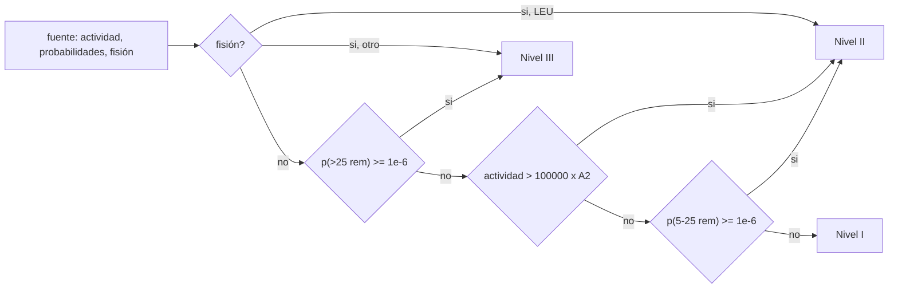

# B86-C18 — Seguridad y licenciamiento energético

<!-- nav:top -->
[🏠 Programa](../../../../README.md) · [📚 Bloque B86](../../../tronco-comun/B86-sistemas-de-potencia-y-energia-espacial.md) · [← Anterior: B86-C17 — Energía nuclear espacial conceptual](../B86-C17-energia-nuclear-espacial-conceptual/CLASE.md) · [Siguiente: B86-C19 — Presupuesto de potencia de misión →](../B86-C19-presupuesto-de-potencia-de-mision/CLASE.md)
<!-- /nav -->

## 1. Ubicación, nivel y alcance

Clase 18 del bloque B86. Nivel N3. Decimoctava clase del bloque. Una fuente nuclear en una nave no solo se diseña: se autoriza. Aquí ubicas el marco institucional de Estados Unidos (la memoria presidencial NSPM-20 de 2019) en una clase que codifica sus tres niveles de autorización de lanzamiento, calcula la actividad de una fuente de plutonio-238 y muestra cómo el nivel depende de un umbral (`A2`) que esta clase **no consultó** y por eso parametriza. La clase es conceptual: no es una evaluación de seguridad, no es asesoría legal y no cubre el marco de otros países.

## 2. Por qué esta clase existe

Los límites de la energía nuclear en el espacio son tanto jurídicos y de seguridad como técnicos: quién aprueba, con qué análisis y con qué umbrales. Un ingeniero de potencia debe saber que estas decisiones existen y qué datos las gobiernan. La decisión central: **¿cómo decide el marco de NSPM-20 el nivel de autorización de un lanzamiento, y qué parte de esa decisión depende de un dato que hay que consultar en la fuente primaria?**

## 3. Lo que podrás hacer al terminar

1. Describir los tres niveles de autorización de NSPM-20 y sus criterios (actividad en múltiplos de `A2`, probabilidad de dosis, fisión).
2. Calcular la actividad de una masa de Pu-238 por dos vías.
3. Clasificar fuentes de distinta masa en un nivel con un `A2` parametrizado.
4. Medir la sensibilidad del nivel al valor de `A2` y a las probabilidades de dosis.
5. Verificar la lógica de clasificación con una tabla de verdad.
6. Separar lo consultado (texto de NSPM-20) de lo no consultado (`A2`, vida media, normativa de implementación).

La evidencia es **la hoja de clasificación de autorización con análisis de sensibilidad** del ejercicio 12 (sección 20).

## 4. Con qué llegas y cómo comprobarlo

1. ¿Qué es la actividad de una fuente?
2. ¿Qué es un valor `A2`?
3. ¿Qué es una dosis efectiva total?
4. ¿Qué es un nivel de autorización?
5. ¿Qué es un dato no consultado?

<details>
<summary>Ver respuestas</summary>

1. El número de desintegraciones por segundo, en becquereles. 2. Un límite de actividad por radionúclido usado en transporte de material radiactivo (IAEA SSR-6); aquí se parametriza. 3. Una medida del efecto de la radiación en el cuerpo, en rem o sievert. 4. Un escalón de revisión y de autoridad de aprobación según el riesgo. 5. Un dato usado como valor ilustrativo sin haberlo leído en una fuente concreta.
</details>

Con cuatro o cinco aciertos, sigue; si no, repasa los prerrequisitos.

## 5. Un caso de contexto y casos de referencia

La actividad específica del Pu-238 calculada es `0,634 TBq/g`. Con un `A2` **ilustrativo** de `10⁹ Bq`, una fuente de `1 g` está en el Nivel I (`6,3e+02` veces `A2`) y los `3408 g` de Pu-238 de un MMRTG tienen `2,16e+06` veces `A2` y quedan en el Nivel II. El umbral de `100000 × A2` cae en `158 g`. Es el **ejemplo conductor**: la estructura de niveles es de NSPM-20 y los números dependen de un `A2` que no se consultó.

## 6. Vocabulario

**NSPM-20** es la memoria presidencial de 2019 que fija el proceso de autorización de lanzamientos con sistemas nucleares espaciales. Los **niveles I, II y III** escalan la revisión según actividad, probabilidad de dosis y fisión. **A2** es el valor de actividad de la tabla de la IAEA SSR-6. **TED** es la dosis efectiva total. **LEU** es uranio poco enriquecido (< 20 % de U-235).

## 7. Modelo mental: un control de aduana con tres filas



*Descripción textual:* primero se ve si hay fisión (LEU nivel II, otro combustible nivel III); luego la probabilidad de más de 25 rem (nivel III); luego la actividad frente a `100000 × A2` (nivel II) y la probabilidad de 5–25 rem (nivel II); si nada se cumple, es nivel I.

Analogía: una aduana con tres filas: lo ordinario pasa por la primera, lo que pesa más o tiene riesgo por la segunda y lo más delicado por la tercera. Límite: el diagrama resume la sección 4; el texto de la memoria y su implementación por agencias tienen más condiciones que esta clase no codifica.

## 8. La explicación, paso a paso

### 8.1 Qué establece NSPM-20

La memoria presidencial NSPM-20 (2019) fija tres niveles de autorización de lanzamiento. El **Nivel I** cubre fuentes radiactivas hasta `100000 × A2` (valor de la tabla 2 de la IAEA SSR-6, Rev.1). El **Nivel II** cubre fuentes mayores, lanzamientos de Nivel I cuya probabilidad de un accidente con `5` a `25 rem` de dosis efectiva total para un miembro del público es `≥ 10⁻⁶`, y sistemas de fisión con uranio poco enriquecido. El **Nivel III** cubre lanzamientos con probabilidad `≥ 10⁻⁶` de más de `25 rem` y los sistemas de fisión con cualquier otro combustible. En proyectos federales, para el Nivel I la autoridad es el jefe de la agencia patrocinadora; para el Nivel II también lo es; para los comerciales la autoridad de licencia es el Secretario de Transporte en los tres niveles (según el texto y el resumen de la memoria; la clase no analiza la parte jurídica).

### 8.2 Actividad y razón con `A2`

Actividad específica: `6,3358e+11 Bq/g` (dos vías, diferencia `0,0e+00`).

| Fuente | `m` (g) | `A` (Bq) | `A/A2` | Nivel |
|---|---|---|---|---|
| 100 mg | 0,1 | 6,336e+10 | 6,336e+01 | 1 |
| 1 g | 1 | 6,336e+11 | 6,336e+02 | 1 |
| 100 g | 100 | 6,336e+13 | 6,336e+04 | 1 |
| 3408 g | 3408 | 2,159e+15 | 2,159e+06 | 2 |

### 8.3 Sensibilidad a `A2`

El nivel de la fuente de `3408 g` con `A2 = 10⁸`, `10⁹`, `10¹⁰` y `10¹¹ Bq` es `2`, `2`, `2` y `1`, y el umbral de masa del Nivel I se mueve de `15,8 g` a `15783 g`. La conclusión de nivel depende del `A2` real de la IAEA, que esta clase no consultó: por eso el número `158 g` es solo una ilustración.

### 8.4 Tabla de verdad

Con una fuente de `1 g`: sin probabilidades, Nivel `1`; con `p(5–25 rem) = 10⁻⁶`, Nivel `2`; con `10⁻⁷`, Nivel `1`; con `p(>25 rem) = 10⁻⁶`, Nivel `3`; fisión con uranio poco enriquecido, Nivel `2`; fisión con otro combustible, Nivel `3`. La actividad al lanzamiento (no la inicial) es la que cuenta: la de `3408 g` pasa de `2,159 PBq` a `1,888 PBq` en `17` años.

## 9. Magnitudes, símbolos y unidades

| Símbolo | Qué es | Unidad | Valor / nota |
|---|---|---|---|
| `A` | actividad | Bq | 2,16e+15 (3408 g) |
| `A2` | valor de la tabla IAEA SSR-6 | Bq | 10⁹ (ilustrativo, no consultado) |
| `A/A2` | razón con `A2` | — | 2,16e+06 |
| Umbral Nivel I | múltiplo de `A2` | — | 100000 (NSPM-20) |
| `p` | probabilidad de dosis | — | ≥ 10⁻⁶ (NSPM-20) |
| `m_umbral` | masa en el umbral del Nivel I | g | 158 (con `A2` ilustrativo) |
| `T½` | vida media del Pu-238 | años | 87,7 (no consultada) |

## 10. Convenciones y referencias

El script codifica un resumen de la sección 4 de NSPM-20; `A2` se parametriza porque no se consultó la tabla de la IAEA SSR-6; la vida media y la masa molar son valores de manual no consultados. La clase no evalúa riesgo, no hace análisis de seguridad y no es asesoría legal.

## 11. De dónde sale lo que afirmamos

| ID | Fuente | Localizador | Respalda | Estado |
|---|---|---|---|---|
| S1 | Presidencia de EE. UU., Memorandum on Launch of Spacecraft Containing Space Nuclear Systems (NSPM-20), 2019 — https://www.govinfo.gov/content/pkg/DCPD-201900558/html/DCPD-201900558.htm (consultada 2026-11-10) | texto de la sección 4 leído | criterios de los niveles I, II y III (múltiplos de A2, probabilidades de dosis, fisión), definición de criticidad y de LEU | Consultada |
| S2 | NASA, Radioisotope Power Systems FAQ — https://science.nasa.gov/planetary-science/programs/radioisotope-power-systems/faq/ (consultada 2026-11-10) | página leída (no describe el proceso de autorización) | 8 módulos, 4,8 kg de óxido de plutonio, ~71 % de Pu-238, forma cerámica; varias capas de seguridad | Consultada |
| S3 | Resultados de búsqueda (AIP, FAA, NASA NPR 8715.26) sobre NSPM-20 (consultada 2026-11-10) | solo resúmenes; los documentos no se abrieron | que NSPM-20 sustituyó a un proceso previo de aprobación presidencial caso por caso, que la FAA incorpora los niveles en la circular AC 450.45-1 y que NASA los implementa en NPR 8715.26 (febrero de 2022) | Visto solo en resúmenes de búsqueda; no consultado en el documento |
| — | IAEA SSR-6 (Rev.1), Tabla 2 (valores A2) | — | valor A2 del Pu-238 | No consultada |
| — | Relación estándar: actividad `A = λN` y reglas de clasificación como código | — | la verifica el laboratorio con una segunda vía | No consultada en una fuente concreta |
| — | Datos sintéticos: valor de A2 de referencia, casos de masa y probabilidades | — | valores generados para el ejemplo | Ilustrativo, no medido |

Límites: no se consultó la tabla A2 de la IAEA, ni el texto de NPR 8715.26 ni de la AC 450.45-1; el marco de otros países y organismos (incluido el de las Naciones Unidas) no se trata; esta clase no es asesoría legal ni análisis de seguridad.

## 12. Cómo ver el nivel según la masa y el valor de A2

| Magnitud | Valor |
|---|---|
| Actividad específica | 0,634 TBq/g |
| 1 g con `A2` ilustrativo | Nivel 1 |
| 3408 g con `A2` ilustrativo | Nivel 2 |
| Umbral Nivel I | 158 g |
| Diferencia de vías | 0,0e+00 |

Descripción larga: el nivel crece con la masa y con la probabilidad de dosis; el umbral de masa se desplaza linealmente con `A2`.

## 13. Ejemplo trabajado: la razón con A2 de una fuente de 1 g

**Paso 1 · Actividad específica.** `6,3358e+11 Bq/g`.

**Paso 2 · Actividad de 1 g.** `6,336e+11 Bq`.

**Paso 3 · Razón.** `6,336e+11/10⁹ = 6,3e+02`.

**Paso 4 · Nivel.** Menor que `100000`: Nivel I (salvo que una probabilidad de dosis lo suba).

## 14. Distintas formas de describir el marco de autorización

**Por actividad:** múltiplos de `A2`. **Por probabilidad:** dosis de 5–25 rem o más de 25 rem. **Por fisión:** LEU u otro combustible. **Por nivel:** I, II, III. **Por autoridad:** agencia o transporte.

## 15. Práctica guiada

**Ejercicio 1 · con los pasos indicados.** Calcula la razón con `A2` de una fuente de `10¹⁴ Bq` si `A2 = 10⁹ Bq`. *Pasos:* divide.

<details><summary>Solución comentada</summary>

`10⁵`: justo en el umbral (`≤ 100000`, Nivel I).
</details>

**Ejercicio 2 · con una pista.** Predice el nivel de un sistema de fisión con uranio poco enriquecido. *Pista:* sección 4(b).

<details><summary>Solución comentada</summary>

Nivel II.
</details>

**Ejercicio 3 · casi autónomo.** Nivel de un sistema con fisión de otro combustible.

<details><summary>Solución comentada</summary>

Nivel III.
</details>

## 16. Práctica autónoma, transferencia e integrador

**Ejercicio 4 · autónomo.** ¿Qué pasa con el umbral de masa si `A2` se duplica?

<details><summary>Solución comentada</summary>

Se duplica.
</details>

**Ejercicio 5 · autónomo.** Actividad de `3408 g` a los `17` años.

<details><summary>Solución comentada</summary>

`1,888 PBq`.
</details>

**Ejercicio 6 · autónomo.** Un lanzamiento de Nivel I con `p(5–25 rem) = 2×10⁻⁶`.

<details><summary>Solución comentada</summary>

Pasa a Nivel II.
</details>

**Ejercicio 7 · autónomo.** Un lanzamiento con `p(>25 rem) = 5×10⁻⁷`.

<details><summary>Solución comentada</summary>

No es Nivel III por esa vía (`< 10⁻⁶`).
</details>

**Ejercicio 8 · autónomo.** ¿Quién es la autoridad de licencia de un lanzamiento comercial?

<details><summary>Solución comentada</summary>

El Secretario de Transporte, en los tres niveles (según el texto y el resumen consultados).
</details>

**Ejercicio 9 · transferencia.** **Transferencia.** Un colega usa el `A2` de este laboratorio para decidir el nivel de una fuente real. ¿Qué corriges?

<details><summary>Solución comentada</summary>

El `A2` es ilustrativo y no se consultó; hay que usar la tabla vigente de la IAEA.
</details>

**Ejercicio 10 · transferencia.** **Transferencia.** Un colega dice que esta clase sirve como análisis de seguridad. ¿Qué corriges?

<details><summary>Solución comentada</summary>

Es una clase conceptual; el análisis de seguridad lo hacen especialistas y lo revisan las autoridades.
</details>

**Ejercicio 11 · transferencia.** **Transferencia.** Se presentan las actividades como las de una fuente real de una misión. ¿Qué corriges?

<details><summary>Solución comentada</summary>

Son cálculos con datos no consultados; las fuentes reales las caracterizan sus autoridades.
</details>

**Ejercicio 12 · integrador.** **Integrador.** Elabora tu *hoja de clasificación de autorización con análisis de sensibilidad*: actividad, razón, nivel, barrido de `A2`, tabla de verdad y rótulos.

<details><summary>Solución comentada</summary>

Secciones 8.1–8.4 y la salida del laboratorio.
</details>

## 17. Laboratorio: niveles de autorización con A2 parametrizado

El script [niveles_autorizacion.py](niveles_autorizacion.py) calcula la actividad del Pu-238 por dos vías, clasifica cuatro masas con un `A2` ilustrativo, barre `A2` y verifica la lógica de clasificación con una tabla de verdad (**comprueba** actividad por las dos vías < 1e-12 de diferencia y que todas las reglas de la tabla de verdad se cumplen).

**Datos:** texto de NSPM-20 y FAQ de la NASA (consultados); `A2`, vida media y masa molar **no consultados**. **Predice antes de ejecutar:** ¿qué nivel tiene la fuente de `3408 g` con el `A2` ilustrativo? (Nivel II). **Ejecución del 2026-11-10 (Python 3.12.9):**

```text
Python 3.12.9 (biblioteca estandar)
Clasificacion de niveles de NSPM-20 con A2 PARAMETRIZADO (A2 de referencia ilustrativo = 1e9 Bq, NO consultado)
Actividad especifica del Pu-238 (calculada, vida media 87.7 a no consultada) = 6.3358e+11 Bq/g = 0.634 TBq/g ; diferencia entre las dos vias = 0.0e+00
 fuente                               m [g]       A [Bq]       A/A2       nivel
 100 mg (fuente muy pequena)             0.1    6.336e+10    6.336e+01   1
 1 g                                     1.0    6.336e+11    6.336e+02   1
 100 g                                 100.0    6.336e+13    6.336e+04   1
 3408 g (Pu-238 de un MMRTG)          3408.0    2.159e+15    2.159e+06   2
Masa de Pu-238 que cruza el umbral de 100000 x A2 (con A2 = 1e9 Bq) = 157.8 g
Sensibilidad al valor de A2 (fuente de 3408 g):
  A2 = 1e+08 Bq -> nivel 2 ; umbral del Nivel I = 15.8 g de Pu-238
  A2 = 1e+09 Bq -> nivel 2 ; umbral del Nivel I = 157.8 g de Pu-238
  A2 = 1e+10 Bq -> nivel 2 ; umbral del Nivel I = 1578.3 g de Pu-238
  A2 = 1e+11 Bq -> nivel 1 ; umbral del Nivel I = 15783.2 g de Pu-238
Actividad de 3408 g: ahora = 2.159 PBq ; a los 17 anos = 1.888 PBq (el nivel se decide con la actividad al lanzamiento)
Tabla de verdad (1 g): sin probabilidades -> 1 ; p(5-25 rem) = 1e-6 -> 2 ; 1e-7 -> 1 ; p(>25 rem) = 1e-6 -> 3 ; fision LEU -> 2 ; fision otro combustible -> 3
Pruebas superadas.
```

```bash
python programa/clases/B86/B86-C18-seguridad-y-licenciamiento-energetico/niveles_autorizacion.py
```

**Límites:** resume la sección 4 de NSPM-20; no codifica el resto del proceso, el marco de otros países ni el análisis de seguridad.

## 18. Errores frecuentes y cómo corregirlos

**Tomar el `A2` ilustrativo como dato real.** Se corrige con 8.3.

**Decidir el nivel con la actividad inicial en vez de la del lanzamiento.** Se corrige con 8.4.

**Tratar la clase como asesoría legal.** Se corrige con las secciones 1 y 21.

**Citar NPR 8715.26 y la AC 450.45-1 como leídos.** Se corrige con la sección 11: solo se vieron en resúmenes.

## 19. Cómo sabrás que vas bien

Tras la sección 8: ¿qué nivel esperabas para `1 g` y cuál obtuviste? Si dudas, repasa el ejemplo 13. Tras el laboratorio: ¿qué verifica la tabla de verdad? (ver la sección 17).

## 20. Qué entregas y cómo se evalúa

El producto es **la hoja de clasificación de autorización con análisis de sensibilidad** (ejercicio 12).

| Criterio | Inicial | En desarrollo | Logrado | Destacado |
|---|---|---|---|---|
| Conceptos | Los confunde | Parciales | Clasifica en niveles y distingue lo consultado | Explica los límites |
| Cálculo | Sin unidades | Con errores | Tablas completas con unidades | Calcula casos nuevos |
| Numérico | Sin comprobar | Un caso | Contraste con una segunda vía | Interpreta las diferencias |
| Fuentes | Sin fuente | Sin fecha | Fuentes con fecha y estado | Declara lo ilustrativo y lo no consultado |
| Límites | No los nombra | Uno | Tres | Discute qué falta del modelo |

**Condiciones críticas (no se compensan con promedio):** rotular `A2` como no consultado; no tratar la clase como asesoría legal ni análisis de seguridad; citar solo lo consultado.

## 21. Ética, seguridad y límites

Clase educativa: los modelos son simplificados y sus datos son sintéticos o ilustrativos; ningún resultado describe una nave real ni sustituye a la ingeniería de una misión ni a una norma aplicada. Los sistemas nucleares espaciales se regulan por autoridades nacionales e internacionales; esta clase solo explica un esquema público de niveles. No orienta sobre manipulación, fabricación ni obtención de material radiactivo ni sustituye a un análisis de seguridad. Accesibilidad: tablas equivalentes a las gráficas, fórmulas en texto, ejercicios sin conexión.

## 22. Para cerrar y seguir

NSPM-20 organiza la autorización en tres niveles según actividad, probabilidad de dosis y fisión; con un `A2` ilustrativo, `1 g` de Pu-238 es Nivel I y `3408 g` Nivel II. Queda una pregunta: ¿cómo se reúne todo en el presupuesto de potencia de una misión?

**Glosario español–inglés.** licenciamiento · *licensing*; nivel de autorización · *authorization tier*; actividad · *activity*; dosis efectiva total · *total effective dose*; uranio poco enriquecido · *low-enriched uranium*.

**Continuidad.** [B86-C19](../B86-C19-presupuesto-de-potencia-de-mision/CLASE.md) estudia el presupuesto de potencia de una misión.

**Referencias:** ver sección 11.

<!-- nav:bottom -->
---

[← Anterior: B86-C17 — Energía nuclear espacial conceptual](../B86-C17-energia-nuclear-espacial-conceptual/CLASE.md) · [📚 Bloque B86](../../../tronco-comun/B86-sistemas-de-potencia-y-energia-espacial.md) · [Siguiente: B86-C19 — Presupuesto de potencia de misión →](../B86-C19-presupuesto-de-potencia-de-mision/CLASE.md)
<!-- /nav -->
