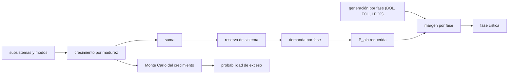

# B86-C19 — Presupuesto de potencia de misión

<!-- nav:top -->
<!-- /nav -->

## 1. Ubicación, nivel y alcance

Clase 19 del bloque B86. Nivel N3. Decimonovena clase del bloque. Con la generación, la batería, el bus y el envejecimiento ya calculados, aquí se junta todo en el presupuesto de potencia de una misión sintética: cargas por subsistema y por fase, reservas de crecimiento según madurez, reserva de sistema, potencia de ala requerida y margen en cada fase de la vida. Las reservas porcentuales son ilustrativas; no se consultó ningún estándar de masa y potencia. Usa la tabla de cargas de la primera clase y el envejecimiento de la clase 14.

## 2. Por qué esta clase existe

Un presupuesto es un compromiso de ingeniería: cada subsistema promete una potencia que todavía puede crecer. Las reservas por madurez evitan que el ala quede corta cuando una carga nueva consume más de lo previsto. La decisión central: **¿en qué fase de la misión queda el menor margen, y con qué probabilidad la demanda real superaría la generación?**

## 3. Lo que podrás hacer al terminar

1. Aplicar un crecimiento por madurez de cada subsistema y una reserva de sistema.
2. Calcular la potencia de ala requerida por fase con las eficiencias de camino.
3. Obtener el margen de cada fase y encontrar la fase crítica.
4. Verificar que la suma de contribuciones de los subsistemas iguala el total.
5. Estimar con Monte Carlo la probabilidad de que la demanda supere la generación y compararla con el caso determinista.
6. Separar lo consultado (periodo y eclipse) de lo ilustrativo (reservas, cargas y fases).

La evidencia es **el presupuesto de potencia de misión con reservas** del ejercicio 12 (sección 20).

## 4. Con qué llegas y cómo comprobarlo

1. ¿Qué es una reserva de crecimiento?
2. ¿Por qué la reserva depende de la madurez?
3. ¿Qué es una fase de misión?
4. ¿Qué es el margen?
5. ¿Qué es una simulación Monte Carlo?

<details>
<summary>Ver respuestas</summary>

1. Un porcentaje añadido a una carga para cubrir su incertidumbre de diseño. 2. Porque un equipo comercial ya medido es más predecible que uno nuevo. 3. Un tramo de la vida con su configuración, por ejemplo puesta en órbita, operación y modo seguro. 4. `(P_gen − P_req)/P_req`. 5. Repetir muchas veces un cálculo con valores aleatorios para ver su dispersión.
</details>

Con cuatro o cinco aciertos, sigue; si no, repasa los prerrequisitos.

## 5. Un caso de contexto y casos de referencia

La carga nominal en luz de la nave sintética es `84 W`; con crecimiento por madurez y `10 %` de reserva de sistema pasa a `109,45 W` (`+30,3 %`). Entre las cuatro fases, el menor margen es `-14,5 %` en la fase «LEOP». Monte Carlo da una probabilidad de `0,0000` de que la demanda supere la generación en el nominal de fin de vida. Es el **ejemplo conductor** y es **ilustrativo**.

## 6. Vocabulario

El **crecimiento por madurez** es la reserva de cada equipo según lo conocido que sea (comercial, modificado, nuevo). La **reserva de sistema** se aplica al total. La **fase** es un modo de operación con su generación. El **margen** compara lo disponible con lo requerido. La **fase crítica** es la de menor margen.

## 7. Modelo mental: el presupuesto de una casa con gastos inciertos



*Descripción textual:* los subsistemas, con su crecimiento por madurez y la reserva de sistema, dan la demanda por fase y la potencia de ala requerida; con la generación de cada fase resultan los márgenes y la fase crítica; un Monte Carlo del crecimiento estima la probabilidad de exceso.

Analogía: el presupuesto de una casa deja un colchón mayor para los gastos que se conocen poco (una obra nueva) y menor para los fijos (el alquiler). Límite: los porcentajes de esta clase son ilustrativos; los proyectos fijan los suyos en normas y revisan el presupuesto en cada hito.

## 8. La explicación, paso a paso

### 8.1 Demanda con reservas

En el modo nominal en luz, cada subsistema crece según su madurez y el total recibe una reserva de sistema del `10 %`:

| Subsistema | Madurez | `P` (W) | Crecimiento | Con crecimiento (W) |
|---|---|---|---|---|
| Ordenador de a bordo | comercial | 12,0 | 5 % | 12,600 |
| Control de actitud | modificado | 20,0 | 15 % | 23,000 |
| Radio | modificado | 18,0 | 15 % | 20,700 |
| Carga útil | nuevo | 30,0 | 30 % | 39,000 |
| Térmica | comercial | 4,0 | 5 % | 4,200 |
| Despliegue | nuevo | 0,0 | 30 % | 0,000 |

La suma con reserva de sistema es `109,45 W` en luz y `65,23 W` en eclipse, con un residuo de la suma de contribuciones de `0,0e+00 W`.

### 8.2 Fases

| Fase | `P` luz (W) | `P` eclipse (W) | `P_ala` req. (W) | `P_ala` disp. (W) | Margen (%) |
|---|---|---|---|---|---|
| LEOP | 86,52 | 73,86 | 167,66 | 143,34 | -14,5 |
| Nominal inicio de vida | 109,45 | 65,23 | 186,94 | 286,67 | 53,3 |
| Nominal fin de vida | 109,45 | 65,23 | 186,94 | 253,93 | 35,8 |
| Modo seguro fin de vida | 31,13 | 44,99 | 76,75 | 253,93 | 230,9 |

El margen mínimo es `-14,5 %` en la fase «LEOP».

### 8.3 Monte Carlo

Si cada carga crece un valor uniforme entre `0` y su reserva, la potencia de ala requerida en el nominal de fin de vida tiene media `174,29 W`, percentil `95` de `181,03 W` y máximo `185,69 W`, frente a los `186,94 W` del caso determinista con todos los crecimientos máximos: el determinista es una cota superior. La probabilidad de que supere los `253,93 W` disponibles es `0,0000`.

### 8.4 Qué decidir con esto

En este caso el margen mínimo es negativo en la fase «LEOP»: con el ala al `50 %` la generación no cierra el ciclo con las cargas de esa fase. Eso no invalida el diseño, pero obliga a decidir: aceptar que la batería cubra el déficit durante pocas órbitas (clase de energía durante el eclipse), reducir cargas en esa fase (clases de modos de operación y de deslastre) o cambiar la orientación del ala. Las fases con margen positivo no necesitan acción.

## 9. Magnitudes, símbolos y unidades

| Símbolo | Qué es | Unidad | Valor / nota |
|---|---|---|---|
| `c_i` | crecimiento por madurez | — | 0,05; 0,15; 0,30 (ilustrativos) |
| `r` | reserva de sistema | — | 0,10 (ilustrativa) |
| `P_d`, `P_e` | demanda nominal en luz y eclipse | W | 109,45; 65,23 |
| `P_sa` | potencia de ala requerida | W | 186,94 (nominal EOL) |
| `P_gen` | potencia disponible | W | 253,93 (nominal EOL) |
| Margen | `(P_gen − P_sa)/P_sa` | % | 35,8 (nominal EOL) |
| `p` | probabilidad de exceso (MC) | — | 0,0000 |

## 10. Convenciones y referencias

Órbita de `600 km` con `β = 0`; cargas por modo promediadas; potencia de ala normal al Sol de `286,67 W` al inicio y `0,8858` a cinco años (clase de envejecimiento); LEOP con el ala al `50 %`. Los porcentajes de crecimiento y de sistema, las cargas y las fases son **ilustrativos**: no provienen de ninguna norma.

## 11. De dónde sale lo que afirmamos

| ID | Fuente | Localizador | Respalda | Estado |
|---|---|---|---|---|
| S1 | NASA/NSSDC, Earth Fact Sheet — https://nssdc.gsfc.nasa.gov/planetary/factsheet/earthfact.html (consultada 2026-11-10) | ficha completa leída | irradiancia solar 1361,0 W/m²; GM = 0,39860 × 10⁶ km³/s²; radio medio 6371,000 km; periodo orbital sideral 365,256 d | Consultada |
| — | Relación estándar: presupuesto de potencia por modos y fases y reservas de crecimiento por madurez | — | la verifica el laboratorio con una segunda vía | No consultada en una fuente concreta |
| — | Datos sintéticos: cargas por subsistema, reservas, fases y generación disponible | — | valores generados para el ejemplo | Ilustrativo, no medido |

Límites: no se consultó ningún estándar de reservas de masa y potencia ni el manual de ingeniería de sistemas de la NASA en esta clase; los porcentajes son ilustrativos y no representan una política de proyecto.

## 12. Cómo ver el presupuesto por fases

| Magnitud | Valor |
|---|---|
| Demanda nominal en luz | 109,45 W |
| Margen mínimo | -14,5 % |
| Media Monte Carlo | 174,29 W |
| Máximo Monte Carlo | 185,69 W |
| Probabilidad de exceso | 0,0000 |

Descripción larga: la fase de menor margen decide el diseño; el caso determinista con reservas máximas queda por encima de toda la nube Monte Carlo.

## 13. Ejemplo trabajado: el crecimiento de la carga útil

**Paso 1 · Carga.** `30 W` en luz.

**Paso 2 · Madurez.** Nueva: `+30 %`.

**Paso 3 · Con crecimiento.** `30 × 1,30 = 39,000 W`.

**Paso 4 · Con reserva de sistema.** `39,000 × 1,10 = 42,900 W` de aporte al total.

## 14. Distintas formas de describir un presupuesto de potencia

**Por subsistema:** carga y madurez. **Por modo:** luz y eclipse. **Por fase:** LEOP, nominal, seguro. **Por margen:** `(P_gen − P_sa)/P_sa`. **Por probabilidad:** Monte Carlo.

## 15. Práctica guiada

**Ejercicio 1 · con los pasos indicados.** Calcula el crecimiento de una carga comercial de `12 W`. *Pasos:* `12 × 1,05`.

<details><summary>Solución comentada</summary>

`12,6 W`.
</details>

**Ejercicio 2 · con una pista.** Predice si subir la reserva de sistema a `15 %` sube o baja el margen. *Pista:* sube la demanda.

<details><summary>Solución comentada</summary>

Lo baja.
</details>

**Ejercicio 3 · casi autónomo.** Demanda de luz nominal sin reservas.

<details><summary>Solución comentada</summary>

`84 W`.
</details>

## 16. Práctica autónoma, transferencia e integrador

**Ejercicio 4 · autónomo.** Aumento porcentual total por reservas.

<details><summary>Solución comentada</summary>

`30,3 %`.
</details>

**Ejercicio 5 · autónomo.** Margen de la fase LEOP.

<details><summary>Solución comentada</summary>

`-14,5 %`.
</details>

**Ejercicio 6 · autónomo.** Margen del nominal de inicio de vida.

<details><summary>Solución comentada</summary>

`53,3 %`.
</details>

**Ejercicio 7 · autónomo.** ¿Qué fase tiene menor margen?

<details><summary>Solución comentada</summary>

«LEOP».
</details>

**Ejercicio 8 · autónomo.** Probabilidad de exceso en el nominal de fin de vida.

<details><summary>Solución comentada</summary>

`0,0000`.
</details>

**Ejercicio 9 · transferencia.** **Transferencia.** Un equipo suma las cargas máximas de todos los modos. ¿Qué error comete?

<details><summary>Solución comentada</summary>

Sobredimensiona: los modos no son simultáneos; se presupuesta por modo y fase.
</details>

**Ejercicio 10 · transferencia.** **Transferencia.** Un colega aplica reservas iguales a todas las cargas. ¿Qué pierde?

<details><summary>Solución comentada</summary>

La información de madurez: un equipo comercial ya medido no necesita la reserva de uno nuevo.
</details>

**Ejercicio 11 · transferencia.** **Transferencia.** Se presenta el presupuesto como el de una misión real. ¿Qué corriges?

<details><summary>Solución comentada</summary>

Es un caso sintético con reservas ilustrativas; los porcentajes los fija cada proyecto.
</details>

**Ejercicio 12 · integrador.** **Integrador.** Elabora tu *presupuesto de potencia de misión con reservas*: subsistemas, reservas, fases, margen crítico, Monte Carlo y rótulos.

<details><summary>Solución comentada</summary>

Secciones 8.1–8.4 y la salida del laboratorio.
</details>

## 17. Laboratorio: presupuesto de potencia de misión por fases

El script [presupuesto_mision.py](presupuesto_mision.py) calcula la demanda por fase con crecimiento por madurez y reserva de sistema, la potencia de ala requerida, los márgenes y la fase crítica, y estima con Monte Carlo la probabilidad de exceso (**comprueba** residuo de la suma de contribuciones < 1e-9 W y que el caso determinista es cota superior del Monte Carlo).

**Datos:** periodo y eclipse de la NASA/NSSDC (consultados); reservas, cargas y fases **ilustrativas**. **Predice antes de ejecutar:** ¿qué fase será la crítica? (mira los márgenes antes de ejecutar). **Ejecución del 2026-11-10 (Python 3.12.9):**

```text
Python 3.12.9 (biblioteca estandar)
Orbita SINTETICA 600 km: T = 5792.3 s ; eclipse = 2125.6 s ; luz = 3666.7 s
Modo nominal en luz (crecimiento por madurez = 5 % comercial, 15 % modificado, 30 % nuevo):
 subsistema              madurez      P [W]  crec.   con crec. [W]
 Ordenador de a bordo   comercial     12.0     5 %       12.600
 Control de actitud     modificado    20.0    15 %       23.000
 Radio                  modificado    18.0    15 %       20.700
 Carga util             nuevo         30.0    30 %       39.000
 Termica                comercial      4.0     5 %        4.200
 Despliegue             nuevo          0.0    30 %        0.000
Suma con crecimiento = 99.500 W ; con reserva de sistema 10 % = 109.450 W (sin reservas 84.0 W ; +30.3 %) ; eclipse = 65.230 W
Residuo de la suma de contribuciones = 0.0e+00 W
 fase                              P_luz [W]  P_ecl [W]  P_ala req. [W]  P_ala disp. [W]  margen [%]
 LEOP                                 86.52      73.86         167.66           143.34      -14.5
 Nominal inicio de vida              109.45      65.23         186.94           286.67       53.3
 Nominal fin de vida (5 anos)        109.45      65.23         186.94           253.93       35.8
 Modo seguro fin de vida              31.13      44.99          76.75           253.93      230.9
Margen minimo = -14.5 % en la fase 'LEOP'
Monte Carlo (nominal fin de vida): media = 174.29 W ; p95 = 181.03 W ; maximo = 185.69 W ; P(demanda > generacion) = 0.0000
Determinista con crecimiento maximo = 186.94 W frente a Monte Carlo maximo = 185.69 W
Pruebas superadas.
```

```bash
python programa/clases/B86/B86-C19-presupuesto-de-potencia-de-mision/presupuesto_mision.py
```

**Límites:** cargas promedio por modo, crecimiento uniforme e independiente y porcentajes ilustrativos.

## 18. Errores frecuentes y cómo corregirlos

**Sumar las cargas máximas de todos los modos.** Se corrige con 8.2.

**Aplicar la misma reserva a todo.** Se corrige con 8.1.

**Olvidar la fase de fin de vida.** Se corrige con 8.2.

**Presentar las reservas como una norma.** Se corrige con la sección 10.

## 19. Cómo sabrás que vas bien

Tras la sección 8: ¿qué fase esperabas crítica y cuál fue? Si dudas, repasa el ejemplo 13. Tras el laboratorio: ¿qué cota representa el caso determinista? (ver la sección 17).

## 20. Qué entregas y cómo se evalúa

El producto es **el presupuesto de potencia de misión con reservas** (ejercicio 12).

| Criterio | Inicial | En desarrollo | Logrado | Destacado |
|---|---|---|---|---|
| Conceptos | Los confunde | Parciales | Calcula demandas, márgenes y fase crítica | Explica los límites |
| Cálculo | Sin unidades | Con errores | Tablas completas con unidades | Calcula casos nuevos |
| Numérico | Sin comprobar | Un caso | Contraste con una segunda vía | Interpreta las diferencias |
| Fuentes | Sin fuente | Sin fecha | Fuentes con fecha y estado | Declara lo ilustrativo y lo no consultado |
| Límites | No los nombra | Uno | Tres | Discute qué falta del modelo |

**Condiciones críticas (no se compensan con promedio):** rotular las reservas como ilustrativas; calcular el margen por fase; citar solo lo consultado.

## 21. Ética, seguridad y límites

Clase educativa: los modelos son simplificados y sus datos son sintéticos o ilustrativos; ningún resultado describe una nave real ni sustituye a la ingeniería de una misión ni a una norma aplicada.  Accesibilidad: tablas equivalentes a las gráficas, fórmulas en texto, ejercicios sin conexión.

## 22. Para cerrar y seguir

El presupuesto sintético crece `30,3 %` con reservas, tiene un margen mínimo de `-14,5 %` y una probabilidad de exceso de `0,000`. Queda una pregunta: ¿cómo se simula el ciclo entero durante semanas?

**Glosario español–inglés.** presupuesto de potencia · *power budget*; reserva de crecimiento · *growth allowance*; madurez · *maturity*; fase de misión · *mission phase*; margen · *margin*.

**Continuidad.** [B86-C20](../B86-C20-simulacion-de-ciclo-energetico-orbital/CLASE.md) estudia la simulación del ciclo energético orbital.

**Referencias:** ver sección 11.

<!-- nav:bottom -->
<!-- /nav -->
