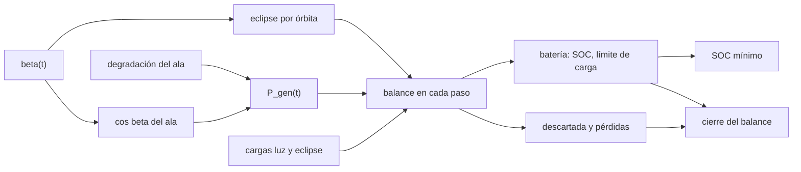

# B86-C20 — Simulación de ciclo energético orbital

<!-- nav:top -->
<!-- /nav -->

## 1. Ubicación, nivel y alcance

Clase 20 del bloque B86. Nivel N3. Vigésima clase del bloque. Aquí se acoplan todas las piezas: la órbita y el eclipse que cambian con `β`, el ala de un eje con su degradación, la carga con sus modos y la batería con su límite de carga. Simulas `30` días (`447` órbitas) de una nave sintética con dos casos de carga, buscas el estado de carga mínimo y verificas el balance global de energía. Todo es sintético y el resultado es una simulación, no una telemetría.

## 2. Por qué esta clase existe

Los cálculos por órbita aislada no ven que `β` cambia día a día ni que la degradación se acumula. Una simulación larga revela el peor día y comprueba que la energía se conserva en todo el recorrido. La decisión central: **¿cuál es el estado de carga mínimo en 30 días y cuándo ocurre, y se conserva la energía en el modelo?**

## 3. Lo que podrás hacer al terminar

1. Acoplar la geometría de eclipse con `β` variable, el ala, la batería y las cargas en un paso de tiempo fijo.
2. Registrar el SOC mínimo (sin contar la condición inicial) y el momento en que ocurre.
3. Cerrar el balance global de energía con las pérdidas y la generación descartada.
4. Contrastar la energía de una luz simulada con su integral exacta.
5. Comparar dos casos de carga y leer su efecto en el SOC.
6. Separar lo consultado (periodo y eclipse) de lo ilustrativo (todo lo demás) y no presentar la simulación como observación.

La evidencia es **el informe de ciclo energético con carga mínima y cierre de energía** del ejercicio 12 (sección 20).

## 4. Con qué llegas y cómo comprobarlo

1. ¿Qué es un balance global de energía?
2. ¿Qué es la generación descartada?
3. ¿Qué es un paso de tiempo?
4. ¿Por qué cambia el eclipse con `β`?
5. ¿Qué es una simulación frente a una medición?

<details>
<summary>Ver respuestas</summary>

1. Que lo generado sea igual a lo consumido más lo almacenado más las pérdidas. 2. La energía del ala que no se usa porque la batería está llena o no admite más carga. 3. El intervalo en que el modelo supone constantes las potencias. 4. Porque la sombra de la Tierra cubre una parte distinta de la órbita (clase de eclipse). 5. Un cálculo con un modelo; no es un dato observado.
</details>

Con cuatro o cinco aciertos, sigue; si no, repasa los prerrequisitos.

## 5. Un caso de contexto y casos de referencia

En `30` días (`447` órbitas) con `β` de `0°` a `50°`, la nave sintética con cargas nominales no baja de un SOC de `84,5 %`; con `45 W` adicionales en luz el mínimo es `56,4 %`. El balance global cierra con residuos de `1,1e-07` y `2,6e-07 Wh`. Es el **ejemplo conductor** y es **ilustrativo**: ningún valor es una medición.

## 6. Vocabulario

La **simulación acoplada** integra a la vez varios subsistemas. El **paso de tiempo** es `10 s`. La **generación descartada** (*curtailment*) es energía del ala no usada. El **cierre del balance** es que el residuo sea cero. El **SOC mínimo** es el menor estado de carga del periodo simulado.

## 7. Modelo mental: una película cuadro a cuadro



*Descripción textual:* `β` fija el eclipse y el coseno del ala; con la degradación da la generación; en cada paso el balance con las cargas determina la batería, la energía descartada y las pérdidas; de ahí salen el SOC mínimo y el cierre del balance.

Analogía: una película se compone de cuadros, y cada cuadro es una pequeña cuenta de ingresos y gastos; el balance de la película entera es la suma de los cuadros. Límite: el paso de `10 s` y el modelo de energía no ven transitorios de segundos ni la curva de carga CC–CV.

## 8. La explicación, paso a paso

### 8.1 Qué se simula

En cada órbita se calcula el eclipse con `β` en el punto medio de la órbita; en luz el ala entrega `P_BOL · f(t) · cos β` (un eje, con degradación lineal entre `0` y `5` años desde el día `1500`); la carga es `100,8 W` en luz y `64,8 W` en eclipse (más `45 W` en luz en el caso B). El eclipse pasa de `36,7 %` a `28,3 %` de la órbita en el mes.

### 8.2 Resultados

| Caso | SOC mín. (%) | Órbita (día) | SOC final (%) | SOC medio (%) | Descartada (%) |
|---|---|---|---|---|---|
| A: nominal | 84,46 | 2 (0,1) | 88,01 | 85,44 | 39,3 |
| B: +45 W | 56,42 | 447 (30,0) | 56,42 | 84,89 | 19,6 |

### 8.3 Cierre del balance

`generación = cargas + pérdidas de carga y descarga + generación descartada + variación de la batería`. En el caso A: `107101 Wh = 63595 + 1365,7 + 42120 + 20,77 Wh`, con residuo `1,1e-07 Wh`. Caso B: residuo `2,6e-07 Wh`.

### 8.4 Contraste con una integral

La energía generada en la primera luz es `264,596270 Wh` por simulación y `264,596270 Wh` por integral fina (diferencia `1,2e-10 Wh`). El SOC mínimo ocurre en el caso B en la órbita `447`: donde la combinación de `β`, degradación y carga extra es menos favorable.

## 9. Magnitudes, símbolos y unidades

| Símbolo | Qué es | Unidad | Valor / nota |
|---|---|---|---|
| `n_orb` | órbitas simuladas | — | 447 |
| `β` | ángulo beta | ° | 0 → 50 |
| `SOC_min` | estado de carga mínimo | % | 84,5 (A); 56,4 (B) |
| `E_gen` | energía generada | Wh | 107101 (A) |
| `E_desc` | energía descartada | Wh | 42120 (A) |
| Residuo | cierre del balance | Wh | 1,1e-07 |
| `Δt` | paso de tiempo | s | 10 |

## 10. Convenciones y referencias

Órbita circular de `600 km` con sombra cilíndrica, `β` lineal en el mes (ilustrativo), ala de un eje (`cos β`) con degradación lineal ilustrativa, bus directo con eficiencias de carga `0,97` y descarga `0,95`, potencia de carga limitada a `70 W`. Todo es **ilustrativo** salvo el periodo y el eclipse (NASA/NSSDC). La salida es una simulación y no una observación.

## 11. De dónde sale lo que afirmamos

| ID | Fuente | Localizador | Respalda | Estado |
|---|---|---|---|---|
| S1 | NASA/NSSDC, Earth Fact Sheet — https://nssdc.gsfc.nasa.gov/planetary/factsheet/earthfact.html (consultada 2026-11-10) | ficha completa leída | irradiancia solar 1361,0 W/m²; GM = 0,39860 × 10⁶ km³/s²; radio medio 6371,000 km; periodo orbital sideral 365,256 d | Consultada |
| — | Relación estándar: balance de energía de una batería y geometría de eclipse | — | la verifica el laboratorio con una segunda vía | No consultada en una fuente concreta |
| — | Datos sintéticos: perfil de beta, cargas, ala, degradación y batería | — | valores generados para el ejemplo | Ilustrativo, no medido |

Límites: no se consultaron datos de vuelo ni efemérides de `β`; la degradación del ala es lineal e ilustrativa; no se modelan penumbra, temperatura ni la curva de carga de la batería.

## 12. Cómo ver el SOC en 30 días

| Magnitud | Valor |
|---|---|
| Órbitas | 447 |
| SOC mínimo (A) | 84,5 % |
| SOC mínimo (B) | 56,4 % |
| Descartada (A) | 39,3 % |
| Residuo del balance | 1,1e-07 Wh |

Descripción larga: el SOC al inicio de cada órbita es casi constante cuando sobra generación y baja en el caso B cuando la carga extra consume el excedente.

## 13. Ejemplo trabajado: el balance de energía del caso A

**Paso 1 · Generada.** `107101 Wh` en `30` días.

**Paso 2 · Consumida.** Cargas `63595 Wh` y pérdidas `1365,7 Wh`.

**Paso 3 · Descartada.** `42120 Wh` (`39,3 %`).

**Paso 4 · Cierre.** `107101 − (63595 + 1365,7 + 42120) = 20,77 Wh`, la variación de la batería.

## 14. Distintas formas de describir una simulación de ciclo

**Por órbita:** SOC al inicio. **Por energía:** generación, carga, pérdidas, descarte. **Por extremo:** SOC mínimo. **Por cierre:** residuo. **Por caso:** A y B.

## 15. Práctica guiada

**Ejercicio 1 · con los pasos indicados.** Calcula el número de órbitas en `30` días con `T = 5792,3 s`. *Pasos:* `2592000/5792,3`.

<details><summary>Solución comentada</summary>

`447` (parte entera).
</details>

**Ejercicio 2 · con una pista.** Predice si el SOC mínimo del caso B es menor o mayor que el del A. *Pista:* más carga.

<details><summary>Solución comentada</summary>

Menor: `56,4 %` frente a `84,5 %`.
</details>

**Ejercicio 3 · casi autónomo.** Energía de carga en luz y eclipse de una órbita nominal con `T_d = 3666,7 s` y `T_e = 2125,6 s`.

<details><summary>Solución comentada</summary>

`100,8 × 3666,7/3600 + 64,8 × 2125,6/3600 = 141,0 Wh`.
</details>

## 16. Práctica autónoma, transferencia e integrador

**Ejercicio 4 · autónomo.** ¿Qué porcentaje de la generación se descarta en el caso A?

<details><summary>Solución comentada</summary>

`39,3 %`.
</details>

**Ejercicio 5 · autónomo.** ¿Por qué se descarta tanta generación?

<details><summary>Solución comentada</summary>

Porque el ala entrega mucho más de lo que las cargas y la carga limitada de la batería pueden usar.
</details>

**Ejercicio 6 · autónomo.** Residuo del balance en el caso B.

<details><summary>Solución comentada</summary>

`2,6e-07 Wh`: prácticamente cero.
</details>

**Ejercicio 7 · autónomo.** ¿Qué pasa con el eclipse a lo largo del mes?

<details><summary>Solución comentada</summary>

Baja de `36,7 %` a `28,3 %` por el aumento de `β`.
</details>

**Ejercicio 8 · autónomo.** Variación de la energía de la batería en el caso A.

<details><summary>Solución comentada</summary>

`20,77 Wh`.
</details>

**Ejercicio 9 · transferencia.** **Transferencia.** Un colega presenta el SOC mínimo como medido en vuelo. ¿Qué corriges?

<details><summary>Solución comentada</summary>

Es una simulación con datos sintéticos; no se debe presentar como observación.
</details>

**Ejercicio 10 · transferencia.** **Transferencia.** Un colega usa el SOC al inicio de la primera órbita como representativo de todo el mes. ¿Qué omite?

<details><summary>Solución comentada</summary>

La variación de `β` y de la degradación a lo largo del mes.
</details>

**Ejercicio 11 · transferencia.** **Transferencia.** Se acepta el diseño porque el balance cierra con residuo cero. ¿Qué falta?

<details><summary>Solución comentada</summary>

El cierre del balance prueba el código, no que el diseño cumpla; hay que mirar el SOC mínimo y los márgenes.
</details>

**Ejercicio 12 · integrador.** **Integrador.** Elabora tu *informe de ciclo energético con carga mínima y cierre de energía*: parámetros, SOC mínimo, balance global, contraste con la integral y rótulos.

<details><summary>Solución comentada</summary>

Secciones 8.1–8.4 y la salida del laboratorio.
</details>

## 17. Laboratorio: simulación del ciclo energético de 30 días

El script [simulacion_ciclo.py](simulacion_ciclo.py) simula 30 días con `β` variable, ala con degradación, batería y cargas, registra el SOC mínimo y verifica el balance global (**comprueba** residuo < 1e-6 Wh en los dos casos y energía de la primera luz simulada frente a la integral < 1e-6 Wh).

**Datos:** periodo y eclipse de la NASA/NSSDC (consultados); todo el resto **ilustrativo**. **Predice antes de ejecutar:** ¿en qué caso será menor el SOC mínimo? (en el caso B). **Ejecución del 2026-11-10 (Python 3.12.9):**

```text
Python 3.12.9 (biblioteca estandar)
Orbita SINTETICA 600 km: T = 5792.3 s ; 447 orbitas en 30 dias ; beta de 0 a 50 grados ; eclipse de 36.70 % a 28.28 %
 caso                      SOC min [%]  orbita (dia)    SOC fin [%]  SOC medio [%]  gen [Wh]   carga [Wh]  perdidas [Wh]  descartada [Wh] (%)   residuo [Wh]
 A: cargas nominales          84.46       2 ( 0.1)        88.01         85.44     107101       63595        1365.7       42120 (39.3)  1.1e-07
 B: +45 W de carga util       56.42     447 (30.0)        56.42         84.89     107101       84832        1363.1       20967 (19.6)  2.6e-07
Energia generada en la primera luz: simulacion = 264.596270 Wh ; integral = 264.596270 Wh ; diferencia = 1.2e-10 Wh
Pruebas superadas.
```

```bash
python programa/clases/B86/B86-C20-simulacion-de-ciclo-energetico-orbital/simulacion_ciclo.py
```

**Límites:** modelo de energía con paso de `10 s`, `β` lineal ilustrativo, degradación lineal y sin temperatura ni curva CC–CV.

## 18. Errores frecuentes y cómo corregirlos

**Presentar la simulación como telemetría.** Se corrige con la sección 10.

**Creer que el residuo cero valida el diseño.** Se corrige con el ejercicio 11.

**Usar un solo día como representativo.** Se corrige con 8.2.

**Olvidar la energía descartada en el balance.** Se corrige con 8.3.

## 19. Cómo sabrás que vas bien

Tras la sección 8: ¿qué SOC mínimo esperabas en el caso B y cuál obtuviste? Si dudas, repasa el ejemplo 13. Tras el laboratorio: ¿qué comprueba el balance global? (ver la sección 17).

## 20. Qué entregas y cómo se evalúa

El producto es **el informe de ciclo energético con carga mínima y cierre de energía** (ejercicio 12).

| Criterio | Inicial | En desarrollo | Logrado | Destacado |
|---|---|---|---|---|
| Conceptos | Los confunde | Parciales | Simula, mide el SOC mínimo y cierra el balance | Explica los límites |
| Cálculo | Sin unidades | Con errores | Tablas completas con unidades | Calcula casos nuevos |
| Numérico | Sin comprobar | Un caso | Contraste con una segunda vía | Interpreta las diferencias |
| Fuentes | Sin fuente | Sin fecha | Fuentes con fecha y estado | Declara lo ilustrativo y lo no consultado |
| Límites | No los nombra | Uno | Tres | Discute qué falta del modelo |

**Condiciones críticas (no se compensan con promedio):** rotular la simulación como tal y sus datos como ilustrativos; cerrar el balance global; citar solo lo consultado.

## 21. Ética, seguridad y límites

Clase educativa: los modelos son simplificados y sus datos son sintéticos o ilustrativos; ningún resultado describe una nave real ni sustituye a la ingeniería de una misión ni a una norma aplicada.  Accesibilidad: tablas equivalentes a las gráficas, fórmulas en texto, ejercicios sin conexión.

## 22. Para cerrar y seguir

En `30` días la nave sintética mantiene un SOC mínimo de `84,5 %` con cargas nominales y `56,4 %` con `45 W` extra, y el balance de energía cierra. Queda una pregunta: ¿cómo se gestionan los modos de bajo consumo cuando la energía escasea?

**Glosario español–inglés.** simulación acoplada · *coupled simulation*; generación descartada · *curtailment*; estado de carga mínimo · *minimum state of charge*; balance global · *global balance*; paso de tiempo · *time step*.

**Continuidad.** [B86-C21](../B86-C21-modos-de-operacion-y-estados-de-bajo-consumo/CLASE.md) estudia los modos de operación y los estados de bajo consumo.

**Referencias:** ver sección 11.

<!-- nav:bottom -->
<!-- /nav -->
