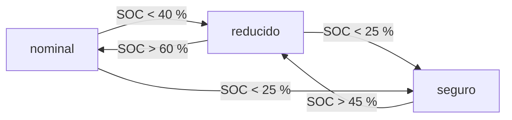

# B86-C21 — Modos de operación y estados de bajo consumo

<!-- nav:top -->
[🏠 Programa](../../../../README.md) · [📚 Bloque B86](../../../tronco-comun/B86-sistemas-de-potencia-y-energia-espacial.md) · [← Anterior: B86-C20 — Simulación de ciclo energético orbital](../B86-C20-simulacion-de-ciclo-energetico-orbital/CLASE.md) · [Siguiente: B86-C22 — Suministro de energía durante la noche lunar →](../B86-C22-suministro-de-energia-durante-la-noche-lunar/CLASE.md)
<!-- /nav -->

## 1. Ubicación, nivel y alcance

Clase 21 del bloque B86. Nivel N3. Vigesimoprimera clase del bloque, programada por la ampliación `0.2.0`. El presupuesto de potencia depende de los modos de la nave, y hasta aquí la carga era un solo número por fase. Aquí modelas una máquina de estados de tres modos (nominal, reducido y seguro) con umbrales de estado de carga e histéresis, la simulas durante `30` días con una generación insuficiente para el modo nominal y mides cuánto tiempo pasa en cada modo, cuántas veces cambia de modo y si la batería sobrevive. La nave y la política son sintéticas.

## 2. Por qué esta clase existe

Cuando la energía escasea, apagar la carga útil a tiempo mantiene viva la nave. Un umbral único hace oscilar al sistema entre modos; la histéresis lo evita. Esta lógica es la que convierte un presupuesto de potencia en una operación sostenible. La decisión central: **¿qué umbrales de estado de carga mantienen viva la nave con la mayor fracción posible de modo nominal y con pocos cambios de modo?**

## 3. Lo que podrás hacer al terminar

1. Describir tres modos con sus cargas de luz y de eclipse y su balance de energía por órbita.
2. Implementar una política de cambio de modo por umbrales de SOC con histéresis.
3. Simular 30 días y medir el tiempo en cada modo, las transiciones y el SOC mínimo.
4. Comparar la política con histéresis, con un umbral único y sin política.
5. Predecir la fracción de tiempo nominal desde el balance de energía y contrastarla con la simulación.
6. Separar lo consultado (periodo y eclipse) de lo ilustrativo (modos, umbrales y generación).

La evidencia es **la tabla de modos y la simulación de transiciones por carga de batería** del ejercicio 12 (sección 20).

## 4. Con qué llegas y cómo comprobarlo

1. ¿Qué es una máquina de estados?
2. ¿Qué es la histéresis?
3. ¿Qué es un modo seguro?
4. ¿Qué es el SOC?
5. ¿Qué es un dato sintético?

<details>
<summary>Ver respuestas</summary>

1. Un modelo con un número finito de estados y reglas de transición entre ellos. 2. Usar dos umbrales distintos para subir y bajar y evitar oscilaciones. 3. Una configuración mínima que mantiene la nave viva y apuntada al Sol mientras se resuelve un problema. 4. La fracción de carga que queda en la batería. 5. Un dato generado para el ejemplo, no medido.
</details>

Con cuatro o cinco aciertos, sigue; si no, repasa los prerrequisitos.

## 5. Un caso de contexto y casos de referencia

Con una generación de `125 W` en luz, el modo nominal pierde `16,4 Wh` por órbita y la batería sin política se agota en la órbita `13` (día `0,80`). La política con histéresis `40/60 %` mantiene el SOC mínimo en `37,1 %`, con `74,0 %` del tiempo en nominal y `441` transiciones en `30` días; el umbral único de `50 %` hace `885`. Es el **ejemplo conductor** y es **ilustrativo**.

## 6. Vocabulario

Un **modo de operación** es una configuración de la nave con su consumo. El **modo seguro** es el de consumo mínimo. La **política de modos** decide cuándo cambiar según el SOC. La **histéresis** separa el umbral de bajada del de subida. Una **transición** es un cambio de modo. El **retorno científico** es el tiempo en modo nominal.

## 7. Modelo mental: un termostato con banda muerta



*Descripción textual:* el modo nominal baja a reducido con SOC menor de `40 %` y vuelve con SOC mayor de `60 %`; con SOC menor de `25 %` se pasa a seguro, que vuelve a reducido por encima de `45 %`.

Analogía: un termostato con banda muerta no enciende y apaga la calefacción cada segundo: espera a que la temperatura baje y suba lo suficiente. Límite: la política usa solo el SOC y no considera el eclipse que viene, el estado de la carga útil ni los comandos de tierra.

## 8. La explicación, paso a paso

### 8.1 Los modos

| Modo | `P` luz (W) | `P` eclipse (W) | `P` media (W) | `ΔE` por órbita (Wh) |
|---|---|---|---|---|
| Nominal | 100,8 | 64,8 | 87,59 | -16,37 |
| Reducido | 60,8 | 44,8 | 54,93 | +35,58 |
| Seguro | 30,0 | 30,0 | 30,00 | +50,51 |

Con `125 W` en luz el modo nominal pierde energía en cada órbita (`ΔE < 0`), y el reducido y el seguro la ganan.

### 8.2 Sin política

Con la nave siempre en nominal la batería se agota en la órbita `13`, es decir, en `0,80` días.

### 8.3 Con política

| Política | Transiciones | SOC mín. (%) | Nominal (%) | Reducido (%) | Seguro (%) | `P` media (W) |
|---|---|---|---|---|---|---|
| Umbral único `50 %` | 885 | 44,09 | 65,08 | 34,92 | 0,00 | 77,57 |
| Histéresis `40/60 %` | 441 | 37,08 | 74,05 | 25,95 | 0,00 | 77,26 |

El umbral único hace `2,0` veces más transiciones que la histéresis para un reparto de modos parecido.

### 8.4 Predicción desde el balance

Cuando solo se alternan nominal y reducido, el equilibrio de energía exige `f ΔE_nom + (1 − f) ΔE_red = 0`, de donde `f = ΔE_red/(ΔE_red − ΔE_nom) = 68,50 %`. La simulación da `74,05 %` (diferencia `5,55` puntos). La predicción supone un modo constante durante toda la órbita; los cambios reales ocurren a mitad de órbita (una explicación plausible, no verificada aquí, es que la bajada de SOC cruza el umbral en el eclipse y la subida en la luz), de modo que la simulación pasa algo más de tiempo en nominal. Los residuos del balance global son `1,7e-07` y `1,6e-07 Wh`.

## 9. Magnitudes, símbolos y unidades

| Símbolo | Qué es | Unidad | Valor / nota |
|---|---|---|---|
| `P_modo` | carga media por modo | W | 87,6; 54,9; 30,0 |
| `ΔE` | variación de energía por órbita | Wh | -16,4 (nominal) |
| Umbrales | bajar/subir | % SOC | 40/60 (ilustrativos) |
| `f_nom` | fracción de tiempo nominal | % | 74,0 |
| Transiciones | cambios de modo en 30 días | — | 441 |
| `SOC_min` | SOC mínimo | % | 37,1 |
| `P_gen` | generación en luz | W | 125 (ilustrativa) |

## 10. Convenciones y referencias

Órbita de `600 km` con `β = 0` y sombra cilíndrica, generación constante en luz, batería y eficiencias como en la clase de eclipse, política evaluada en cada paso de `10 s`. Modos, umbrales y generación son **ilustrativos**.

## 11. De dónde sale lo que afirmamos

| ID | Fuente | Localizador | Respalda | Estado |
|---|---|---|---|---|
| S1 | NASA/NSSDC, Earth Fact Sheet — https://nssdc.gsfc.nasa.gov/planetary/factsheet/earthfact.html (consultada 2026-11-10) | ficha completa leída | irradiancia solar 1361,0 W/m²; GM = 0,39860 × 10⁶ km³/s²; radio medio 6371,000 km; periodo orbital sideral 365,256 d | Consultada |
| — | Relación estándar: máquina de estados con histéresis y balance de energía por modo | — | la verifica el laboratorio con una segunda vía | No consultada en una fuente concreta |
| — | Datos sintéticos: modos, cargas, umbrales y generación | — | valores generados para el ejemplo | Ilustrativo, no medido |

Límites: no se consultó ninguna norma ni documento de operaciones de modos seguros (por ejemplo los de ECSS o de NASA); los modos y umbrales son ilustrativos y no representan una política de misión.

## 12. Cómo ver los modos en 30 días

| Magnitud | Valor |
|---|---|
| Sin política | agotada en la órbita 13 |
| Histéresis: SOC mínimo | 37,1 % |
| Histéresis: tiempo nominal | 74,0 % |
| Transiciones | 441 (histéresis); 885 (umbral único) |
| Fracción nominal predicha | 68,5 % |

Descripción larga: la política mantiene viva la nave con parte del tiempo en nominal; la histéresis reduce las transiciones frente al umbral único.

## 13. Ejemplo trabajado: la fracción nominal desde el balance

**Paso 1 · Nominal.** `ΔE_nom = -16,37 Wh` por órbita.

**Paso 2 · Reducido.** `ΔE_red = +35,58 Wh`.

**Paso 3 · Equilibrio.** `f ΔE_nom + (1 − f) ΔE_red = 0`.

**Paso 4 · Resultado.** `f = +35,58/(+35,58 − (-16,37)) = 68,50 %`.

## 14. Distintas formas de describir una política de modos

**Por modo:** carga y balance. **Por umbral:** SOC de bajada y de subida. **Por histéresis:** banda entre umbrales. **Por resultado:** tiempo por modo y transiciones. **Por predicción:** fracción de equilibrio.

## 15. Práctica guiada

**Ejercicio 1 · con los pasos indicados.** Calcula la potencia media del modo nominal por órbita. *Pasos:* ponderar luz y eclipse.

<details><summary>Solución comentada</summary>

`87,59 W`.
</details>

**Ejercicio 2 · con una pista.** Predice si el modo reducido gana o pierde energía con `125 W`. *Pista:* `ΔE`.

<details><summary>Solución comentada</summary>

Gana: `+35,58 Wh` por órbita.
</details>

**Ejercicio 3 · casi autónomo.** ¿Cuántas órbitas dura la batería sin política?

<details><summary>Solución comentada</summary>

`13` órbitas.
</details>

## 16. Práctica autónoma, transferencia e integrador

**Ejercicio 4 · autónomo.** Fracción nominal predicha del balance.

<details><summary>Solución comentada</summary>

`68,50 %`.
</details>

**Ejercicio 5 · autónomo.** ¿Qué hace el modo seguro cuando el SOC supera `45 %`?

<details><summary>Solución comentada</summary>

Pasa a reducido.
</details>

**Ejercicio 6 · autónomo.** ¿Qué ocurre si los dos umbrales (40 y 60) se juntan en uno?

<details><summary>Solución comentada</summary>

El sistema oscila entre modos: aumentan las transiciones.
</details>

**Ejercicio 7 · autónomo.** Transiciones de la política con histéresis.

<details><summary>Solución comentada</summary>

`441`.
</details>

**Ejercicio 8 · autónomo.** ¿Cuánta potencia media consume la política con histéresis?

<details><summary>Solución comentada</summary>

`77,26 W`.
</details>

**Ejercicio 9 · transferencia.** **Transferencia.** Un colega añade un umbral más bajo (`10 %`) para el modo seguro. ¿Qué riesgo corre?

<details><summary>Solución comentada</summary>

Que la batería baje demasiado antes de reaccionar; el margen de la carga mínima se reduce.
</details>

**Ejercicio 10 · transferencia.** **Transferencia.** Un colega calcula la política sin considerar el eclipse que viene. ¿Qué advertencia haces?

<details><summary>Solución comentada</summary>

Un cambio basado solo en el SOC puede llegar tarde si el eclipse es largo; conviene combinar SOC y tiempo de eclipse.
</details>

**Ejercicio 11 · transferencia.** **Transferencia.** Se presenta esta política como la de una misión real. ¿Qué corriges?

<details><summary>Solución comentada</summary>

Es una política sintética con umbrales ilustrativos; cada misión define los suyos y los valida.
</details>

**Ejercicio 12 · integrador.** **Integrador.** Elabora tu *tabla de modos y simulación de transiciones por carga de batería*: modos, balance, política, tiempo por modo, transiciones y rótulos.

<details><summary>Solución comentada</summary>

Secciones 8.1–8.4 y la salida del laboratorio.
</details>

## 17. Laboratorio: modos de bajo consumo por umbral de SOC

El script [modos_bajo_consumo.py](modos_bajo_consumo.py) simula 30 días con tres políticas (ninguna, umbral único e histéresis) y compara tiempo por modo, transiciones, SOC mínimo y la fracción nominal predicha (**comprueba** que sin política la batería se agota, residuo del balance < 1e-6 Wh, fracción nominal simulada frente a la predicha < `8` puntos y menos transiciones con histéresis).

**Datos:** periodo y eclipse de la NASA/NSSDC (consultados); modos, umbrales y generación **ilustrativos**. **Predice antes de ejecutar:** ¿cuántas veces menos transiciones hará la política con histéresis? (mira la tabla). **Ejecución del 2026-11-10 (Python 3.12.9):**

```text
Python 3.12.9 (biblioteca estandar)
Orbita SINTETICA 600 km: T = 5792.3 s ; eclipse = 2125.6 s ; generacion en luz = 125.0 W ; 447 orbitas en 30 dias
 modo        P luz [W]  P eclipse [W]  P media por orbita [W]  delta de energia por orbita [Wh]
 nominal        100.8           64.8                   87.59                          -16.37
 reducido        60.8           44.8                   54.93                          +35.58
 seguro          30.0           30.0                   30.00                          +50.51
Sin politica (siempre nominal): la bateria se agota en la orbita 13 (dia 0.80)
 politica         transiciones  SOC min [%]  nominal [%]  reducido [%]  seguro [%]  P media [W]  residuo [Wh]
 umbral unico 50 %        885        44.09        65.08         34.92        0.00        77.57  1.6e-07
 histeresis 40/60 %        441        37.08        74.05         25.95        0.00        77.26  1.7e-07
Fraccion nominal/(nominal+reducido) con histeresis: simulada = 74.05 % ; predicha del balance = 68.50 % ; diferencia = 5.55 puntos
Transiciones sin histeresis / con histeresis = 2.0
Pruebas superadas.
```

```bash
python programa/clases/B86/B86-C21-modos-de-operacion-y-estados-de-bajo-consumo/modos_bajo_consumo.py
```

**Límites:** política solo por SOC, generación constante en luz y sin comandos ni fallas; los modos son ilustrativos.

## 18. Errores frecuentes y cómo corregirlos

**Usar un umbral único.** Se corrige con 8.3.

**Confundir potencia máxima con potencia media por modo.** Se corrige con 8.1.

**Olvidar el balance de energía al elegir umbrales.** Se corrige con 8.4.

**Presentar la política como real.** Se corrige con la sección 10.

## 19. Cómo sabrás que vas bien

Tras la sección 8: ¿qué fracción nominal esperabas y cuál obtuviste? Si dudas, repasa el ejemplo 13. Tras el laboratorio: ¿qué verifica la predicción? (ver la sección 17).

## 20. Qué entregas y cómo se evalúa

El producto es **la tabla de modos y la simulación de transiciones por carga de batería** (ejercicio 12).

| Criterio | Inicial | En desarrollo | Logrado | Destacado |
|---|---|---|---|---|
| Conceptos | Los confunde | Parciales | Simula modos y predice la fracción nominal | Explica los límites |
| Cálculo | Sin unidades | Con errores | Tablas completas con unidades | Calcula casos nuevos |
| Numérico | Sin comprobar | Un caso | Contraste con una segunda vía | Interpreta las diferencias |
| Fuentes | Sin fuente | Sin fecha | Fuentes con fecha y estado | Declara lo ilustrativo y lo no consultado |
| Límites | No los nombra | Uno | Tres | Discute qué falta del modelo |

**Condiciones críticas (no se compensan con promedio):** rotular los modos y umbrales como ilustrativos; no presentar la política como real; citar solo lo consultado.

## 21. Ética, seguridad y límites

Clase educativa: los modelos son simplificados y sus datos son sintéticos o ilustrativos; ningún resultado describe una nave real ni sustituye a la ingeniería de una misión ni a una norma aplicada.  Accesibilidad: tablas equivalentes a las gráficas, fórmulas en texto, ejercicios sin conexión.

## 22. Para cerrar y seguir

Con la política de histéresis la nave sintética sobrevive `30` días con `74 %` del tiempo en nominal y solo `441` cambios de modo, mientras sin política se agota en `0,8` días. Queda una pregunta: ¿qué hacer cuando incluso el modo nominal debe recortar cargas en el eclipse más largo, y cómo se priorizan?

**Glosario español–inglés.** modo de operación · *operating mode*; modo seguro · *safe mode*; histéresis · *hysteresis*; transición · *transition*; bajo consumo · *low power*.

**Continuidad.** [B86-C22](../B86-C22-suministro-de-energia-durante-la-noche-lunar/CLASE.md) estudia la noche lunar y su suministro de energía.

**Referencias:** ver sección 11.

<!-- nav:bottom -->
---

[← Anterior: B86-C20 — Simulación de ciclo energético orbital](../B86-C20-simulacion-de-ciclo-energetico-orbital/CLASE.md) · [📚 Bloque B86](../../../tronco-comun/B86-sistemas-de-potencia-y-energia-espacial.md) · [Siguiente: B86-C22 — Suministro de energía durante la noche lunar →](../B86-C22-suministro-de-energia-durante-la-noche-lunar/CLASE.md)
<!-- /nav -->
