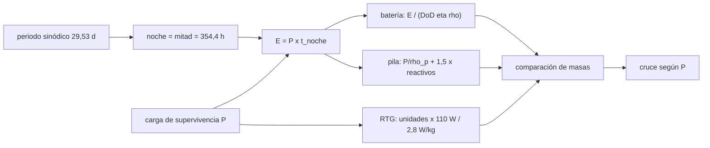

# B86-C22 — Suministro de energía durante la noche lunar

<!-- nav:top -->
[🏠 Programa](../../../../README.md) · [📚 Bloque B86](../../../tronco-comun/B86-sistemas-de-potencia-y-energia-espacial.md) · [← Anterior: B86-C21 — Modos de operación y estados de bajo consumo](../B86-C21-modos-de-operacion-y-estados-de-bajo-consumo/CLASE.md) · [Siguiente: B86-C23 — Priorización y deslastre de cargas eléctricas →](../B86-C23-priorizacion-y-deslastre-de-cargas-electricas/CLASE.md)
<!-- /nav -->

## 1. Ubicación, nivel y alcance

Clase 22 del bloque B86. Nivel N3. Vigesimosegunda clase del bloque, programada por la ampliación `0.2.0`. Los eclipses orbitales duran unos `35` minutos; en la superficie de la Luna la noche dura unos `14` días. Aquí calculas la energía que hay que guardar o generar para sobrevivir a esa noche con una carga mínima y comparas, por masa, una batería, una pila de combustible y un generador radioisotópico. La noche se toma como la mitad del periodo sinódico (ecuador, sin libración); la carga y los sistemas son sintéticos.

## 2. Por qué esta clase existe

Una batería dimensionada para un eclipse orbital no sirve para una noche lunar: la energía crece unas doscientas veces y la masa de la batería deja de ser razonable. Por eso la estrategia cambia de almacenar a generar de otra manera. La decisión central: **¿qué fuente de energía pesa menos para sobrevivir a la noche lunar con una carga dada, y a partir de qué potencia cambia la respuesta?**

## 3. Lo que podrás hacer al terminar

1. Calcular la duración de la noche lunar desde el periodo sinódico y la energía de supervivencia.
2. Calcular la masa de una batería con profundidad de descarga y eficiencia.
3. Calcular la masa de una pila de combustible con sus reactivos y de un generador radioisotópico por unidades.
4. Comparar las tres opciones a `20`, `100` y `300 W` y encontrar el cruce del generador radioisotópico.
5. Verificar la energía por integral y los reactivos por carga de Faraday.
6. Separar lo consultado (periodo sinódico, temperaturas, rangos de baterías, datos del MMRTG, `F`) de lo ilustrativo (cargas, DoD, tanques).

La evidencia es **la comparación de estrategias para la noche lunar** del ejercicio 12 (sección 20).

## 4. Con qué llegas y cómo comprobarlo

1. ¿Qué es el periodo sinódico?
2. ¿Por qué la noche lunar dura unos 14 días?
3. ¿Qué es la profundidad de descarga?
4. ¿Qué aporta un generador radioisotópico?
5. ¿Qué es un dato ilustrativo?

<details>
<summary>Ver respuestas</summary>

1. El tiempo entre dos fases iguales de la Luna, de unos `29,53` días. 2. Porque un día lunar completo dura el periodo sinódico y la noche es aproximadamente la mitad. 3. La fracción de la capacidad que se usa en un ciclo. 4. Potencia continua, independiente del Sol, y calor útil. 5. Un dato inventado para el ejemplo, no tomado de un diseño real.
</details>

Con cuatro o cinco aciertos, sigue; si no, repasa los prerrequisitos.

## 5. Un caso de contexto y casos de referencia

La noche lunar equivale a `354,4 h` (`14,77 días`). Con `20 W` de supervivencia la energía es de `7,09 kWh`, unas `185` veces la de un eclipse orbital. Una batería de `150 Wh/kg` pesa `62,2 kg`, una pila H₂/O₂ `5,0 kg` y un generador radioisotópico de `110 W` `39,3 kg`. Es el **ejemplo conductor** y es **ilustrativo**.

## 6. Vocabulario

La **noche lunar** es el periodo sin Sol en un punto de la superficie. La **carga de supervivencia** es la mínima para mantener la nave viva y caliente. La **masa de la batería** es `E/(DoD η ρ)`. Una **unidad** de generador radioisotópico entrega `110 W` eléctricos. El **cruce** es la potencia a partir de la cual otra fuente pesa menos.

## 7. Modelo mental: un invierno largo frente a una noche corta



*Descripción textual:* el periodo sinódico da la duración de la noche; con la carga de supervivencia se obtiene la energía; ésta fija la masa de batería y de pila, mientras el RTG se dimensiona por potencia; la comparación da el mejor sistema y los cruces.

Analogía: una noche corta se pasa con una linterna de pilas; un invierno largo pide leña o una estufa continua. Límite: la noche se toma como la mitad del periodo sinódico en el ecuador; en latitudes altas, con libración o con el terreno, el tiempo cambia mucho, y el control térmico (que mueve la carga) no se modela.

## 8. La explicación, paso a paso

### 8.1 La noche

El periodo sinódico de la ficha de la Luna es `29,53` días; la noche se toma como la mitad: `14,765 días` o `354,4 h`. Las temperaturas ecuatoriales van de `95 K` (noche) a `390 K` (día), por lo que sobrevivir exige abrigar y calentar los equipos. La energía a `20 W` es `7,09 kWh` (`185` veces el eclipse orbital de `38,3 Wh`).

### 8.2 Masas

| `P` (W) | `E` (kWh) | Batería 150 Wh/kg (kg) | Batería 250 Wh/kg (kg) | Pila H₂/O₂ (kg) | RTG (kg; unidades) | Mejor |
|---|---|---|---|---|---|---|
| 20 | 7,09 | 62,2 | 37,3 | 5,0 | 39,3; 1 | pila |
| 100 | 35,44 | 310,8 | 186,5 | 24,8 | 39,3; 1 | pila |
| 300 | 106,31 | 932,5 | 559,5 | 74,5 | 117,9; 3 | pila |

La batería usa `DoD = 0,8` y `η_d = 0,95`; la pila usa `0,75 V`, `100 W/kg` y un factor `1,5` sobre los reactivos; el RTG se cuenta por unidades de `110 W` a `2,8 W/kg` (hoja de la NASA). El RTG de una unidad entrega más de lo necesario a `20 W`: su masa es fija por unidad.

### 8.3 Cruce del generador radioisotópico

Una unidad de `110 W` pesa menos que la batería de `150 Wh/kg` a partir de una carga de `12,6 W` (con esta noche y estos supuestos). Con estos mismos supuestos la pila H₂/O₂ es la más liviana a las tres potencias, porque el modelo solo cuenta pila y reactivos con un factor `1,5`: es una **cota optimista** que no incluye almacenamiento criogénico, pérdidas por evaporación en `14` días, gestión del agua ni control térmico. El generador radioisotópico, en cambio, no consume reactivos y aporta calor útil para abrigar la nave, ventajas que la masa por sí sola no recoge.

### 8.4 Verificaciones

La energía por integral numérica coincide con `P t` con diferencia relativa `0,0e+00`; los reactivos de la pila para `20 W` son `3,18 kg` (`0,355 kg` de H₂) y por carga de Faraday coinciden con diferencia `3,1e-16`.

## 9. Magnitudes, símbolos y unidades

| Símbolo | Qué es | Unidad | Valor / nota |
|---|---|---|---|
| `T_noche` | duración de la noche | h | 354,4 |
| `P` | carga de supervivencia | W | 20; 100; 300 (ilustrativas) |
| `E` | energía de la noche | kWh | 7,09 (20 W) |
| `m_bat` | masa de la batería | kg | 62,2 (20 W) |
| `m_pila` | masa de la pila | kg | 5,0 (20 W) |
| `m_RTG` | masa del RTG | kg | 39,3 (1 unidad) |
| `P_cruce` | potencia de cruce del RTG | W | 12,6 |

## 10. Convenciones y referencias

Noche = mitad del periodo sinódico, carga constante, sin control térmico explícito. Periodo, temperaturas, rango de baterías, datos del MMRTG y `F` consultados; masas molares no consultadas; cargas, `DoD`, eficiencias y factor de tanques **ilustrativos**.

## 11. De dónde sale lo que afirmamos

| ID | Fuente | Localizador | Respalda | Estado |
|---|---|---|---|---|
| S2 | NASA/NSSDC, Moon Fact Sheet — https://nssdc.gsfc.nasa.gov/planetary/factsheet/moonfact.html (consultada 2026-11-10) | ficha completa leída | periodo sinódico 29,53 d; gravedad 1,62 m/s²; temperatura ecuatorial 95 K (noche) a 390 K (día) | Consultada |
| S3 | NASA Small Spacecraft Systems Virtual Institute, State-of-the-Art of Small Spacecraft Technology, cap. 3 Power — https://www.nasa.gov/smallsat-institute/sst-soa/power-subsystems/ (consultada 2026-11-10) | primeros 100.000 de 119.638 caracteres y el resumen final; no se leyó el resto | eficiencias de celdas multiunión (29,5–34 % BOL), energía específica de baterías Li-ion (150–270 Wh/kg comerciales), bus de 8,2 V con salidas de 5,0 y 3,3 V, tensiones de 12, 28 y 50 V con convertidores GaN, PCDU de 960 W y 1500 W; la degradación se lista como factor sin cifra | Consultada (parcial) |
| S4 | NASA/DOE, hoja técnica del MMRTG — https://mars.nasa.gov/internal_resources/788/ (consultada 2026-11-10) | hoja de 2 páginas leída con PyMuPDF | 110 W eléctricos al inicio, 72 W estimados a 17 años, eficiencia de sistema 6 %, 2,8 W/kg, 30 V de carga, 768 termopares, ~2000 W térmicos | Consultada |
| S4 | NIST, CODATA 2022 — constante de Faraday — https://physics.nist.gov/cgi-bin/cuu/Value?f (consultada 2026-11-10) | valor recomendado leído | F = 96485,33212 C/mol | Consultada |
| — | Relación estándar: balance de energía, masa de reactivos de una pila y dimensionamiento por unidades | — | la verifica el laboratorio con una segunda vía | No consultada en una fuente concreta |
| — | Datos sintéticos: cargas de supervivencia, DoD, eficiencias y factor de tanques | — | valores generados para el ejemplo | Ilustrativo, no medido |

Límites: no se consultó ninguna propuesta de misión lunar ni datos de latitud o libración; la noche se aproxima como la mitad del periodo sinódico; las masas molares no se consultaron y la carga de supervivencia es ilustrativa.

## 12. Cómo ver las masas para la noche lunar

| Magnitud | Valor |
|---|---|
| Duración de la noche | 354,4 h |
| Energía a 20 W | 7,09 kWh |
| Batería a 20 W | 62,2 kg |
| Pila a 20 W | 5,0 kg |
| RTG a 20 W | 39,3 kg |
| Cruce del RTG | 12,6 W |

Descripción larga: la masa de la batería crece en proporción a la energía y la noche la hace muy pesada; el generador radioisotópico tiene una masa fija por unidad y supera a la batería desde unos pocos vatios; en este modelo la pila es la más liviana, pero es una cota optimista.

## 13. Ejemplo trabajado: la masa de la batería para 20 W

**Paso 1 · Duración.** `29,53/2 × 24 = 354,4 h`.

**Paso 2 · Energía.** `20 × 354,4 = 7087 Wh`.

**Paso 3 · Capacidad.** `7087/(0,8 × 0,95) = 9325 Wh`.

**Paso 4 · Masa.** `9325/150 = 62,2 kg`.

## 14. Distintas formas de describir una estrategia nocturna

**Por duración:** `T_noche`. **Por energía:** `P t`. **Por almacenamiento:** batería o reactivos. **Por generación:** RTG. **Por masa:** kg comparados.

## 15. Práctica guiada

**Ejercicio 1 · con los pasos indicados.** Calcula la noche en horas. *Pasos:* `29,53/2 × 24`.

<details><summary>Solución comentada</summary>

`354,4 h`.
</details>

**Ejercicio 2 · con una pista.** Predice si con `100 W` gana la batería o el generador radioisotópico. *Pista:* mira la tabla.

<details><summary>Solución comentada</summary>

Gana `pila`.
</details>

**Ejercicio 3 · casi autónomo.** Energía a `50 W` en la noche.

<details><summary>Solución comentada</summary>

`17718 Wh`.
</details>

## 16. Práctica autónoma, transferencia e integrador

**Ejercicio 4 · autónomo.** Masa de la batería de `250 Wh/kg` para `20 W`.

<details><summary>Solución comentada</summary>

`37,3 kg`.
</details>

**Ejercicio 5 · autónomo.** ¿Cuántas unidades de RTG para `200 W`?

<details><summary>Solución comentada</summary>

`2`.
</details>

**Ejercicio 6 · autónomo.** ¿Por qué la pila H₂/O₂ gana a la batería a largo plazo?

<details><summary>Solución comentada</summary>

Porque su masa de reactivos crece más despacio con la energía.
</details>

**Ejercicio 7 · autónomo.** ¿Cuántas veces mayor es la energía de la noche con `20 W` que la de un eclipse orbital?

<details><summary>Solución comentada</summary>

`185`.
</details>

**Ejercicio 8 · autónomo.** ¿Qué pasa con la noche en una latitud alta (conceptual)?

<details><summary>Solución comentada</summary>

El tiempo de oscuridad y la geometría cambian; el modelo de la mitad del periodo ya no sirve.
</details>

**Ejercicio 9 · transferencia.** **Transferencia.** Un colega dimensiona la batería lunar con el eclipse orbital. ¿Qué error comete?

<details><summary>Solución comentada</summary>

Subdimensiona unas doscientas veces la energía.
</details>

**Ejercicio 10 · transferencia.** **Transferencia.** Un colega elige el RTG por su calor útil y no calcula su masa. ¿Qué advertencia haces?

<details><summary>Solución comentada</summary>

El RTG tiene masa fija por unidad (`39,3 kg` a `110 W`); hay que comparar con la carga real.
</details>

**Ejercicio 11 · transferencia.** **Transferencia.** Se presentan estas masas como las de una misión lunar. ¿Qué corriges?

<details><summary>Solución comentada</summary>

Son cálculos con cargas ilustrativas; ninguna misión lunar se consultó.
</details>

**Ejercicio 12 · integrador.** **Integrador.** Elabora tu *comparación de estrategias para la noche lunar*: energía, masas a tres potencias, cruce, verificaciones y rótulos.

<details><summary>Solución comentada</summary>

Secciones 8.1–8.4 y la salida del laboratorio.
</details>

## 17. Laboratorio: energía de supervivencia en la noche lunar

El script [noche_lunar.py](noche_lunar.py) calcula la noche, la energía y la masa de batería, de pila de combustible y de generador radioisotópico a tres potencias, y el cruce del RTG (**comprueba** energía por integral frente a `P t` < 1e-9 relativo y reactivos por energía frente a carga de Faraday < 1e-9).

**Datos:** periodo sinódico y temperaturas de la NASA/NSSDC, rangos de baterías y datos del MMRTG de la NASA y `F` del NIST (consultados); masas molares no consultadas; cargas y factores **ilustrativos**. **Predice antes de ejecutar:** ¿qué opción pesa menos con `20 W`? (mira la tabla antes de ejecutar). **Ejecución del 2026-11-10 (Python 3.12.9):**

```text
Python 3.12.9 (biblioteca estandar)
Noche lunar (mitad del periodo sinodico de 29.53 d, ecuador): 14.765 d = 354.4 h ; temperatura ecuatorial nocturna 95 K, diurna 390 K
Referencia: un eclipse orbital de 600 km pide 38.3 Wh ; la noche lunar con 20 W pide 7087 Wh (185 veces)
 P [W]   E [kWh]   bateria 150 Wh/kg [kg]   bateria 250 Wh/kg [kg]   pila H2/O2 [kg]   RTG [kg] (unidades)   mejor
    20      7.09                    62.2                    37.3              5.0      39.3 (1)   pila
   100     35.44                   310.8                   186.5             24.8      39.3 (1)   pila
   300    106.31                   932.5                   559.5             74.5     117.9 (3)   pila
Energia por integral frente a P t (20 W): diferencia relativa = 0.0e+00 ; H2 por energia frente a H2 por carga: 3.1e-16
Reactivos de la pila para 20 W en la noche: 3.18 kg (H2: 0.355 kg)
Potencia de la carga a partir de la cual un RTG de 110 W pesa menos que la bateria de 150 Wh/kg = 12.6 W
Pruebas superadas.
```

```bash
python programa/clases/B86/B86-C22-suministro-de-energia-durante-la-noche-lunar/noche_lunar.py
```

**Límites:** noche igual a la mitad del periodo sinódico, carga constante y sin control térmico, latitud ni libración.

## 18. Errores frecuentes y cómo corregirlos

**Usar la duración de un eclipse orbital.** Se corrige con 8.1.

**Comparar solo la masa de reactivos.** Se corrige con 8.2.

**Ignorar que el RTG se cuenta por unidades.** Se corrige con 8.2 y 8.3.

**Presentar la carga ilustrativa como real.** Se corrige con la sección 10.

## 19. Cómo sabrás que vas bien

Tras la sección 8: ¿qué opción esperabas más liviana a `100 W` y cuál fue? Si dudas, repasa el ejemplo 13. Tras el laboratorio: ¿qué verifica la integral? (ver la sección 17).

## 20. Qué entregas y cómo se evalúa

El producto es **la comparación de estrategias para la noche lunar** (ejercicio 12).

| Criterio | Inicial | En desarrollo | Logrado | Destacado |
|---|---|---|---|---|
| Conceptos | Los confunde | Parciales | Calcula energía y masas por estrategia | Explica los límites |
| Cálculo | Sin unidades | Con errores | Tablas completas con unidades | Calcula casos nuevos |
| Numérico | Sin comprobar | Un caso | Contraste con una segunda vía | Interpreta las diferencias |
| Fuentes | Sin fuente | Sin fecha | Fuentes con fecha y estado | Declara lo ilustrativo y lo no consultado |
| Límites | No los nombra | Uno | Tres | Discute qué falta del modelo |

**Condiciones críticas (no se compensan con promedio):** rotular las cargas como ilustrativas y la noche como aproximada; citar solo lo consultado; no tratar un cálculo como diseño de misión.

## 21. Ética, seguridad y límites

Clase educativa: los modelos son simplificados y sus datos son sintéticos o ilustrativos; ningún resultado describe una nave real ni sustituye a la ingeniería de una misión ni a una norma aplicada.  Accesibilidad: tablas equivalentes a las gráficas, fórmulas en texto, ejercicios sin conexión.

## 22. Para cerrar y seguir

La noche lunar de `354 h` pide `7,1 kWh` a `20 W`: `62 kg` de batería, `5 kg` de pila o `39 kg` de RTG. Queda una pregunta: ¿qué cargas se mantienen cuando ni siquiera eso alcanza?

**Glosario español–inglés.** noche lunar · *lunar night*; carga de supervivencia · *survival load*; periodo sinódico · *synodic period*; generador radioisotópico · *radioisotope generator*; pila de combustible · *fuel cell*.

**Continuidad.** [B86-C23](../B86-C23-priorizacion-y-deslastre-de-cargas-electricas/CLASE.md) estudia la priorización y el deslastre de cargas.

**Referencias:** ver sección 11.

<!-- nav:bottom -->
---

[← Anterior: B86-C21 — Modos de operación y estados de bajo consumo](../B86-C21-modos-de-operacion-y-estados-de-bajo-consumo/CLASE.md) · [📚 Bloque B86](../../../tronco-comun/B86-sistemas-de-potencia-y-energia-espacial.md) · [Siguiente: B86-C23 — Priorización y deslastre de cargas eléctricas →](../B86-C23-priorizacion-y-deslastre-de-cargas-electricas/CLASE.md)
<!-- /nav -->
