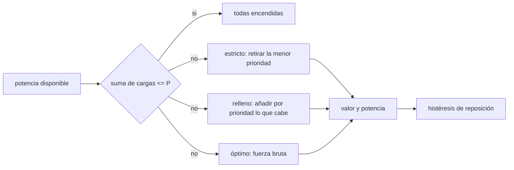

# B86-C23 — Priorización y deslastre de cargas eléctricas

<!-- nav:top -->
[🏠 Programa](../../../../README.md) · [📚 Bloque B86](../../../tronco-comun/B86-sistemas-de-potencia-y-energia-espacial.md) · [← Anterior: B86-C22 — Suministro de energía durante la noche lunar](../B86-C22-suministro-de-energia-durante-la-noche-lunar/CLASE.md) · [Siguiente: B87-C01 — Dinámica de cuerpo rígido →](../../B87/B87-C01-dinamica-de-cuerpo-rigido/CLASE.md)
<!-- /nav -->

## 1. Ubicación, nivel y alcance

Clase 23 del bloque B86. Nivel N3. Vigesimotercera y última clase del bloque, programada por la ampliación `0.2.0`. Cuando la potencia disponible no alcanza para todas las cargas, hay que decidir cuáles se apagan. Aquí implementas tres estrategias de deslastre sobre diez cargas sintéticas con prioridades (deslastre estricto, relleno por prioridad y óptimo por fuerza bruta), las comparas con dos modelos de valor y pruebas una histéresis de reposición con un perfil de potencia ruidoso. Las cargas y prioridades son sintéticas; la clase no define una política de misión.

## 2. Por qué esta clase existe

La clase de distribución trató cómo repartir potencia, pero no qué hacer cuando falta. Una política de prioridades bien definida mantiene lo crítico vivo y recupera ciencia cuando vuelve la potencia, sin oscilar entre estados. La decisión central: **¿qué cargas se deslastran para una potencia disponible dada, y cuándo una heurística por prioridad deja de ser óptima?**

## 3. Lo que podrás hacer al terminar

1. Definir cargas con prioridad y criticidad y calcular su potencia total.
2. Implementar el deslastre estricto y el relleno por prioridad.
3. Obtener el óptimo por fuerza bruta con las cargas críticas fijas.
4. Comparar heurísticas con el óptimo bajo un modelo de valor lexicográfico y otro aditivo.
5. Probar una histéresis de reposición con un perfil de potencia ruidoso.
6. Separar lo consultado (nada numérico) de lo ilustrativo (cargas, prioridades y valores).

La evidencia es **el plan de deslastre verificado contra fuerza bruta** del ejercicio 12 (sección 20).

## 4. Con qué llegas y cómo comprobarlo

1. ¿Qué es una carga crítica?
2. ¿Qué es el deslastre de cargas?
3. ¿Qué es una heurística?
4. ¿Qué es la fuerza bruta?
5. ¿Qué es un dato sintético?

<details>
<summary>Ver respuestas</summary>

1. Una carga sin la cual la nave pierde su función de supervivencia; no se deslastra. 2. Apagar cargas de menor prioridad cuando la potencia no alcanza. 3. Una regla simple que da una solución buena pero no siempre óptima. 4. Probar todas las combinaciones y quedarse con la mejor. 5. Un dato generado para el ejemplo, no medido.
</details>

Con cuatro o cinco aciertos, sigue; si no, repasa los prerrequisitos.

## 5. Un caso de contexto y casos de referencia

Las diez cargas sintéticas suman `131 W`, de los que `46 W` son críticos. Con `70 W` disponibles el deslastre estricto deja `6` cargas (`66 W`) y el relleno `6` (`66 W`). Con valores aditivos, el relleno no siempre coincide con el óptimo. Es el **ejemplo conductor** y es **ilustrativo**.

## 6. Vocabulario

La **prioridad** ordena las cargas (1 es la más alta). Una **carga crítica** no se deslastra. El **deslastre estricto** retira de la menor prioridad hacia arriba. El **relleno** añade de la mayor a la menor lo que cabe. El **óptimo** maximiza un valor total. La **histéresis de reposición** exige margen antes de volver a encender.

## 7. Modelo mental: elegir qué llevar en una mochila con límite de peso



*Descripción textual:* si la suma de cargas cabe en la potencia disponible, todas siguen encendidas; si no, tres estrategias (estricto, relleno y óptimo) eligen el conjunto, cuyo valor y potencia se comparan; una histéresis evita oscilaciones al reponer.

Analogía: llenar una mochila con un límite de peso: se puede sacar primero lo menos importante, o llenarla por orden de importancia, o probar todas las combinaciones. Límite: aquí el valor es un número asignado a mano y las cargas son sintéticas; una misión real discute las prioridades con su operación y su ciencia.

## 8. La explicación, paso a paso

### 8.1 Cargas

| Carga | `P` (W) | Prioridad | Crítica |
|---|---|---|---|
| Ordenador de a bordo | 12 | 1 | sí |
| Control de actitud | 20 | 1 | sí |
| Térmica de supervivencia | 10 | 1 | sí |
| Radio de recepción | 4 | 2 | sí |
| Radio de transmisión | 14 | 3 | no |
| Almacenamiento de datos | 6 | 4 | no |
| Calefactor opcional | 8 | 5 | no |
| Carga útil A | 30 | 6 | no |
| Carga útil B | 15 | 7 | no |
| Experimento | 12 | 8 | no |

Suman `131 W`, con `46 W` críticos.

### 8.2 Resultados por potencia disponible

| `P_disp` (W) | Estricto: n / `P` / valor lex. | Relleno: n / `P` / valor lex. / valor adit. | Óptimo lex.: n / valor | Óptimo adit.: n / `P` / valor |
|---|---|---|---|---|
| 150 | 10 / 131 / 1022 | 10 / 131 / 1022 / 52 | 10 / 1022 | 10 / 131 / 52 |
| 100 | 7 / 74 / 1008 | 8 / 89 / 1012 / 48 | 8 / 1012 | 8 / 89 / 48 |
| 70 | 6 / 66 / 992 | 6 / 66 / 992 / 42 | 6 / 992 | 6 / 66 / 42 |
| 60 | 5 / 60 / 960 | 5 / 60 / 960 / 37 | 5 / 960 | 6 / 60 / 40 |
| 30 | 4 / 46 / 896 | 4 / 46 / 896 / 31 | 4 / 896 | 4 / 46 / 31 |

Con valor lexicográfico (cada prioridad vale más que todas las menores juntas) el relleno coincide con el óptimo en todas las potencias. Con valor aditivo existe al menos una potencia en que el relleno queda por debajo del óptimo. Con `30 W` ni siquiera caben las cargas críticas (`46 W`): todas las estrategias devuelven el conjunto crítico y la falta de potencia se resuelve fuera del deslastre, con el modo seguro y la intervención de operaciones.

### 8.3 Perfil con ruido

En un perfil sintético de `400` pasos (luz de unos `140 W` y eclipse de unos `62 W` con ruido), la política con histéresis de reposición hace `79` transiciones; el relleno aplicado en cada paso sin histéresis hace `181`.

### 8.4 Qué decidir con esto

La fuerza bruta sirve como referencia con pocas cargas (aquí `2⁶ = 64` combinaciones); con muchas cargas el número de subconjuntos explota y se usan métodos más eficientes. Los valores y las prioridades son decisión de ingeniería y de operación, no un resultado de este cálculo.

## 9. Magnitudes, símbolos y unidades

| Símbolo | Qué es | Unidad | Valor / nota |
|---|---|---|---|
| `P_i` | potencia de la carga `i` | W | 4 a 30 (ilustrativas) |
| Prioridad | 1 es la más alta | — | 1 a 8 |
| `P_disp` | potencia disponible | W | 150; 100; 70; 60; 30 |
| Valor lex. | `2^(9 − prioridad)` | — | dominio de las prioridades altas |
| Valor adit. | `9 − prioridad` | — | suma simple |
| `P_crit` | potencia de las cargas críticas | W | 46 |
| Transiciones | cambios de conjunto activo | — | 79 con histéresis |

## 10. Convenciones y referencias

Cargas de potencia constante, prioridades y criticidad asignadas a mano, fuerza bruta sobre los subconjuntos de las cargas no críticas, perfil sintético con ruido uniforme y semilla `20261110`. Todo es **ilustrativo**; no se consultó ninguna fuente numérica.

## 11. De dónde sale lo que afirmamos

| ID | Fuente | Localizador | Respalda | Estado |
|---|---|---|---|---|
| — | Relación estándar: problema de la mochila (selección de un subconjunto de máximo valor con restricción de potencia) y heurísticas voraces | — | la verifica el laboratorio con una segunda vía | No consultada en una fuente concreta |
| — | Datos sintéticos: cargas, prioridades, criticidad, valores y perfil de potencia disponible | — | valores generados para el ejemplo | Ilustrativo, no medido |

Límites: no se consultó ninguna política real de deslastre de cargas ni normas de operación; las prioridades son ilustrativas y no representan decisiones de misión.

## 12. Cómo ver el deslastre según la potencia

| Magnitud | Valor |
|---|---|
| Potencia total de las cargas | 131 W |
| Cargas críticas | 46 W |
| Estricto con 70 W | 6 cargas |
| Relleno con 70 W | 6 cargas |
| Transiciones (con / sin histéresis) | 79 / 181 |

Descripción larga: a menos potencia quedan menos cargas encendidas; el relleno recupera cargas que el deslastre estricto no recupera y la histéresis evita oscilar.

## 13. Ejemplo trabajado: el relleno con 70 W

**Paso 1 · Críticas.** `12 + 20 + 10 + 4 = 46 W`.

**Paso 2 · Siguiente por prioridad.** Radio de transmisión (14 W): `46 + 14 = 60 W`, cabe.

**Paso 3 · Siguiente.** Almacenamiento (6 W): `66 W`, cabe.

**Paso 4 · Siguiente.** Calefactor (8 W): `74 W` supera `70 W`, no cabe; se sigue con las de menor prioridad que quepan.

## 14. Distintas formas de describir un deslastre

**Por prioridad:** 1 a 8. **Por criticidad:** sí o no. **Por estrategia:** estricto, relleno, óptimo. **Por valor:** lexicográfico o aditivo. **Por estabilidad:** histéresis.

## 15. Práctica guiada

**Ejercicio 1 · con los pasos indicados.** Suma de las cargas críticas. *Pasos:* `12 + 20 + 10 + 4`.

<details><summary>Solución comentada</summary>

`46 W`.
</details>

**Ejercicio 2 · con una pista.** Predice si con `150 W` se deslastra algo. *Pista:* compara con el total de `131 W`.

<details><summary>Solución comentada</summary>

No: el total es `131 W`, menor que `150 W`, y todas las cargas caben.
</details>

**Ejercicio 3 · casi autónomo.** ¿Qué carga se retira primero en el deslastre estricto?

<details><summary>Solución comentada</summary>

La de prioridad 8 (experimento).
</details>

## 16. Práctica autónoma, transferencia e integrador

**Ejercicio 4 · autónomo.** Potencia mínima para mantener solo las críticas.

<details><summary>Solución comentada</summary>

`46 W`.
</details>

**Ejercicio 5 · autónomo.** ¿Cuántos subconjuntos revisa la fuerza bruta aquí?

<details><summary>Solución comentada</summary>

`2⁶ = 64`.
</details>

**Ejercicio 6 · autónomo.** ¿Por qué el relleno es óptimo con valores lexicográficos?

<details><summary>Solución comentada</summary>

Porque cada prioridad vale más que todas las menores juntas y conviene siempre incluirla si cabe.
</details>

**Ejercicio 7 · autónomo.** Número de transiciones con histéresis.

<details><summary>Solución comentada</summary>

`79`.
</details>

**Ejercicio 8 · autónomo.** ¿Qué pasa si el margen de reposición se sube?

<details><summary>Solución comentada</summary>

Hay menos transiciones pero se tarda más en reponer cargas.
</details>

**Ejercicio 9 · transferencia.** **Transferencia.** Un colega deslastra por potencia (la mayor primero) en vez de por prioridad. ¿Qué riesgo corre?

<details><summary>Solución comentada</summary>

Puede apagar una carga importante solo por ser grande.
</details>

**Ejercicio 10 · transferencia.** **Transferencia.** Un colega marca todas las cargas como críticas. ¿Qué pierde?

<details><summary>Solución comentada</summary>

El deslastre deja de poder actuar y el sistema solo tiene el modo seguro.
</details>

**Ejercicio 11 · transferencia.** **Transferencia.** Se presentan estas prioridades como la política de una misión. ¿Qué corriges?

<details><summary>Solución comentada</summary>

Son prioridades sintéticas; una misión las decide con su ciencia y su operación.
</details>

**Ejercicio 12 · integrador.** **Integrador.** Elabora tu *plan de deslastre verificado contra fuerza bruta*: cargas, potencias disponibles, estrategias, óptimo, histéresis y rótulos.

<details><summary>Solución comentada</summary>

Secciones 8.1–8.4 y la salida del laboratorio.
</details>

## 17. Laboratorio: deslastre de cargas contra fuerza bruta

El script [deslastre_cargas.py](deslastre_cargas.py) calcula el deslastre estricto, el relleno por prioridad y el óptimo por fuerza bruta a cinco potencias disponibles con dos modelos de valor, y prueba la histéresis de reposición con un perfil ruidoso (**comprueba** que ninguna heurística supera al óptimo, que con valor lexicográfico el relleno es óptimo, que con valor aditivo existe un caso no óptimo y que la histéresis no aumenta las transiciones).

**Datos:** ninguna cifra consultada; cargas, prioridades, valores y perfil **ilustrativos**. **Predice antes de ejecutar:** ¿qué estrategia deja más cargas con `70 W`? (mira la tabla). **Ejecución del 2026-11-10 (Python 3.12.9):**

```text
Python 3.12.9 (biblioteca estandar)
Cargas SINTETICAS: 10 (total 131 W ; criticas 46 W). Fuerza bruta sobre 64 subconjuntos de las 6 cargas no criticas
 P_disp [W]  estricto: n / P / valor lex / valor adit   relleno: n / P / lex / adit   optimo lex: n / P / lex   optimo adit: n / P / adit
       150   10   131  1022  52          10   131  1022  52       10   131  1022          10   131  52
       100    7    74  1008  46           8    89  1012  48        8    89  1012           8    89  48
        70    6    66   992  42           6    66   992  42        6    66   992           6    66  42
        60    5    60   960  37           5    60   960  37        5    60   960           6    60  40
        30    4    46   896  31           4    46   896  31        4    46   896           4    46  31
Cargas deslastradas con 70 W: estricto = Calefactor opcional, Carga util A, Carga util B, Experimento
                              relleno  = Calefactor opcional, Carga util A, Carga util B, Experimento
Perfil de 400 pasos con ruido: transiciones con histeresis de reposicion = 79 ; sin histeresis (relleno en cada paso) = 181
Pruebas superadas.
```

```bash
python programa/clases/B86/B86-C23-priorizacion-y-deslastre-de-cargas-electricas/deslastre_cargas.py
```

**Límites:** cargas de potencia constante, valores asignados a mano y fuerza bruta solo con pocas cargas; no define una política de misión.

## 18. Errores frecuentes y cómo corregirlos

**Deslastrar por tamaño y no por prioridad.** Se corrige con 8.2.

**Marcar todo como crítico.** Se corrige con el ejercicio 10.

**Creer que el relleno siempre es óptimo.** Se corrige con 8.2.

**Presentar las prioridades como de una misión.** Se corrige con la sección 10.

## 19. Cómo sabrás que vas bien

Tras la sección 8: ¿qué cargas esperabas apagadas con `70 W` y cuáles fueron? Si dudas, repasa el ejemplo 13. Tras el laboratorio: ¿qué referencia usa la fuerza bruta? (ver la sección 17).

## 20. Qué entregas y cómo se evalúa

El producto es **el plan de deslastre verificado contra fuerza bruta** (ejercicio 12).

| Criterio | Inicial | En desarrollo | Logrado | Destacado |
|---|---|---|---|---|
| Conceptos | Los confunde | Parciales | Deslastra y verifica contra el óptimo | Explica los límites |
| Cálculo | Sin unidades | Con errores | Tablas completas con unidades | Calcula casos nuevos |
| Numérico | Sin comprobar | Un caso | Contraste con una segunda vía | Interpreta las diferencias |
| Fuentes | Sin fuente | Sin fecha | Fuentes con fecha y estado | Declara lo ilustrativo y lo no consultado |
| Límites | No los nombra | Uno | Tres | Discute qué falta del modelo |

**Condiciones críticas (no se compensan con promedio):** rotular las prioridades y los valores como ilustrativos; verificar contra una referencia; citar solo lo consultado.

## 21. Ética, seguridad y límites

Clase educativa: los modelos son simplificados y sus datos son sintéticos o ilustrativos; ningún resultado describe una nave real ni sustituye a la ingeniería de una misión ni a una norma aplicada.  Accesibilidad: tablas equivalentes a las gráficas, fórmulas en texto, ejercicios sin conexión.

## 22. Para cerrar y seguir

Con `70 W` el deslastre estricto deja `6` cargas y el relleno `6`; con valores lexicográficos el relleno es óptimo y con valores aditivos no siempre lo es. Con esto se cierra el bloque: de la celda al deslastre, toda la energía se calcula por balance, por modo y por fase, con modelos sintéticos que hay que sustituir por datos de proyecto.

**Glosario español–inglés.** deslastre de cargas · *load shedding*; prioridad · *priority*; carga crítica · *critical load*; fuerza bruta · *brute force*; histéresis · *hysteresis*.

**Continuidad.** [B87 — Sensores y control de actitud](../../../tronco-comun/B87-sensores-y-control-de-actitud.md) abre el siguiente bloque del área, que trata los sensores y el control de actitud.

**Referencias:** ver sección 11.

<!-- nav:bottom -->
---

[← Anterior: B86-C22 — Suministro de energía durante la noche lunar](../B86-C22-suministro-de-energia-durante-la-noche-lunar/CLASE.md) · [📚 Bloque B86](../../../tronco-comun/B86-sistemas-de-potencia-y-energia-espacial.md) · [Siguiente: B87-C01 — Dinámica de cuerpo rígido →](../../B87/B87-C01-dinamica-de-cuerpo-rigido/CLASE.md)
<!-- /nav -->
