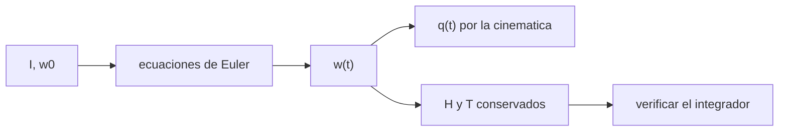

# B87-C01 — Dinámica de cuerpo rígido

<!-- nav:top -->
[🏠 Programa](../../../../README.md) · [📚 Bloque B87](../../../tronco-comun/B87-sensores-y-control-de-actitud.md) · [← Anterior: B86-C23 — Priorización y deslastre de cargas eléctricas](../../B86/B86-C23-priorizacion-y-deslastre-de-cargas-electricas/CLASE.md) · [Siguiente: B87-C02 — Representaciones de orientación →](../B87-C02-representaciones-de-orientacion/CLASE.md)
<!-- /nav -->

## 1. Ubicación, nivel y alcance

Clase 1 del bloque B87. Nivel N3. Un satélite sin ruedas ni propulsores se comporta como un **cuerpo rígido libre de pares**: su momento angular se conserva y su velocidad angular obedece las ecuaciones de Euler. Es la base de todo el bloque: sin este modelo no se pueden entender sensores, estimadores ni actuadores. Todos los datos son sintéticos: un microsatélite de ejemplo de ejes principales `I = diag(0,35; 0,40; 0,30) kg·m²`, sin relación con ninguna misión.

## 2. Por qué esta clase existe

Un diseñador de actitud necesita saber qué hace el vehículo cuando nadie lo controla: **¿cuánto vale el momento angular, cómo se mueve el eje de giro y cuándo un giro aparentemente tranquilo se desestabiliza?** El caso clásico es el eje intermedio de inercia: un giro sobre él es inestable y un pequeño error se amplifica hasta voltear el cuerpo.

## 3. Lo que podrás hacer al terminar

1. Calcular el momento angular `H = Iω` y la energía cinética de rotación `T = ½ ω·Iω` de un cuerpo con ejes principales.
2. Escribir y resolver las ecuaciones de Euler `I ω̇ = −ω × Iω` con un integrador RK4.
3. Comprobar la conservación de `H` (en el sistema inercial) y de `T` como segunda vía de un integrador.
4. Identificar los ejes de inercia mayor, intermedio y menor y decidir cuáles son estables.
5. Predecir la tasa de crecimiento de la inestabilidad del eje intermedio y compararla con la simulación.
6. Separar lo sintético (el cuerpo, las condiciones iniciales) de lo consultado y de lo no consultado.

La evidencia es la **ficha de conservación y crecimiento de la inestabilidad de un cuerpo rígido** del ejercicio 12 (sección 20).

## 4. Con qué llegas y cómo comprobarlo

1. ¿Qué es el momento angular de un cuerpo rígido y qué lo cambia?
2. ¿Qué es un eje principal de inercia?
3. ¿Cuál es la derivada de un vector expresado en un sistema que gira con `ω`?
4. ¿Qué es un método Runge–Kutta de orden 4?
5. ¿Qué es una cantidad conservada?

<details>
<summary>Ver respuestas</summary>

1. El producto del tensor de inercia por la velocidad angular, `H = Iω`; solo lo cambia un par externo. 2. Un eje en el que el tensor de inercia es diagonal: `H` y `ω` son paralelos si el giro es sobre él. 3. `(dH/dt)_I = (dH/dt)_B + ω × H`. 4. Un integrador de una etapa múltiple con error local `O(h⁵)`. 5. Una magnitud que no cambia en el tiempo; sirve para detectar errores de integración.
</details>

Con cuatro o cinco aciertos, sigue; si no, repasa los prerrequisitos.

## 5. Un caso de contexto y casos de referencia

Un microsatélite de ejemplo, `I = diag(0,35; 0,40; 0,30) kg·m²`, gira a `1 rad/s` sobre su eje de inercia intermedia (el eje `x`, de `0,35`) con una perturbación de `10⁻⁴ rad/s` en `y`. Sin pares externos, `H = 0,35 kg·m²/s` y `T = 0,175 J`. Es el **ejemplo conductor**: la simulación muestra que la perturbación crece como `e^{0,1443 t}` hasta voltear el cuerpo, mientras `H` y `T` se conservan a `1,5e-12` y `1,6e-14`. Todo es **sintético**.

## 6. Vocabulario

El **tensor de inercia** `I` (3×3, simétrico) reúne los momentos de inercia. Los **ejes principales** lo diagonalizan; sus momentos son `I₁`, `I₂`, `I₃`. El **momento angular** es `H = Iω`; la **energía de rotación** es `T = ½ ω·Iω`. Las **ecuaciones de Euler** sin par son `I ω̇ = −ω × (Iω)`. Un giro **simple** es el que ocurre sobre un eje principal. El **eje intermedio** es el de momento de inercia intermedio. La **polhodia** es la curva que describe `ω` en el cuerpo.

## 7. Modelo mental: dos cantidades conservadas acotan el movimiento



*Descripción textual:* del tensor de inercia y la velocidad angular inicial salen las ecuaciones de Euler; su solución da `ω(t)` y, con la cinemática, la actitud; `H` y `T` se conservan y sirven para verificar el integrador.

Analogía: una peonza (trompo) que gira sobre su eje largo es estable, igual que un giro sobre el eje de mayor o menor inercia; una raqueta lanzada al aire girando sobre su eje intermedio da una vuelta extra impredecible. Límite: la raqueta tiene aire y ejes que no son exactamente principales; el modelo de la clase es ideal y sin pares.

## 8. La explicación, paso a paso

### 8.1 Momento angular y energía

Con `ω = (ωx, ωy, ωz)` en ejes principales: `H = (I₁ωx, I₂ωy, I₃ωz)` y `T = ½(I₁ωx² + I₂ωy² + I₃ωz²)`. Para el ejemplo (`ω = (1; 10⁻⁴; 0) rad/s`): `|H| = 0,35000 kg·m²/s` y `T = 0,17500 J`.

### 8.2 Ecuaciones de Euler y conservación

Sin par externo, `(dH/dt)_I = 0`; en ejes del cuerpo `I ω̇ = −ω × Iω`. De ahí salen dos invariantes: `|H|` (la esfera del momento) y `T` (el elipsoide de energía). El movimiento de `ω` en el cuerpo es la intersección de ambas superficies. En el laboratorio la deriva máxima de `H` inercial fue `1,53e-12` (relativa) y la de `T`, `1,63e-14`.

### 8.3 Estabilidad de los giros simples

Linealizando alrededor de un giro `Ω` sobre el eje 1: `ω̈₂ = Ω² (I₃−I₁)(I₁−I₂)/(I₂I₃) ω₂`. Si el eje 1 es el mayor o el menor, el coeficiente es negativo y hay oscilación (estable). Si es el intermedio, es positivo y hay crecimiento exponencial con
`λ = Ω √[(I₂−I₁)(I₁−I₃)/(I₂I₃)]` (para `I₃ < I₁ < I₂`). Con los valores del ejemplo, `λ = 0,14434 s⁻¹`; la simulación ajustada da `0,14426 s⁻¹`. La perturbación se multiplica por 10 cada `15,95 s`.

### 8.4 Comparación de los tres ejes (`Ω = 1 rad/s`, perturbación `10⁻⁴ rad/s`)

| Eje de giro | Momento de inercia (kg·m²) | Resultado en 60 s |
|---|---|---|
| `x` (intermedio) | 0,35 | `max |ωy|` = 0,2754 rad/s: inestable |
| `y` (mayor) | 0,40 | `max |ωx|` = 1,0e-04 rad/s: estable |

El eje de menor inercia es estable en el modelo rígido; en un satélite real la disipación interna lo vuelve inestable y deja como estable solo el de mayor inercia (explicación que no se desarrolla ni se consultó aquí).

## 9. Magnitudes, símbolos y unidades

| Símbolo | Qué es | Unidad | Valor / nota |
|---|---|---|---|
| `I` | tensor de inercia | kg·m² | diag(0,35; 0,40; 0,30), sintético |
| `ω` | velocidad angular del cuerpo respecto de I | rad/s | en ejes del cuerpo |
| `H` | momento angular | kg·m²/s | 0,35000 en el ejemplo |
| `T` | energía cinética de rotación | J | 0,17500 en el ejemplo |
| `λ` | tasa de crecimiento del eje intermedio | 1/s | 0,14434 |
| `q` | cuaternión de actitud | — | norma 1 |

## 10. Convenciones y referencias

Integrador RK4 de paso fijo `0,01 s`. Tolerancias: deriva relativa de `H` y `T` `< 10⁻⁹`, desvío de la norma del cuaternión `< 10⁻¹²`, tasa de crecimiento dentro del 2 % de la teoría. Cuaternión `q = [qx, qy, qz, qw]` con la parte escalar al final, `v_B = A(q) v_I`, producto tal que `A(q⊗p) = A(q) A(p)`, cinemática `q̇ = ½ [ω; 0] ⊗ q` con `ω` del cuerpo respecto del sistema inercial expresada en el cuerpo (la biblioteca [adcs_comun.py](../adcs_comun.py) del bloque lo comprueba). Sistema inercial `I` de **ejemplo** (ejes sin relación con J2000), órbita circular de dos cuerpos con radio terrestre `6 378 137 m` y `μ = 3,986004418 × 10¹⁴ m³/s²` como valores adoptados de ejemplo. Satélite **sintético** `I = diag(0,35; 0,40; 0,30) kg·m²` salvo que la clase diga otra cosa. Todo dato es sintético con semilla fija.

## 11. De dónde sale lo que afirmamos

| ID | Fuente | Localizador | Respalda | Estado |
|---|---|---|---|---|
| S2 | B. Graf, «Quaternions and dynamics», arXiv:0811.2889 — https://arxiv.org/abs/0811.2889 (consultada 2026-11-10) | solo la página de resumen | introducción autocontenida a los cuaterniones en dinámica, con la dinámica del cuerpo rígido y, en un apéndice, un satélite con ruedas inerciales; sostiene que los cuaterniones, a diferencia de los ángulos de Euler, permiten escribir a mano dinámicas complejas | Consultada (solo el resumen) |
| — | Relaciones estándar de dinámica de actitud, estimación y control usadas en esta clase (ecuaciones de Euler, cinemática de cuaterniones, problema de Wahba, filtro de Kalman multiplicativo, estabilidad de Lyapunov, modelos de sensores y actuadores) | — | las verifica el laboratorio con una segunda vía (conservación, comparación entre métodos, propagación independiente o Monte Carlo) | No consultada en una fuente concreta |
| — | Libros de texto de actitud y control (p. ej. Wertz, Markley–Crassidis, Sidi) y hojas de datos de fabricantes | — | — | No consultada |

Límites: Graf (S2) solo respalda, desde su resumen, que los cuaterniones permiten escribir la dinámica del cuerpo rígido; las ecuaciones de Euler y la fórmula de `λ` no se consultaron en una fuente concreta y las valida el laboratorio por conservación y por comparación con la tasa ajustada.

## 12. Cómo ver las cantidades conservadas

| Magnitud | Valor |
|---|---|
| `|H|` inicial | 0,35000 kg·m²/s |
| `T` inicial | 0,17500 J |
| deriva de `H` (60 s) | 1,53e-12 |
| deriva de `T` (60 s) | 1,63e-14 |
| `λ` teórica / ajustada | 0,14434 / 0,14426 1/s |

Descripción larga: las dos derivas son del orden del error de redondeo acumulado; la tasa ajustada coincide con la teórica en menos del 0,1 %.

## 13. Ejemplo trabajado: el giro sobre el eje intermedio

**Paso 1 · Datos.** `I = diag(0,35; 0,40; 0,30)`, `ω₀ = (1; 10⁻⁴; 0) rad/s`.

**Paso 2 · Invariantes.** `|H| = 0,35000 kg·m²/s`, `T = 0,17500 J`.

**Paso 3 · Estabilidad.** `I₁ = 0,35` es el valor intermedio: `λ = 0,14434 s⁻¹`.

**Paso 4 · Predicción.** La perturbación pasa de `10⁻⁴` a `1 rad/s` en `ln(10⁴)/λ ≈ 64 s`, pero la no linealidad la satura antes: a los 60 s el máximo observado es `0,275 rad/s`.

**Paso 5 · Comprobación.** Con `ω₀ = (10⁻⁴; 1; 0)` (eje mayor) el máximo de `|ωx|` sigue en `1,0e-04 rad/s`.

## 14. Distintas formas de describir la dinámica de un cuerpo rígido

**En el cuerpo:** ecuaciones de Euler (esta clase). **En el sistema inercial:** `H` constante y la actitud se deduce de `H = Aᵀ Iω`. **Con ruedas:** el momento se reparte entre cuerpo y ruedas (C11). **Con par:** el momento cambia con `τ` (C17). La conservación inercial de `H` es la segunda vía de este laboratorio.

## 15. Práctica guiada

**Ejercicio 1 · con los pasos indicados.** Calcula `|H|` y `T` para `ω = (0,10; 0,20; 0,30) rad/s` con `I = diag(0,35; 0,40; 0,30)`. *Pasos:* `Iω`, norma, `½ ω·Iω`.

<details><summary>Solución comentada</summary>

`Iω = (0,035; 0,080; 0,090)`; `|H| = 0,12540 kg·m²/s`; `T = ½(0,0035 + 0,0160 + 0,0270) = 0,02325 J`.
</details>

**Ejercicio 2 · con una pista.** ¿Qué eje es el intermedio para `I = diag(0,35; 0,40; 0,30)`? *Pista:* ordena los tres valores.

<details><summary>Solución comentada</summary>

Ordenados: `0,30 < 0,35 < 0,40`; el intermedio es `x` (0,35).
</details>

**Ejercicio 3 · casi autónomo.** Con `Ω = 1 rad/s`, calcula `λ` para el eje `x`.

<details><summary>Solución comentada</summary>

`λ = √[(0,40−0,35)(0,35−0,30)/(0,40·0,30)] = √(0,0025/0,12) = 0,1443 s⁻¹`.
</details>

## 16. Práctica autónoma, transferencia e integrador

**Ejercicio 4 · autónomo.** Calcula el tiempo para que una perturbación de `10⁻⁴` se multiplique por 100 con `λ = 0,1443 s⁻¹`.

<details><summary>Solución comentada</summary>

`t = ln 100/λ = 4,605/0,1443 = 31,9 s`.
</details>

**Ejercicio 5 · autónomo.** ¿Cambia `λ` si `Ω` se duplica?

<details><summary>Solución comentada</summary>

Sí, `λ` es proporcional a `Ω`: pasa a `0,2887 s⁻¹` y el tiempo de multiplicación se reduce a la mitad.
</details>

**Ejercicio 6 · autónomo.** ¿Qué ocurre con `T` si hay un par disipativo interno? ¿Y con `H`?

<details><summary>Solución comentada</summary>

`T` decrece; `H` se conserva mientras no haya par externo. Por eso, a igual `H`, el estado de mínima energía es el giro sobre el eje de mayor inercia.
</details>

**Ejercicio 7 · autónomo.** Si `T` y `|H|` se conservan, ¿qué forma tiene la trayectoria de `ω`?

<details><summary>Solución comentada</summary>

La intersección de la esfera `|Iω| = H` con el elipsoide `ω·Iω = 2T`: una curva cerrada llamada polhodia.
</details>

**Ejercicio 8 · autónomo.** Un integrador Euler explícito (orden 1) con `dt = 0,01 s`, ¿conservaría `T` mejor o peor que RK4?

<details><summary>Solución comentada</summary>

Peor: su error local es `O(h²)` y `T` crece de forma sistemática; la deriva sería varios órdenes mayor que `1,6e-14`.
</details>

**Ejercicio 9 · transferencia.** **Transferencia.** **Transferencia.** Un colega afirma que un satélite real girando sobre su eje intermedio se desestabiliza exactamente con `λ`. ¿Es válido?

<details><summary>Solución comentada</summary>

Solo como estimación cualitativa: el modelo es rígido, sin pares ni sloshing ni flexibilidad; un satélite real también cambia por disipación interna. El valor numérico procede de un cuerpo sintético.
</details>

**Ejercicio 10 · transferencia.** **Transferencia.** **Transferencia.** ¿Qué cambia si el satélite lleva una rueda con momento `h` en el eje `x`?

<details><summary>Solución comentada</summary>

Aparece un momento almacenado constante en el cuerpo, `ω × (Iω + h)`: el eje de giro estable se desplaza y puede estabilizarse un giro que sin rueda era inestable (C11).
</details>

**Ejercicio 11 · transferencia.** **Transferencia.** **Transferencia.** ¿Por qué se comprueba `H` en el sistema inercial y no en el del cuerpo?

<details><summary>Solución comentada</summary>

Porque en ejes del cuerpo `H` cambia de dirección aunque su módulo no varíe; solo en el sistema inercial es un vector constante.
</details>

**Ejercicio 12 · integrador.** **Integrador.** **Integrador.** Elabora tu *ficha de conservación y crecimiento de la inestabilidad*: `H`, `T`, derivas, `λ` teórica y ajustada, resultado para los dos ejes, y lista de qué es consultado y sintético.

<details><summary>Solución comentada</summary>

Secciones 8.1–8.4, 12 y la salida del laboratorio; la lista de fuentes está en la sección 11 (Graf solo por el resumen).
</details>

## 17. Laboratorio: giro libre, conservación e inestabilidad del eje intermedio

El script [cuerpo_rigido.py](cuerpo_rigido.py) integra las ecuaciones de Euler y la cinemática con RK4 durante 60 s, comprueba la deriva de `H` inercial, de `T` y de la norma del cuaternión, ajusta la tasa de crecimiento de una perturbación de `10⁻⁷ rad/s` entre 20 y 45 s y la compara con `λ`, y repite el giro sobre el eje mayor (**comprueba** deriva `< 10⁻⁹`, tasa dentro del 2 % y máximo estable `< 10⁻³ rad/s`). Usa la biblioteca común [adcs_comun.py](../adcs_comun.py) del bloque.

**Datos:** cuerpo y condiciones iniciales **sintéticos**; sin datos medidos. **Predice antes de ejecutar:** ¿Crecerá o no una perturbación sobre el eje mayor? (No: queda en `10⁻⁴ rad/s`.) **Ejecución del 2026-11-10 (Python 3.12.9, numpy 2.4.4):**

```text
Python 3.12.9 | numpy 2.4.4
B87-C01 cuerpo rigido sin par | cuerpo SINTETICO I = diag(0.35, 0.40, 0.30) kg m^2
Giro de 1 rad/s sobre el eje intermedio con perturbacion de 1e-4 rad/s (tasa: 1e-7 rad/s); RK4, dt = 0.01 s, 60 s
H0 = 0.35000 kg m^2/s ; T0 = 0.17500 J
deriva maxima: |dH|/H = 1.53e-12 ; |dT|/T = 1.63e-14 ; |norma(q)-1| = 0.00e+00
tasa de crecimiento teorica = 0.14434 1/s ; ajustada = 0.14426 1/s
tiempo teorico de x10 = 15.95 s
eje intermedio: max |w_y| = 0.2754 rad/s (parte de 1e-4)
eje mayor (estable): max |w_x| = 1.00e-04 rad/s ; dH = 1.1e-14 ; dT = 2.2e-14
Pruebas superadas.
```

```bash
python programa/clases/B87/B87-C01-dinamica-de-cuerpo-rigido/cuerpo_rigido.py
```

**Límites:** cuerpo rígido, sin pares ni disipación, ejes principales alineados con los del cuerpo; el ajuste exponencial vale solo en el régimen lineal.

## 18. Errores frecuentes y cómo corregirlos

**Comprobar `H` en ejes del cuerpo.** Calcula `Aᵀ Iω` y compáralo con su valor inicial (8.2)

**Creer que todo giro es estable.** Revisa el signo de `(I₃−I₁)(I₁−I₂)` (8.3)

**Usar un integrador de bajo orden sin vigilar `T`.** Mide la deriva de `T` y de `|H|` en cada corrida

## 19. Cómo sabrás que vas bien

Tras la sección 8: ¿qué eje esperabas inestable y con qué `λ`? Si dudas, repasa el ejemplo 13. Tras el laboratorio: ¿qué comprueba? (ver sección 17).

## 20. Qué entregas y cómo se evalúa

El producto es tu **ficha de conservación y crecimiento de la inestabilidad de un cuerpo rígido** (ejercicio 12).

| Criterio | Inicial | En desarrollo | Logrado | Destacado |
|---|---|---|---|---|
| Conceptos | Los confunde | Parciales | Explica el método y su dominio | Explica los límites y las alternativas |
| Cálculo | Sin unidades | Con errores | Resultados con unidades y comprobados | Resuelve casos nuevos |
| Numérico | Sin comprobar | Un caso | Verifica con una segunda vía en varios casos | Interpreta las diferencias y los fallos |
| Fuentes | Sin fuente | Sin fecha | Fuentes con fecha y estado | Declara lo sintético y lo no consultado |
| Límites | No los nombra | Uno | Tres | Discute qué falta del modelo |

**Condiciones críticas (no se compensan con promedio):** rotular los datos como sintéticos; verificar cada resultado con una segunda vía; citar solo lo consultado.

## 21. Ética, seguridad y límites

Clase educativa: los modelos son simplificados y los datos son sintéticos; ningún resultado describe una misión real ni sustituye el diseño y la verificación de un subsistema de actitud con herramientas validadas, ensayos y revisión de especialistas.  Accesibilidad: tablas equivalentes a las gráficas, fórmulas en texto, ejercicios sin conexión.

## 22. Para cerrar y seguir

Un cuerpo libre conserva `H = 0,35 kg·m²/s` y `T = 0,175 J`, y un giro sobre el eje intermedio crece como `e^{λt}` con `λ = 0,1443 s⁻¹`. Queda una pregunta: ¿cómo se describe la orientación de ese cuerpo sin ambigüedades?

**Glosario español–inglés.** tensor de inercia · *inertia tensor*; momento angular · *angular momentum*; ecuaciones de Euler · *Euler's equations*; eje intermedio · *intermediate axis*; polhodia · *polhode*; velocidad angular · *angular velocity*.

**Continuidad.** [B87-C02](../B87-C02-representaciones-de-orientacion/CLASE.md) presenta las formas de representar la orientación (matriz, ángulos de Euler, cuaterniones).

**Referencias:** ver sección 11.

<!-- nav:bottom -->
---

[← Anterior: B86-C23 — Priorización y deslastre de cargas eléctricas](../../B86/B86-C23-priorizacion-y-deslastre-de-cargas-electricas/CLASE.md) · [📚 Bloque B87](../../../tronco-comun/B87-sensores-y-control-de-actitud.md) · [Siguiente: B87-C02 — Representaciones de orientación →](../B87-C02-representaciones-de-orientacion/CLASE.md)
<!-- /nav -->
