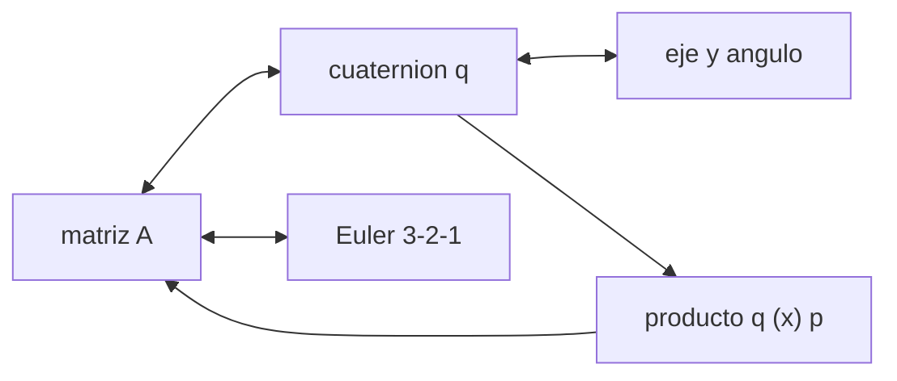

# B87-C02 — Representaciones de orientación

<!-- nav:top -->
[🏠 Programa](../../../../README.md) · [📚 Bloque B87](../../../tronco-comun/B87-sensores-y-control-de-actitud.md) · [← Anterior: B87-C01 — Dinámica de cuerpo rígido](../B87-C01-dinamica-de-cuerpo-rigido/CLASE.md) · [Siguiente: B87-C03 — Sensores solares →](../B87-C03-sensores-solares/CLASE.md)
<!-- /nav -->

## 1. Ubicación, nivel y alcance

Clase 2 del bloque B87. Nivel N3. La orientación de un satélite respecto de un sistema inercial se puede escribir como matriz de actitud, tres ángulos de Euler, un eje y un ángulo, o un cuaternión. Cada forma tiene ventajas y defectos. Esta clase fija las convenciones que usa todo el bloque (`v_B = A(q) v_I`, cuaternión con la parte escalar al final) y mide la precisión de las conversiones. Todos los casos son sintéticos: 2000 orientaciones aleatorias de semilla fija y un ejemplo de ángulos `30°, 20°, 10°`.

## 2. Por qué esta clase existe

Casi todos los errores de actitud en software vienen de convenciones mezcladas: orden de ejes, sentido de la rotación, posición de la parte escalar. La decisión central: **¿qué representación uso para integrar, cuál para filtrar y cuál para mostrar?** Y una pregunta previa: ¿cuándo falla cada una?

## 3. Lo que podrás hacer al terminar

1. Construir la matriz de actitud 3-2-1 y extraer de ella los tres ángulos.
2. Convertir entre matriz, cuaternión y eje-ángulo con la convención del bloque.
3. Componer rotaciones con el producto de cuaterniones y comprobar `A(q⊗p) = A(q) A(p)`.
4. Explicar la doble cobertura (`q` y `−q`) y la singularidad de los ángulos de Euler (bloqueo de cardán).
5. Verificar la cinemática `q̇ = ½ [ω; 0] ⊗ q` por diferencias finitas.
6. Separar lo sintético de lo consultado y de lo no consultado.

La evidencia es la **tabla de conversiones de orientación con error de ida y vuelta** del ejercicio 12 (sección 20).

## 4. Con qué llegas y cómo comprobarlo

1. ¿Qué propiedades tiene una matriz de rotación?
2. ¿Qué es una rotación activa y una pasiva?
3. ¿Qué es un cuaternión unitario?
4. ¿Qué es una singularidad de una parametrización?
5. ¿Por qué se mide un error de ida y vuelta?

<details>
<summary>Ver respuestas</summary>

1. Es ortogonal (`AAᵀ = I`) y tiene determinante `+1`. 2. La activa mueve el vector; la pasiva cambia el sistema en que se expresa. Aquí `A` es pasiva (de I a B). 3. Cuatro números con norma 1, `q = [n sin(φ/2), cos(φ/2)]`. 4. Un punto donde varios parámetros describen la misma orientación o donde la derivada se vuelve infinita. 5. Porque convertir A→q→A debe devolver la matriz original; la diferencia mide el error numérico.
</details>

Con cuatro o cinco aciertos, sigue; si no, repasa los prerrequisitos.

## 5. Un caso de contexto y casos de referencia

La secuencia 3-2-1 del ejemplo conductor (`yaw = 30°`, `pitch = 20°`, `roll = 10°`) da el cuaternión `q = [0,038135; 0,189308; 0,239298; 0,951549]` y una rotación única de `35,8171°` alrededor del eje `[0,12402; 0,61564; 0,77821]`. Al llevar `pitch` hacia 90° los ángulos de Euler se vuelven hipersensibles, mientras el cuaternión no. Todo es **sintético**.

## 6. Vocabulario

La **matriz de actitud** `A` (3×3, ortogonal, `det = +1`) lleva coordenadas de `I` a `B`. Los **ángulos de Euler 3-2-1** son *yaw* (eje z), *pitch* (eje y) y *roll* (eje x): `A = Rx(roll) Ry(pitch) Rz(yaw)`. El **cuaternión** `q = [qv; qw]` tiene norma 1. El **eje-ángulo** `(n, φ)` cumple `q = [n sin(φ/2); cos(φ/2)]`. La **doble cobertura** dice que `q` y `−q` son la misma actitud. El **bloqueo de cardán** es la pérdida de un grado de libertad en `pitch = ±90°`.

## 7. Modelo mental: una rotación, cuatro lenguajes



*Descripción textual:* la rotación es una sola; la matriz y el cuaternión se convierten sin pérdida, el eje-ángulo es una lectura geométrica del cuaternión y Euler es la forma legible pero singular; el producto de cuaterniones compone rotaciones.

Analogía: una misma dirección puede darse como «40° al noreste» (Euler), como un vector (matriz) o como una brújula con un giro (eje-ángulo); cada forma es buena para algo. Límite: la dirección tiene dos grados de libertad y la orientación tres; por eso en Euler aparece un punto donde dos ángulos se confunden.

## 8. La explicación, paso a paso

### 8.1 Matriz de actitud y ángulos 3-2-1

`A = Rx(roll) Ry(pitch) Rz(yaw)` con `Rx(a) = [[1,0,0],[0,cos a, sin a],[0,−sin a, cos a]]` y análogas. Para `(30°, 20°, 10°)` resulta la matriz impresa en el laboratorio, con `A[0,2] = −sin(pitch) = −0,3420`. Los ángulos se recuperan como `pitch = −asin A₀₂`, `yaw = atan2(A₀₁, A₀₀)` y `roll = atan2(A₁₂, A₂₂)`.

### 8.2 Cuaternión, eje-ángulo y producto

`A(q) = (qw² − |qv|²) I + 2 qv qvᵀ − 2 qw [qv×]`. El método de Shepperd obtiene `q` de `A` eligiendo el término más grande entre `tr A` y la diagonal para evitar dividir por un número pequeño. El producto `q⊗p` cumple `A(q⊗p) = A(q) A(p)`: en el laboratorio la diferencia es `2,2e-16`. La doble cobertura: `A(q) − A(−q) = 0,0e+00`.

### 8.3 Errores de conversión (2000 casos)

| Ida y vuelta | Error máximo |
|---|---|
| `A → q → A` | `6,7e-16` |
| `A → Euler → A` | `1,3e-14` |
| `q → eje-ángulo → A` | `6,7e-16` |

### 8.4 Singularidad de Euler

Una rotación inercial de `10⁻⁶ rad` cambia `yaw` y `roll` en `0,87` veces ese valor con `pitch = 0°`, `4,99` con 80°, `49,6` con 89° y `4976` con 89,99°: crece como `1/cos(pitch)`. El cuaternión no tiene ese problema: su cinemática `q̇ = ½ [ω; 0] ⊗ q` coincide con las diferencias finitas de `A` con un error de `2,4e-08`.

## 9. Magnitudes, símbolos y unidades

| Símbolo | Qué es | Unidad | Valor / nota |
|---|---|---|---|
| `A` | matriz de actitud I→B | — | ortogonal, det +1 |
| `q` | cuaternión `[qx, qy, qz, qw]` | — | norma 1 |
| `yaw, pitch, roll` | ángulos 3-2-1 | rad (°) | 30°, 20°, 10° en el ejemplo |
| `n, φ` | eje y ángulo de la rotación | —, rad | φ = 35,8171° en el ejemplo |
| `ω` | velocidad angular | rad/s | en ejes del cuerpo |

## 10. Convenciones y referencias

Rotaciones **pasivas** y sentido positivo de la regla de la mano derecha. Tolerancias: ida y vuelta `< 10⁻¹²` (Euler) y `< 10⁻¹⁴` (cuaternión y eje-ángulo); composición `< 10⁻¹⁴`; cinemática `< 10⁻⁵` (diferencia finita con `10⁻⁷`). Cuaternión `q = [qx, qy, qz, qw]` con la parte escalar al final, `v_B = A(q) v_I`, producto tal que `A(q⊗p) = A(q) A(p)`, cinemática `q̇ = ½ [ω; 0] ⊗ q` con `ω` del cuerpo respecto del sistema inercial expresada en el cuerpo (la biblioteca [adcs_comun.py](../adcs_comun.py) del bloque lo comprueba). Sistema inercial `I` de **ejemplo** (ejes sin relación con J2000), órbita circular de dos cuerpos con radio terrestre `6 378 137 m` y `μ = 3,986004418 × 10¹⁴ m³/s²` como valores adoptados de ejemplo. Satélite **sintético** `I = diag(0,35; 0,40; 0,30) kg·m²` salvo que la clase diga otra cosa. Todo dato es sintético con semilla fija.

## 11. De dónde sale lo que afirmamos

| ID | Fuente | Localizador | Respalda | Estado |
|---|---|---|---|---|
| S2 | B. Graf, «Quaternions and dynamics», arXiv:0811.2889 — https://arxiv.org/abs/0811.2889 (consultada 2026-11-10) | solo la página de resumen | introducción autocontenida a los cuaterniones en dinámica, con la dinámica del cuerpo rígido y, en un apéndice, un satélite con ruedas inerciales; sostiene que los cuaterniones, a diferencia de los ángulos de Euler, permiten escribir a mano dinámicas complejas | Consultada (solo el resumen) |
| S4 | M. D. Shuster, «A Survey of Attitude Representations», The Journal of the Astronautical Sciences 41(4), 439–517 (1993) (cita verificada 2026-11-10 mediante resultados de búsqueda; el artículo no se abrió) | referencia bibliográfica | recopila en una notación coherente los resultados conocidos sobre representaciones de la actitud (unas 79 páginas y 163 referencias según el resumen de búsqueda) | Cita consultada; contenido no consultado |
| — | Relaciones estándar de dinámica de actitud, estimación y control usadas en esta clase (ecuaciones de Euler, cinemática de cuaterniones, problema de Wahba, filtro de Kalman multiplicativo, estabilidad de Lyapunov, modelos de sensores y actuadores) | — | las verifica el laboratorio con una segunda vía (conservación, comparación entre métodos, propagación independiente o Monte Carlo) | No consultada en una fuente concreta |
| — | Libros de texto de actitud y control (p. ej. Wertz, Markley–Crassidis, Sidi) y hojas de datos de fabricantes | — | — | No consultada |

Límites: Graf (S2) solo respalda, desde su resumen, que los cuaterniones permiten escribir dinámicas complejas a mano frente a los ángulos de Euler; de Shuster (S4) solo se verificó la cita, no su contenido. Las fórmulas de conversión y la convención del bloque no se consultaron y las valida el laboratorio por ida y vuelta y por composición.

## 12. Cómo ver las conversiones

| Magnitud | Valor |
|---|---|
| `A` → `q` (ejemplo) | `[0,0381; 0,1893; 0,2393; 0,9515]` |
| ángulo de la rotación única | 35,8171° |
| ida y vuelta (peor de tres) | 1,3e-14 |
| sensibilidad a 89,99° | 4976 veces |

Descripción larga: el error de conversión es del orden del redondeo; la sensibilidad de Euler aumenta de 1 a casi 5000 al acercar `pitch` a 90°.

## 13. Ejemplo trabajado: de ángulos de Euler a cuaternión

**Paso 1 · Matriz.** `A = Rx(10°) Ry(20°) Rz(30°)`; `A₀₂ = −sin 20° = −0,3420`.

**Paso 2 · Cuaternión.** Shepperd: `q = [0,03813; 0,18931; 0,23930; 0,95155]`, `|q| = 1,000000`.

**Paso 3 · Eje-ángulo.** `φ = 2 acos(qw) = 35,8171°`.

**Paso 4 · Ida y vuelta.** `q → A` recupera la matriz con error `< 10⁻¹⁵`.

**Paso 5 · Comprobación.** `pitch = 20°` está lejos de 90°: la sensibilidad de Euler vale `0,87` (no hay amplificación).

## 14. Distintas formas de describir una orientación

**Matriz:** sin singularidades, 9 números; útil para rotar vectores. **Cuaternión:** 4 números, sin singularidad, compone con un producto; la usa el integrador y el filtro (C09, C10). **Euler:** 3 números, legible, singular en `pitch = ±90°`; solo para mostrar y para pequeñas desviaciones. **Eje-ángulo:** da la maniobra de menor giro (C17). El laboratorio compara las cuatro por ida y vuelta.

## 15. Práctica guiada

**Ejercicio 1 · con los pasos indicados.** Construye `A` para `yaw = 90°`, `pitch = 0`, `roll = 0` y rota el vector `v_I = (1; 0; 0)`. *Pasos:* `Rz(90°)`, producto.

<details><summary>Solución comentada</summary>

`Rz(90°) = [[0,1,0],[−1,0,0],[0,0,1]]`; `v_B = (0; −1; 0)`: el eje x inercial queda en `−y` del cuerpo (rotación pasiva).
</details>

**Ejercicio 2 · con una pista.** Escribe el cuaternión de una rotación de `60°` alrededor de `z`. *Pista:* `q = [n sin(φ/2); cos(φ/2)]`.

<details><summary>Solución comentada</summary>

`q = [0; 0; sin 30°; cos 30°] = [0; 0; 0,5; 0,8660]`.
</details>

**Ejercicio 3 · casi autónomo.** ¿Qué rotación representa `−q` si `q` representa `R`?

<details><summary>Solución comentada</summary>

La misma `R`: doble cobertura; las dos dan la misma matriz (el laboratorio mide `0,0e+00` de diferencia).
</details>

## 16. Práctica autónoma, transferencia e integrador

**Ejercicio 4 · autónomo.** Compón `60°` sobre `z` y `60°` sobre `z`; ¿qué ángulo total resulta con el producto de cuaterniones?

<details><summary>Solución comentada</summary>

`φ = 120°`; `q = [0; 0; sin 60°; cos 60°] = [0; 0; 0,8660; 0,5]`.
</details>

**Ejercicio 5 · autónomo.** Para `A` con `pitch = 89,99°`, ¿cuántas veces amplifica Euler un error de `10⁻⁶ rad`?

<details><summary>Solución comentada</summary>

`4976` veces (tabla 8.4), del orden de `1/cos(89,99°) = 5730`.
</details>

**Ejercicio 6 · autónomo.** Si `q = [0; 0; 0; 1]`, ¿qué matriz resulta y qué ángulo?

<details><summary>Solución comentada</summary>

`A = I` y `φ = 0`.
</details>

**Ejercicio 7 · autónomo.** ¿Cuántos parámetros independientes tiene una orientación y cuántos números usa cada representación?

<details><summary>Solución comentada</summary>

Tres grados de libertad; la matriz usa 9 con 6 restricciones, el cuaternión 4 con 1, Euler 3, eje-ángulo 4 con 1 (o 3 si se codifica `φn`).
</details>

**Ejercicio 8 · autónomo.** ¿Por qué conviene renormalizar el cuaternión tras cada paso de integración?

<details><summary>Solución comentada</summary>

Porque el error numérico saca `|q|` de 1 y entonces `A(q)` deja de ser ortogonal; renormalizar lo corrige sin cambiar la actitud.
</details>

**Ejercicio 9 · transferencia.** **Transferencia.** **Transferencia.** Un software de vuelo de una misión usa `qw` primero; el tuyo lo usa al final. ¿Qué haces antes de mezclarlos?

<details><summary>Solución comentada</summary>

Reordenar los componentes y comprobar el signo de la rotación con un caso de prueba (por ejemplo, 90° sobre `z`); de otro modo la rotación sale invertida.
</details>

**Ejercicio 10 · transferencia.** **Transferencia.** **Transferencia.** ¿Por qué un filtro no usa los ángulos de Euler como estado, aunque un panel de operador sí los muestre?

<details><summary>Solución comentada</summary>

Porque cerca de `pitch = 90°` el estado se vuelve singular; el filtro usa cuaterniones y el operador ve ángulos solo como conversión.
</details>

**Ejercicio 11 · transferencia.** **Transferencia.** **Transferencia.** ¿Qué rotación de menor ángulo lleva `q₁` a `q₂`?

<details><summary>Solución comentada</summary>

`q_e = q₂ ⊗ q₁⁻¹` con `qw ≥ 0`; su ángulo es `2 atan2(|qv|, qw)` (la función `ang_between` del laboratorio).
</details>

**Ejercicio 12 · integrador.** **Integrador.** **Integrador.** Elabora tu *tabla de conversiones de orientación*: la matriz, el cuaternión y el eje-ángulo del ejemplo conductor, los tres errores de ida y vuelta y la sensibilidad de Euler a 89,99°, más la lista de consultado y sintético.

<details><summary>Solución comentada</summary>

Secciones 8.1–8.4, 12 y la salida del laboratorio.
</details>

## 17. Laboratorio: conversiones, composición y singularidad

El script [representaciones.py](representaciones.py) convierte 2000 orientaciones aleatorias entre las cuatro formas, compone cuaterniones, verifica la doble cobertura y la cinemática y mide la sensibilidad de Euler al acercarse a `pitch = 90°` (**comprueba** ida y vuelta `< 10⁻¹⁴`, composición `< 10⁻¹⁴`, cinemática `< 10⁻⁵` y sensibilidad creciente). Usa la biblioteca común [adcs_comun.py](../adcs_comun.py) del bloque.

**Datos:** 2000 cuaterniones **sintéticos** de semilla 20260511; el ejemplo conductor son ángulos de ejemplo. **Predice antes de ejecutar:** ¿Cuántas veces se amplifica un error de `10⁻⁶ rad` en Euler con `pitch = 89,99°`? (alrededor de 5000.) **Ejecución del 2026-11-10 (Python 3.12.9, numpy 2.4.4):**

```text
Python 3.12.9 | numpy 2.4.4
B87-C02 representaciones de orientacion | 2000 casos SINTETICOS (semilla 20260511)
Ejemplo conductor: yaw 30 deg, pitch 20 deg, roll 10 deg (secuencia 3-2-1, I -> B)
A =
   [ 0.813798   0.469846  -0.342020]
   [-0.440970   0.882564   0.163176]
   [ 0.378522   0.018028   0.925417]
q = [0.038135 0.189308 0.239298 0.951549] ; |q| = 1.000000
eje = [0.12402 0.61564 0.77821] ; angulo = 35.8171 deg
error maximo de ida y vuelta A->q->A = 6.66e-16 ; A->Euler->A = 1.30e-14 ; q->eje-angulo->A = 6.66e-16
composicion A(q(x)p) - A(q)A(p): 2.22e-16 ; doble cobertura A(q) - A(-q): 0.00e+00
cinematica dq/dt = 0.5[w;0](x)q frente a diferencias finitas: 2.41e-08
Sensibilidad de (yaw, roll) a una rotacion de 1e-6 rad (veces):
  pitch =   0.00 deg ->         0.87
  pitch =  80.00 deg ->         4.99
  pitch =  89.00 deg ->        49.62
  pitch =  89.99 deg ->      4976.17
Pruebas superadas.
```

```bash
python programa/clases/B87/B87-C02-representaciones-de-orientacion/representaciones.py
```

**Límites:** solo la secuencia 3-2-1 y rotaciones pasivas; otras secuencias de Euler (3-1-3) y los parámetros de Rodrigues modificados no se tratan.

## 18. Errores frecuentes y cómo corregirlos

**Mezclar la posición de la parte escalar.** Declara siempre la convención y prueba una rotación de 90° (sección 10)

**Olvidar que `q` y `−q` son iguales.** Compara con `|q·p|` o con la matriz, nunca componente a componente

**Usar Euler cerca de 90°.** Pasa a cuaterniones (8.4)

## 19. Cómo sabrás que vas bien

Tras la sección 8: ¿qué ángulo de rotación única esperabas para `(30°, 20°, 10°)`? Si dudas, repasa el ejemplo 13. Tras el laboratorio: ¿qué comprueba? (ver sección 17).

## 20. Qué entregas y cómo se evalúa

El producto es tu **tabla de conversiones de orientación con error de ida y vuelta** (ejercicio 12).

| Criterio | Inicial | En desarrollo | Logrado | Destacado |
|---|---|---|---|---|
| Conceptos | Los confunde | Parciales | Explica el método y su dominio | Explica los límites y las alternativas |
| Cálculo | Sin unidades | Con errores | Resultados con unidades y comprobados | Resuelve casos nuevos |
| Numérico | Sin comprobar | Un caso | Verifica con una segunda vía en varios casos | Interpreta las diferencias y los fallos |
| Fuentes | Sin fuente | Sin fecha | Fuentes con fecha y estado | Declara lo sintético y lo no consultado |
| Límites | No los nombra | Uno | Tres | Discute qué falta del modelo |

**Condiciones críticas (no se compensan con promedio):** rotular los datos como sintéticos; verificar cada resultado con una segunda vía; citar solo lo consultado.

## 21. Ética, seguridad y límites

Clase educativa: los modelos son simplificados y los datos son sintéticos; ningún resultado describe una misión real ni sustituye el diseño y la verificación de un subsistema de actitud con herramientas validadas, ensayos y revisión de especialistas.  Accesibilidad: tablas equivalentes a las gráficas, fórmulas en texto, ejercicios sin conexión.

## 22. Para cerrar y seguir

La misma rotación se escribe como matriz, cuaternión de `[0,038; 0,189; 0,239; 0,952]`, un giro de `35,82°` o tres ángulos, con errores de ida y vuelta `< 10⁻¹³`. Queda una pregunta: ¿cómo mide un satélite un vector, por ejemplo la dirección al Sol?

**Glosario español–inglés.** matriz de actitud · *attitude matrix*; cuaternión · *quaternion*; ángulos de Euler · *Euler angles*; bloqueo de cardán · *gimbal lock*; doble cobertura · *double cover*; eje-ángulo · *axis–angle*.

**Continuidad.** [B87-C03](../B87-C03-sensores-solares/CLASE.md) trata el sensor solar, que mide un vector en el cuerpo.

**Referencias:** ver sección 11.

<!-- nav:bottom -->
---

[← Anterior: B87-C01 — Dinámica de cuerpo rígido](../B87-C01-dinamica-de-cuerpo-rigido/CLASE.md) · [📚 Bloque B87](../../../tronco-comun/B87-sensores-y-control-de-actitud.md) · [Siguiente: B87-C03 — Sensores solares →](../B87-C03-sensores-solares/CLASE.md)
<!-- /nav -->
