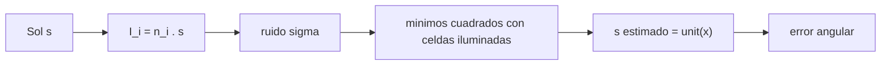

# B87-C03 — Sensores solares

<!-- nav:top -->
[🏠 Programa](../../../../README.md) · [📚 Bloque B87](../../../tronco-comun/B87-sensores-y-control-de-actitud.md) · [← Anterior: B87-C02 — Representaciones de orientación](../B87-C02-representaciones-de-orientacion/CLASE.md) · [Siguiente: B87-C04 — Sensores terrestres →](../B87-C04-sensores-terrestres/CLASE.md)
<!-- /nav -->

## 1. Ubicación, nivel y alcance

Clase 3 del bloque B87. Nivel N3. Un sensor solar mide en el cuerpo la dirección al Sol: es el sensor de vector más simple y más usado en satélites pequeños. Aquí modelas un sensor de seis fotodiodos (uno por cara, ley del coseno) y estimas el vector solar por mínimos cuadrados. Todos los datos son sintéticos: corrientes normalizadas a `I₀ = 1`, direcciones solares aleatorias de semilla fija, sin albedo ni eclipse.

## 2. Por qué esta clase existe

Un satélite que sale de un eclipse o de un modo seguro necesita saber hacia dónde está el Sol para orientar sus paneles. La decisión central: **¿con qué precisión angular se obtiene el vector solar de las corrientes de las fotoceldas y cuánto ruido tolera el diseño?** Y una previa: ¿cuántas celdas ven el Sol al mismo tiempo?

## 3. Lo que podrás hacer al terminar

1. Escribir la respuesta de una fotocelda con la ley del coseno y su campo de visión.
2. Estimar el vector solar a partir de las celdas iluminadas con mínimos cuadrados.
3. Relacionar el ruido de corriente con el error angular, `≈ √2 σ` con tres celdas ortogonales.
4. Explicar por qué una celda pierde sensibilidad cerca del eje (la pendiente `sin θ`).
5. Calcular la fracción de direcciones con tres o más celdas útiles.
6. Separar lo sintético de lo consultado y de lo no consultado.

La evidencia es la **curva de error angular del sensor solar frente al ruido** del ejercicio 12 (sección 20).

## 4. Con qué llegas y cómo comprobarlo

1. ¿Qué es el producto escalar de dos vectores unitarios?
2. ¿Qué es un problema de mínimos cuadrados lineal?
3. ¿Qué es el campo de visión de un sensor?
4. ¿Cuánto vale `cos 60°`?
5. ¿Qué es una dirección sintética?

<details>
<summary>Ver respuestas</summary>

1. El coseno del ángulo entre ellos. 2. Hallar `x` que minimiza `|Ax − y|²`. 3. El cono de direcciones en que el sensor responde. 4. 0,5. 5. Una dirección generada por un sorteo con semilla fija, no medida.
</details>

Con cuatro o cinco aciertos, sigue; si no, repasa los prerrequisitos.

## 5. Un caso de contexto y casos de referencia

Con el Sol de ejemplo `s = [0,6017; 0,5014; 0,6217]` los tres fotodiodos del lado iluminado miden `0,6017; 0,5014; 0,6217` y el estimador devuelve el vector exacto (error `0,0e+00°` sin ruido). Con ruido de `0,01` de `I₀` por celda el error angular es `0,798°`. Todo es **sintético**: corrientes normalizadas, sin albedo ni eclipse.

## 6. Vocabulario

La **ley del coseno** dice que una celda de normal `n` da `I = I₀ max(0, n·s)`. El **vector solar** `s` es la dirección unitaria al Sol en el cuerpo. El **campo de visión** es el semiángulo máximo en que la celda se usa (aquí 80°). El **estimador por mínimos cuadrados** resuelve `N s ≈ I` con las celdas iluminadas, y se normaliza. La **sensibilidad** de una celda es `dI/dθ = I₀ sin θ`. La **fracción útil** es la proporción de direcciones con tres celdas dentro del campo.

## 7. Modelo mental: seis celdas ven un coseno



*Descripción textual:* la dirección solar proyectada en las normales de las celdas da corrientes proporcionales al coseno; con ruido, un ajuste por mínimos cuadrados sobre las celdas iluminadas devuelve el vector, cuyo error angular crece con el ruido.

Analogía: como medir la altura del Sol por la longitud de la sombra de tres palos perpendiculares: cada sombra da una componente. Límite: la sombra no cambia de sentido de modo continuo como la corriente, y una celda casi de canto (sombra larga) pierde sensibilidad.

## 8. La explicación, paso a paso

### 8.1 Respuesta de una celda

`I = I₀ max(0, n·s)`. Con `n·s = cos θ`, `dI/dθ = −I₀ sin θ`: cerca del eje (`θ ≈ 0`) la celda casi no cambia con el ángulo (`sin 5° = 0,0872`) y a `80°` es muy sensible (`0,9848`). Por eso se usan varias celdas con normales distintas.

### 8.2 Estimación del vector solar

Con las celdas iluminadas (`n_i·s > cos 80°`) se resuelve `N_u x = I_u` por mínimos cuadrados y `ŝ = x/|x|`. Con las tres celdas ortogonales de un cubo, `x` es directamente `I`. Si hay menos de tres celdas útiles, no hay solución y el sensor no entrega vector.

### 8.3 Error frente al ruido

Con ruido gaussiano `σ` por celda, el error angular es del orden de `√2 σ` (rad):

| `σ` (× `I₀`) | Error rms (°) | Fracción con ≥ 3 celdas |
|---|---|---|
| 0,001 | 0,0799 | 0,542 |
| 0,003 | 0,2395 | 0,542 |
| 0,01 | 0,7980 | 0,542 |
| 0,03 | 2,3902 | 0,542 |
| 0,1 | 7,9333 | 0,542 |

El error es proporcional al ruido (de `0,001` a `0,1` se multiplica por `99`), y solo el 54 % de las direcciones tiene tres celdas dentro del campo de 80°.

### 8.4 Qué no incluye el modelo

No hay albedo terrestre (que añade luz reflejada y sesga el vector), ni eclipse, ni calibración de las celdas, ni dependencia con la temperatura. Cada uno se trata, si procede, como una fuente de error aparte (C08, C22).

## 9. Magnitudes, símbolos y unidades

| Símbolo | Qué es | Unidad | Valor / nota |
|---|---|---|---|
| `n_i` | normal de la celda `i` | — | ±x, ±y, ±z |
| `s` | dirección al Sol en el cuerpo | — | unitaria |
| `I_i` | corriente normalizada | × I₀ | ley del coseno |
| `σ` | ruido por celda | × I₀ | 0,001 a 0,1 |
| `θ` | ángulo de incidencia | rad (°) | campo de 80° |

## 10. Convenciones y referencias

Corriente normalizada a `I₀ = 1` (no se usa irradiancia en W/m²; los valores nominales de la IAU 2015 B3 no se necesitan aquí). Campo de visión de cada celda `80°`. Tolerancias: error sin ruido `< 10⁻⁶°`, error monótono creciente con `σ`, relación entre `σ = 0,1` y `σ = 0,001` cercana a 100 (±25 %). Cuaternión `q = [qx, qy, qz, qw]` con la parte escalar al final, `v_B = A(q) v_I`, producto tal que `A(q⊗p) = A(q) A(p)`, cinemática `q̇ = ½ [ω; 0] ⊗ q` con `ω` del cuerpo respecto del sistema inercial expresada en el cuerpo (la biblioteca [adcs_comun.py](../adcs_comun.py) del bloque lo comprueba). Sistema inercial `I` de **ejemplo** (ejes sin relación con J2000), órbita circular de dos cuerpos con radio terrestre `6 378 137 m` y `μ = 3,986004418 × 10¹⁴ m³/s²` como valores adoptados de ejemplo. Satélite **sintético** `I = diag(0,35; 0,40; 0,30) kg·m²` salvo que la clase diga otra cosa. Todo dato es sintético con semilla fija.

## 11. De dónde sale lo que afirmamos

| ID | Fuente | Localizador | Respalda | Estado |
|---|---|---|---|---|
| S5 | E. E. Mamajek et al., IAU 2015 Resolution B3, arXiv:1510.07674 — https://arxiv.org/abs/1510.07674 (consultada 2026-11-10) | solo la página de resumen | la resolución define constantes nominales solares y planetarias como valores exactos en unidades SI; la página no mostró los valores numéricos | Consultada (solo el resumen; valores no vistos) |
| — | Relaciones estándar de dinámica de actitud, estimación y control usadas en esta clase (ecuaciones de Euler, cinemática de cuaterniones, problema de Wahba, filtro de Kalman multiplicativo, estabilidad de Lyapunov, modelos de sensores y actuadores) | — | las verifica el laboratorio con una segunda vía (conservación, comparación entre métodos, propagación independiente o Monte Carlo) | No consultada en una fuente concreta |
| — | Libros de texto de actitud y control (p. ej. Wertz, Markley–Crassidis, Sidi) y hojas de datos de fabricantes | — | — | No consultada |

Límites: La resolución IAU 2015 B3 (S5) se consultó solo por su resumen y sin valores numéricos; esta clase no usa irradiancia. La ley del coseno y el estimador no se consultaron en una fuente concreta; los valida el laboratorio con el caso sin ruido y con la escala del error.

## 12. Cómo ver el error del sensor

| Magnitud | Valor |
|---|---|
| error sin ruido | 0,0e+00° |
| error con `σ = 0,01` | 0,798° |
| error con `σ = 0,1` | 7,933° |
| fracción útil (≥ 3 celdas) | 0,542 |

Descripción larga: el error angular crece de forma lineal con el ruido y la fracción útil es independiente del ruido porque solo depende de la geometría.

## 13. Ejemplo trabajado: vector solar con ruido

**Paso 1 · Verdad.** `s = [0,6017; 0,5014; 0,6217]`.

**Paso 2 · Corrientes.** Con las celdas `+x`, `+y`, `+z`: `I = (0,6017; 0,5014; 0,6217)`; las otras tres valen 0.

**Paso 3 · Estimación.** `x = I` y `ŝ = x/|x|`; sin ruido el error es `0,0e+00°`.

**Paso 4 · Con ruido.** Con `σ = 0,01`: error rms `0,798°` (3000 sorteos).

**Paso 5 · Comprobación.** `√2 σ` rad `= 0,810°`, del mismo orden.

## 14. Distintas formas de describir la medida de un sensor solar

**Celdas sueltas con ley del coseno** (esta clase). **Sensor de cuatro cuadrantes** de dos ejes: el ángulo sale de una razón de corrientes, `tan θ = (I₁ − I₂)/(I₁ + I₂)`. **Sensor de rendija o de matriz** (imagen del Sol en un detector): ángulo fino a partir del centroide. Los tres entregan una dirección; el laboratorio evalúa el primero.

## 15. Práctica guiada

**Ejercicio 1 · con los pasos indicados.** Una celda con normal `n` ve el Sol a `60°`. ¿Qué corriente da (`I₀ = 1`)? *Pasos:* `cos 60°`.

<details><summary>Solución comentada</summary>

`I = cos 60° = 0,5`.
</details>

**Ejercicio 2 · con una pista.** Con `I = (0,6; 0,5; 0,6245)` en tres celdas ortogonales, calcula `ŝ`. *Pista:* normaliza el vector.

<details><summary>Solución comentada</summary>

`|I| = 1,0000`; `ŝ = (0,6000; 0,5000; 0,6245)`.
</details>

**Ejercicio 3 · casi autónomo.** Si una celda tiene ruido `σ = 0,01` y el Sol está a `80°` de su normal, ¿qué error angular induce solo esa celda?

<details><summary>Solución comentada</summary>

`σ/sin 80° = 0,01/0,9848 = 0,01015 rad = 0,582°` (la pendiente `sin θ` de 8.1).
</details>

## 16. Práctica autónoma, transferencia e integrador

**Ejercicio 4 · autónomo.** ¿Por qué el error `σ = 0,1` es unas 100 veces el de `σ = 0,001`?

<details><summary>Solución comentada</summary>

Porque el estimador es lineal en la corriente; el cociente medido es `99`.
</details>

**Ejercicio 5 · autónomo.** ¿Qué fracción de direcciones tiene tres celdas con campo de 80°? Compara con 90°.

<details><summary>Solución comentada</summary>

El laboratorio da `0,542` con 80°; con 90° (solo `n·s > 0`) siempre hay tres celdas (excepto en el plano), es decir casi 1.
</details>

**Ejercicio 6 · autónomo.** ¿Cómo cambiaría el error si se usara la media de dos sensores independientes?

<details><summary>Solución comentada</summary>

Bajaría un factor `√2` (ruido independiente), de `0,798°` a `0,564°` con `σ = 0,01`.
</details>

**Ejercicio 7 · autónomo.** ¿Qué pasa con las celdas cuando el satélite entra en eclipse?

<details><summary>Solución comentada</summary>

Todas dan corriente nula (más ruido); con menos de tres celdas útiles el estimador no devuelve vector y el sensor debe declarar «sin Sol».
</details>

**Ejercicio 8 · autónomo.** Una celda tiene un factor de escala de `1,05` sin calibrar. ¿Qué error induce en `I = 0,5`?

<details><summary>Solución comentada</summary>

`ΔI = 0,025`, que equivale a `0,025/sin 60° = 0,0289 rad = 1,65°` (se corrige en C08).
</details>

**Ejercicio 9 · transferencia.** **Transferencia.** **Transferencia.** Un colega usa estos resultados para afirmar la precisión de un sensor comercial. ¿Es válido?

<details><summary>Solución comentada</summary>

No: el ruido es sintético y no hay albedo, calibración ni temperatura; para un sensor real hay que usar su hoja de datos y ensayos (no consultados aquí).
</details>

**Ejercicio 10 · transferencia.** **Transferencia.** **Transferencia.** ¿Cómo afecta el albedo terrestre a un sensor solar en órbita baja?

<details><summary>Solución comentada</summary>

La luz reflejada por la Tierra ilumina celdas del lado nadir y sesga el vector hacia la Tierra; se mitiga con filtros, máscaras o modelos (fuera del alcance del modelo de esta clase).
</details>

**Ejercicio 11 · transferencia.** **Transferencia.** **Transferencia.** ¿Por qué un sensor solar grueso no basta para apuntar con precisión de segundos de arco?

<details><summary>Solución comentada</summary>

Porque su error (décimas de grado con ruido de `0,3 %`) es muy superior; se usan sensores finos o rastreadores estelares (C07) para eso.
</details>

**Ejercicio 12 · integrador.** **Integrador.** **Integrador.** Elabora tu *curva de error angular frente al ruido*: la tabla de 8.3, la fracción útil, la relación `√2 σ` y la lista de consultado y sintético.

<details><summary>Solución comentada</summary>

Secciones 8.1–8.4, 12 y la salida del laboratorio.
</details>

## 17. Laboratorio: vector solar con seis fotodiodos

El script [sensor_solar.py](sensor_solar.py) sortea 3000 direcciones solares por nivel de ruido, genera las corrientes con la ley del coseno y ruido gaussiano, estima el vector por mínimos cuadrados con las celdas iluminadas (campo de 80°) y mide el error angular rms y la fracción de casos con tres celdas útiles (**comprueba** error sin ruido `< 10⁻⁶°`, monotonía y proporcionalidad al ruido). Usa la biblioteca común [adcs_comun.py](../adcs_comun.py) del bloque.

**Datos:** corrientes y direcciones **sintéticas** de semilla 20260512; sin albedo ni eclipse. **Predice antes de ejecutar:** ¿Cuántas veces mayor será el error con `σ = 0,1` que con `σ = 0,001`? (unas 100.) **Ejecución del 2026-11-10 (Python 3.12.9, numpy 2.4.4):**

```text
Python 3.12.9 | numpy 2.4.4
B87-C03 sensor solar de 6 fotodiodos | datos SINTETICOS (semilla 20260512), ruido en unidades de I0
Sol de ejemplo s = [0.6017 0.5014 0.6217] ; error sin ruido = 0.00e+00 deg
sigma_I   error rms [deg]   fraccion con >= 3 celdas iluminadas
  0.001           0.0799      0.542
  0.003           0.2395      0.542
  0.010           0.7980      0.542
  0.030           2.3902      0.542
  0.100           7.9333      0.542
sensibilidad d(cos)/d(theta) = sin(theta): a 80 deg = 0.9848 ; a 5 deg = 0.0872
error angular de una celda a 80 deg por 0.01 de ruido: 0.582 deg
Pruebas superadas.
```

```bash
python programa/clases/B87/B87-C03-sensores-solares/sensor_solar.py
```

**Límites:** modelo ideal de seis celdas sin calibrar, sin albedo, sin dependencia térmica ni deriva; el error real depende del sensor y de su calibración (C08).

## 18. Errores frecuentes y cómo corregirlos

**Olvidar que una celda de canto no ve el Sol.** Aplica el campo de visión y exige tres celdas útiles (8.2)

**Suponer que el error angular es igual en todo el campo.** Usa la pendiente `sin θ` de 8.1

**Dar el error en unidades de corriente.** Conviértelo a grados con `σ/sin θ` o con el estimador

## 19. Cómo sabrás que vas bien

Tras la sección 8: ¿qué error angular esperabas con `σ = 0,01`? Si dudas, repasa el ejemplo 13. Tras el laboratorio: ¿qué comprueba? (ver sección 17).

## 20. Qué entregas y cómo se evalúa

El producto es tu **curva de error angular del sensor solar frente al ruido** (ejercicio 12).

| Criterio | Inicial | En desarrollo | Logrado | Destacado |
|---|---|---|---|---|
| Conceptos | Los confunde | Parciales | Explica el método y su dominio | Explica los límites y las alternativas |
| Cálculo | Sin unidades | Con errores | Resultados con unidades y comprobados | Resuelve casos nuevos |
| Numérico | Sin comprobar | Un caso | Verifica con una segunda vía en varios casos | Interpreta las diferencias y los fallos |
| Fuentes | Sin fuente | Sin fecha | Fuentes con fecha y estado | Declara lo sintético y lo no consultado |
| Límites | No los nombra | Uno | Tres | Discute qué falta del modelo |

**Condiciones críticas (no se compensan con promedio):** rotular los datos como sintéticos; verificar cada resultado con una segunda vía; citar solo lo consultado.

## 21. Ética, seguridad y límites

Clase educativa: los modelos son simplificados y los datos son sintéticos; ningún resultado describe una misión real ni sustituye el diseño y la verificación de un subsistema de actitud con herramientas validadas, ensayos y revisión de especialistas.  Accesibilidad: tablas equivalentes a las gráficas, fórmulas en texto, ejercicios sin conexión.

## 22. Para cerrar y seguir

Con tres celdas ortogonales el vector solar sale de las corrientes con un error de `√2 σ`: `0,80°` para `σ = 0,01`. Queda una pregunta: ¿cómo se obtiene otra dirección, la del nadir, con un sensor de horizonte?

**Glosario español–inglés.** sensor solar · *sun sensor*; ley del coseno · *cosine law*; fotodiodo · *photodiode*; vector solar · *sun vector*; campo de visión · *field of view*; albedo · *albedo*.

**Continuidad.** [B87-C04](../B87-C04-sensores-terrestres/CLASE.md) trata el sensor de horizonte, que da la dirección del nadir.

**Referencias:** ver sección 11.

<!-- nav:bottom -->
---

[← Anterior: B87-C02 — Representaciones de orientación](../B87-C02-representaciones-de-orientacion/CLASE.md) · [📚 Bloque B87](../../../tronco-comun/B87-sensores-y-control-de-actitud.md) · [Siguiente: B87-C04 — Sensores terrestres →](../B87-C04-sensores-terrestres/CLASE.md)
<!-- /nav -->
