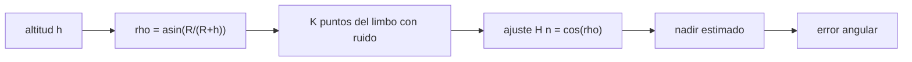

# B87-C04 — Sensores terrestres

<!-- nav:top -->
[🏠 Programa](../../../../README.md) · [📚 Bloque B87](../../../tronco-comun/B87-sensores-y-control-de-actitud.md) · [← Anterior: B87-C03 — Sensores solares](../B87-C03-sensores-solares/CLASE.md) · [Siguiente: B87-C05 — Magnetómetros →](../B87-C05-magnetometros/CLASE.md)
<!-- /nav -->

## 1. Ubicación, nivel y alcance

Clase 4 del bloque B87. Nivel N3. Un sensor de horizonte (o sensor terrestre) mide puntos del limbo de la Tierra y de ellos obtiene la dirección del nadir. Es el segundo sensor de vector del bloque. Aquí modelas una Tierra esférica, el radio angular `ρ = asin(R/(R+h))`, `K` puntos del limbo con ruido y el ajuste de la dirección del nadir. Los datos son sintéticos: un limbo con error angular gaussiano de `0,05°` por eje, semilla fija; el radio terrestre es un valor adoptado de ejemplo.

## 2. Por qué esta clase existe

Para apuntar una antena o una cámara hacia la Tierra hace falta el nadir. La decisión central: **¿cuántos puntos del limbo y qué precisión se necesitan, y cuánto cambia el resultado con la altitud y con un error en el radio angular supuesto?** Una sorpresa: el error de nadir casi no depende de la altitud.

## 3. Lo que podrás hacer al terminar

1. Calcular el radio angular de la Tierra a una altitud dada.
2. Ajustar la dirección del nadir a `K` puntos del limbo con mínimos cuadrados.
3. Predecir el error de nadir `2σ/√K` y comprobarlo con Monte Carlo.
4. Explicar por qué el error de nadir no depende de `ρ` y por qué la altitud casi no se observa.
5. Cuantificar el efecto de suponer una altitud errónea.
6. Separar lo sintético de lo consultado y de lo no consultado.

La evidencia es la **curva de error de nadir frente a la altitud y al número de puntos del limbo** del ejercicio 12 (sección 20).

## 4. Con qué llegas y cómo comprobarlo

1. ¿Qué es el radio angular de la Tierra vista desde un satélite?
2. ¿Qué es el limbo?
3. ¿Qué es el nadir?
4. ¿Cómo se ajusta un vector con mínimos cuadrados?
5. ¿Qué es una simulación de Monte Carlo?

<details>
<summary>Ver respuestas</summary>

1. El semiángulo del cono que la contiene: `sin ρ = R/(R+h)`. 2. El borde aparente del disco terrestre. 3. La dirección del satélite al centro de la Tierra. 4. Resolviendo `H n ≈ y` con la pseudoinversa. 5. Repetir un cálculo con entradas sorteadas para medir su dispersión.
</details>

Con cuatro o cinco aciertos, sigue; si no, repasa los prerrequisitos.

## 5. Un caso de contexto y casos de referencia

A `500 km` de altitud `ρ = 68,0187°`. Con cuatro puntos del limbo y `σ = 0,05°` por eje, el error de nadir es `0,0495°` (teoría `0,0500°`). A `35 786 km` el disco mide solo `8,70°` de radio y el error es el mismo: `0,0496°`. Todo es **sintético**.

## 6. Vocabulario

El **radio angular** `ρ` cumple `sin ρ = R/(R+h)`. Un **punto del limbo** es una dirección `h_k` con `h_k·n = cos ρ`. El **nadir** `n` es la dirección al centro terrestre. El **ajuste** resuelve `H n = cos ρ · 1` por mínimos cuadrados y normaliza. La **sensibilidad de altitud** es `dh/dρ = −R cos ρ/sin²ρ`. La **Tierra esférica** es un modelo sin achatamiento ni atmósfera.

## 7. Modelo mental: el limbo es un círculo alrededor del nadir



*Descripción textual:* la altitud fija el radio angular; los puntos del limbo están a ese ángulo del nadir, y un ajuste lineal por mínimos cuadrados devuelve el nadir y su error.

Analogía: como encontrar el centro de una moneda viendo cuatro puntos de su borde: el centro se ve bien aunque no se conozca con exactitud el radio. Límite: el borde de la Tierra tiene atmósfera y achatamiento, que el modelo ignora.

## 8. La explicación, paso a paso

### 8.1 Radio angular

`ρ = asin(R/(R+h))`. Para `R = 6378,137 km`: `70,22°` a 400 km, `68,02°` a 500 km, `62,69°` a 800 km, `54,06°` a 1500 km y `8,70°` a 35 786 km.

### 8.2 Ajuste del nadir

Cada punto del limbo cumple `h_k·n = cos ρ`. Apilando `K` puntos, `H n = cos ρ · 1` se resuelve con la pseudoinversa y `n̂ = n/|n|`. Con puntos equiespaciados en azimut, el error de las componentes perpendiculares a `n` es `σ√(2/K)` por eje y el error angular total `2σ/√K`, independiente de `ρ`. El laboratorio da `0,0495°` (K = 4), `0,0352°` (K = 8) y `0,0252°` (K = 16) frente a `0,0500°`, `0,0354°` y `0,0250°`.

### 8.3 Efecto de la altitud

| Altitud (km) | `ρ` (°) | Error de nadir (°) | km de altitud por grado de `ρ` |
|---|---|---|---|
| 400 | 70,218 | 0,0497 | 42,5 |
| 500 | 68,019 | 0,0495 | 48,5 |
| 800 | 62,692 | 0,0494 | 64,7 |
| 1500 | 54,057 | 0,0496 | 99,7 |
| 35 786 | 8,700 | 0,0496 | 4809 |

El nadir se estima igual de bien a toda altitud, pero la altitud derivada de `ρ` es mal observable: a 500 km, un grado de `ρ` equivale a `48,5 km`, y el ruido de `ρ` es `0,025°`.

### 8.4 Altitud supuesta errónea

Si se supone 450 km cuando la altitud es 500 km, `ρ` supuesto cambia `1,064°`, pero el error de nadir sigue siendo `0,0495°`: con puntos simétricos, un `ρ` mal supuesto desplaza todos los términos por igual y no sesga la dirección. No incluye atmósfera ni achatamiento, que sí producen sesgos reales y no se modelan.

## 9. Magnitudes, símbolos y unidades

| Símbolo | Qué es | Unidad | Valor / nota |
|---|---|---|---|
| `R` | radio terrestre (adoptado) | m | 6 378 137 |
| `h` | altitud | m | 500 000 |
| `ρ` | radio angular de la Tierra | rad (°) | 68,0187° a 500 km |
| `K` | puntos del limbo | — | 4, 8, 16 |
| `σ` | error angular del limbo, por eje | rad (°) | 0,05° |

## 10. Convenciones y referencias

Tierra esférica sin atmósfera. Tolerancias: error de nadir dentro del 8 % de `2σ/√K` y diferencia entre altitudes menor del 10 %. Cuaternión `q = [qx, qy, qz, qw]` con la parte escalar al final, `v_B = A(q) v_I`, producto tal que `A(q⊗p) = A(q) A(p)`, cinemática `q̇ = ½ [ω; 0] ⊗ q` con `ω` del cuerpo respecto del sistema inercial expresada en el cuerpo (la biblioteca [adcs_comun.py](../adcs_comun.py) del bloque lo comprueba). Sistema inercial `I` de **ejemplo** (ejes sin relación con J2000), órbita circular de dos cuerpos con radio terrestre `6 378 137 m` y `μ = 3,986004418 × 10¹⁴ m³/s²` como valores adoptados de ejemplo. Satélite **sintético** `I = diag(0,35; 0,40; 0,30) kg·m²` salvo que la clase diga otra cosa. Todo dato es sintético con semilla fija.

## 11. De dónde sale lo que afirmamos

| ID | Fuente | Localizador | Respalda | Estado |
|---|---|---|---|---|
| — | Relaciones estándar de dinámica de actitud, estimación y control usadas en esta clase (ecuaciones de Euler, cinemática de cuaterniones, problema de Wahba, filtro de Kalman multiplicativo, estabilidad de Lyapunov, modelos de sensores y actuadores) | — | las verifica el laboratorio con una segunda vía (conservación, comparación entre métodos, propagación independiente o Monte Carlo) | No consultada en una fuente concreta |
| — | Libros de texto de actitud y control (p. ej. Wertz, Markley–Crassidis, Sidi) y hojas de datos de fabricantes | — | — | No consultada |
| — | Modelo de limbo infrarrojo (CO₂ a 15 µm), efectos de la atmósfera y del achatamiento terrestre en sensores de horizonte | — | — | No consultada |

Límites: Esta clase no tiene fuente consultada propia: `R` es un valor adoptado de ejemplo y la geometría es estándar; el laboratorio la valida con la comparación entre el error simulado y `2σ/√K`.

## 12. Cómo ver el error de nadir

| Magnitud | Valor |
|---|---|
| `ρ` a 500 km | 68,0187° |
| error K = 4 (sim / teoría) | 0,0495° / 0,0500° |
| error K = 16 (sim / teoría) | 0,0252° / 0,0250° |
| error con altitud supuesta errónea | 0,0495° |

Descripción larga: el error de nadir se reduce como `1/√K` y no depende de la altitud ni de un `ρ` supuesto erróneo.

## 13. Ejemplo trabajado: nadir a 500 km con cuatro puntos del limbo

**Paso 1 · Radio angular.** `sin ρ = 6378,137/6878,137`, `ρ = 68,0187°`.

**Paso 2 · Medidas.** Cuatro puntos del limbo a 90° de azimut con `σ = 0,05°` por eje.

**Paso 3 · Ajuste.** `H n = cos ρ · 1` y `n̂ = n/|n|`.

**Paso 4 · Error.** `2σ/√4 = 0,0500°`; simulado `0,0495°`.

**Paso 5 · Comprobación.** Con 450 km supuestos, el error es `0,0495°`.

## 14. Distintas formas de describir la medida de un sensor de horizonte

**Puntos del limbo con ajuste de nadir** (esta clase). **Sensor de barrido cónico:** un haz que barre un cono y detecta los cruces del horizonte; los cruces de entrada y salida dan un acimut y un ángulo. **Sensor de matriz infrarroja:** una imagen del disco terrestre y su centroide. En los tres, el nadir sale de la geometría del disco.

## 15. Práctica guiada

**Ejercicio 1 · con los pasos indicados.** Calcula `ρ` para `h = 800 km`. *Pasos:* `R/(R+h)`, `asin`.

<details><summary>Solución comentada</summary>

`6378,137/7178,137 = 0,8886`; `ρ = 62,692°`.
</details>

**Ejercicio 2 · con una pista.** ¿Cuánto vale `ρ` a `h → ∞`?

<details><summary>Solución comentada</summary>

`sin ρ → 0`, `ρ → 0`: el disco se reduce a un punto.
</details>

**Ejercicio 3 · casi autónomo.** Calcula el error de nadir esperado con `K = 6` y `σ = 0,1°`. *Pista:* `2σ/√K`.

<details><summary>Solución comentada</summary>

`2·0,1/√6 = 0,0816°`.
</details>

## 16. Práctica autónoma, transferencia e integrador

**Ejercicio 4 · autónomo.** ¿Cuántos puntos del limbo hacen falta para reducir el error a la mitad respecto de `K = 4`?

<details><summary>Solución comentada</summary>

El error `∝ 1/√K`: se necesita `K = 16`; el laboratorio da `0,0252°` frente a `0,0495°`.
</details>

**Ejercicio 5 · autónomo.** A `500 km`, ¿cuántos kilómetros de altitud corresponden a un error de `0,025°` en `ρ`?

<details><summary>Solución comentada</summary>

`0,025 · 48,5 = 1,21 km`: la altitud casi no se observa.
</details>

**Ejercicio 6 · autónomo.** ¿Por qué el nadir no depende de la altitud supuesta en el modelo simétrico?

<details><summary>Solución comentada</summary>

Porque `ρ` supuesto desplaza todos los términos `cos ρ` por igual; el ajuste proyecta ese término común sobre `n` y la dirección no cambia (8.4).
</details>

**Ejercicio 7 · autónomo.** ¿Qué efecto tiene el achatamiento terrestre sobre el nadir?

<details><summary>Solución comentada</summary>

Introduce un sesgo que depende de la latitud; no está en el modelo esférico y no se cuantificó aquí.
</details>

**Ejercicio 8 · autónomo.** Con tres puntos del limbo a 120°, ¿se puede ajustar `n`?

<details><summary>Solución comentada</summary>

Sí, `H` es 3×3 y no singular si los puntos no son coplanares con el origen; sin redundancia, el ruido pasa entero al nadir.
</details>

**Ejercicio 9 · transferencia.** **Transferencia.** **Transferencia.** Un colega usa `0,05°` como precisión de un sensor real. ¿Es válido?

<details><summary>Solución comentada</summary>

No: `0,05°` es el error sintético del limbo; la precisión de un sensor real incluye atmósfera, calibración y efectos térmicos.
</details>

**Ejercicio 10 · transferencia.** **Transferencia.** **Transferencia.** ¿Por qué en órbita geoestacionaria el disco ocupa solo `8,7°` y aun así el nadir se obtiene igual de bien?

<details><summary>Solución comentada</summary>

Porque el error depende de la precisión del limbo y de `K`, no del tamaño del disco; lo que empeora es la sensibilidad de la altitud (4809 km por grado).
</details>

**Ejercicio 11 · transferencia.** **Transferencia.** **Transferencia.** ¿Qué combinarías con el sensor de horizonte para conocer la actitud completa?

<details><summary>Solución comentada</summary>

Otro vector no paralelo (el Sol, C03, o el campo magnético, C05): el nadir fija dos grados de libertad y el giro alrededor de él queda sin observar.
</details>

**Ejercicio 12 · integrador.** **Integrador.** **Integrador.** Elabora tu *curva de error de nadir*: la tabla de 8.3, el error frente a `K`, el caso de altitud supuesta errónea y la lista de consultado y sintético.

<details><summary>Solución comentada</summary>

Secciones 8.1–8.4, 12 y la salida del laboratorio.
</details>

## 17. Laboratorio: nadir por puntos del limbo

El script [sensor_horizonte.py](sensor_horizonte.py) sortea 2000 nadires por caso, genera `K` puntos del limbo equiespaciados con error gaussiano de `0,05°` por eje, ajusta el nadir por mínimos cuadrados, mide el error rms para cinco altitudes y para `K = 4, 8, 16` y repite con una altitud supuesta errónea (**comprueba** igualdad entre altitudes, acuerdo con `2σ/√K` en menos del 8 % e insensibilidad a la altitud supuesta). Usa la biblioteca común [adcs_comun.py](../adcs_comun.py) del bloque.

**Datos:** limbo y nadires **sintéticos** de semilla 20260514; radio terrestre adoptado de ejemplo. **Predice antes de ejecutar:** ¿Cambia el error de nadir al pasar de 400 km a 35 786 km? (No: es el mismo, `≈ 0,05°`.) **Ejecución del 2026-11-10 (Python 3.12.9, numpy 2.4.4):**

```text
Python 3.12.9 | numpy 2.4.4
B87-C04 sensor de horizonte | Tierra esferica; limbo medido con sigma = 0.05 deg por eje (SINTETICO, semilla 20260514)
alt [km]  rho [deg]  error nadir rms [deg]  desv. de rho [deg]  km de altitud por grado de rho
     400    70.2179                0.0497             0.0246          42.5
     500    68.0187                0.0495             0.0247          48.5
     800    62.6917                0.0494             0.0247          64.7
    1500    54.0568                0.0496             0.0248          99.7
   35786     8.7005                0.0496             0.0255        4808.9
K = 4 puntos: error rms = 0.0495 deg (teoria 2*sigma/sqrt(K) = 0.0500)
K = 8 puntos: error rms = 0.0352 deg (teoria 0.0354)
K = 16 puntos: error rms = 0.0252 deg (teoria 0.0250)
altitud supuesta 450 km en lugar de 500 km (rho cambia 1.064 deg): error de nadir = 0.0495 deg
Pruebas superadas.
```

```bash
python programa/clases/B87/B87-C04-sensores-terrestres/sensor_horizonte.py
```

**Límites:** Tierra esférica, limbo puntual, sin atmósfera, achatamiento ni ruido de escala; el eje de giro alrededor del nadir no se observa.

## 18. Errores frecuentes y cómo corregirlos

**Creer que un disco más grande da más precisión de nadir.** Revisa que el error es `2σ/√K` (8.2)

**Estimar la altitud desde `ρ` sin ver su sensibilidad.** Calcula `dh/dρ` (8.3)

**Suponer que un solo vector da la actitud completa.** Combina con otro vector (ejercicio 11)

## 19. Cómo sabrás que vas bien

Tras la sección 8: ¿qué error de nadir esperabas con `K = 4` y `σ = 0,05°`? Si dudas, repasa el ejemplo 13. Tras el laboratorio: ¿qué comprueba? (ver sección 17).

## 20. Qué entregas y cómo se evalúa

El producto es tu **curva de error de nadir frente a la altitud y al número de puntos del limbo** (ejercicio 12).

| Criterio | Inicial | En desarrollo | Logrado | Destacado |
|---|---|---|---|---|
| Conceptos | Los confunde | Parciales | Explica el método y su dominio | Explica los límites y las alternativas |
| Cálculo | Sin unidades | Con errores | Resultados con unidades y comprobados | Resuelve casos nuevos |
| Numérico | Sin comprobar | Un caso | Verifica con una segunda vía en varios casos | Interpreta las diferencias y los fallos |
| Fuentes | Sin fuente | Sin fecha | Fuentes con fecha y estado | Declara lo sintético y lo no consultado |
| Límites | No los nombra | Uno | Tres | Discute qué falta del modelo |

**Condiciones críticas (no se compensan con promedio):** rotular los datos como sintéticos; verificar cada resultado con una segunda vía; citar solo lo consultado.

## 21. Ética, seguridad y límites

Clase educativa: los modelos son simplificados y los datos son sintéticos; ningún resultado describe una misión real ni sustituye el diseño y la verificación de un subsistema de actitud con herramientas validadas, ensayos y revisión de especialistas.  Accesibilidad: tablas equivalentes a las gráficas, fórmulas en texto, ejercicios sin conexión.

## 22. Para cerrar y seguir

El nadir sale del ajuste de `K` puntos del limbo con error `2σ/√K` (`0,049°` con `K = 4`), igual a cualquier altitud. Queda una pregunta: ¿cómo medir el campo magnético y qué dirección útil entrega?

**Glosario español–inglés.** sensor de horizonte · *horizon sensor*; nadir · *nadir*; limbo · *limb*; radio angular · *angular radius*; barrido cónico · *conical scan*; Monte Carlo · *Monte Carlo*.

**Continuidad.** [B87-C05](../B87-C05-magnetometros/CLASE.md) trata los magnetómetros, el sensor de vector más usado en órbita baja.

**Referencias:** ver sección 11.

<!-- nav:bottom -->
---

[← Anterior: B87-C03 — Sensores solares](../B87-C03-sensores-solares/CLASE.md) · [📚 Bloque B87](../../../tronco-comun/B87-sensores-y-control-de-actitud.md) · [Siguiente: B87-C05 — Magnetómetros →](../B87-C05-magnetometros/CLASE.md)
<!-- /nav -->
