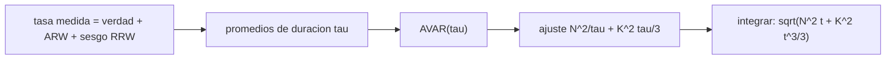

# B87-C06 — Giroscopios MEMS

<!-- nav:top -->
[🏠 Programa](../../../../README.md) · [📚 Bloque B87](../../../tronco-comun/B87-sensores-y-control-de-actitud.md) · [← Anterior: B87-C05 — Magnetómetros](../B87-C05-magnetometros/CLASE.md) · [Siguiente: B87-C07 — Rastreadores estelares →](../B87-C07-rastreadores-estelares/CLASE.md)
<!-- /nav -->

## 1. Ubicación, nivel y alcance

Clase 6 del bloque B87. Nivel N3. Un giroscopio MEMS mide la velocidad angular del cuerpo, pero su error crece con el tiempo al integrarla. Aquí modelas un giroscopio de un eje con ruido de paseo angular (ARW, ruido blanco de la tasa) y ruido de paseo de la tasa (RRW, el sesgo que se desplaza al azar), generas una serie sintética de 4 h a 10 Hz, calculas la varianza de Allan y de ella identificas los coeficientes. Todos los datos son sintéticos con semilla fija.

## 2. Por qué esta clase existe

Entre dos medidas de un sensor de vector, la actitud se propaga integrando el giroscopio, y esa integración se desvía. La decisión central: **¿cada cuánto hay que corregir con otro sensor, y qué parte de la deriva es ruido blanco y cuál sesgo?** La varianza de Allan separa ambos.

## 3. Lo que podrás hacer al terminar

1. Modelar un giroscopio con ARW y RRW en unidades coherentes (rad, s).
2. Calcular la desviación de Allan de una serie de tasa y reconocer sus pendientes `−1/2` y `+1/2`.
3. Ajustar `AVAR(τ) = N²/τ + K²τ/3` y obtener `N` y `K`.
4. Predecir el error de ángulo por integración `√(N²t + K²t³/3)` y compararlo con Monte Carlo.
5. Convertir entre `°/√h`, `°/h` y unidades SI.
6. Separar lo sintético de lo consultado y de lo no consultado.

La evidencia es la **curva de varianza de Allan con los coeficientes de ruido identificados** del ejercicio 12 (sección 20).

## 4. Con qué llegas y cómo comprobarlo

1. ¿Qué es el ruido blanco y cómo se integra?
2. ¿Qué es un paseo aleatorio?
3. ¿Qué es el sesgo de un giroscopio?
4. ¿Cuántos segundos tiene una `√h`?
5. ¿Qué es una varianza?

<details>
<summary>Ver respuestas</summary>

1. Ruido sin correlación; su integral es un paseo aleatorio cuya desviación crece como `√t`. 2. La suma de pasos independientes. 3. Una tasa distinta de cero con la entrada nula. 4. `√3600 = 60 √s`. 5. El valor medio del cuadrado de la desviación.
</details>

Con cuatro o cinco aciertos, sigue; si no, repasa los prerrequisitos.

## 5. Un caso de contexto y casos de referencia

Con `N = 0,2 °/√h` (`5,818e-05 rad/√s`) y `K = 2 °/h/√h` (`1,616e-07 rad/s/√s`), la curva de Allan baja con pendiente `−1/2`, alcanza un mínimo de `0,633 °/h` en `τ = 330 s` y vuelve a subir. El ajuste devuelve `N = 0,1999 °/√h` y `K = 2,203 °/h/√h`. Integrando solo el giroscopio, el error de ángulo a `600 s` es de unos `414″`. Todo es **sintético**.

## 6. Vocabulario

El **ARW** (*angle random walk*) `N` es el ruido blanco de la tasa, en `rad/√s`. El **RRW** (*rate random walk*) `K` es la deriva aleatoria del sesgo, en `rad/s/√s`. La **varianza de Allan** `AVAR(τ) = ½⟨(ȳ_{k+1} − ȳ_k)²⟩` de promedios de duración `τ`. La **inestabilidad de sesgo** es el mínimo de la curva. La **tasa de muestreo** es 10 Hz. El **ajuste** de `AVAR` es lineal en `N²` y `K²`.

## 7. Modelo mental: dos ruidos, una curva



*Descripción textual:* la tasa medida suma el ruido blanco y un sesgo que se desplaza; los promedios por duración `τ` dan la varianza de Allan, que se ajusta con dos términos y permite predecir la deriva del ángulo integrado.

Analogía: un reloj que se adelanta con un tic aleatorio (ARW) y que además cambia de ritmo a lo largo del día (RRW): para periodos cortos domina el tic y para largos domina el cambio de ritmo. Límite: el sesgo real de un MEMS tiene también ruido de destello (*flicker*) que este modelo no incluye.

## 8. La explicación, paso a paso

### 8.1 Modelo de la serie

La tasa medida es `y(t) = ω(t) + b(t) + n(t)`. El ruido blanco tiene `σ_n = N/√Δt` por muestra (aquí `Δt = 0,1 s`). El sesgo `b(t)` es un paseo aleatorio de coeficiente `K`. Se generaron `144 000` muestras (4 h). Equivalencias: `1 °/√h = 1/60 °/√s` y `1 °/h/√h = 1/(3600·60) °/s/√s`.

### 8.2 Varianza de Allan

`AVAR(τ) = N²/τ + K²τ/3`. La curva baja con pendiente `−1/2` para `τ` pequeño (dominio del ARW, donde `σ_Allan(1 s) = N`) y sube con pendiente `+1/2` para `τ` grande (RRW). Valores simulados (extracto):

| `τ` (s) | `σ_Allan` (°/h) |
|---|---|
| 0,1 | 37,91 |
| 2,9 | 6,93 |
| 43,5 | 1,647 |
| 647,7 | 0,763 |
| 1995,3 | 1,041 |

El mínimo es `0,633 °/h` en `τ ≈ 330 s` (la **inestabilidad de sesgo**).

### 8.3 Identificación y error de integración

Un ajuste lineal por mínimos cuadrados de `σ²` sobre `[1/τ, τ/3]` da `N = 0,1999 °/√h` (verdad 0,2) y `K = 2,203 °/h/√h` (verdad 2). Si solo se integra el giroscopio, el ángulo se desvía `σ_θ(t) = √(N²t + K²t³/3)`; a `t = 600 s` la teoría da `408″` y el Monte Carlo de 300 corridas `414″`.

### 8.4 Qué incluye y qué no

El modelo omite el ruido de destello, la dependencia con la temperatura, el factor de escala y la sensibilidad a la aceleración y a la vibración. Un giroscopio real tiene un sesgo de encendido que se estima y se corrige (C08, C10).

## 9. Magnitudes, símbolos y unidades

| Símbolo | Qué es | Unidad | Valor / nota |
|---|---|---|---|
| `N` | ARW | rad/√s (°/√h) | 5,818e-05 rad/√s = 0,2 °/√h |
| `K` | RRW | rad/s/√s | 1,616e-07 |
| `τ` | tiempo de promedio | s | 0,1 a 2000 s |
| `σ_Allan` | desviación de Allan | rad/s (°/h) | mínimo 0,633 °/h |
| `σ_θ` | error de ángulo por integración | rad (″) | 408″ a 600 s |

## 10. Convenciones y referencias

Serie **sintética** a `10 Hz` durante `4 h` (semilla 20260516). Varianza de Allan no solapada. Tolerancias: `N` dentro del 10 %, `K` dentro del 35 % (menos datos en `τ` grande) y error de integración dentro del 15 % de la teoría. Cuaternión `q = [qx, qy, qz, qw]` con la parte escalar al final, `v_B = A(q) v_I`, producto tal que `A(q⊗p) = A(q) A(p)`, cinemática `q̇ = ½ [ω; 0] ⊗ q` con `ω` del cuerpo respecto del sistema inercial expresada en el cuerpo (la biblioteca [adcs_comun.py](../adcs_comun.py) del bloque lo comprueba). Sistema inercial `I` de **ejemplo** (ejes sin relación con J2000), órbita circular de dos cuerpos con radio terrestre `6 378 137 m` y `μ = 3,986004418 × 10¹⁴ m³/s²` como valores adoptados de ejemplo. Satélite **sintético** `I = diag(0,35; 0,40; 0,30) kg·m²` salvo que la clase diga otra cosa. Todo dato es sintético con semilla fija.

## 11. De dónde sale lo que afirmamos

| ID | Fuente | Localizador | Respalda | Estado |
|---|---|---|---|---|
| — | Relaciones estándar de dinámica de actitud, estimación y control usadas en esta clase (ecuaciones de Euler, cinemática de cuaterniones, problema de Wahba, filtro de Kalman multiplicativo, estabilidad de Lyapunov, modelos de sensores y actuadores) | — | las verifica el laboratorio con una segunda vía (conservación, comparación entre métodos, propagación independiente o Monte Carlo) | No consultada en una fuente concreta |
| — | Libros de texto de actitud y control (p. ej. Wertz, Markley–Crassidis, Sidi) y hojas de datos de fabricantes | — | — | No consultada |
| — | IEEE Std 952 y 647 (giroscopios y varianza de Allan) y hojas de datos de giroscopios MEMS | — | — | No consultada |

Límites: Esta clase no tiene fuente consultada propia: la varianza de Allan y el modelo `N²/τ + K²τ/3` son relaciones estándar que no se consultaron en una fuente concreta; las valida el laboratorio recuperando los coeficientes con que se generó la serie y comparando la deriva con Monte Carlo.

## 12. Cómo ver la curva de Allan

| Magnitud | Valor |
|---|---|
| mínimo de la curva | 0,633 °/h |
| `τ` del mínimo | 330 s |
| `N` ajustado / verdadero | 0,1999 / 0,2 °/√h |
| `K` ajustado / verdadero | 2,203 / 2 °/h/√h |
| error de ángulo a 600 s (MC / teoría) | 414″ / 408″ |

Descripción larga: la curva baja con pendiente −1/2 hasta unos 300 s y sube con pendiente +1/2; los coeficientes se recuperan con la precisión esperada.

## 13. Ejemplo trabajado: deriva por integración a 600 s

**Paso 1 · Coeficientes.** `N = 5,818e-05 rad/√s`, `K = 1,616e-07 rad/s/√s`.

**Paso 2 · Términos.** `N² t = 2,031e-06 rad²`; `K² t³/3 = 1,880e-06 rad²`.

**Paso 3 · Suma.** `σ_θ = √(…) = 1,978e-03 rad = 408″`.

**Paso 4 · Monte Carlo.** 300 corridas de 600 s dan `414″`.

**Paso 5 · Comprobación.** Diferencia `1,4 %`, dentro de la tolerancia del 15 %.

## 14. Distintas formas de describir el error de un giroscopio

**Varianza de Allan** (esta clase): separa ruidos por escala de tiempo. **Densidad espectral de potencia:** la misma información en frecuencia. **Hoja de datos:** da ARW, inestabilidad de sesgo y densidad de ruido, a menudo con otras unidades; hay que convertirlas. En los tres casos el objetivo es predecir el error que se acumula entre correcciones.

## 15. Práctica guiada

**Ejercicio 1 · con los pasos indicados.** Convierte `0,2 °/√h` a `rad/√s`. *Pasos:* grados a radianes, `√h → √s`.

<details><summary>Solución comentada</summary>

`0,2·π/180 = 3,491×10⁻³ rad/√h`; `÷ 60 = 5,818e-05 rad/√s`.
</details>

**Ejercicio 2 · con una pista.** Calcula `σ_Allan(1 s)` para `N = 0,2 °/√h`, despreciando `K`. *Pista:* `σ² = N²/τ`.

<details><summary>Solución comentada</summary>

`σ = N/√τ = 0,2/60 = 3,33×10⁻³ °/√s = 12,0 °/h` a `τ = 1 s`.
</details>

**Ejercicio 3 · casi autónomo.** Con `N = 0,2 °/√h`, ¿cuánto se desvía el ángulo en `60 s` por ruido blanco?

<details><summary>Solución comentada</summary>

`σ_θ = N√t = (0,2/60) °/√s · √60 = 93,0″`.
</details>

## 16. Práctica autónoma, transferencia e integrador

**Ejercicio 4 · autónomo.** ¿Cuánto vale el tiempo `τ*` del mínimo si `N = 5,82×10⁻⁵` y `K = 1,616×10⁻⁷`? *Pista:* `d/dτ(N²/τ + K²τ/3) = 0`.

<details><summary>Solución comentada</summary>

`τ* = N√3/K = 624 s`; el mínimo observado fue `330 s` (la curva es plana cerca del mínimo).
</details>

**Ejercicio 5 · autónomo.** ¿Qué pendiente tiene la curva de Allan en un régimen de RRW dominante?

<details><summary>Solución comentada</summary>

`+1/2` en escala doble logarítmica (`σ ∝ √τ`).
</details>

**Ejercicio 6 · autónomo.** Un giroscopio tiene un sesgo constante de `0,05°/s`. ¿Qué error de ángulo da a 600 s, y se ve en la varianza de Allan?

<details><summary>Solución comentada</summary>

`0,05·600 = 30°`; un sesgo constante no aparece en la varianza de Allan (es la pendiente `+1` de la tasa constante, que se calibra, C08).
</details>

**Ejercicio 7 · autónomo.** ¿Qué pasa con `σ_θ` si el muestreo pasa de 10 a 100 Hz con el mismo `N`?

<details><summary>Solución comentada</summary>

No cambia: depende de `N` y no de `Δt`; sí cambia la desviación por muestra `N/√Δt` (crece `√10`).
</details>

**Ejercicio 8 · autónomo.** ¿Por qué el ajuste de `K` es más incierto que el de `N`?

<details><summary>Solución comentada</summary>

Porque `K` se ve solo en `τ` grande, donde quedan pocos promedios independientes (`T/τ`); la tolerancia de `K` es del 35 %.
</details>

**Ejercicio 9 · transferencia.** **Transferencia.** **Transferencia.** Un colega usa estos valores para un giroscopio comercial. ¿Es válido?

<details><summary>Solución comentada</summary>

No: `N` y `K` son sintéticos; un giroscopio real exige sus propios ensayos y su hoja de datos (no consultadas).
</details>

**Ejercicio 10 · transferencia.** **Transferencia.** **Transferencia.** ¿Cada cuánto debe corregirse la actitud con otro sensor si el error de ángulo permitido es `0,01°`?

<details><summary>Solución comentada</summary>

Con solo ARW, `N√t = 36″` da `t = (36″/N)²`; con `N = 12,00 ″/√s`, `t = 9,0 s` (el término `K` a ese tiempo es despreciable). En la práctica se corrige mucho antes.
</details>

**Ejercicio 11 · transferencia.** **Transferencia.** **Transferencia.** ¿Qué mide el giroscopio que no mide ningún sensor de vector?

<details><summary>Solución comentada</summary>

La variación de la actitud en el tiempo; los sensores de vector dan la actitud absoluta pero con ruido y sin tasa; el filtro (C10) los combina.
</details>

**Ejercicio 12 · integrador.** **Integrador.** **Integrador.** Elabora tu *curva de Allan*: los coeficientes verdaderos y ajustados, el mínimo, el error de integración a 600 s (Monte Carlo y teoría) y la lista de consultado y sintético.

<details><summary>Solución comentada</summary>

Secciones 8.1–8.4, 12 y la salida del laboratorio.
</details>

## 17. Laboratorio: varianza de Allan y deriva por integración

El script [giroscopio.py](giroscopio.py) simula 4 h de un giroscopio a 10 Hz con ARW `0,2 °/√h` y RRW `2 °/h/√h`, calcula la desviación de Allan en 45 duraciones, ajusta `N²/τ + K²τ/3` y compara la deriva de ángulo a 600 s con 300 corridas de Monte Carlo (**comprueba** `N` dentro del 10 %, `K` dentro del 35 % y la deriva dentro del 15 %). Usa la biblioteca común [adcs_comun.py](../adcs_comun.py) del bloque.

**Datos:** serie **sintética** (semilla 20260516), coeficientes de ejemplo; no hay datos de ningún giroscopio real. **Predice antes de ejecutar:** ¿Hacia qué `τ` esperas el mínimo de la curva? (unos 300 s.) **Ejecución del 2026-11-10 (Python 3.12.9, numpy 2.4.4):**

```text
Python 3.12.9 | numpy 2.4.4
B87-C06 giroscopio MEMS | serie SINTETICA de 4 h a 10 Hz (semilla 20260516)
parametros verdaderos: N = 0.2 deg/sqrt(h) = 5.8178e-05 rad/sqrt(s) ; K = 2.0 deg/h/sqrt(h) = 1.6160e-07 rad/s/sqrt(s)
tau [s]   sigma_Allan [deg/h]
     0.1       37.909
     0.5       16.941
     1.2       11.023
     2.9        6.930
     7.2        4.360
    17.7        2.801
    43.5        1.647
   107.0        1.113
   263.3        0.703
   647.7        0.763
  1593.2        0.883
minimo de la curva: 0.633 deg/h en tau = 329.7 s
ajuste AVAR = N^2/tau + K^2 tau/3: N = 0.1999 deg/sqrt(h) ; K = 2.2029 deg/h/sqrt(h)
error de angulo integrando solo el giroscopio a 600 s: Monte Carlo = 413.63 arcsec ; teoria = 407.92 arcsec
Pruebas superadas.
```

```bash
python programa/clases/B87/B87-C06-giroscopios-mems/giroscopio.py
```

**Límites:** solo ARW y RRW; sin ruido de destello, temperatura, escala ni sensibilidad a la vibración; un solo eje.

## 18. Errores frecuentes y cómo corregirlos

**Confundir `°/√h` con `°/h`.** Convierte unidades explícitamente (ejercicio 1)

**Creer que el mínimo es el sesgo constante.** El sesgo constante no se ve en Allan; se calibra (C08)

**Ajustar con pocos promedios.** Exige al menos 3 promedios por `τ` (sección 8.2)

## 19. Cómo sabrás que vas bien

Tras la sección 8: ¿qué mínimo y a qué `τ` esperabas? Si dudas, repasa el ejemplo 13. Tras el laboratorio: ¿qué comprueba? (ver sección 17).

## 20. Qué entregas y cómo se evalúa

El producto es tu **curva de varianza de Allan con los coeficientes de ruido identificados** (ejercicio 12).

| Criterio | Inicial | En desarrollo | Logrado | Destacado |
|---|---|---|---|---|
| Conceptos | Los confunde | Parciales | Explica el método y su dominio | Explica los límites y las alternativas |
| Cálculo | Sin unidades | Con errores | Resultados con unidades y comprobados | Resuelve casos nuevos |
| Numérico | Sin comprobar | Un caso | Verifica con una segunda vía en varios casos | Interpreta las diferencias y los fallos |
| Fuentes | Sin fuente | Sin fecha | Fuentes con fecha y estado | Declara lo sintético y lo no consultado |
| Límites | No los nombra | Uno | Tres | Discute qué falta del modelo |

**Condiciones críticas (no se compensan con promedio):** rotular los datos como sintéticos; verificar cada resultado con una segunda vía; citar solo lo consultado.

## 21. Ética, seguridad y límites

Clase educativa: los modelos son simplificados y los datos son sintéticos; ningún resultado describe una misión real ni sustituye el diseño y la verificación de un subsistema de actitud con herramientas validadas, ensayos y revisión de especialistas.  Accesibilidad: tablas equivalentes a las gráficas, fórmulas en texto, ejercicios sin conexión.

## 22. Para cerrar y seguir

El giroscopio de ejemplo tiene ARW `0,2 °/√h` y RRW `2 °/h/√h`; su mínimo de Allan es `0,63 °/h` a `330 s` y su error de ángulo a 600 s es `408″`. Queda una pregunta: ¿cómo se obtiene una referencia de actitud con precisión de segundos de arco?

**Glosario español–inglés.** giroscopio · *gyroscope*; paseo angular · *angle random walk*; paseo de tasa · *rate random walk*; varianza de Allan · *Allan variance*; inestabilidad de sesgo · *bias instability*; deriva · *drift*.

**Continuidad.** [B87-C07](../B87-C07-rastreadores-estelares/CLASE.md) trata los rastreadores estelares, que dan la actitud absoluta con la precisión más alta.

**Referencias:** ver sección 11.

<!-- nav:bottom -->
---

[← Anterior: B87-C05 — Magnetómetros](../B87-C05-magnetometros/CLASE.md) · [📚 Bloque B87](../../../tronco-comun/B87-sensores-y-control-de-actitud.md) · [Siguiente: B87-C07 — Rastreadores estelares →](../B87-C07-rastreadores-estelares/CLASE.md)
<!-- /nav -->
