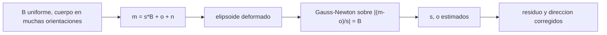

# B87-C08 — Calibración de sensores

<!-- nav:top -->
[🏠 Programa](../../../../README.md) · [📚 Bloque B87](../../../tronco-comun/B87-sensores-y-control-de-actitud.md) · [← Anterior: B87-C07 — Rastreadores estelares](../B87-C07-rastreadores-estelares/CLASE.md) · [Siguiente: B87-C09 — Estimación de actitud →](../../../tronco-comun/B87-sensores-y-control-de-actitud.md#b87-c09)
<!-- /nav -->

## 1. Ubicación, nivel y alcance

Clase 8 del bloque B87. Nivel N3. Calibrar un sensor es estimar sus errores sistemáticos (sesgo, factor de escala, desalineación) para restarlos de las medidas. Aquí calibras un magnetómetro de tres ejes con sesgo y escala por eje, con mínimos cuadrados no lineales (Gauss–Newton) sobre la condición de que el módulo del campo medido sea constante, y calibras el sesgo de un giroscopio con el satélite en reposo. Todos los datos son sintéticos con semilla fija.

## 2. Por qué esta clase existe

Un magnetómetro sin calibrar con `3000 nT` de sesgo da errores de dirección de varios grados (C05), mayores que los del ruido. La decisión central: **¿qué error sistemático se puede estimar a bordo sin otro sensor, con qué maniobra y cuánto mejora la medida?** Una previa: ¿qué se puede calibrar y qué no es observable?

## 3. Lo que podrás hacer al terminar

1. Escribir el modelo `m = s ⊙ B + o + n` del magnetómetro.
2. Plantear el residuo `|(m − o)/s| − B` y resolverlo por Gauss–Newton.
3. Estimar sesgo y escala con precisión de decenas de nanoteslas y milésimas.
4. Medir la mejora en el residuo de módulo y en el error de dirección.
5. Estimar el sesgo de un giroscopio con el satélite en reposo y su incertidumbre `σ/√N`.
6. Separar lo sintético de lo consultado y de lo no consultado.

La evidencia es la **informe de residuos antes y después de la calibración** del ejercicio 12 (sección 20).

## 4. Con qué llegas y cómo comprobarlo

1. ¿Qué es un mínimo cuadrado no lineal?
2. ¿Qué es una iteración de Gauss–Newton?
3. ¿Qué es el factor de escala de un sensor?
4. ¿Por qué el módulo del campo es una buena restricción?
5. ¿Cuánto baja la incertidumbre de una media de `N` datos independientes?

<details>
<summary>Ver respuestas</summary>

1. Minimizar `Σ r_k(p)²` con `r` no lineal en los parámetros `p`. 2. Linealizar el residuo, resolver `J Δp = −r` y actualizar `p`. 3. El cociente entre lo que lee y la magnitud real. 4. Porque no depende de la orientación del cuerpo: los puntos de medida están sobre una esfera. 5. Como `1/√N`.
</details>

Con cuatro o cinco aciertos, sigue; si no, repasa los prerrequisitos.

## 5. Un caso de contexto y casos de referencia

El magnetómetro sintético tiene escalas `(1,03; 0,97; 1,01)` y sesgo `(3000; −2000; 1000) nT`. Con 600 medidas en orientaciones aleatorias, Gauss–Newton converge en 6 iteraciones y recupera escalas `(1,0298; 0,9700; 1,0103)` y sesgo `(3013; -2004; 1004) nT`. El error de dirección baja de `5,30°` a `0,25°`. Todo es **sintético**.

## 6. Vocabulario

El **modelo del sensor** es `m = s ⊙ B + o + n` (producto por eje). El **sesgo** `o` es un desplazamiento y la **escala** `s` un factor por eje. El **residuo de módulo** es `|(m − o)/s| − B`. **Gauss–Newton** resuelve el ajuste iterando con el jacobiano. La **observabilidad** exige orientaciones variadas que cubran la esfera. El **sesgo de giroscopio** se estima como la media de la tasa con el cuerpo quieto.

## 7. Modelo mental: una esfera de medidas deformada



*Descripción textual:* con el campo constante y el cuerpo en muchas orientaciones, las medidas ideales caen sobre una esfera; el sesgo la desplaza y la escala la deforma en elipsoide, y el ajuste devuelve los parámetros que la devuelven a esfera.

Analogía: un reloj con la hora adelantada y que corre a otro ritmo: con dos referencias horarias se estiman ambos defectos y se corrige la lectura. Límite: aquí la referencia es el módulo del campo y no hay referencia del sentido del campo, de modo que no se calibra la desalineación entre ejes sin otra información.

## 8. La explicación, paso a paso

### 8.1 Modelo y residuo

`m_k = s ⊙ B_k + o + n_k`. Con `|B_k| = B` constante, el residuo es `r_k = |(m_k − o)/s| − B` y los parámetros son `p = (s₁,s₂,s₃,o₁,o₂,o₃)`. El jacobiano tiene `∂r/∂s_i = −y_i²/(s_i |y|)` y `∂r/∂o_i = −y_i/(s_i |y|)`, con `y = (m − o)/s`.

### 8.2 Gauss–Newton

Se parte de `s = 1`, `o = 0` y se resuelve `J Δp = −r` por mínimos cuadrados en cada paso. El rms del residuo baja `2229 → 224 → 98 nT` y se detiene cuando `|Δp| < 10⁻¹⁴` tras 6 iteraciones.

### 8.3 Resultado

| Parámetro | Verdad | Estimado |
|---|---|---|
| escala x | 1,0300 | 1,02981 |
| escala y | 0,9700 | 0,97004 |
| escala z | 1,0100 | 1,01027 |
| sesgo x (nT) | 3000 | 3012,7 |
| sesgo y (nT) | −2000 | -2004,0 |
| sesgo z (nT) | 1000 | 1004,2 |

El residuo de módulo pasa de `2229 nT` a `98 nT` (el ruido por eje es 100 nT) y el error de dirección de `5,30°` a `0,25°`.

### 8.4 Giroscopio en reposo y límites

Con el satélite quieto, la media de la tasa es el sesgo: `0,0500 °/s` frente a `0,0500 °/s`, con una incertidumbre de `σ/√N = 1,55 °/h` tras 60 s a 10 Hz. Quedan fuera la desalineación entre ejes, la dependencia con la temperatura y el hierro blando; y la calibración solo es observable si las orientaciones cubren la esfera (si el cuerpo no gira, no hay solución).

## 9. Magnitudes, símbolos y unidades

| Símbolo | Qué es | Unidad | Valor / nota |
|---|---|---|---|
| `s` | factores de escala por eje | — | 1,03; 0,97; 1,01 |
| `o` | sesgo por eje | T (nT) | 3000; −2000; 1000 nT |
| `B` | módulo del campo (sintético, constante) | T | 34 µT |
| `r_k` | residuo de módulo | T | rms 98 nT |
| `b_g` | sesgo del giroscopio | rad/s (°/s) | 0,05 °/s |

## 10. Convenciones y referencias

Campo uniforme y constante de `34 µT` visto desde un cuerpo en 600 orientaciones aleatorias (semilla 20260518); sin desalineación entre ejes. Tolerancias: escalas a `0,002`, sesgos a `100 nT`, residuo `÷ 5`, error de dirección `÷ 3`, sesgo del giroscopio a `5σ/√N`. Cuaternión `q = [qx, qy, qz, qw]` con la parte escalar al final, `v_B = A(q) v_I`, producto tal que `A(q⊗p) = A(q) A(p)`, cinemática `q̇ = ½ [ω; 0] ⊗ q` con `ω` del cuerpo respecto del sistema inercial expresada en el cuerpo (la biblioteca [adcs_comun.py](../adcs_comun.py) del bloque lo comprueba). Sistema inercial `I` de **ejemplo** (ejes sin relación con J2000), órbita circular de dos cuerpos con radio terrestre `6 378 137 m` y `μ = 3,986004418 × 10¹⁴ m³/s²` como valores adoptados de ejemplo. Satélite **sintético** `I = diag(0,35; 0,40; 0,30) kg·m²` salvo que la clase diga otra cosa. Todo dato es sintético con semilla fija.

## 11. De dónde sale lo que afirmamos

| ID | Fuente | Localizador | Respalda | Estado |
|---|---|---|---|---|
| — | Relaciones estándar de dinámica de actitud, estimación y control usadas en esta clase (ecuaciones de Euler, cinemática de cuaterniones, problema de Wahba, filtro de Kalman multiplicativo, estabilidad de Lyapunov, modelos de sensores y actuadores) | — | las verifica el laboratorio con una segunda vía (conservación, comparación entre métodos, propagación independiente o Monte Carlo) | No consultada en una fuente concreta |
| — | Libros de texto de actitud y control (p. ej. Wertz, Markley–Crassidis, Sidi) y hojas de datos de fabricantes | — | — | No consultada |
| — | Algoritmos de calibración de magnetómetros publicados (TWOSTEP, elipsoide) y procedimientos de calibración de giroscopios en banco | — | — | No consultada |

Límites: Esta clase no tiene fuente consultada propia: el ajuste por Gauss–Newton y la estimación del sesgo del giroscopio no se consultaron en una fuente concreta; el laboratorio las valida recuperando los parámetros con los que se generaron los datos.

## 12. Cómo ver la mejora

| Magnitud | Valor |
|---|---|
| residuo rms de módulo (antes → después) | 2229 → 98 nT |
| error de dirección (antes → después) | 5,30° → 0,25° |
| iteraciones | 6 |
| sesgo del giroscopio (estimado) | 0,0500 °/s |

Descripción larga: el residuo cae de 2229 nT al nivel del ruido y el error de dirección baja unas 20 veces.

## 13. Ejemplo trabajado: calibrar el magnetómetro

**Paso 1 · Datos.** 600 vectores `m` en orientaciones aleatorias, ruido de 100 nT.

**Paso 2 · Residuo inicial.** `s = 1`, `o = 0`: `2229 nT` rms.

**Paso 3 · Iteración.** `J Δp = −r`; tras 6 iteraciones el residuo vale `98 nT`.

**Paso 4 · Parámetros.** Escala `(1,0298; 0,9700; 1,0103)`; sesgo `(3013; -2004; 1004) nT`.

**Paso 5 · Comprobación.** El error de dirección baja a `0,25°`, cerca del límite por ruido `σ√2/B = 0,24°`.

## 14. Distintas formas de describir la calibración

**Ajuste de módulo** (esta clase): no necesita actitud. **Ajuste con actitud conocida:** compara `m` con `A B_ref` y estima también la desalineación. **Calibración en línea:** se incluye el sesgo en el estado del filtro (C10). El giroscopio se calibra con el cuerpo quieto o con el filtro.

## 15. Práctica guiada

**Ejercicio 1 · con los pasos indicados.** Un sensor lee `|m| = 34,5 µT` con campo real de `34 µT`, sin sesgo. ¿Cuál es el factor de escala si es igual en los tres ejes?

<details><summary>Solución comentada</summary>

`s = 34,5/34 = 1,0147`.
</details>

**Ejercicio 2 · con una pista.** Con sesgo `o = (3000; 0; 0) nT` y campo de `34 µT` en `x`, ¿qué lee el eje `x`?

<details><summary>Solución comentada</summary>

`34 000 + 3000 = 37 000 nT` (con escala 1).
</details>

**Ejercicio 3 · casi autónomo.** Calcula el error de dirección por un sesgo `3000 nT` perpendicular al campo de `34 µT`. *Pista:* `atan(b/B)`.

<details><summary>Solución comentada</summary>

`atan(3/34) = 5,04°`.
</details>

## 16. Práctica autónoma, transferencia e integrador

**Ejercicio 4 · autónomo.** ¿Cuántas orientaciones necesita en mínimo el ajuste (6 parámetros)?

<details><summary>Solución comentada</summary>

Al menos 6 ecuaciones independientes; en la práctica, centenares distribuidas por la esfera (aquí 600).
</details>

**Ejercicio 5 · autónomo.** ¿Qué pasa si el cuerpo solo gira alrededor de `z`?

<details><summary>Solución comentada</summary>

Las medidas cubren un círculo; el sesgo y la escala en `z` no son observables y el ajuste queda mal condicionado.
</details>

**Ejercicio 6 · autónomo.** Con `σ = 100 nT`, ¿qué residuo rms mínimo esperas tras calibrar?

<details><summary>Solución comentada</summary>

Del orden de `σ = 100 nT` por eje (el módulo tiene ruido ~ `σ`): el laboratorio da `98 nT`.
</details>

**Ejercicio 7 · autónomo.** ¿Qué incertidumbre tiene el sesgo del giroscopio tras 120 s a 10 Hz con `σ_n = 5,8×10⁻⁴ rad/s`?

<details><summary>Solución comentada</summary>

`σ/√1200 = 1,10 °/h`; mejora con `√t`.
</details>

**Ejercicio 8 · autónomo.** ¿Por qué no basta calibrar una vez antes del lanzamiento?

<details><summary>Solución comentada</summary>

Porque el sesgo y la escala cambian con la temperatura, el envejecimiento y el campo de los equipos a bordo; hay que recalibrar en órbita.
</details>

**Ejercicio 9 · transferencia.** **Transferencia.** **Transferencia.** Un colega afirma que el residuo de `98 nT` prueba que el sensor real está calibrado. ¿Es válido?

<details><summary>Solución comentada</summary>

No: son datos sintéticos con el modelo exacto con el que se generaron; un sensor real tiene desalineación, hierro blando y variación térmica no modelados.
</details>

**Ejercicio 10 · transferencia.** **Transferencia.** **Transferencia.** ¿Cómo se calibra el magnetómetro de un cubesat en órbita?

<details><summary>Solución comentada</summary>

Se hace girar al satélite (o se aprovecha su rotación) para cubrir la esfera y se ajusta el modelo, comparando con un modelo de campo; los detalles de una misión real no se consultaron aquí.
</details>

**Ejercicio 11 · transferencia.** **Transferencia.** **Transferencia.** ¿Por qué estimar el sesgo del giroscopio dentro del filtro es mejor que con el cuerpo quieto?

<details><summary>Solución comentada</summary>

Porque el sesgo deriva (RRW, C06) y el filtro lo sigue con las medidas de los otros sensores sin detener el satélite (C10).
</details>

**Ejercicio 12 · integrador.** **Integrador.** **Integrador.** Elabora tu *informe de residuos antes y después*: tabla de parámetros, residuos, errores de dirección, sesgo del giroscopio y lista de consultado y sintético.

<details><summary>Solución comentada</summary>

Secciones 8.1–8.4, 12 y la salida del laboratorio.
</details>

## 17. Laboratorio: calibración del magnetómetro y del giroscopio

El script [calibracion.py](calibracion.py) genera 600 medidas de un campo constante de `34 µT` en orientaciones aleatorias con sesgo `(3000; −2000; 1000) nT`, escalas `(1,03; 0,97; 1,01)` y ruido de `100 nT`; ajusta con Gauss–Newton; mide el residuo y el error de dirección antes y después; y estima el sesgo de un giroscopio en reposo durante 60 s (**comprueba** escalas a `0,002`, sesgos a `100 nT`, mejora de `5×` y `3×` y sesgo del giroscopio a `5σ/√N`). Usa la biblioteca común [adcs_comun.py](../adcs_comun.py) del bloque.

**Datos:** medidas **sintéticas** de semilla 20260518; el campo es uniforme y los errores son de ejemplo. **Predice antes de ejecutar:** ¿Qué residuo rms esperas después de calibrar? (cerca del ruido, 100 nT.) **Ejecución del 2026-11-10 (Python 3.12.9, numpy 2.4.4):**

```text
Python 3.12.9 | numpy 2.4.4
B87-C08 calibracion | magnetometro y giroscopio SINTETICOS (semilla 20260518)
verdad: escalas = [1.03 0.97 1.01] ; sesgo = [ 3000. -2000.  1000.] nT
estimado: escalas = [1.02981 0.97004 1.01027] ; sesgo = [ 3012.7 -2004.   1004.2] nT
iteraciones Gauss-Newton = 6 ; rms de |m|-B: 2228.6 -> 223.9 -> 98.0 -> 98.0 -> 98.0 nT
residuo rms de |m| - B: antes = 2228.6 nT ; despues = 98.0 nT (ruido = 100 nT por eje)
error de direccion rms: antes = 5.296 deg ; despues = 0.247 deg
giroscopio en reposo 60 s: sesgo verdadero = 0.0500 deg/s ; estimado = 0.0500 deg/s ; sigma de la media = 1.55 deg/h
Pruebas superadas.
```

```bash
python programa/clases/B87/B87-C08-calibracion-de-sensores/calibracion.py
```

**Límites:** sin desalineación entre ejes, sin hierro blando ni temperatura; orientaciones aleatorias uniformes, que en vuelo habría que conseguir con una maniobra.

## 18. Errores frecuentes y cómo corregirlos

**Calibrar con orientaciones que no cubren la esfera.** Comprueba la cobertura (ejercicio 5)

**Atribuir al sensor el error del modelo de campo.** Declara qué referencia usas (8.4)

**Olvidar que los parámetros derivan.** Recalibra o incluye el sesgo en el filtro (ejercicio 8)

## 19. Cómo sabrás que vas bien

Tras la sección 8: ¿qué mejora esperabas en la dirección? Si dudas, repasa el ejemplo 13. Tras el laboratorio: ¿qué comprueba? (ver sección 17).

## 20. Qué entregas y cómo se evalúa

El producto es tu **informe de residuos antes y después de la calibración** (ejercicio 12).

| Criterio | Inicial | En desarrollo | Logrado | Destacado |
|---|---|---|---|---|
| Conceptos | Los confunde | Parciales | Explica el método y su dominio | Explica los límites y las alternativas |
| Cálculo | Sin unidades | Con errores | Resultados con unidades y comprobados | Resuelve casos nuevos |
| Numérico | Sin comprobar | Un caso | Verifica con una segunda vía en varios casos | Interpreta las diferencias y los fallos |
| Fuentes | Sin fuente | Sin fecha | Fuentes con fecha y estado | Declara lo sintético y lo no consultado |
| Límites | No los nombra | Uno | Tres | Discute qué falta del modelo |

**Condiciones críticas (no se compensan con promedio):** rotular los datos como sintéticos; verificar cada resultado con una segunda vía; citar solo lo consultado.

## 21. Ética, seguridad y límites

Clase educativa: los modelos son simplificados y los datos son sintéticos; ningún resultado describe una misión real ni sustituye el diseño y la verificación de un subsistema de actitud con herramientas validadas, ensayos y revisión de especialistas.  Accesibilidad: tablas equivalentes a las gráficas, fórmulas en texto, ejercicios sin conexión.

## 22. Para cerrar y seguir

El ajuste de módulo recupera sesgo y escala del magnetómetro (error `< 13 nT` y `< 0,001`) y baja el error de dirección de `5,3°` a `0,25°`. Queda una pregunta: ¿cómo se combinan varios sensores en una sola estimación de actitud?

**Glosario español–inglés.** calibración · *calibration*; sesgo · *bias*; factor de escala · *scale factor*; Gauss–Newton · *Gauss–Newton*; observabilidad · *observability*; residuo · *residual*.

**Continuidad.** [B87-C09](../B87-C09-estimacion-de-actitud/CLASE.md) presenta la estimación de actitud con varios vectores (problema de Wahba).

**Referencias:** ver sección 11.

<!-- nav:bottom -->
---

[← Anterior: B87-C07 — Rastreadores estelares](../B87-C07-rastreadores-estelares/CLASE.md) · [📚 Bloque B87](../../../tronco-comun/B87-sensores-y-control-de-actitud.md) · [Siguiente: B87-C09 — Estimación de actitud →](../../../tronco-comun/B87-sensores-y-control-de-actitud.md#b87-c09)
<!-- /nav -->
