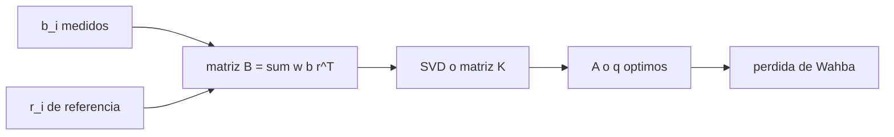

# B87-C09 — Estimación de actitud

<!-- nav:top -->
[🏠 Programa](../../../../README.md) · [📚 Bloque B87](../../../tronco-comun/B87-sensores-y-control-de-actitud.md) · [← Anterior: B87-C08 — Calibración de sensores](../B87-C08-calibracion-de-sensores/CLASE.md) · [Siguiente: B87-C10 — Filtro de actitud →](../B87-C10-filtro-de-actitud/CLASE.md)
<!-- /nav -->

## 1. Ubicación, nivel y alcance

Clase 9 del bloque B87. Nivel N3. Con dos o más vectores medidos en el cuerpo (Sol, campo magnético, nadir) y conocidos en el sistema inercial, la actitud sale de resolver el **problema de Wahba**: hallar la rotación que mejor los alinea. Esta clase compara TRIAD, el SVD ponderado y el método q de Davenport. Todos los datos son sintéticos: una actitud aleatoria, vectores de referencia de ejemplo fijos en el sistema inercial y ruido angular de `0,5°` (Sol) y `1,0°` (campo).

## 2. Por qué esta clase existe

Cada sensor de vector da solo dos grados de libertad; la actitud completa exige combinarlos. La decisión central: **¿qué método usar, cómo ponderar el sensor mejor y cuánto importa el ángulo entre los vectores?** TRIAD es simple pero descarta información; el SVD y el método q usan todos los vectores de forma óptima.

## 3. Lo que podrás hacer al terminar

1. Plantear la función de pérdida de Wahba `L(A) = ½ Σ w_i |b_i − A r_i|²`.
2. Resolverla con SVD (corrigiendo el determinante) y con el método q de Davenport.
3. Construir TRIAD con un vector primario y uno secundario.
4. Elegir pesos `w_i = 1/σ_i²` y medir el error rms con Monte Carlo.
5. Explicar la influencia del ángulo de separación entre los vectores.
6. Separar lo sintético de lo consultado y de lo no consultado.

La evidencia es la **comparación de métodos de estimación de actitud con la pérdida de Wahba** del ejercicio 12 (sección 20).

## 4. Con qué llegas y cómo comprobarlo

1. ¿Qué es una matriz de rotación?
2. ¿Qué es el SVD?
3. ¿Qué es un autovalor máximo?
4. ¿Por qué ponderar por `1/σ²`?
5. ¿Qué es el ángulo de separación entre dos vectores?

<details>
<summary>Ver respuestas</summary>

1. Una matriz ortogonal con determinante `+1`. 2. La factorización `B = U S Vᵀ` con `U, V` ortogonales. 3. El mayor valor propio de una matriz simétrica; su autovector da el máximo de la forma cuadrática. 4. Porque da más peso al sensor más preciso. 5. El ángulo cuyo coseno es su producto escalar.
</details>

Con cuatro o cinco aciertos, sigue; si no, repasa los prerrequisitos.

## 5. Un caso de contexto y casos de referencia

Con Sol y campo separados `70°`, el error rms de 3000 casos es `1,275°` con TRIAD (Sol primario), `1,549°` con TRIAD (campo primario) y `1,258°` con el SVD ponderado, que coincide con el método q (diferencia máxima `2,7e-13°`). Todo es **sintético**.

## 6. Vocabulario

La **pérdida de Wahba** es `L(A) = ½ Σ w_i |b_i − A r_i|²`. El **SVD de Wahba** factoriza `B = Σ w_i b_i r_iᵀ = U S Vᵀ` y toma `A = U diag(1, 1, det U det V) Vᵀ`. El **método q** halla el autovector de mayor autovalor de la matriz `K` de Davenport. **TRIAD** construye ternas ortonormales con dos vectores. El **vector primario** de TRIAD se respeta exactamente. La **separación** es el ángulo entre los dos vectores.

## 7. Modelo mental: de vectores medidos a una rotación óptima



*Descripción textual:* los vectores medidos y de referencia, ponderados, forman una matriz `B`; su SVD (o el autovector de `K`) da la rotación que minimiza la pérdida.

Analogía: como alinear dos mapas con varias marcas: con dos marcas bien separadas la alineación es firme, con marcas casi juntas el giro alrededor de ellas queda incierto. Límite: aquí los ruidos son independientes y gaussianos, y no hay sesgos.

## 8. La explicación, paso a paso

### 8.1 La pérdida y la matriz B

`L(A) = ½ Σ w_i |b_i − A r_i|² = ½ Σ w_i − tr(A Bᵀ)` con `B = Σ w_i b_i r_iᵀ`. Minimizar `L` es maximizar `tr(A Bᵀ)`. Con pesos `w_i = 1/σ_i²` y los dos vectores del ejemplo, la pérdida media en 3000 casos es `0,498` (cerca de 1, el número de grados de libertad de ruido por dos vectores).

### 8.2 SVD y método q

El SVD `B = U S Vᵀ` da `A = U diag(1, 1, det U · det V) Vᵀ`. El método q arma `K = [[B + Bᵀ − tr B · I, z],[zᵀ, tr B]]` con `z = (B₂₃ − B₃₂, B₃₁ − B₁₃, B₁₂ − B₂₁)` y toma el autovector de mayor autovalor como `q`. Son equivalentes: la actitud difiere `2,7e-13°` como máximo.

### 8.3 TRIAD frente a SVD

| Método | Error rms (°) |
|---|---|
| TRIAD, Sol primario | 1,275 |
| TRIAD, campo primario | 1,549 |
| SVD ponderado | 1,258 |
| método q ponderado | 1,258 |

TRIAD con el sensor peor como primario cuesta `23 %` más de error; el SVD pondera por precisión y gana.

### 8.4 Efecto de la separación

| Separación (°) | Error SVD (°) |
|---|---|
| 20 | 3,368 |
| 45 | 1,699 |
| 70 | 1,252 |
| 90 | 1,204 |

El error baja cuando la separación se acerca a 90°; con vectores casi paralelos el giro alrededor de ellos es mal observable.

## 9. Magnitudes, símbolos y unidades

| Símbolo | Qué es | Unidad | Valor / nota |
|---|---|---|---|
| `b_i`, `r_i` | vector medido (cuerpo) y de referencia (inercial) | — | unitarios |
| `w_i` | peso | 1/rad² | 1/σ² |
| `B` | matriz de actitud ponderada | — | 3×3 |
| `A`, `q` | actitud estimada | — | I → B |
| `L` | pérdida de Wahba | — | 0,498 media |

## 10. Convenciones y referencias

Vectores de referencia de ejemplo `r₁ = (0,6; 0,5; 0,62)/|·|` y `r₂` a la separación pedida. Ruido angular gaussiano por eje transversal: Sol `0,5°`, campo `1,0°`. Tolerancias: SVD frente a método q `< 10⁻⁶°`; SVD `≤` TRIAD (Sol). Cuaternión `q = [qx, qy, qz, qw]` con la parte escalar al final, `v_B = A(q) v_I`, producto tal que `A(q⊗p) = A(q) A(p)`, cinemática `q̇ = ½ [ω; 0] ⊗ q` con `ω` del cuerpo respecto del sistema inercial expresada en el cuerpo (la biblioteca [adcs_comun.py](../adcs_comun.py) del bloque lo comprueba). Sistema inercial `I` de **ejemplo** (ejes sin relación con J2000), órbita circular de dos cuerpos con radio terrestre `6 378 137 m` y `μ = 3,986004418 × 10¹⁴ m³/s²` como valores adoptados de ejemplo. Satélite **sintético** `I = diag(0,35; 0,40; 0,30) kg·m²` salvo que la clase diga otra cosa. Todo dato es sintético con semilla fija.

## 11. De dónde sale lo que afirmamos

| ID | Fuente | Localizador | Respalda | Estado |
|---|---|---|---|---|
| S4 | M. D. Shuster, «A Survey of Attitude Representations», The Journal of the Astronautical Sciences 41(4), 439–517 (1993) (cita verificada 2026-11-10 mediante resultados de búsqueda; el artículo no se abrió) | referencia bibliográfica | recopila en una notación coherente los resultados conocidos sobre representaciones de la actitud (unas 79 páginas y 163 referencias según el resumen de búsqueda) | Cita consultada; contenido no consultado |
| — | Relaciones estándar de dinámica de actitud, estimación y control usadas en esta clase (ecuaciones de Euler, cinemática de cuaterniones, problema de Wahba, filtro de Kalman multiplicativo, estabilidad de Lyapunov, modelos de sensores y actuadores) | — | las verifica el laboratorio con una segunda vía (conservación, comparación entre métodos, propagación independiente o Monte Carlo) | No consultada en una fuente concreta |
| — | Libros de texto de actitud y control (p. ej. Wertz, Markley–Crassidis, Sidi) y hojas de datos de fabricantes | — | — | No consultada |
| — | Davenport (q-method), Shuster y Oh (QUEST), Wahba (1965) | — | — | No consultada |

Límites: De Shuster (S4) solo se verificó la cita de su estudio de representaciones; no se consultó el contenido ni los trabajos originales de Wahba, Davenport o QUEST. Las fórmulas se validan por equivalencia numérica entre métodos y por la pérdida.

## 12. Cómo comparar los métodos

| Magnitud | Valor |
|---|---|
| TRIAD (Sol primario) | 1,275° |
| TRIAD (campo primario) | 1,549° |
| SVD = método q | 1,258° |
| SVD a 20° / 90° | 3,37° / 1,20° |

Descripción larga: el SVD ponderado es el mejor de los cuatro; el error cae con la separación entre vectores.

## 13. Ejemplo trabajado: actitud con Sol y campo a 70°

**Paso 1 · Datos.** `b₁` (Sol, `σ = 0,5°`), `b₂` (campo, `σ = 1°`), pesos `4` y `1` en `1/deg²·` relativos (`1/σ²`).

**Paso 2 · Matriz.** `B = w₁ b₁ r₁ᵀ + w₂ b₂ r₂ᵀ`.

**Paso 3 · SVD.** `A = U diag(1,1,det) Vᵀ`.

**Paso 4 · Error.** rms `1,258°` en 3000 casos.

**Paso 5 · Comprobación.** El método q da lo mismo: diferencia `2,7e-13°`.

## 14. Distintas formas de describir la solución del problema de Wahba

**TRIAD:** determinista, dos vectores, no óptimo. **SVD (Markley):** robusto y exacto. **Método q (Davenport):** un autovector 4×4. **QUEST:** variante rápida del método q (no consultada). Todos minimizan lo mismo; el laboratorio compara tres.

## 15. Práctica guiada

**Ejercicio 1 · con los pasos indicados.** Calcula los pesos `1/σ²` para `σ_Sol = 0,5°` y `σ_B = 1°` en `1/rad²`. *Pasos:* `σ` en rad.

<details><summary>Solución comentada</summary>

`σ_Sol = 8,727×10⁻³`; `w = 13131`. `σ_B = 1,745×10⁻²`; `w = 3283`; razón 4.
</details>

**Ejercicio 2 · con una pista.** ¿Cuál es el vector primario de TRIAD si se quiere respetar el Sol? *Pista:* TRIAD respeta exactamente el primero.

<details><summary>Solución comentada</summary>

El Sol: `t₁ = b₁`, `t₂ = (b₁ × b₂)/|·|`.
</details>

**Ejercicio 3 · casi autónomo.** ¿Qué pérdida de Wahba da un ajuste exacto sin ruido?

<details><summary>Solución comentada</summary>

Cero: `b_i = A r_i` para todo `i`.
</details>

## 16. Práctica autónoma, transferencia e integrador

**Ejercicio 4 · autónomo.** ¿Cuántos grados de libertad de medida aportan dos vectores?

<details><summary>Solución comentada</summary>

Cuatro (dos por vector) frente a tres de la actitud: sobra uno, que permite una verificación de consistencia.
</details>

**Ejercicio 5 · autónomo.** ¿Qué ocurre si `r₁ ∥ r₂`?

<details><summary>Solución comentada</summary>

El giro alrededor de ese eje no es observable y `B` tiene rango 1: el error crece sin límite.
</details>

**Ejercicio 6 · autónomo.** El error con separación de 20° es `3,37°` y con 90° `1,20°`. ¿Cuál es el cociente?

<details><summary>Solución comentada</summary>

`2,80`; el error crece como `1/sin(separación)` aproximadamente.
</details>

**Ejercicio 7 · autónomo.** ¿Por qué el SVD necesita `det U · det V`?

<details><summary>Solución comentada</summary>

Para evitar una reflexión: `A` debe tener determinante `+1`, no `−1`.
</details>

**Ejercicio 8 · autónomo.** ¿Qué método usarías con tres vectores de precisión distinta?

<details><summary>Solución comentada</summary>

SVD o método q con pesos `1/σ²`; TRIAD solo usa dos.
</details>

**Ejercicio 9 · transferencia.** **Transferencia.** **Transferencia.** Un colega usa estos `1,26°` como precisión de una misión. ¿Es válido?

<details><summary>Solución comentada</summary>

No: los ruidos son sintéticos, sin sesgos, sin error de modelo de referencia y sin calibración.
</details>

**Ejercicio 10 · transferencia.** **Transferencia.** **Transferencia.** ¿Qué ocurre con el estimador si el Sol está en eclipse?

<details><summary>Solución comentada</summary>

Queda solo un vector (campo): la actitud no es completamente observable; se propaga con el giroscopio (C10).
</details>

**Ejercicio 11 · transferencia.** **Transferencia.** **Transferencia.** ¿Por qué un filtro supera al SVD de época en época?

<details><summary>Solución comentada</summary>

Porque combina la dinámica (giroscopio) con las medidas; el rms de `1,26°` por época baja a décimas de grado (C10).
</details>

**Ejercicio 12 · integrador.** **Integrador.** **Integrador.** Elabora tu *comparación de métodos de estimación*: tabla de 8.3 y 8.4, equivalencia SVD–método q, pérdida media y lista de consultado y sintético.

<details><summary>Solución comentada</summary>

Secciones 8.1–8.4, 12 y la salida del laboratorio.
</details>

## 17. Laboratorio: TRIAD, SVD y método q

El script [wahba.py](wahba.py) sortea 3000 actitudes, mide el Sol y el campo con ruido, estima con TRIAD (ambos órdenes), SVD y método q con pesos `1/σ²`, y repite para cuatro separaciones (**comprueba** equivalencia SVD–q `< 10⁻⁶°`, SVD mejor que TRIAD y error decreciente con la separación). Usa la biblioteca común [adcs_comun.py](../adcs_comun.py) del bloque.

**Datos:** actitudes, vectores y ruidos **sintéticos** de semilla 20260519. **Predice antes de ejecutar:** ¿Será mejor TRIAD con el Sol como primario o con el campo? (con el Sol, el sensor más preciso.) **Ejecución del 2026-11-10 (Python 3.12.9, numpy 2.4.4):**

```text
Python 3.12.9 | numpy 2.4.4
B87-C09 estimacion de actitud con dos vectores | SINTETICO (semilla 20260519): Sol 0.5 deg, campo 1.0 deg, separacion 70 deg
error rms de actitud (3000 casos, separacion de 70 deg):
  TRIAD (Sol primario)   = 1.2752 deg
  TRIAD (campo primario) = 1.5486 deg
  SVD ponderado (Wahba)  = 1.2576 deg
  metodo q ponderado     = 1.2576 deg
  diferencia maxima SVD - q = 2.72e-13 deg
  perdida de Wahba media (con pesos 1/sigma^2) = 0.498
separacion [deg]  error SVD [deg]  error TRIAD (Sol) [deg]
              20          3.3675                  3.3754
              45          1.6995                  1.7125
              70          1.2521                  1.2717
              90          1.2035                  1.2205
Pruebas superadas.
```

```bash
python programa/clases/B87/B87-C09-estimacion-de-actitud/wahba.py
```

**Límites:** dos vectores, ruido gaussiano independiente, sin sesgos, sin error del modelo de referencia; no se evalúa QUEST.

## 18. Errores frecuentes y cómo corregirlos

**Elegir como primario el sensor peor.** Usa el más preciso o, mejor, el SVD ponderado

**Olvidar la corrección de determinante.** Aplica `det U det V` (8.2)

**Usar vectores casi paralelos.** Revisa la separación (8.4)

## 19. Cómo sabrás que vas bien

Tras la sección 8: ¿qué método esperabas mejor? Si dudas, repasa el ejemplo 13. Tras el laboratorio: ¿qué comprueba? (ver sección 17).

## 20. Qué entregas y cómo se evalúa

El producto es tu **comparación de métodos de estimación de actitud con la pérdida de Wahba** (ejercicio 12).

| Criterio | Inicial | En desarrollo | Logrado | Destacado |
|---|---|---|---|---|
| Conceptos | Los confunde | Parciales | Explica el método y su dominio | Explica los límites y las alternativas |
| Cálculo | Sin unidades | Con errores | Resultados con unidades y comprobados | Resuelve casos nuevos |
| Numérico | Sin comprobar | Un caso | Verifica con una segunda vía en varios casos | Interpreta las diferencias y los fallos |
| Fuentes | Sin fuente | Sin fecha | Fuentes con fecha y estado | Declara lo sintético y lo no consultado |
| Límites | No los nombra | Uno | Tres | Discute qué falta del modelo |

**Condiciones críticas (no se compensan con promedio):** rotular los datos como sintéticos; verificar cada resultado con una segunda vía; citar solo lo consultado.

## 21. Ética, seguridad y límites

Clase educativa: los modelos son simplificados y los datos son sintéticos; ningún resultado describe una misión real ni sustituye el diseño y la verificación de un subsistema de actitud con herramientas validadas, ensayos y revisión de especialistas.  Accesibilidad: tablas equivalentes a las gráficas, fórmulas en texto, ejercicios sin conexión.

## 22. Para cerrar y seguir

El SVD y el método q dan la misma actitud, con `1,26°` de error rms con Sol y campo a 70°, mejor que TRIAD. Queda una pregunta: ¿cómo se combinan estas medidas con el giroscopio en un filtro?

**Glosario español–inglés.** problema de Wahba · *Wahba's problem*; TRIAD · *TRIAD*; método q · *q-method*; pérdida · *loss function*; vector primario · *primary vector*; separación · *separation angle*.

**Continuidad.** [B87-C10](../B87-C10-filtro-de-actitud/CLASE.md) presenta el filtro multiplicativo, que combina el giroscopio con estas medidas.

**Referencias:** ver sección 11.

<!-- nav:bottom -->
---

[← Anterior: B87-C08 — Calibración de sensores](../B87-C08-calibracion-de-sensores/CLASE.md) · [📚 Bloque B87](../../../tronco-comun/B87-sensores-y-control-de-actitud.md) · [Siguiente: B87-C10 — Filtro de actitud →](../B87-C10-filtro-de-actitud/CLASE.md)
<!-- /nav -->
