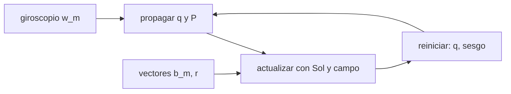

# B87-C10 — Filtro de actitud

<!-- nav:top -->
[🏠 Programa](../../../../README.md) · [📚 Bloque B87](../../../tronco-comun/B87-sensores-y-control-de-actitud.md) · [← Anterior: B87-C09 — Estimación de actitud](../B87-C09-estimacion-de-actitud/CLASE.md) · [Siguiente: B87-C11 — Ruedas de reacción →](../B87-C11-ruedas-de-reaccion/CLASE.md)
<!-- /nav -->

## 1. Ubicación, nivel y alcance

Clase 10 del bloque B87. Nivel N3. El filtro de Kalman extendido multiplicativo (MEKF) mantiene un cuaternión de actitud y estima el **error de actitud** (3 componentes) y el **sesgo del giroscopio** (3), combinando el giroscopio a 10 Hz con los vectores solar y magnético a 1 Hz. Aquí lo simulas durante 900 s con datos sintéticos (giro lento de ejemplo, sesgo verdadero `(0,05; −0,03; 0,02) °/s`, ruido de las clases C06 y C09) y lo comparas con integrar solo el giroscopio y con el SVD de época.

## 2. Por qué esta clase existe

Un giroscopio sin corregir se desvía decenas de grados en minutos; un vector solo da `~1°` por época. La decisión central: **¿cómo se combinan para obtener una actitud mejor que cada uno, y cómo se sabe que el filtro es honesto?** Una previa: ¿por qué se filtra el error y no el cuaternión?

## 3. Lo que podrás hacer al terminar

1. Plantear el estado de error `x = (δθ, Δb)` y su dinámica `δθ̇ = −ω̂×δθ − Δb − η_v`.
2. Propagar el cuaternión con el giroscopio corregido y la covarianza con `Φ = I + FΔt + ½(FΔt)²`.
3. Actualizar con vectores `z = b_m − Â r`, `H = [[Âr×], 0]` y reiniciar el error.
4. Estimar el sesgo del giroscopio y medir su error.
5. Comprobar la consistencia con el NEES.
6. Separar lo sintético de lo consultado y de lo no consultado.

La evidencia es la **comparación del error del filtro de actitud con la integración del giroscopio sola** del ejercicio 12 (sección 20).

## 4. Con qué llegas y cómo comprobarlo

1. ¿Qué es el filtro de Kalman?
2. ¿Por qué no se filtra el cuaternión directamente?
3. ¿Qué es el sesgo del giroscopio?
4. ¿Qué es una covarianza?
5. ¿Qué es el NEES?

<details>
<summary>Ver respuestas</summary>

1. Un estimador óptimo lineal que alterna propagación y actualización. 2. Porque tiene 4 números y 3 grados de libertad: la covarianza sería singular. 3. Una tasa constante que se suma a la medida (C06). 4. La matriz de varianzas y correlaciones del error. 5. El error normalizado al cuadrado `eᵀP⁻¹e`, de media igual a la dimensión si el filtro es consistente.
</details>

Con cuatro o cinco aciertos, sigue; si no, repasa los prerrequisitos.

## 5. Un caso de contexto y casos de referencia

Con error inicial de `5°`, el filtro baja a `0,14°` en 60 s y a un rms de `0,080°` en la segunda mitad. Solo con el giroscopio, el error llega a `26,0°` por el sesgo no corregido; el SVD por época da `1,18°`. El sesgo se estima con un error de `1,1 °/h` (verdadero `221 °/h`). Todo es **sintético**.

## 6. Vocabulario

El **estado nominal** es `(q̂, b̂)`. El **estado de error** es `(δθ, Δb)` con `A_true = (I − [δθ×]) Â`. La **propagación** usa `ω̂ = ω_m − b̂`. La **actualización** usa el residuo `z = b_m − Â r`. El **reinicio** aplica `δq = [δθ/2; 1]` y pone `δθ = 0`. El **NEES** mide consistencia. El **ruido de proceso** viene de ARW y RRW (C06).

## 7. Modelo mental: propagar con el giroscopio, corregir con los vectores



*Descripción textual:* el giroscopio propaga la actitud y la covarianza; cada segundo, las medidas de vector corrigen la actitud y el sesgo y se reinicia el error.

Analogía: navegar por estima (el giroscopio) y corregir la posición cada vez que se ve un faro (los vectores): la estima sola se desvía, el faro solo es ruidoso, juntos dan mejor posición. Límite: el filtro supone ruidos gaussianos y un modelo conocido de los sensores.

## 8. La explicación, paso a paso

### 8.1 Estado de error y dinámica

Con `A_true = (I − [δθ×]) Â` y `ω̂ = ω_m − b̂`: `δθ̇ = −[ω̂×]δθ − Δb − η_v`, `Δḃ = η_u`. Se discretiza con `Φ = I + F Δt + ½(FΔt)²`; `Q = diag(N² Δt · I₃, K² Δt · I₃)` con `N = 0,2 °/√h` y `K = 2 °/h/√h`.

### 8.2 Actualización y reinicio

Para cada vector (`σ_Sol = 0,5°`, `σ_B = 1°`): `z = b_m − Â r`, `H = [[Â r ×], 0]`, `K = P Hᵀ (H P Hᵀ + σ² I)⁻¹`, `δx = K z`. Se aplica `q̂ ← [δθ/2; 1] ⊗ q̂` y `b̂ ← b̂ + Δb`. La forma de Joseph conserva la positividad de `P`.

### 8.3 Resultados (900 s)

| Magnitud | Valor |
|---|---|
| error inicial | 4,994° |
| error a 60 s | 0,143° |
| rms del filtro (450–900 s) | 0,0801° |
| solo giroscopio: error final | 26,03° |
| solo vectores (SVD por época), rms | 1,177° |
| error de estimación del sesgo | 1,1 °/h |

### 8.4 Consistencia y límites

El NEES medio de la actitud es `2,31` (ideal 3): el filtro no es optimista. Quedan sin modelar la desalineación entre sensores, los sesgos de los vectores y el error del modelo de referencia; el filtro solo vale mientras haya al menos dos vectores no paralelos.

## 9. Magnitudes, símbolos y unidades

| Símbolo | Qué es | Unidad | Valor / nota |
|---|---|---|---|
| `δθ` | error de actitud (vector pequeño) | rad | 3 componentes |
| `Δb` | error del sesgo | rad/s | 3 componentes |
| `P` | covarianza 6×6 | — | inicial: 5°, 0,1 °/s |
| `N`, `K` | ARW, RRW | rad/√s, rad/s/√s | 0,2 °/√h, 2 °/h/√h |
| `σ` | ruido de vector | rad | 0,5°, 1° |

## 10. Convenciones y referencias

Giroscopio a `10 Hz`, vectores a `1 Hz`, `900 s`, semilla 20260520; giro de ejemplo `≈ 0,5 °/s`; vectores de referencia fijos en `I`. Tolerancias: error del giroscopio solo `> 10×` el del filtro; filtro mejor que el SVD de época; error de sesgo `< 30 %`; NEES entre 0,3 y 12. Cuaternión `q = [qx, qy, qz, qw]` con la parte escalar al final, `v_B = A(q) v_I`, producto tal que `A(q⊗p) = A(q) A(p)`, cinemática `q̇ = ½ [ω; 0] ⊗ q` con `ω` del cuerpo respecto del sistema inercial expresada en el cuerpo (la biblioteca [adcs_comun.py](../adcs_comun.py) del bloque lo comprueba). Sistema inercial `I` de **ejemplo** (ejes sin relación con J2000), órbita circular de dos cuerpos con radio terrestre `6 378 137 m` y `μ = 3,986004418 × 10¹⁴ m³/s²` como valores adoptados de ejemplo. Satélite **sintético** `I = diag(0,35; 0,40; 0,30) kg·m²` salvo que la clase diga otra cosa. Todo dato es sintético con semilla fija.

## 11. De dónde sale lo que afirmamos

| ID | Fuente | Localizador | Respalda | Estado |
|---|---|---|---|---|
| S2 | B. Graf, «Quaternions and dynamics», arXiv:0811.2889 — https://arxiv.org/abs/0811.2889 (consultada 2026-11-10) | solo la página de resumen | introducción autocontenida a los cuaterniones en dinámica, con la dinámica del cuerpo rígido y, en un apéndice, un satélite con ruedas inerciales; sostiene que los cuaterniones, a diferencia de los ángulos de Euler, permiten escribir a mano dinámicas complejas | Consultada (solo el resumen) |
| — | Relaciones estándar de dinámica de actitud, estimación y control usadas en esta clase (ecuaciones de Euler, cinemática de cuaterniones, problema de Wahba, filtro de Kalman multiplicativo, estabilidad de Lyapunov, modelos de sensores y actuadores) | — | las verifica el laboratorio con una segunda vía (conservación, comparación entre métodos, propagación independiente o Monte Carlo) | No consultada en una fuente concreta |
| — | Libros de texto de actitud y control (p. ej. Wertz, Markley–Crassidis, Sidi) y hojas de datos de fabricantes | — | — | No consultada |
| — | Lefferts, Markley y Shuster (1982) y trabajos sobre el MEKF; Trawny y Roumeliotis sobre el filtro indirecto | — | — | No consultada |

Límites: Graf (S2) solo respalda desde su resumen el uso de cuaterniones en la dinámica; el MEKF no se consultó en una fuente concreta y se valida contra el giroscopio solo, el SVD de época y el NEES.

## 12. Cómo ver el desempeño del filtro

| Magnitud | Valor |
|---|---|
| rms del filtro (450–900 s) | 0,0801° |
| solo giroscopio, final | 26,03° |
| SVD por época, rms | 1,177° |
| error de sesgo | 1,1 °/h |
| NEES medio | 2,31 |

Descripción larga: el filtro es unas 15 veces mejor que el SVD de época y dos órdenes mejor que el giroscopio solo.

## 13. Ejemplo trabajado: filtro frente a giroscopio solo

**Paso 1 · Inicio.** Error de `5°`, sesgo estimado `0`.

**Paso 2 · Giroscopio solo.** El sesgo `|b| = 221 °/h` se integra: `26,0°` al final.

**Paso 3 · Filtro.** A 60 s el error es `0,14°` y el sesgo converge.

**Paso 4 · Régimen.** rms `0,080°` frente a `1,18°` del SVD por época.

**Paso 5 · Consistencia.** NEES `2,31`, cercano a 3.

## 14. Distintas formas de describir la fusión giroscopio–vectores

**MEKF** (esta clase): rápido y estándar. **Filtro complementario:** corrige con una ganancia fija, sin covarianza. **Filtro sin perfume (UKF) y de partículas:** mejores con no linealidades fuertes (no tratados). Todos propagan con el giroscopio y corrigen con medidas.

## 15. Práctica guiada

**Ejercicio 1 · con los pasos indicados.** ¿Cuántos estados tiene el MEKF de esta clase y por qué 6 y no 7?

<details><summary>Solución comentada</summary>

6: `δθ` (3) y `Δb` (3); el cuaternión tiene 4 números pero 3 grados de libertad.
</details>

**Ejercicio 2 · con una pista.** Calcula `Q` para `ARW = 0,2 °/√h` y `Δt = 0,1 s`. *Pista:* `N² Δt` con `N` en rad/√s.

<details><summary>Solución comentada</summary>

`N = 5,818×10⁻⁵ rad/√s`; `N² Δt = 3,385e-10 rad²`.
</details>

**Ejercicio 3 · casi autónomo.** ¿Qué pasa con `P` durante la propagación sin medidas?

<details><summary>Solución comentada</summary>

Crece: `P ← Φ P Φᵀ + Q`; la incertidumbre de actitud aumenta con el ARW y con el sesgo no corregido.
</details>

## 16. Práctica autónoma, transferencia e integrador

**Ejercicio 4 · autónomo.** ¿Por qué se reinicia `δθ = 0` tras cada actualización?

<details><summary>Solución comentada</summary>

Porque el error ya se absorbió en `q̂`; si no, se contaría dos veces.
</details>

**Ejercicio 5 · autónomo.** El sesgo verdadero es `221 °/h`; ¿qué error de ángulo daría en `900 s` si no se corrigiera?

<details><summary>Solución comentada</summary>

Del orden de `55°` (el laboratorio da `26°` en la dirección de la velocidad del giro).
</details>

**Ejercicio 6 · autónomo.** Con NEES medio `0,3`, ¿qué dirías del filtro? ¿Y con 12?

<details><summary>Solución comentada</summary>

Con `0,3 < 3`: pesimista (covarianza demasiado grande); con 12: optimista (covarianza demasiado pequeña) y poco fiable.
</details>

**Ejercicio 7 · autónomo.** ¿Por qué el filtro mejora al SVD por época aunque use las mismas medidas?

<details><summary>Solución comentada</summary>

Porque promedia en el tiempo con ayuda de la dinámica; cada época usa lo aprendido antes.
</details>

**Ejercicio 8 · autónomo.** ¿Qué ocurre con el sesgo si el satélite no gira?

<details><summary>Solución comentada</summary>

Sigue siendo observable en el modelo por la diferencia entre el giroscopio y los vectores; con vectores constantes sí se estima.
</details>

**Ejercicio 9 · transferencia.** **Transferencia.** **Transferencia.** Un colega usa `0,08°` como el error de una misión real. ¿Es válido?

<details><summary>Solución comentada</summary>

No: todo es sintético, sin desalineaciones ni sesgos de vector ni error del modelo de referencia.
</details>

**Ejercicio 10 · transferencia.** **Transferencia.** **Transferencia.** ¿Qué cambia si se añade un rastreador estelar (C07) a 1 Hz con `σ = 5″`?

<details><summary>Solución comentada</summary>

El error del filtro baja de décimas de grado a segundos de arco y el sesgo se estima mucho mejor; `R` cambia a `σ_ST²`.
</details>

**Ejercicio 11 · transferencia.** **Transferencia.** **Transferencia.** ¿Qué hace el filtro si un sensor da un valor atípico (por ejemplo, el Sol en eclipse)?

<details><summary>Solución comentada</summary>

Debe rechazar la medida por una prueba de residuo (`zᵀ S⁻¹ z` alto) y propagar con el giroscopio; esa lógica no se implementa aquí.
</details>

**Ejercicio 12 · integrador.** **Integrador.** **Integrador.** Elabora tu *comparación del filtro con el giroscopio solo*: tabla de 8.3, NEES y lista de consultado y sintético.

<details><summary>Solución comentada</summary>

Secciones 8.1–8.4, 12 y la salida del laboratorio.
</details>

## 17. Laboratorio: MEKF con giroscopio, Sol y campo

El script [mekf.py](mekf.py) simula la actitud verdadera, el giroscopio con ARW, RRW y sesgo, y los vectores con ruido; ejecuta el MEKF de 6 estados, el giroscopio solo y el SVD por época; y calcula el NEES (**comprueba** error del giroscopio solo `> 10×` el del filtro, filtro mejor que el SVD, error de sesgo `< 30 %` y NEES razonable). Usa la biblioteca común [adcs_comun.py](../adcs_comun.py) del bloque.

**Datos:** trayectoria, ruidos y sesgos **sintéticos** de semilla 20260520. **Predice antes de ejecutar:** ¿Cuántos grados se desvía el giroscopio solo en 15 minutos? (decenas de grados.) **Ejecución del 2026-11-10 (Python 3.12.9, numpy 2.4.4):**

```text
Python 3.12.9 | numpy 2.4.4
B87-C10 MEKF | SINTETICO (semilla 20260520): giroscopio 10 Hz, Sol 0.5 deg y campo 1.0 deg a 1 Hz, 900 s, error inicial 5 deg
error de actitud: inicial = 4.994 deg ; a 60 s = 0.143 deg ; final = 0.0273 deg
rms del filtro en la segunda mitad (450-900 s) = 0.0801 deg
solo giroscopio (sesgo sin corregir): final = 26.03 deg ; rms = 18.24 deg
solo vectores (SVD por epoca, sin filtrar): rms = 1.1771 deg
sesgo: |verdadero| = 221.1 deg/h ; error de estimacion final = 1.1 deg/h
NEES medio (consistencia, ideal ~3) = 2.31
Pruebas superadas.
```

```bash
python programa/clases/B87/B87-C10-filtro-de-actitud/mekf.py
```

**Límites:** vectores de referencia fijos, sin desalineaciones ni sesgos de vector, sin eclipse ni rechazo de atípicos; un solo caso de semilla (el NEES es un solo valor, no un promedio de corridas).

## 18. Errores frecuentes y cómo corregirlos

**Filtrar el cuaternión como si fuera un vector de 4 estados.** Filtra el error de 3 componentes (8.1)

**Olvidar el reinicio.** Aplica `δq` y pon `δθ = 0` (8.2)

**Aceptar el filtro sin NEES.** Comprueba la consistencia (8.4)

## 19. Cómo sabrás que vas bien

Tras la sección 8: ¿qué error esperabas del filtro frente al giroscopio? Si dudas, repasa el ejemplo 13. Tras el laboratorio: ¿qué comprueba? (ver sección 17).

## 20. Qué entregas y cómo se evalúa

El producto es tu **comparación del error del filtro de actitud con la integración del giroscopio sola** (ejercicio 12).

| Criterio | Inicial | En desarrollo | Logrado | Destacado |
|---|---|---|---|---|
| Conceptos | Los confunde | Parciales | Explica el método y su dominio | Explica los límites y las alternativas |
| Cálculo | Sin unidades | Con errores | Resultados con unidades y comprobados | Resuelve casos nuevos |
| Numérico | Sin comprobar | Un caso | Verifica con una segunda vía en varios casos | Interpreta las diferencias y los fallos |
| Fuentes | Sin fuente | Sin fecha | Fuentes con fecha y estado | Declara lo sintético y lo no consultado |
| Límites | No los nombra | Uno | Tres | Discute qué falta del modelo |

**Condiciones críticas (no se compensan con promedio):** rotular los datos como sintéticos; verificar cada resultado con una segunda vía; citar solo lo consultado.

## 21. Ética, seguridad y límites

Clase educativa: los modelos son simplificados y los datos son sintéticos; ningún resultado describe una misión real ni sustituye el diseño y la verificación de un subsistema de actitud con herramientas validadas, ensayos y revisión de especialistas.  Accesibilidad: tablas equivalentes a las gráficas, fórmulas en texto, ejercicios sin conexión.

## 22. Para cerrar y seguir

El MEKF baja el error de `5°` a `0,08°` rms, estima el sesgo con `1,1 °/h` de error y es consistente (NEES `2,3`). Queda una pregunta: ¿con qué actuadores se lleva el satélite a la actitud deseada?

**Glosario español–inglés.** filtro de Kalman · *Kalman filter*; MEKF · *multiplicative extended Kalman filter*; sesgo · *bias*; covarianza · *covariance*; consistencia · *consistency*; reinicio · *reset*.

**Continuidad.** [B87-C11](../B87-C11-ruedas-de-reaccion/CLASE.md) presenta las ruedas de reacción, el actuador principal de los satélites de tres ejes.

**Referencias:** ver sección 11.

<!-- nav:bottom -->
---

[← Anterior: B87-C09 — Estimación de actitud](../B87-C09-estimacion-de-actitud/CLASE.md) · [📚 Bloque B87](../../../tronco-comun/B87-sensores-y-control-de-actitud.md) · [Siguiente: B87-C11 — Ruedas de reacción →](../B87-C11-ruedas-de-reaccion/CLASE.md)
<!-- /nav -->
