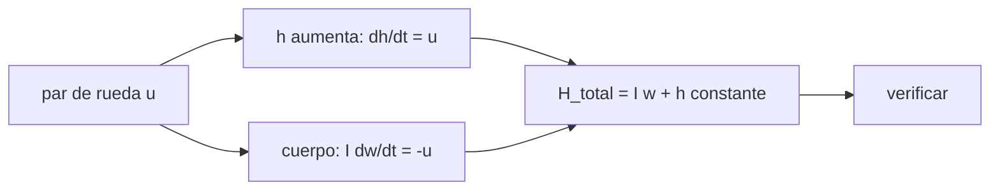

# B87-C11 — Ruedas de reacción

<!-- nav:top -->
[🏠 Programa](../../../../README.md) · [📚 Bloque B87](../../../tronco-comun/B87-sensores-y-control-de-actitud.md) · [← Anterior: B87-C10 — Filtro de actitud](../B87-C10-filtro-de-actitud/CLASE.md) · [Siguiente: B87-C12 — Magnetopares →](../B87-C12-magnetopares/CLASE.md)
<!-- /nav -->

## 1. Ubicación, nivel y alcance

Clase 11 del bloque B87. Nivel N3. Una rueda de reacción es un volante accionado por un motor: al acelerarla, el cuerpo recibe el par opuesto y gira; el momento angular total se conserva. Aquí simulas con RK4 una maniobra rest-to-rest alrededor de un eje con una rueda de ejemplo (par máximo `0,01 N·m`, momento máximo `0,05 N·m·s`, inercia `5×10⁻⁵ kg·m²`), compruebas la conservación del momento total y ves cuándo el perfil pasa de triangular a trapezoidal. Todo es sintético.

## 2. Por qué esta clase existe

La rueda es el actuador estándar del control fino de tres ejes. La decisión central: **¿cuánto tarda una maniobra con límites de par y de momento, y qué velocidad alcanza la rueda?** Y una previa: ¿por qué la rueda no cambia el momento angular total?

## 3. Lo que podrás hacer al terminar

1. Escribir la dinámica `I ω̇ = −ω×(Iω + h) − u` y `ḣ = u`.
2. Calcular la aceleración angular máxima `τ/I` y el tiempo de un giro triangular.
3. Decidir si el perfil es triangular o trapezoidal según el límite de momento.
4. Verificar la conservación del momento total inercial.
5. Estimar la velocidad de la rueda `h/I_w` en rpm.
6. Separar lo sintético de lo consultado y de lo no consultado.

La evidencia es la **maniobra de un eje con el histórico de la rueda de reacción** del ejercicio 12 (sección 20).

## 4. Con qué llegas y cómo comprobarlo

1. ¿Qué conserva un sistema aislado?
2. ¿Qué es el momento angular de una rueda?
3. ¿Qué es una maniobra rest-to-rest?
4. ¿Qué es un perfil triangular de velocidad?
5. ¿Cuántos rpm son `rad/s`?

<details>
<summary>Ver respuestas</summary>

1. Su momento angular total. 2. `h = I_w Ω`. 3. Un giro que parte y termina en reposo. 4. Aceleración constante y frenado simétrico, sin tramo a velocidad constante. 5. `1 rad/s = 60/(2π) rpm ≈ 9,55 rpm`.
</details>

Con cuatro o cinco aciertos, sigue; si no, repasa los prerrequisitos.

## 5. Un caso de contexto y casos de referencia

Para girar `30°` con `τ = 0,01 N·m` y `I_z = 0,30 kg·m²` la aceleración es `0,0333 rad/s²`; el giro dura `7,93 s` con perfil triangular, la velocidad pico es `7,57 °/s` y el momento pico de la rueda `0,0396 N·m·s` (la rueda llega a `7571 rpm`). A `90°` el momento pico llegaría a `0,0686`, supera `0,05` y el perfil pasa a trapezoidal. Todo es **sintético**.

## 6. Vocabulario

La **rueda de reacción** intercambia momento con el cuerpo. El **par de rueda** `u` actúa sobre la rueda y `−u` sobre el cuerpo. El **momento almacenado** es `h`. La **saturación de momento** ocurre al llegar a `h_max`. El **perfil triangular** acelera y frena sin crucero; el **trapezoidal** incluye un tramo a velocidad máxima. La **inercia de rueda** `I_w` fija la velocidad `h/I_w`.

## 7. Modelo mental: el cuerpo gira porque la rueda gira al revés



*Descripción textual:* el par aplicado a la rueda acumula momento en ella y gira el cuerpo en sentido opuesto; la suma de ambos momentos se conserva, lo que se verifica en el sistema inercial.

Analogía: como girar sentado en una silla giratoria haciendo girar una rueda de bicicleta en las manos: la rueda gira en un sentido y tú en el otro, y al frenar la rueda te detienes. Límite: la rueda real tiene fricción, par máximo por motor y límite de velocidad.

## 8. La explicación, paso a paso

### 8.1 Dinámica con rueda

`I ω̇ = −ω × (Iω + h) − u + τ_ext` y `ḣ = u`. El momento total `H = Iω + h` (en el sistema inercial `Aᵀ H`) cambia solo por `τ_ext`. En el laboratorio la deriva máxima es `2,9e-15 N·m·s` (30°), `7,2e-15` (90°) y `7,2e-15` (180°).

### 8.2 Perfil de la maniobra

Con `α = τ/I_z = 0,0333 rad/s²` y un giro `θ`, el perfil triangular tiene `t_a = √(θ/α)` y velocidad pico `α t_a`; el momento pico es `I_z α t_a`. Si supera `h_max`, la velocidad se limita a `ω_max = h_max/I_z = 0,1667 rad/s`, con `t_a = ω_max/α = 5,0 s` y un tramo de crucero.

### 8.3 Resultados

| Giro | Tiempo (s) | Aceleración (s) | Crucero (s) | `ω` pico (°/s) | `h` pico (N·m·s) | Error final (°) |
|---|---|---|---|---|---|---|
| 30° | 7,93 | 3,96 | 0,00 | 7,57 | 0,0396 | 0,010 |
| 90° | 14,42 | 5,00 | 4,42 | 9,55 | 0,0500 | 0,020 |
| 180° | 23,85 | 5,00 | 13,85 | 9,55 | 0,0500 | 0,040 |

El error final (centésimas de grado) viene de discretizar los instantes de conmutación en pasos de `0,001 s`.

### 8.4 Qué no incluye

No hay fricción de rodamientos, límite de par que dependa de la velocidad, jitter de la rueda ni zona de cruce por velocidad cero; `h` vuelve a cero al final porque la maniobra parte y termina en reposo, pero en una maniobra real con perturbaciones el momento se acumula (C14).

## 9. Magnitudes, símbolos y unidades

| Símbolo | Qué es | Unidad | Valor / nota |
|---|---|---|---|
| `u` | par sobre la rueda | N·m | ±0,01 |
| `h` | momento de la rueda | N·m·s | pico 0,0396 a 30° |
| `α` | aceleración angular del cuerpo | rad/s² | 0,0333 |
| `I_w` | inercia de la rueda (ejemplo) | kg·m² | 5×10⁻⁵ |
| `h_max` | momento máximo (ejemplo) | N·m·s | 0,05 |

## 10. Convenciones y referencias

Rueda ideal sobre el eje z; `I = diag(0,35; 0,40; 0,30) kg·m²` (cuerpo total, rueda incluida); RK4 con `dt = 0,001 s`. Tolerancias: deriva de `H < 10⁻¹⁰`, error angular `< 0,05°`, `h` pico `≤ h_max` (+0,2 %). Cuaternión `q = [qx, qy, qz, qw]` con la parte escalar al final, `v_B = A(q) v_I`, producto tal que `A(q⊗p) = A(q) A(p)`, cinemática `q̇ = ½ [ω; 0] ⊗ q` con `ω` del cuerpo respecto del sistema inercial expresada en el cuerpo (la biblioteca [adcs_comun.py](../adcs_comun.py) del bloque lo comprueba). Sistema inercial `I` de **ejemplo** (ejes sin relación con J2000), órbita circular de dos cuerpos con radio terrestre `6 378 137 m` y `μ = 3,986004418 × 10¹⁴ m³/s²` como valores adoptados de ejemplo. Satélite **sintético** `I = diag(0,35; 0,40; 0,30) kg·m²` salvo que la clase diga otra cosa. Todo dato es sintético con semilla fija.

## 11. De dónde sale lo que afirmamos

| ID | Fuente | Localizador | Respalda | Estado |
|---|---|---|---|---|
| S2 | B. Graf, «Quaternions and dynamics», arXiv:0811.2889 — https://arxiv.org/abs/0811.2889 (consultada 2026-11-10) | solo la página de resumen | introducción autocontenida a los cuaterniones en dinámica, con la dinámica del cuerpo rígido y, en un apéndice, un satélite con ruedas inerciales; sostiene que los cuaterniones, a diferencia de los ángulos de Euler, permiten escribir a mano dinámicas complejas | Consultada (solo el resumen) |
| — | Relaciones estándar de dinámica de actitud, estimación y control usadas en esta clase (ecuaciones de Euler, cinemática de cuaterniones, problema de Wahba, filtro de Kalman multiplicativo, estabilidad de Lyapunov, modelos de sensores y actuadores) | — | las verifica el laboratorio con una segunda vía (conservación, comparación entre métodos, propagación independiente o Monte Carlo) | No consultada en una fuente concreta |
| — | Libros de texto de actitud y control (p. ej. Wertz, Markley–Crassidis, Sidi) y hojas de datos de fabricantes | — | — | No consultada |
| — | Hojas de datos de ruedas de reacción comerciales y modelos de fricción y de jitter | — | — | No consultada |

Límites: Graf (S2) respalda, desde su resumen, que su apéndice trata un satélite con ruedas inerciales; esta clase no consultó ese apéndice. Los valores de la rueda son de ejemplo y las ecuaciones se validan por conservación del momento total.

## 12. Cómo ver la maniobra

| Magnitud | Valor |
|---|---|
| aceleración máxima | 0,0333 rad/s² |
| tiempo a 30° / 90° / 180° | 7,9 / 14,4 / 23,8 s |
| deriva de `H` | 7,2e-15 N·m·s |
| rueda a 30° | 7571 rpm |

Descripción larga: el tiempo crece como `√θ` mientras el perfil es triangular y linealmente con el ángulo cuando hay crucero.

## 13. Ejemplo trabajado: giro de 30° con la rueda

**Paso 1 · Aceleración.** `α = 0,01/0,30 = 0,0333 rad/s²`.

**Paso 2 · Tiempo.** `t_a = √(0,5236/α) = 3,963 s`; total `7,93 s`.

**Paso 3 · Momento pico.** `I α t_a = 0,0396 N·m·s ≤ 0,05`: triangular.

**Paso 4 · Rueda.** `h/I_w = 7571 rpm`.

**Paso 5 · Comprobación.** Deriva de `H` `2,9e-15`; error angular `0,010°`.

## 14. Distintas formas de describir la maniobra con rueda

**Perfil bang-bang** (esta clase): tiempo mínimo con límite de par. **Perfil suavizado:** reduce las vibraciones del cuerpo flexible (no tratado). **Ley PD en lazo cerrado:** C17. **Con propulsores:** C13, que cambia el momento total.

## 15. Práctica guiada

**Ejercicio 1 · con los pasos indicados.** Calcula `α` para `τ = 0,005 N·m` e `I = 0,30 kg·m²`. *Pasos:* `τ/I`.

<details><summary>Solución comentada</summary>

`α = 0,0167 rad/s²`.
</details>

**Ejercicio 2 · con una pista.** ¿Cuánto dura un giro triangular de `10°` con `α = 0,0333 rad/s²`? *Pista:* `T = 2√(θ/α)`.

<details><summary>Solución comentada</summary>

`θ = 0,1745 rad`; `T = 2√(0,1745/0,0333) = 4,58 s`.
</details>

**Ejercicio 3 · casi autónomo.** ¿Qué momento pico alcanza la rueda en ese giro?

<details><summary>Solución comentada</summary>

`h = I α t_a = 0,30·0,0333·2,29 = 0,0229 N·m·s`.
</details>

## 16. Práctica autónoma, transferencia e integrador

**Ejercicio 4 · autónomo.** ¿Qué ángulo máximo se puede girar con perfil triangular sin superar `h_max = 0,05`?

<details><summary>Solución comentada</summary>

`I α t_a ≤ 0,05` → `t_a ≤ 5 s` → `θ = α t_a² = 47,7°`.
</details>

**Ejercicio 5 · autónomo.** Con `h = 0,05` e `I_w = 5×10⁻⁵`, ¿cuántos rpm?

<details><summary>Solución comentada</summary>

`9549 rpm`.
</details>

**Ejercicio 6 · autónomo.** ¿Por qué `h` vuelve a 0 al final de una maniobra rest-to-rest?

<details><summary>Solución comentada</summary>

Porque `H_total = 0` se conserva y el cuerpo termina en reposo: `h = −Iω = 0`.
</details>

**Ejercicio 7 · autónomo.** ¿Cómo cambia el tiempo de 90° si `h_max` baja a 0,03?

<details><summary>Solución comentada</summary>

`ω_max = 0,1 rad/s`, `t_a = 3 s`; el ángulo de rampas es `0,3 rad`; el crucero dura `(1,5708 − 0,3)/0,1 = 12,7 s` y el total `18,7 s`.
</details>

**Ejercicio 8 · autónomo.** ¿Qué efecto tiene el acoplamiento giroscópico `ω × h`?

<details><summary>Solución comentada</summary>

Aparece un par cruzado si `ω` no es paralela a `h`; es pequeño en maniobras lentas y se tiene en cuenta en el modelo (`ω×(Iω + h)`).
</details>

**Ejercicio 9 · transferencia.** **Transferencia.** **Transferencia.** Un colega usa `0,05 N·m·s` como capacidad de una rueda real. ¿Es válido?

<details><summary>Solución comentada</summary>

No: es un valor de ejemplo; las capacidades reales están en las hojas de datos (no consultadas).
</details>

**Ejercicio 10 · transferencia.** **Transferencia.** **Transferencia.** ¿Por qué se usan cuatro ruedas en pirámide en lugar de tres ortogonales?

<details><summary>Solución comentada</summary>

Por redundancia: si una falla, las tres restantes siguen dando control de tres ejes; el reparto de momento exige una matriz de distribución (no tratada).
</details>

**Ejercicio 11 · transferencia.** **Transferencia.** **Transferencia.** ¿Qué pasa si la maniobra de 180° se repite con una perturbación que acumula momento?

<details><summary>Solución comentada</summary>

El momento inicial de la rueda no es cero y `h_pico` sube; si supera `h_max`, hay saturación y hay que descargar (C14).
</details>

**Ejercicio 12 · integrador.** **Integrador.** **Integrador.** Elabora tu *maniobra de un eje*: tabla de 8.3, conservación de `H`, rpm y lista de consultado y sintético.

<details><summary>Solución comentada</summary>

Secciones 8.1–8.4, 12 y la salida del laboratorio.
</details>

## 17. Laboratorio: maniobra rest-to-rest con una rueda

El script [rueda.py](rueda.py) integra con RK4 (paso de `0,001 s`) giros de 30°, 90° y 180° con perfil triangular o trapezoidal según el momento, calcula la deriva del momento total inercial, el momento pico, la velocidad pico y el error angular final (**comprueba** deriva `< 10⁻¹⁰`, error `< 0,05°`, `h ≤ h_max` y la transición triangular–trapezoidal). Usa la biblioteca común [adcs_comun.py](../adcs_comun.py) del bloque.

**Datos:** satélite y rueda **sintéticos** (valores de ejemplo). **Predice antes de ejecutar:** ¿Qué perfil tendrá el giro de 90°? (trapezoidal: el momento pico supera 0,05.) **Ejecución del 2026-11-10 (Python 3.12.9, numpy 2.4.4):**

```text
Python 3.12.9 | numpy 2.4.4
B87-C11 rueda de reaccion | SINTETICO: I = diag(0.35, 0.40, 0.30) kg m^2; par max 0.01 N m, momento max 0.05 N m s, I_rueda = 5e-5 kg m^2
aceleracion angular maxima del cuerpo = par/Iz = 0.03333 rad/s^2
giro   tiempo [s]  acel [s]  crucero [s]  w pico [deg/s]  h pico [N m s]  deriva H [N m s]  error angular [deg]  w final [rad/s]
30 deg      7.927     3.963        0.000           7.571         0.0396          2.90e-15             1.02e-02        3.33e-05
90 deg     14.425     5.000        4.425           9.551         0.0500          7.22e-15             2.01e-02        3.33e-05
180 deg     23.850     5.000       13.850           9.551         0.0500          7.22e-15             4.02e-02        3.33e-05
velocidad de la rueda a 30 deg (h pico / I_rueda) = 7571 rpm
Pruebas superadas.
```

```bash
python programa/clases/B87/B87-C11-ruedas-de-reaccion/rueda.py
```

**Límites:** rueda ideal, un solo eje, sin fricción ni jitter, cuerpo rígido; la maniobra no incluye perturbaciones.

## 18. Errores frecuentes y cómo corregirlos

**Olvidar que `h` está limitado.** Calcula `h_pico` antes de elegir el perfil (8.2)

**Comprobar el momento en ejes del cuerpo.** Hazlo en el sistema inercial (8.1)

**Confundir el par de rueda con el del cuerpo.** Cuerpo recibe `−u` (8.1)

## 19. Cómo sabrás que vas bien

Tras la sección 8: ¿qué perfil esperabas para 30° y 90°? Si dudas, repasa el ejemplo 13. Tras el laboratorio: ¿qué comprueba? (ver sección 17).

## 20. Qué entregas y cómo se evalúa

El producto es tu **maniobra de un eje con el histórico de la rueda de reacción** (ejercicio 12).

| Criterio | Inicial | En desarrollo | Logrado | Destacado |
|---|---|---|---|---|
| Conceptos | Los confunde | Parciales | Explica el método y su dominio | Explica los límites y las alternativas |
| Cálculo | Sin unidades | Con errores | Resultados con unidades y comprobados | Resuelve casos nuevos |
| Numérico | Sin comprobar | Un caso | Verifica con una segunda vía en varios casos | Interpreta las diferencias y los fallos |
| Fuentes | Sin fuente | Sin fecha | Fuentes con fecha y estado | Declara lo sintético y lo no consultado |
| Límites | No los nombra | Uno | Tres | Discute qué falta del modelo |

**Condiciones críticas (no se compensan con promedio):** rotular los datos como sintéticos; verificar cada resultado con una segunda vía; citar solo lo consultado.

## 21. Ética, seguridad y límites

Clase educativa: los modelos son simplificados y los datos son sintéticos; ningún resultado describe una misión real ni sustituye el diseño y la verificación de un subsistema de actitud con herramientas validadas, ensayos y revisión de especialistas.  Accesibilidad: tablas equivalentes a las gráficas, fórmulas en texto, ejercicios sin conexión.

## 22. Para cerrar y seguir

Con `0,01 N·m` y `I = 0,30 kg·m²`, un giro de 30° dura `7,9 s` y la rueda llega a `7571 rpm`; `H` se conserva a `3e-15`. Queda una pregunta: ¿cómo se genera par sin gastar propergol ni usar ruedas?

**Glosario español–inglés.** rueda de reacción · *reaction wheel*; momento almacenado · *stored momentum*; saturación · *saturation*; perfil trapezoidal · *trapezoidal profile*; conservación · *conservation*; par · *torque*.

**Continuidad.** [B87-C12](../B87-C12-magnetopares/CLASE.md) presenta los magnetopares, que generan par con el campo terrestre.

**Referencias:** ver sección 11.

<!-- nav:bottom -->
---

[← Anterior: B87-C10 — Filtro de actitud](../B87-C10-filtro-de-actitud/CLASE.md) · [📚 Bloque B87](../../../tronco-comun/B87-sensores-y-control-de-actitud.md) · [Siguiente: B87-C12 — Magnetopares →](../B87-C12-magnetopares/CLASE.md)
<!-- /nav -->
