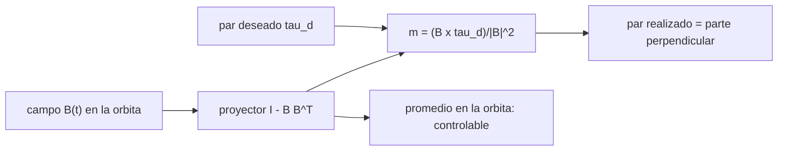

# B87-C12 — Magnetopares

<!-- nav:top -->
[🏠 Programa](../../../../README.md) · [📚 Bloque B87](../../../tronco-comun/B87-sensores-y-control-de-actitud.md) · [← Anterior: B87-C11 — Ruedas de reacción](../B87-C11-ruedas-de-reaccion/CLASE.md) · [Siguiente: B87-C13 — Propulsores de control de actitud →](../B87-C13-propulsores-de-control-de-actitud/CLASE.md)
<!-- /nav -->

## 1. Ubicación, nivel y alcance

Clase 12 del bloque B87. Nivel N3. Un magnetopar (*magnetorquer*) es una bobina que genera un momento dipolar `m`; en el campo terrestre `B` recibe el par `τ = m × B`. Es un actuador sin propergol, pero **subactuado**: el par siempre es perpendicular a `B`. Aquí mides, en una órbita de `500 km` y `51,6°` con el campo dipolar sintético de C05, el par máximo, la fracción de un par deseado que se puede realizar y la controlabilidad promedio. Todo es sintético.

## 2. Por qué esta clase existe

Los magnetopares descargan ruedas (C14) y hacen detumbling (C16) con muy poca masa. La decisión central: **¿qué par se puede generar en cada instante, qué dirección queda inaccesible y basta una órbita para cubrir los tres ejes?** Una previa: ¿qué dipolo máximo se necesita?

## 3. Lo que podrás hacer al terminar

1. Calcular `τ = m × B` y su máximo `m_max |B|`.
2. Obtener `m = (B × τ_d)/|B|²` y comprobar que reproduce la parte perpendicular de `τ_d`.
3. Calcular la fracción realizable `sin(∠τ_d,B)` y su media y mínimo en una órbita.
4. Evaluar la controlabilidad con la matriz promedio `P̄ = ⟨I − B̂B̂ᵀ⟩`.
5. Ver cuándo el dipolo se satura.
6. Separar lo sintético de lo consultado y de lo no consultado.

La evidencia es la **mapa de par magnético disponible en una órbita** del ejercicio 12 (sección 20).

## 4. Con qué llegas y cómo comprobarlo

1. ¿Qué es el producto vectorial?
2. ¿Qué es el momento dipolar de una bobina?
3. ¿Qué es un sistema subactuado?
4. ¿Qué es un autovalor?
5. ¿Qué campo hay en órbita baja?

<details>
<summary>Ver respuestas</summary>

1. Un vector perpendicular a los dos factores, de módulo `|a||b| sin θ`. 2. `m = N I A n̂`: vueltas, corriente, área y normal. 3. Uno con menos entradas independientes que grados de libertad en cada instante. 4. Un factor `λ` con `P v = λ v`. 5. Del orden de `25–45 µT` (C05).
</details>

Con cuatro o cinco aciertos, sigue; si no, repasa los prerrequisitos.

## 5. Un caso de contexto y casos de referencia

En la órbita de ejemplo, `|B|` va de `24,88` a `42,25 µT`, así que con `m_max = 0,2 A·m²` el par máximo va de `4,98` a `8,45 µN·m`. Un par deseado fijo a lo largo de `x` se realiza en media al `76 %`, y a lo largo de `z`, `80 %` en media pero solo `2 %` como mínimo. Todo es **sintético**.

## 6. Vocabulario

El **momento dipolar** `m` (A·m²) es la salida del actuador. El **par magnético** es `τ = m × B`. El **par realizable** de un `τ_d` es su componente perpendicular a `B`. La **ley de proyección** `m = (B × τ_d)/|B|²` lo logra. La **matriz de controlabilidad promedio** `P̄` suma las proyecciones en una órbita. La **saturación** es `|m| > m_max`.

## 7. Modelo mental: el par siempre es perpendicular al campo



*Descripción textual:* en cada instante solo se puede generar par perpendicular al campo; como el campo cambia de dirección a lo largo de la órbita, el promedio de los proyectores cubre los tres ejes.

Analogía: como girar una rueda con una llave que solo puede empujar de lado: en cada instante hay una dirección que no puedes mover, pero si el eje de la llave cambia, al cabo de un rato mueves en todas. Límite: la «llave» (el campo) no se controla y la cobertura depende de la órbita.

## 8. La explicación, paso a paso

### 8.1 Par máximo

`|τ| ≤ m_max |B|` cuando `m ⊥ B`. Con `m_max = 0,2 A·m²`: de `4,98` a `8,45 µN·m` en la órbita, el mínimo donde `|B|` es mínimo.

### 8.2 Ley de proyección

Dado `τ_d`, `m = (B × τ_d)/|B|²` produce `τ = m × B = τ_d − (τ_d·B̂)B̂`, es decir, la parte de `τ_d` perpendicular a `B`. El error relativo frente a esa parte es `2,4e-16` (redondeo). La componente a lo largo de `B` **no** se puede generar.

### 8.3 Fracción realizable en la órbita

Para un `τ_d` fijo en el sistema inercial, la fracción realizable es `sin(∠τ_d, B)`:

| Eje del `τ_d` | Media | Mínimo |
|---|---|---|
| `x` | 0,760 | 0,443 |
| `y` | 0,808 | 0,505 |
| `z` | 0,801 | 0,021 |

### 8.4 Controlabilidad promedio y saturación

`P̄ = ⟨I − B̂B̂ᵀ⟩` tiene autovalores `(0,602; 0,612; 0,787)` (suman 2) y rango 3: en promedio hay par disponible en las tres direcciones, pero ninguna es instantáneamente completa. Un par constante de `4 µN·m` en `y` satura el dipolo el `0,0 %` de la órbita con `m_max = 0,2`.

## 9. Magnitudes, símbolos y unidades

| Símbolo | Qué es | Unidad | Valor / nota |
|---|---|---|---|
| `m` | momento dipolar | A·m² | máx. 0,2 (ejemplo) |
| `B` | campo magnético | T | 24,9 a 42,3 µT |
| `τ` | par magnético | N·m | máx. 4,98 a 8,45 µN·m |
| `P̄` | matriz de controlabilidad promedio | — | autovalores > 0,6 |
| `τ_d` | par deseado | N·m | µN·m |

## 10. Convenciones y referencias

Campo dipolar **sintético** (C05), órbita circular de `500 km` y `51,6°`, 720 puntos; cuerpo alineado con el sistema inercial de ejemplo. Tolerancias: error de la ley de proyección `< 10⁻¹²`, suma de autovalores de `P̄` igual a 2, rango 3. Cuaternión `q = [qx, qy, qz, qw]` con la parte escalar al final, `v_B = A(q) v_I`, producto tal que `A(q⊗p) = A(q) A(p)`, cinemática `q̇ = ½ [ω; 0] ⊗ q` con `ω` del cuerpo respecto del sistema inercial expresada en el cuerpo (la biblioteca [adcs_comun.py](../adcs_comun.py) del bloque lo comprueba). Sistema inercial `I` de **ejemplo** (ejes sin relación con J2000), órbita circular de dos cuerpos con radio terrestre `6 378 137 m` y `μ = 3,986004418 × 10¹⁴ m³/s²` como valores adoptados de ejemplo. Satélite **sintético** `I = diag(0,35; 0,40; 0,30) kg·m²` salvo que la clase diga otra cosa. Todo dato es sintético con semilla fija.

## 11. De dónde sale lo que afirmamos

| ID | Fuente | Localizador | Respalda | Estado |
|---|---|---|---|---|
| S1 | NOAA/NCEI, International Geomagnetic Reference Field (IGRF) — https://www.ncei.noaa.gov/products/international-geomagnetic-reference-field (consultada 2026-11-10) | página del producto | el IGRF es un modelo estándar del campo magnético principal terrestre, mantenido por IAGA, expresado como serie truncada de un potencial escalar (grado N = 13) con su variación secular; la generación vigente es IGRF-14 (coeficientes cerrados en noviembre de 2024) | Consultada |
| — | Relaciones estándar de dinámica de actitud, estimación y control usadas en esta clase (ecuaciones de Euler, cinemática de cuaterniones, problema de Wahba, filtro de Kalman multiplicativo, estabilidad de Lyapunov, modelos de sensores y actuadores) | — | las verifica el laboratorio con una segunda vía (conservación, comparación entre métodos, propagación independiente o Monte Carlo) | No consultada en una fuente concreta |
| — | Libros de texto de actitud y control (p. ej. Wertz, Markley–Crassidis, Sidi) y hojas de datos de fabricantes | — | — | No consultada |
| — | Modelos de ley de control magnético publicados (por ejemplo, controlabilidad periódica de sistemas con magnetopares) | — | — | No consultada |

Límites: El IGRF (S1) se consultó solo en su descripción; el campo aquí es un dipolo sintético. La ley de proyección y el análisis de controlabilidad promedio no se consultaron en una fuente concreta; el laboratorio las valida numéricamente.

## 12. Cómo ver el par disponible

| Magnitud | Valor |
|---|---|
| par máximo | 4,98 a 8,45 µN·m |
| fracción realizable en `z` (media / mínima) | 0,80 / 0,02 |
| autovalores de `P̄` | 0,602; 0,612; 0,787 |
| error de la ley | 2,4e-16 |

Descripción larga: el par disponible se reduce a la fracción perpendicular al campo; en `z` cae a `0,02` cuando el campo está casi alineado con `z`.

## 13. Ejemplo trabajado: par realizable en una órbita

**Paso 1 · Campo.** En el punto de `|B| = 24,88 µT` el par máximo es `4,98 µN·m`.

**Paso 2 · Ley.** `m = (B × τ_d)/|B|²` con `τ_d = 2×10⁻⁶ N·m`.

**Paso 3 · Par.** `m × B` reproduce la parte perpendicular de `τ_d`, con error `2,4e-16`.

**Paso 4 · Fracción.** En `x`, media `0,76` y mínimo `0,44`.

**Paso 5 · Controlabilidad.** `P̄` tiene autovalores `> 0,6` y rango 3.

## 14. Distintas formas de describir el par magnético

**Ley de proyección** (esta clase): par deseado instantáneo. **Control promedio periódico:** analiza la controlabilidad sobre una órbita. **Descarga de momento:** `m = −K (B × h)/|B|²` (C14). **Detumbling B-dot:** `m = −k Ḃ` (C16). Todas usan `τ = m × B`.

## 15. Práctica guiada

**Ejercicio 1 · con los pasos indicados.** Calcula el par máximo con `m_max = 0,2 A·m²` y `B = 30 µT`. *Pasos:* `m B`.

<details><summary>Solución comentada</summary>

`0,2 · 30×10⁻⁶ = 6 µN·m`.
</details>

**Ejercicio 2 · con una pista.** Para `B = (0; 0; 30) µT` y `τ_d = (1; 0; 0) µN·m`, calcula `m`. *Pista:* `m = (B × τ_d)/|B|²`.

<details><summary>Solución comentada</summary>

`B × τ_d = (0; 30×10⁻⁶·10⁻⁶; 0)`; `m = (0; 3,33×10⁻²; 0)` A·m² (un dipolo de `0,033 A·m²` en `y`).
</details>

**Ejercicio 3 · casi autónomo.** ¿Qué par genera `m = (0; 0,2; 0)` en `B = (0; 0; 30) µT`?

<details><summary>Solución comentada</summary>

`m × B = (0,2·30×10⁻⁶; 0; 0) = (6; 0; 0) µN·m`.
</details>

## 16. Práctica autónoma, transferencia e integrador

**Ejercicio 4 · autónomo.** ¿Qué componente de un `τ_d` paralelo a `B` se puede generar?

<details><summary>Solución comentada</summary>

Ninguna: `τ_d·B̂` no se puede producir; la fracción realizable es 0.
</details>

**Ejercicio 5 · autónomo.** ¿Por qué la fracción en `z` cae a `0,02`?

<details><summary>Solución comentada</summary>

Porque en ese punto `B` es casi paralelo a `z` y `sin(∠τ_d, B) ≈ 0`.
</details>

**Ejercicio 6 · autónomo.** ¿Cuál es la suma de los autovalores de `P̄` y por qué?

<details><summary>Solución comentada</summary>

`2`, porque `tr(I − B̂B̂ᵀ) = 3 − 1 = 2` en cada instante.
</details>

**Ejercicio 7 · autónomo.** ¿Qué pasa con `P̄` en una órbita ecuatorial?

<details><summary>Solución comentada</summary>

El campo apenas cambia de dirección en el plano orbital y un autovalor tiende a 0: no hay par en la dirección del eje del dipolo.
</details>

**Ejercicio 8 · autónomo.** Con un par deseado de `10 µN·m`, ¿qué `m` necesito si `|B| = 25 µT` y `τ_d ⊥ B`?

<details><summary>Solución comentada</summary>

`m = τ/|B| = 0,4 A·m²`, mayor que `0,2`: se satura.
</details>

**Ejercicio 9 · transferencia.** **Transferencia.** **Transferencia.** Un colega usa `0,2 A·m²` como dato de una misión. ¿Es válido?

<details><summary>Solución comentada</summary>

No: es un valor de ejemplo; el dipolo real depende de la bobina y de la potencia disponible (no consultados).
</details>

**Ejercicio 10 · transferencia.** **Transferencia.** **Transferencia.** ¿Por qué los magnetopares casi no sirven en órbita geoestacionaria?

<details><summary>Solución comentada</summary>

Porque el campo decae como `1/r³`: a `42 164 km` es unos `10⁻³` del de órbita baja; el par sería minúsculo.
</details>

**Ejercicio 11 · transferencia.** **Transferencia.** **Transferencia.** ¿Cómo evitas que el magnetopar perturbe al magnetómetro?

<details><summary>Solución comentada</summary>

Alternando la medida y la actuación en el tiempo y esperando a que se apague el campo de la bobina antes de medir (C05).
</details>

**Ejercicio 12 · integrador.** **Integrador.** **Integrador.** Elabora tu *mapa de par magnético en una órbita*: par máximo, fracciones por eje, autovalores de `P̄` y lista de consultado y sintético.

<details><summary>Solución comentada</summary>

Secciones 8.1–8.4, 12 y la salida del laboratorio.
</details>

## 17. Laboratorio: par magnético y controlabilidad en una órbita

El script [magnetopar.py](magnetopar.py) calcula `B` en 720 puntos de la órbita, el par máximo `m_max |B|`, la fracción realizable de pares fijos en los tres ejes, la ley `m = (B × τ_d)/|B|²`, los autovalores de la matriz promedio y la saturación del dipolo (**comprueba** error de la ley `< 10⁻¹²`, autovalores que suman 2 y rango 3). Usa la biblioteca común [adcs_comun.py](../adcs_comun.py) del bloque.

**Datos:** campo dipolar **sintético** (C05); dipolo máximo de ejemplo. **Predice antes de ejecutar:** ¿Será menor la fracción realizable en `z` o en `x`? (el mínimo en `z` es el menor: `B` casi paralelo a `z` en algún punto.) **Ejecución del 2026-11-10 (Python 3.12.9, numpy 2.4.4):**

```text
Python 3.12.9 | numpy 2.4.4
B87-C12 magnetopares | campo dipolar SINTETICO, orbita de 500 km y 51.6 deg, dipolo maximo de ejemplo 0.2 A m^2
|B| = 24.88 a 42.25 uT -> par maximo instantaneo m|B| = 4.98 a 8.45 uN m
fraccion realizable de un par deseado fijo (sin angulo entre tau y B): media / minimo en la orbita
  eje x: 0.760 / 0.443
  eje y: 0.808 / 0.505
  eje z: 0.801 / 0.021
ley m = (B x tau_d)/|B|^2: error relativo del par frente a la parte perpendicular = 2.43e-16
matriz de controlabilidad promedio P = mean(I - Bh Bh^T): autovalores = [0.6015 0.6118 0.7867] ; suma = 2.0000 ; rango = 3
par deseado de 4 uN m en y: dipolo saturado (> 0.2 A m^2) en 0.0 % de la orbita
Pruebas superadas.
```

```bash
python programa/clases/B87/B87-C12-magnetopares/magnetopar.py
```

**Límites:** cuerpo alineado con el sistema inercial de ejemplo, campo dipolar sin armónicos, bobina ideal sin histéresis ni núcleo; sin control en lazo cerrado.

## 18. Errores frecuentes y cómo corregirlos

**Esperar par en la dirección de `B`.** Recuerda `τ ⊥ B` (8.2)

**Ignorar la saturación del dipolo.** Comprueba `|m| ≤ m_max` (8.4)

**Usar la ley sin dividir por `|B|²`.** Verifica con el error de la ley (8.2)

## 19. Cómo sabrás que vas bien

Tras la sección 8: ¿qué eje esperabas más difícil? Si dudas, repasa el ejemplo 13. Tras el laboratorio: ¿qué comprueba? (ver sección 17).

## 20. Qué entregas y cómo se evalúa

El producto es tu **mapa de par magnético disponible en una órbita** (ejercicio 12).

| Criterio | Inicial | En desarrollo | Logrado | Destacado |
|---|---|---|---|---|
| Conceptos | Los confunde | Parciales | Explica el método y su dominio | Explica los límites y las alternativas |
| Cálculo | Sin unidades | Con errores | Resultados con unidades y comprobados | Resuelve casos nuevos |
| Numérico | Sin comprobar | Un caso | Verifica con una segunda vía en varios casos | Interpreta las diferencias y los fallos |
| Fuentes | Sin fuente | Sin fecha | Fuentes con fecha y estado | Declara lo sintético y lo no consultado |
| Límites | No los nombra | Uno | Tres | Discute qué falta del modelo |

**Condiciones críticas (no se compensan con promedio):** rotular los datos como sintéticos; verificar cada resultado con una segunda vía; citar solo lo consultado.

## 21. Ética, seguridad y límites

Clase educativa: los modelos son simplificados y los datos son sintéticos; ningún resultado describe una misión real ni sustituye el diseño y la verificación de un subsistema de actitud con herramientas validadas, ensayos y revisión de especialistas.  Accesibilidad: tablas equivalentes a las gráficas, fórmulas en texto, ejercicios sin conexión.

## 22. Para cerrar y seguir

El magnetopar entrega entre `5,0` y `8,5 µN·m`, siempre perpendicular a `B`, y en una órbita cubre las tres direcciones (autovalores `> 0,6`). Queda una pregunta: ¿qué hacer cuando hace falta más par, y a qué costo?

**Glosario español–inglés.** magnetopar · *magnetorquer*; momento dipolar · *magnetic dipole moment*; subactuado · *underactuated*; controlabilidad · *controllability*; proyección · *projection*; saturación · *saturation*.

**Continuidad.** [B87-C13](../B87-C13-propulsores-de-control-de-actitud/CLASE.md) trata los propulsores de control de actitud, que dan par a cambio de propergol.

**Referencias:** ver sección 11.

<!-- nav:bottom -->
---

[← Anterior: B87-C11 — Ruedas de reacción](../B87-C11-ruedas-de-reaccion/CLASE.md) · [📚 Bloque B87](../../../tronco-comun/B87-sensores-y-control-de-actitud.md) · [Siguiente: B87-C13 — Propulsores de control de actitud →](../B87-C13-propulsores-de-control-de-actitud/CLASE.md)
<!-- /nav -->
