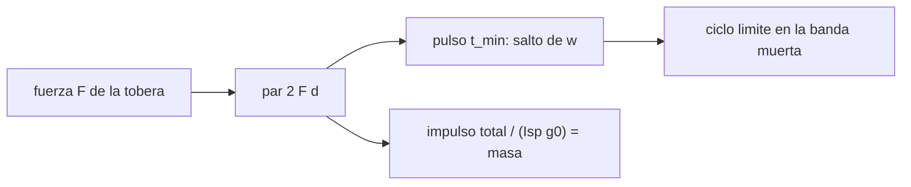

# B87-C13 — Propulsores de control de actitud

<!-- nav:top -->
[🏠 Programa](../../../../README.md) · [📚 Bloque B87](../../../tronco-comun/B87-sensores-y-control-de-actitud.md) · [← Anterior: B87-C12 — Magnetopares](../B87-C12-magnetopares/CLASE.md) · [Siguiente: B87-C14 — Saturación y descarga de momento →](../B87-C14-saturacion-y-descarga-de-momento/CLASE.md)
<!-- /nav -->

## 1. Ubicación, nivel y alcance

Clase 13 del bloque B87. Nivel N3. Un propulsor de control de actitud (en pares de toberas de gas frío o de otro tipo) da par `τ = r × F` a cambio de propergol. Aquí modelas un par de toberas de ejemplo (`F = 0,05 N` cada una a `0,1 m` del eje, par de `0,01 N·m`), su impulso mínimo, el consumo por `Isp` en un detumbling de `5 °/s` y un ciclo límite de banda muerta de `±0,5°`. Todo es sintético.

## 2. Por qué esta clase existe

Los propulsores son el actuador de más par y de respuesta rápida, y el único que cambia el momento total del satélite, pero cada pulso gasta masa que no vuelve. La decisión central: **¿cuánto propergol cuesta una maniobra o un año de mantenimiento de actitud, y qué precisión permite el impulso mínimo?**

## 3. Lo que podrás hacer al terminar

1. Calcular el par de un par de toberas `2 F d` y la aceleración angular resultante.
2. Calcular el impulso mínimo, el salto de velocidad angular por pulso y su límite de apuntamiento.
3. Estimar el propergol con `m = I_total/(Isp g₀)`.
4. Simular un ciclo límite de banda muerta y comparar su periodo con `4 θ_db/Δω`.
5. Estimar el consumo por hora de un ciclo límite.
6. Separar lo sintético de lo consultado y de lo no consultado.

La evidencia es la **ficha de consumo y ciclo límite de una maniobra con propulsores** del ejercicio 12 (sección 20).

## 4. Con qué llegas y cómo comprobarlo

1. ¿Qué es el impulso de una fuerza?
2. ¿Qué es el impulso específico `Isp`?
3. ¿Qué es un par de fuerzas?
4. ¿Qué es una banda muerta?
5. ¿Cuánto vale `g₀`?

<details>
<summary>Ver respuestas</summary>

1. `J = ∫F dt`; con `F` constante, `F t`. 2. El impulso por unidad de peso de propergol: `Isp = J/(m g₀)`. 3. Dos fuerzas iguales y opuestas separadas; su momento es `F d`. 4. Una zona de error en la que no se actúa. 5. `9,80665 m/s²` (valor convencional).
</details>

Con cuatro o cinco aciertos, sigue; si no, repasa los prerrequisitos.

## 5. Un caso de contexto y casos de referencia

Con dos toberas de `0,05 N` a `0,1 m`: `τ = 0,0100 N·m` y `α = 0,0333 rad/s²` para `I_z = 0,30 kg·m²`. El pulso mínimo de `0,02 s` da `2,0 mN·s` por tobera y un salto de `6,667e-04 rad/s` (`0,0382 °/s`). Frenar `5 °/s` cuesta `0,89 g` de propergol con `Isp = 60 s`. Todo es **sintético**.

## 6. Vocabulario

El **par** de un par de toberas es `τ = 2 F d`. El **impulso mínimo** (*minimum impulse bit*) es `F t_min`. La **banda muerta** `±θ_db` es la zona sin acción. El **ciclo límite** es la oscilación permanente entre las paredes de la banda. El **impulso específico** `Isp` mide la eficiencia del propergol. El **consumo** es `m = J_total/(Isp g₀)`.

## 7. Modelo mental: par a cambio de masa



*Descripción textual:* el par de las toberas da un salto de velocidad angular por pulso mínimo, que fija el ciclo límite; el impulso total, dividido por `Isp g₀`, da el propergol gastado.

Analogía: como corregir el rumbo de un bote con pequeños remazos: cada remo da un empujón mínimo; con una banda de tolerancia el bote zigzaguea entre dos límites y gasta combustible en cada giro. Límite: el propulsor real tiene retardos, ramp-up y variación del empuje que el modelo no incluye.

## 8. La explicación, paso a paso

### 8.1 Par y pulso mínimo

`τ = 2 F d = 0,0100 N·m` y `α = τ/I_z = 0,0333 rad/s²`. Un pulso de `t_min = 0,02 s` da un impulso por tobera `F t_min = 2,0 mN·s`, un momento angular `τ t_min = 200 µN·m·s` y un salto `Δω = α t_min = 6,667e-04 rad/s`. Eso es lo más fino que se puede controlar la velocidad angular.

### 8.2 Consumo

El momento a eliminar en un detumbling de `5 °/s` es `ΔH = I_z ω = 0,02618 N·m·s`; el impulso total de las dos toberas es `J = 2 ΔH/d = 0,5236 N·s` y el propergol `m = J/(Isp g₀) = 0,890 g` con `Isp = 60 s`.

### 8.3 Ciclo límite

Con banda muerta de `±0,5°` y la ley «disparar en la pared si la velocidad no va ya hacia dentro», la velocidad queda en `±Δω` y el periodo es `4 θ_db/Δω`. Teoría `52,4 s`; simulado `52,4 s`. En `2000 s` hubo `153` pulsos (`0,520 g`), es decir `0,94 g/h`.

### 8.4 Límites del modelo

Un ciclo límite sin perturbaciones gasta propergol continuamente; en la práctica se amplía la banda muerta o se usan ruedas y se reserva el propulsor para maniobras y descargas. Quedan fuera el retardo de apertura de válvula, la variación del empuje con la presión, la fuga y los efectos de la columna de gas sobre el cuerpo.

## 9. Magnitudes, símbolos y unidades

| Símbolo | Qué es | Unidad | Valor / nota |
|---|---|---|---|
| `F` | empuje por tobera | N | 0,05 |
| `d` | brazo | m | 0,1 |
| `t_min` | tiempo mínimo de encendido | s | 0,02 |
| `Isp` | impulso específico (ejemplo) | s | 60 |
| `Δω` | salto de velocidad por pulso | rad/s | 6,667e-04 |
| `θ_db` | banda muerta | rad (°) | ±0,5° |

## 10. Convenciones y referencias

Gas frío de ejemplo, `g₀ = 9,80665 m/s²` (valor convencional, no consultado en una fuente), `I_z = 0,30 kg·m²`, un eje. RK de primer orden con paso `0,002 s` para el ciclo límite (el pulso dura 10 pasos). Tolerancias: periodo simulado dentro del 10 % de `4 θ_db/Δω`; `|θ| < 0,6°`. Cuaternión `q = [qx, qy, qz, qw]` con la parte escalar al final, `v_B = A(q) v_I`, producto tal que `A(q⊗p) = A(q) A(p)`, cinemática `q̇ = ½ [ω; 0] ⊗ q` con `ω` del cuerpo respecto del sistema inercial expresada en el cuerpo (la biblioteca [adcs_comun.py](../adcs_comun.py) del bloque lo comprueba). Sistema inercial `I` de **ejemplo** (ejes sin relación con J2000), órbita circular de dos cuerpos con radio terrestre `6 378 137 m` y `μ = 3,986004418 × 10¹⁴ m³/s²` como valores adoptados de ejemplo. Satélite **sintético** `I = diag(0,35; 0,40; 0,30) kg·m²` salvo que la clase diga otra cosa. Todo dato es sintético con semilla fija.

## 11. De dónde sale lo que afirmamos

| ID | Fuente | Localizador | Respalda | Estado |
|---|---|---|---|---|
| — | Relaciones estándar de dinámica de actitud, estimación y control usadas en esta clase (ecuaciones de Euler, cinemática de cuaterniones, problema de Wahba, filtro de Kalman multiplicativo, estabilidad de Lyapunov, modelos de sensores y actuadores) | — | las verifica el laboratorio con una segunda vía (conservación, comparación entre métodos, propagación independiente o Monte Carlo) | No consultada en una fuente concreta |
| — | Libros de texto de actitud y control (p. ej. Wertz, Markley–Crassidis, Sidi) y hojas de datos de fabricantes | — | — | No consultada |
| — | Datos de propulsores de gas frío y de monopropergol comerciales, `Isp` reales y retardos de válvula | — | — | No consultada |

Límites: Esta clase no tiene fuente consultada propia: `F`, `d`, `Isp` y `t_min` son valores de ejemplo y la ecuación de cohete `m = J/(Isp g₀)` es estándar; el laboratorio verifica el ciclo límite contra `4 θ_db/Δω` y la masa contra la fórmula.

## 12. Cómo ver el consumo

| Magnitud | Valor |
|---|---|
| par / aceleración | 0,0100 N·m / 0,0333 rad/s² |
| salto por pulso | 6,667e-04 rad/s |
| propergol de un detumbling de 5 °/s | 0,890 g |
| periodo del ciclo límite (sim / teoría) | 52,4 / 52,4 s |
| consumo del ciclo límite | 0,94 g/h |

Descripción larga: el ciclo límite gasta casi 1 g/h, más que el propio detumbling de una sola vez; por eso se evita.

## 13. Ejemplo trabajado: detumbling y ciclo límite

**Paso 1 · Par.** `τ = 2·0,05·0,1 = 0,010 N·m`.

**Paso 2 · Momento.** `ΔH = 0,30·0,0873 = 0,02618 N·m·s`.

**Paso 3 · Impulso.** `J = 2ΔH/d = 0,5236 N·s`; `m = J/(60·9,80665) = 0,890 g`.

**Paso 4 · Ciclo límite.** Periodo `52,4 s`, igual a la teoría.

**Paso 5 · Comprobación.** El salto de velocidad `6,67e-04 rad/s` es el piso de precisión de la velocidad.

## 14. Distintas formas de describir el control con propulsores

**Banda muerta con pulso mínimo** (esta clase): simple, con ciclo límite. **Modulación de pulso (PWM):** el ancho del pulso es proporcional al error. **Control en plano de fase con histéresis:** reduce los disparos. Con ruedas, el propulsor solo descarga momento (C14).

## 15. Práctica guiada

**Ejercicio 1 · con los pasos indicados.** Calcula `τ` para `F = 0,1 N` y `d = 0,2 m` (dos toberas). *Pasos:* `2 F d`.

<details><summary>Solución comentada</summary>

`τ = 2·0,1·0,2 = 0,04 N·m`.
</details>

**Ejercicio 2 · con una pista.** ¿Qué salto de velocidad da un pulso de `0,02 s` con `τ = 0,04 N·m` e `I = 0,30 kg·m²`?

<details><summary>Solución comentada</summary>

`Δω = τ t/I = 0,04·0,02/0,30 = 0,0027 rad/s`.
</details>

**Ejercicio 3 · casi autónomo.** Calcula el propergol para eliminar `10 °/s` con `I = 0,30`, `d = 0,1`, `Isp = 60 s`.

<details><summary>Solución comentada</summary>

`ΔH = 0,30·0,1745 = 0,0524`; `J = 2ΔH/d = 1,047 N·s`; `m = 1,780 g`.
</details>

## 16. Práctica autónoma, transferencia e integrador

**Ejercicio 4 · autónomo.** Si `Isp` sube a 220 s (monopropergol), ¿cuánto baja el consumo?

<details><summary>Solución comentada</summary>

Baja en `60/220`: la masa pasa a `0,243 g` para `5 °/s`.
</details>

**Ejercicio 5 · autónomo.** ¿Cuál es el periodo del ciclo límite con `θ_db = 1°` y el mismo pulso?

<details><summary>Solución comentada</summary>

`4 θ_db/Δω = 4·0,01745/6,67×10⁻⁴ = 104,7 s`.
</details>

**Ejercicio 6 · autónomo.** ¿Por qué ampliar la banda muerta reduce el consumo?

<details><summary>Solución comentada</summary>

Porque alarga el periodo (`∝ θ_db`) y por tanto baja el número de pulsos por hora.
</details>

**Ejercicio 7 · autónomo.** ¿Qué limita la precisión de apuntamiento con propulsores?

<details><summary>Solución comentada</summary>

El salto `Δω` por pulso mínimo: la velocidad no puede controlarse mejor que `0,038 °/s`.
</details>

**Ejercicio 8 · autónomo.** ¿Por qué el propulsor cambia el momento total y la rueda no?

<details><summary>Solución comentada</summary>

Porque expulsa masa y el par es externo al satélite; la rueda solo intercambia momento dentro del satélite.
</details>

**Ejercicio 9 · transferencia.** **Transferencia.** **Transferencia.** Un colega usa `0,9 g/h` para dimensionar el combustible de una misión. ¿Es válido?

<details><summary>Solución comentada</summary>

No: son valores de ejemplo y un ciclo límite sin perturbaciones; el consumo real depende del propulsor, la perturbación y la banda.
</details>

**Ejercicio 10 · transferencia.** **Transferencia.** **Transferencia.** ¿Cómo se combinan propulsores y ruedas en un satélite real?

<details><summary>Solución comentada</summary>

Las ruedas hacen el control fino y los propulsores o magnetopares descargan el momento acumulado (C14).
</details>

**Ejercicio 11 · transferencia.** **Transferencia.** **Transferencia.** ¿Qué pasa con el consumo de un detumbling si el cuerpo gira alrededor de un eje con mayor inercia?

<details><summary>Solución comentada</summary>

`ΔH = I ω` crece con `I`: el propergol es proporcional a la inercia y a la velocidad inicial.
</details>

**Ejercicio 12 · integrador.** **Integrador.** **Integrador.** Elabora tu *ficha de consumo y ciclo límite*: par, salto por pulso, propergol del detumbling, periodo y consumo del ciclo límite y lista de consultado y sintético.

<details><summary>Solución comentada</summary>

Secciones 8.1–8.4, 12 y la salida del laboratorio.
</details>

## 17. Laboratorio: consumo de propergol y ciclo límite

El script [propulsores.py](propulsores.py) calcula el par, el impulso mínimo y el propergol de un detumbling de `5 °/s`, y simula un ciclo límite de banda muerta de `±0,5°` durante `2000 s` con pulsos mínimos discretos, midiendo el periodo y el consumo (**comprueba** periodo dentro del 10 % de `4 θ_db/Δω`, `|θ|` acotado y masa igual a la fórmula). Usa la biblioteca común [adcs_comun.py](../adcs_comun.py) del bloque.

**Datos:** toberas, `Isp` y banda muerta **sintéticos** (valores de ejemplo). **Predice antes de ejecutar:** ¿Cuántos pulsos por ciclo esperas? (cuatro: dos en cada pared.) **Ejecución del 2026-11-10 (Python 3.12.9, numpy 2.4.4):**

```text
Python 3.12.9 | numpy 2.4.4
B87-C13 propulsores | SINTETICO: F = 0.05 N por tobera, brazo 0.1 m, Isp 60 s, impulso minimo de 0.02 s, Iz = 0.30 kg m^2
par = 2 F d = 0.0100 N m ; aceleracion angular = 0.03333 rad/s^2
impulso minimo por tobera F t_min = 2.00 mN s ; momento angular por pulso = 200 uN m s ; salto de velocidad = 6.667e-04 rad/s (0.0382 deg/s)
detumbling de 5 deg/s: momento a eliminar = 0.02618 N m s ; impulso total = 0.5236 N s ; propergol = 0.890 g
ciclo limite (banda muerta +-0.5 deg, 2000 s): periodo medido = 52.4 s ; teoria 4 theta_db/dw = 52.4 s
pulsos = 153 ; propergol = 0.520 g en 2000 s = 0.94 g/h
Pruebas superadas.
```

```bash
python programa/clases/B87/B87-C13-propulsores-de-control-de-actitud/propulsores.py
```

**Límites:** un eje, sin perturbaciones, sin retardo ni rampa del empuje, sin cambio de masa; el consumo real es mayor.

## 18. Errores frecuentes y cómo corregirlos

**Olvidar el brazo `d` en la masa.** Usa `J = 2 ΔH/d` (8.2)

**Usar `Isp` en s como si fuera m/s.** Multiplica por `g₀` (8.2)

**Creer que la banda muerta se reduce sin costo.** Revisa el periodo `∝ θ_db` (8.3)

## 19. Cómo sabrás que vas bien

Tras la sección 8: ¿qué consumo esperabas para el detumbling? Si dudas, repasa el ejemplo 13. Tras el laboratorio: ¿qué comprueba? (ver sección 17).

## 20. Qué entregas y cómo se evalúa

El producto es tu **ficha de consumo y ciclo límite de una maniobra con propulsores** (ejercicio 12).

| Criterio | Inicial | En desarrollo | Logrado | Destacado |
|---|---|---|---|---|
| Conceptos | Los confunde | Parciales | Explica el método y su dominio | Explica los límites y las alternativas |
| Cálculo | Sin unidades | Con errores | Resultados con unidades y comprobados | Resuelve casos nuevos |
| Numérico | Sin comprobar | Un caso | Verifica con una segunda vía en varios casos | Interpreta las diferencias y los fallos |
| Fuentes | Sin fuente | Sin fecha | Fuentes con fecha y estado | Declara lo sintético y lo no consultado |
| Límites | No los nombra | Uno | Tres | Discute qué falta del modelo |

**Condiciones críticas (no se compensan con promedio):** rotular los datos como sintéticos; verificar cada resultado con una segunda vía; citar solo lo consultado.

## 21. Ética, seguridad y límites

Clase educativa: los modelos son simplificados y los datos son sintéticos; ningún resultado describe una misión real ni sustituye el diseño y la verificación de un subsistema de actitud con herramientas validadas, ensayos y revisión de especialistas.  Accesibilidad: tablas equivalentes a las gráficas, fórmulas en texto, ejercicios sin conexión.

## 22. Para cerrar y seguir

Dos toberas de `0,05 N` dan `0,01 N·m`; frenar `5 °/s` cuesta `0,89 g`, y un ciclo límite de `±0,5°` gasta `0,9 g/h`. Queda una pregunta: ¿cómo se gestiona el momento que se acumula en las ruedas?

**Glosario español–inglés.** propulsor · *thruster*; impulso mínimo · *minimum impulse bit*; impulso específico · *specific impulse*; banda muerta · *deadband*; ciclo límite · *limit cycle*; propergol · *propellant*.

**Continuidad.** [B87-C14](../B87-C14-saturacion-y-descarga-de-momento/CLASE.md) trata la saturación de las ruedas y su descarga con magnetopares.

**Referencias:** ver sección 11.

<!-- nav:bottom -->
---

[← Anterior: B87-C12 — Magnetopares](../B87-C12-magnetopares/CLASE.md) · [📚 Bloque B87](../../../tronco-comun/B87-sensores-y-control-de-actitud.md) · [Siguiente: B87-C14 — Saturación y descarga de momento →](../B87-C14-saturacion-y-descarga-de-momento/CLASE.md)
<!-- /nav -->
